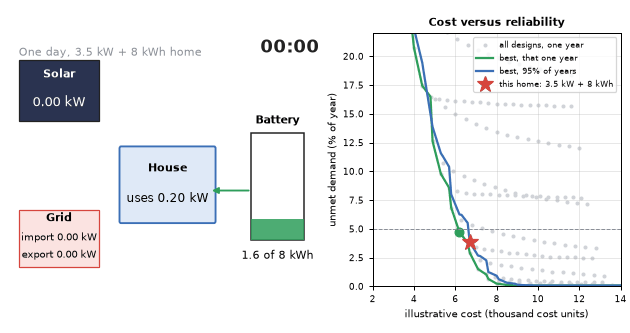
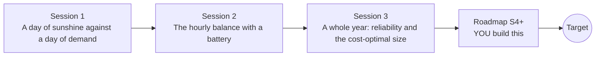

# opensolarbattery

[](https://github.com/KrunalPanchal1995/pan-iit-oss/actions/workflows/tests.yml)   [](https://colab.research.google.com/github/KrunalPanchal1995/pan-iit-oss/blob/main/opensolarbattery/sessions/session-01/lesson.ipynb) [](https://krunalpanchal1995.github.io/pan-iit-oss/opensolarbattery/)

**Size a rooftop solar and battery system for a home, one honest simulation at a time.**

opensolarbattery teaches how to balance sunshine against household demand, from a bell-shaped solar curve to a 365-day reliability simulation and a cost-versus-reliability search, using only Python and a browser.

- **Start from one day.** Session 1 needs only a sine curve and the idea of area; every energy is explained from scratch.
- **See it move.** Every session ships a slider app that runs in the browser, with labelled graphs.
- **Know you got it right.** Each session ends with a checkpoint that prints PASS or FAIL against hand calculations and exact energy rules.
- **Build the missing half.** The repo stops at Session 3 on purpose; the roadmap shows the path to the Target.

[Target](#the-target) · [Who is this for](#who-is-this-for) · [Quick start](#quick-start) · [Sessions](#sessions) · [Roadmap](#roadmap) · [Contribute](#contribute) · [Explainer PDF](docs/explainer.pdf)

> **This repo is incomplete on purpose.** Sessions 1 to 3 are here and fully working. The finished Target below is a preview of what the community can build next. We show you the path, not the code. Sessions 4 and up are yours.

## The Target

A 24-hour energy-flow view of one simulated day for a home with a 3.5 kW array and an 8 kWh battery: sunshine flows to the house and fills the battery, the battery covers the evening, and the grid tops up the little that is left. On the right, a cost-versus-reliability chart shows every design tried. The best design for one lucky weather year is cheaper than the design that stays reliable in 95 percent of random years. Your goal over the coming sessions: build the full search yourself, then make the sizing honest about the weather.



*Target: a 24-hour energy-flow view and the cost-versus-reliability Pareto chart*

Try it live:

- [Math Visual Studio: thermodynamic foundations, energy as a conserved quantity (Atlas S51)](https://krunalpanchal1995.github.io/studio/#atlas?ch=S51&ex=1)
- [Math Visual Studio: the first law, energy in equals energy out plus storage (Atlas S53)](https://krunalpanchal1995.github.io/studio/#atlas?ch=S53&ex=1)

How the Target was made is shown only as a path in [promo/roadmap.md](promo/roadmap.md).

## Who is this for
**diploma / undergraduate to advanced undergraduate (levels 5-6).** Topic area: Electrical Power and Renewable Energy.

Prerequisites:

- Sine curves and the idea of area under a graph (school mathematics).
- Python 3.10 or newer; if `python --version` works, you are ready. PRIMER.md explains the rest.
- No prior GitHub, electrical or energy-systems experience is needed.

New to Python? Read [PRIMER.md](PRIMER.md) first (10 minutes).

## Quick start

No installation knowledge needed. You need [Git](https://git-scm.com/downloads) and [Python 3.10+](https://www.python.org/downloads/) (Windows: tick "Add Python to PATH"). On Mac and Linux type `python3` wherever this page says `python`.

```bash
git clone https://github.com/KrunalPanchal1995/pan-iit-oss.git
cd pan-iit-oss/opensolarbattery
python start.py 1
```

`start.py` creates a private environment, installs what is needed and runs Session 1 with its checkpoint. Next: `python start.py 2`, `python start.py 3`, or `python start.py test` to check everything. Only a checkpoint: `python start.py check 1`.

<!-- friendly-help -->
<details>
<summary><b>Not working? Common fixes (no Git, "python not found", no internet)</b></summary>

- **No Git?** You do not need it. On the main page of this collection click the green **Code** button, then **Download ZIP**, unzip it, open a terminal inside the folder `pan-iit-oss-main/opensolarbattery` and run `python start.py 1`. The ZIP holds every project, so it is large; the live apps need no download at all.
- **"python is not recognized" or "command not found".** On Windows try `py start.py 1`. On Mac and Linux try `python3 start.py 1`. If neither works, install Python from [python.org](https://www.python.org/downloads/) and tick "Add Python to PATH".
- **Needs internet once.** The first run downloads NumPy and Matplotlib into a private folder (`.venv`); after that it works offline.
- **Rather not install anything?** Open the [live apps](https://krunalpanchal1995.github.io/pan-iit-oss/opensolarbattery/) in your browser, or use the Colab badge at the top of this page.
- **Still stuck?** [Open an issue](https://github.com/KrunalPanchal1995/pan-iit-oss/issues/new?title=%5Bopensolarbattery%5D%20) with your operating system and the message you see. Questions from beginners are welcome.

</details>

Five lines turn the idea of Session 1 into a result (they work as they are): Save it as `try.py` and run it with `python start.py run try.py` (this uses the private environment, where NumPy is installed):

```python
import numpy as np
t = (np.arange(240) + 0.5) * 0.1                  # time of day in hours, 0.1 h steps
pv = np.where((t >= 6) & (t <= 18), 4.0 * np.sin(np.pi * (t - 6) / 12), 0.0)   # 4 kW array, clear day
print(round(float(pv.sum() * 0.1), 2), 'kWh in one day')   # area under the curve
print(round(4.0 * 24 / np.pi, 2), 'kWh from the exact formula 4 x 24 / pi')
```

Every session also opens in your browser with sliders (no install): [live apps](https://krunalpanchal1995.github.io/pan-iit-oss/opensolarbattery/). Or use the Colab badge above for the notebook.

## Sessions

| # | Session | Model level | Time | Live app |
|---|---|---|---|---|
| 1 | [A day of sunshine against a day of demand](sessions/session-01/README.md) | Level 1: conceptual interactive model | 60 min | [open](https://krunalpanchal1995.github.io/pan-iit-oss/opensolarbattery/session-01/) |
| 2 | [The hourly balance with a battery](sessions/session-02/README.md) | Level 2: mathematical engineering model | 75 min | [open](https://krunalpanchal1995.github.io/pan-iit-oss/opensolarbattery/session-02/) |
| 3 | [A whole year: reliability and the cost-optimal size](sessions/session-03/README.md) | Level 3: simulation and validation | 90 min | [open](https://krunalpanchal1995.github.io/pan-iit-oss/opensolarbattery/session-03/) |

Each session follows the same six steps: A real-world problem, B concept and theory, C visual explanation, D interactive simulation, E worked example and experiment, F assessment and design challenge. Each ends with `checkpoint.py`, which prints `PASS` or `FAIL` against reference numbers. Session 3 also contains the real-world mini-project: **Size a system from your own electricity bill**.

## Architecture



| Folder or file | What is inside |
|---|---|
| `sessions/` | three sessions: README (A-F), `lesson.py`, notebook, live app, exercises, activity sheet, checkpoint |
| `promo/` | the Target: media, live links, and the roadmap (path only) |
| `docs/` | `explainer.tex` and the built `explainer.pdf` |
| `tests/` | runs every lesson and checkpoint headless |
| `start.py` | one command to set up and run anything |
| `QUALITY.md`, `RUBRIC.md` | the quality checklist and the scoring rubric |
| `.github/` | CI, PDF build, Pages deploy, issue and PR templates |

## Roadmap

| Milestone | What you will build | Difficulty |
|---|---|---|
| Session 4: Robust sizing over many weather years | A search that evaluates every candidate design over many seeds and keeps a design meeting the target in most of them. | intermediate |
| Session 5: A smarter search | An optimiser that replaces the 500-design grid. | intermediate |
| Session 6: Backup for a power cut | A critical-load model and an outage scenario in the yearly simulator. | advanced |
| Session 7: Real weather and real demand | A loader for an hourly irradiance file and a smart-meter file, with the same battery code. | advanced |
| Session 8: Reproduce the Target animation | A 24-hour animation of one simulated day with flow arrows and a battery level, plus the cost-versus-reliability chart. | advanced |

Full detail with a checkpoint per milestone: [promo/roadmap.md](promo/roadmap.md).

## Contribute
New to GitHub? Read [CONTRIBUTING.md](CONTRIBUTING.md); it starts from zero. Pick an issue labelled `good first issue`. Translations into Hindi, Telugu, Tamil and Malayalam are welcome.

<details>
<summary>Development</summary>

```bash
python start.py test        # runs every lesson and checkpoint
```
Lessons use `# %%` cell markers so they open as notebooks in VS Code. See [QUALITY.md](QUALITY.md) for the standard every session meets.
</details>

## License
MIT. See [LICENSE](LICENSE). Media in `promo/media` is (c) Krunal Panchal, CC BY 4.0.

## Acknowledgments
Part of the [PAN IIT OSS](https://hellofoss.tech-iitb.org/projects) open-source teaching collection, modelled on the structure of [openspline](https://github.com/openspline/openspline). Built on ideas from the Math Visual Studio at https://krunalpanchal1995.github.io/studio/.
