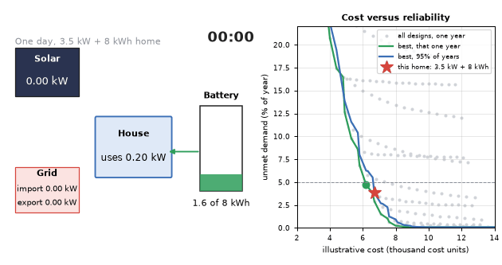

# What you are building toward

A 24-hour energy-flow view of one simulated day for a home with a 3.5 kW array and an 8 kWh battery: sunshine flows to the house and fills the battery, the battery covers the evening, and the grid tops up the little that is left. On the right, a cost-versus-reliability chart shows every design tried. The best design for one lucky weather year is cheaper than the design that stays reliable in 95 percent of random years. Your goal over the coming sessions: build the full search yourself, then make the sizing honest about the weather.

*Target: a 24-hour energy-flow view and the cost-versus-reliability Pareto chart*

These results come from a private reference build. The code is not published; the roadmap shows the path so you can build your own.

Live links:

- [Math Visual Studio: thermodynamic foundations, energy as a conserved quantity (Atlas S51)](https://krunalpanchal1995.github.io/studio/#atlas?ch=S51&ex=1)
- [Math Visual Studio: the first law, energy in equals energy out plus storage (Atlas S53)](https://krunalpanchal1995.github.io/studio/#atlas?ch=S53&ex=1)
