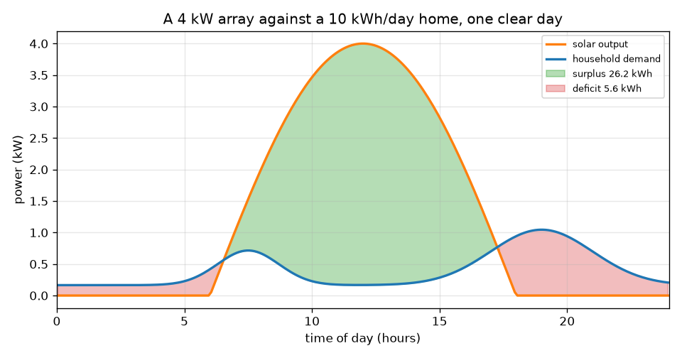
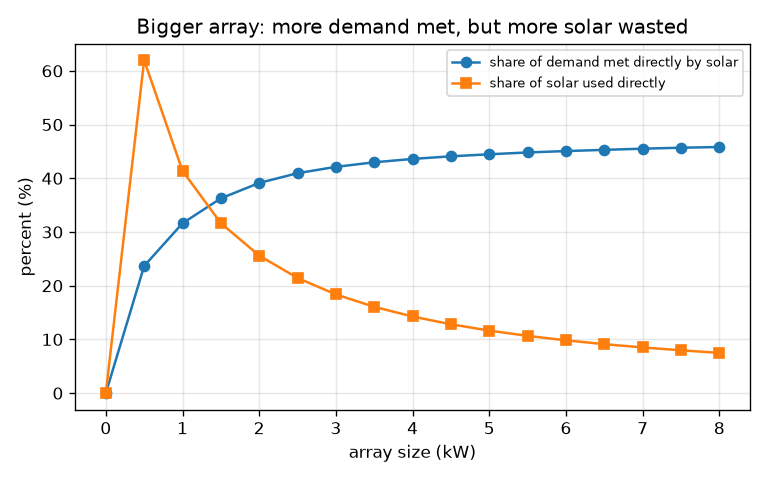

# सत्र 1: एक दिन की धूप बनाम एक दिन की माँग

*स्तर 1 (वैचारिक इंटरैक्टिव मॉडल) · लगभग 60 मिनट · opensolarbattery*

> यह एक सरलीकृत शैक्षिक मॉडल है। यह कोई प्रमाणित डिज़ाइन टूल नहीं है और इसका उपयोग वास्तविक संरचनाओं, बिजली की वायरिंग (electrical installations), वाहनों, औद्योगिक प्रक्रियाओं या चिकित्सा निर्णयों के लिए नहीं किया जाना चाहिए।

**पूर्व-आवश्यकताएँ (Prerequisites)**

- ज्या वक्र (sine curve), और यह विचार कि ग्राफ़ के नीचे का क्षेत्रफल ऊर्जा को जोड़ता है।
- आपने PRIMER.md पढ़ लिया है और एक बार `python start.py 1` चलाया है।
- आप **शक्ति (power)** (kW, एक दर) और **ऊर्जा (energy)** (kWh, समय के साथ कुल योग) के बीच का अंतर समझते हैं।

**सीखने के उद्देश्य (Learning objectives).** इस सत्र के बाद आप:

- एक ही ग्राफ़ पर घंटी के आकार का सौर उत्पादन वक्र और एक घरेलू माँग वक्र बना सकेंगे।
- अधिशेष (surplus), घाटा (deficit) और प्रत्यक्ष उपयोग (direct use) को kWh में क्षेत्रफल के रूप में माप सकेंगे।
- एक सूत्र से ऐरे (array) के आकार से साफ़ दिन की ऊर्जा गणना कर सकेंगे।
- समझा सकेंगे कि केवल बड़ा ऐरे किसी घर की अधिकांश माँग क्यों पूरी नहीं कर सकता।

## A. वास्तविक दुनिया की समस्या
एक पड़ोसी छत पर सौर ऐरे लगवाता है, फिर भी शाम की बत्तियाँ ग्रिड बिजली से ही जलती हैं। क्यों? सूरज दोपहर के आसपास बिजली बनाता है, पर घर अपनी अधिकांश ऊर्जा सुबह और शाम को उपयोग करता है। जहाँ सौर वक्र माँग वक्र से ऊपर है वहाँ एक अधिशेष है जिसे अभी कोई उपयोग नहीं कर सकता; जहाँ यह नीचे है, वहाँ एक घाटा है जिसे किसी और चीज़ को पूरा करना होगा। यह सत्र दोनों वक्र बनाता है और क्षेत्रफल मापता है। यह एक शैक्षिक मॉडल है, संस्थापन (installation) डिज़ाइन नहीं, और यहाँ कुछ भी व्यक्तिगत सलाह नहीं है।

## B. अवधारणा और सिद्धांत
शक्ति ऊर्जा के उपयोग की दर है, किलोवाट (kW) में। ऊर्जा शक्ति गुणा समय है, किलोवाट-घंटे (kWh) में: 3 घंटे चलने वाला 2 kW का हीटर 6 kWh उपयोग करता है। साफ़ दिन पर सौर उत्पादन सूर्योदय (6 h) और सूर्यास्त (18 h) के बीच आधी ज्या तरंग की तरह चढ़ता और उतरता है, इसलिए दिन की सौर ऊर्जा उस आधी ज्या के नीचे का क्षेत्रफल है: ऐरे रेटिंग गुणा 24 भाग pi, ऐरे के हर kW के लिए लगभग 7.64 kWh (1 kW का ऐरे पूरे दिन में लगभग 7.64 kWh बनाता है)। घरेलू माँग में एक छोटा आधार भार (base load) और साथ में एक सुबह का तथा एक बड़ा शाम का शिखर होता है। हम इसके आकार को इस तरह मापते हैं कि इसका क्षेत्रफल आपके द्वारा चुनी गई दैनिक ऊर्जा के बराबर हो। अधिशेष वह क्षेत्रफल है जहाँ सौर माँग से ऊपर है, घाटा वह क्षेत्रफल जहाँ माँग सौर से ऊपर है, और प्रत्यक्ष उपयोग दोनों में से निचले वक्र के नीचे का क्षेत्रफल है।

| प्रतीक | अर्थ | इकाई |
|---|---|---|
| P_peak | ऐरे रेटिंग: दोपहर में पूरी धूप में उत्पादन | kW |
| s | धूप गुणक: 1 साफ़ दिन है, 0.5 एक धुँधला दिन | कोई इकाई नहीं |
| P_pv(t) | समय t पर सौर शक्ति | kW |
| P_load(t) | समय t पर घरेलू माँग | kW |
| E | ऊर्जा: शक्ति वक्र के नीचे का क्षेत्रफल | kWh |
| t | दिन का समय | घंटे |

**मान्यताएँ (Assumptions)**

- 12 घंटे का दिन, सूर्योदय 6 h पर और सूर्यास्त 18 h पर।
- ऐरे सही दिशा में है और छाया में नहीं है; केबलों और इन्वर्टर (inverter) में हानियाँ अनदेखी की गई हैं।
- माँग का आकार विशिष्ट है, मापा हुआ नहीं; दैनिक ऊर्जा वह है जो आप चुनते हैं।
- केवल शैक्षिक मॉडल, संस्थापन डिज़ाइन नहीं।

$$ P_{pv}(t)=P_{peak}\,s\,\sin\!\left(\frac{\pi (t-6)}{12}\right),\qquad 6\le t\le 18 $$

$$ E_{pv}=\int_6^{18} P_{pv}\,dt=P_{peak}\,s\,\frac{24}{\pi}\approx 7.64\,P_{peak}\,s\ \ \mathrm{kWh} $$

$$ E_{surplus}=\int \max\!\big(P_{pv}-P_{load},0\big)dt,\qquad E_{deficit}=\int \max\!\big(P_{load}-P_{pv},0\big)dt $$

$$ E_{direct}=\int \min\!\big(P_{pv},P_{load}\big)dt,\qquad E_{pv}=E_{direct}+E_{surplus},\quad E_{load}=E_{direct}+E_{deficit} $$

## C. दृश्य व्याख्या
पहला चित्र एक साफ़ दिन पर 4 kW के ऐरे को प्रति दिन 10 kWh वाले घर के सापेक्ष दिखाता है। नारंगी सौर वक्र दोपहर में शिखर पर है, नीले माँग वक्र में सुबह और शाम का एक-एक उभार है, हरा क्षेत्रफल अधिशेष (26.2 kWh) है और लाल क्षेत्रफल घाटा (5.6 kWh) हैं। दूसरा चित्र ऐरे के आकार को 0 से 8 kW तक बदलता है। सौर द्वारा प्रत्यक्ष रूप से पूरी की गई माँग का हिस्सा 0 से धीरे-धीरे बढ़कर केवल 45.8 प्रतिशत तक पहुँचता है, जबकि वास्तव में उपयोग हुई सौर ऊर्जा का हिस्सा 41.4 प्रतिशत (1 kW) से गिरकर 7.5 प्रतिशत (8 kW) हो जाता है: अतिरिक्त पैनल अधिकतर दोपहर का अधिशेष जोड़ते हैं।

*10 kWh/दिन वाले घर के सापेक्ष 4 kW का ऐरे: हरे में अधिशेष, लाल में घाटा।*

*बड़ा ऐरे: पूरी हुई माँग का हिस्सा धीरे-धीरे बढ़ता है, उपयोग हुई सौर ऊर्जा का हिस्सा गिरता है।*

## D. इंटरैक्टिव सिमुलेशन
पाठ चलाइए (`python start.py 1`), फिर लाइव ऐप खोलिए: [सत्र 1: एक दिन की धूप बनाम एक दिन की माँग](https://krunalpanchal1995.github.io/pan-iit-oss/opensolarbattery/session-01/) (या इसी फ़ोल्डर में `app.html`)। ऐरे के आकार को ऊपर खिसकाइए और देखिए कि हरा अधिशेष क्षेत्रफल बढ़ता है जबकि लाल घाटा मुश्किल से घटता है। फिर ऊर्जा-बार व्यू पर जाइए और दोनों बारों की तुलना कीजिए। धुँधला दिन देखने के लिए धूप गुणक घटाइए।

**चुनौती।** दिन की सौर ऊर्जा को दिन की माँग से 1 kWh के भीतर मिलाइए, फिर रीडआउट में माँग का सौर हिस्सा पढ़िए: यह अब भी 100 प्रतिशत से बहुत नीचे है।

## E. हल किया गया उदाहरण और प्रयोग
**समस्या।** साफ़ दिन पर एक 4 kW ऐरे, एक घर जो प्रति दिन 10 kWh उपयोग करता है। कितनी सौर ऊर्जा बनती है? कितना अधिशेष है और कितना घाटा? जाँचिए कि संख्याएँ आपस में मेल खाती हैं।

1. सौर ऊर्जा = 4 kW x 24 / pi = 4 x 7.639 = 30.56 kWh।
2. पाठ के क्षेत्रफल योगों से: प्रत्यक्ष उपयोग = 4.36 kWh, अधिशेष = 26.20 kWh, घाटा = 5.64 kWh।
3. सौर पक्ष की जाँच: प्रत्यक्ष + अधिशेष = 4.36 + 26.20 = 30.56 kWh, जो सौर ऊर्जा के बराबर है।
4. माँग पक्ष की जाँच: प्रत्यक्ष + घाटा = 4.36 + 5.64 = 10.00 kWh, जो माँग के बराबर है।
5. माँग का सौर हिस्सा = 4.36 / 10 = 43.6 प्रतिशत; प्रत्यक्ष उपयोग हुई सौर ऊर्जा का हिस्सा = 4.36 / 30.56 = 14.3 प्रतिशत।

**उत्तर।** ऐरे 30.56 kWh बनाता है, माँग का तीन गुना, फिर भी केवल 4.36 kWh (माँग का 43.6 प्रतिशत) प्रत्यक्ष रूप से उपयोग होता है। अधिशेष 26.20 kWh है और घाटा 5.64 kWh।

**प्रयोग।** एक दिन के लिए सुबह 7 बजे, दोपहर 12 बजे, शाम 6 बजे और रात 11 बजे अपना बिजली मीटर पढ़िए (या यदि आपके पास स्मार्ट-मीटर ग्राफ़ है तो उसे पढ़िए) और अपना माँग वक्र बनाइए। इसके आकार की तुलना मॉडल से कीजिए: वास्तविक घरों में केतली और पंपों से उछाल (spikes) आते हैं जिन्हें चिकना वक्र छोड़ देता है। वास्तविक ऐरे भी केबलों और इन्वर्टर में कुछ प्रतिशत खोता है, और उसका उत्पादन दिन के भीतर मौसम का अनुसरण करता है; मॉडल की पूर्ण आधी ज्या सबसे अच्छी स्थिति है।

## F. मूल्यांकन और डिज़ाइन चुनौती
**प्रश्न प्रकार A: वैचारिक।** एक घर के सौर पैनल साफ़ दिन पर उसकी दैनिक ऊर्जा का तीन गुना बनाते हैं। फिर भी उसे हर शाम ग्रिड की ज़रूरत क्यों पड़ सकती है?

संकेत

तुलना कीजिए कि सौर ऊर्जा कब उपलब्ध है और माँग कब सबसे अधिक है।

चरण-दर-चरण हल

बनाई गई ऊर्जा और आवश्यक ऊर्जा पूरे दिन पर मापी जाती हैं, पर वे एक ही समय पर नहीं होतीं। शाम को जब माँग शिखर पर होती है तब सौर उत्पादन लगभग शून्य होता है, और दोपहर में जब माँग कम होती है तब बड़ा, इसलिए अधिकांश सौर ऊर्जा अधिशेष होती है। भंडारण (storage) के बिना अधिशेष को शाम तक नहीं ले जाया जा सकता, इसलिए घाटा अब भी ग्रिड से आता है।

**प्रश्न प्रकार B: संख्यात्मक।** धुँधले दिन (धूप गुणक 0.5) पर एक 2 kW ऐरे एक ऐसे घर को बिजली देता है जो प्रति दिन 10 kWh उपयोग करता है। कितनी सौर ऊर्जा बनती है, और उस दिन न्यूनतम संभव ग्रिड ऊर्जा क्या है?

संकेत

सौर ऊर्जा = P_peak x s x 24 / pi। घाटा कभी भी माँग घटा सौर ऊर्जा से छोटा नहीं हो सकता।

चरण-दर-चरण हल

सौर ऊर्जा = 2 x 0.5 x 7.639 = 7.64 kWh। भले ही हर kWh पूरी तरह उपयोग हो, घर को अब भी कहीं और से कम से कम 10 - 7.64 = 2.36 kWh चाहिए। व्यवहार में घाटा बड़ा होता है क्योंकि समय मेल नहीं खाता। इकाइयाँ: kWh।

**प्रश्न प्रकार C: ग्राफ़ और सिमुलेशन की व्याख्या।** दूसरे चित्र में ऐरे बढ़ने पर प्रत्यक्ष उपयोग हुई सौर ऊर्जा का हिस्सा गिरता है, जबकि पूरी हुई माँग का हिस्सा बढ़ता है। दोनों प्रवृत्तियों को समझाइए और बताइए कि एक बैटरी क्या बदलेगी।

संकेत

बड़े ऐरे की अतिरिक्त ऊर्जा दिन में कब आती है?

चरण-दर-चरण हल

बड़ा ऐरे अधिकतर दोपहर में उत्पादन जोड़ता है, जब माँग पहले ही पूरी हो चुकी है, इसलिए अतिरिक्त ऊर्जा अधिशेष बन जाती है: उपयोग हुई सौर ऊर्जा का हिस्सा गिरता है (1 kW पर 41.4 प्रतिशत से 8 kW पर 7.5 प्रतिशत)। पूरी हुई माँग का हिस्सा केवल धीरे-धीरे बढ़ता है (31.6 से 45.8 प्रतिशत) क्योंकि शाम की माँग अब भी पूरी नहीं हुई। एक बैटरी दोपहर के अधिशेष को संग्रहीत करके शाम को छोड़ेगी, जिससे दोनों हिस्से बढ़ेंगे।

**प्रश्न प्रकार D: डिज़ाइन और अनुकूलन (optimisation) चुनौती।** डिज़ाइन: एक परिवार चाहता है कि साफ़ दिन पर उनकी सौर ऊर्जा उनके 10 kWh के दैनिक उपयोग के बराबर हो। वह कितने आकार का ऐरे है, और उनकी माँग का लगभग कितना हिस्सा सौर द्वारा प्रत्यक्ष रूप से पूरा होगा? क्या इससे उनका बिल समाप्त हो जाता है?

संकेत

E = P_peak x 24 / pi का उपयोग कीजिए, फिर पाठ द्वारा प्रिंट की गई तालिका के आकारों से तुलना कीजिए।

चरण-दर-चरण हल

P_peak = 10 / 7.639 = 1.31 kW। प्रिंट की गई तालिका से, 1 kW माँग का 31.6 प्रतिशत प्रत्यक्ष रूप से पूरा करता है और 2 kW 39.1 प्रतिशत, इसलिए 1.31 kW लगभग एक तिहाई है। बिल समाप्त नहीं होता: माँग का दो-तिहाई भाग अब भी उसी क्षण ग्रिड से आता है, भले ही दिन के कुल योग मेल खाते हों। समझौता (trade-off): भंडारण के बिना बड़ा ऐरे हिस्से को केवल धीरे-धीरे बढ़ाता है, और साफ़ दिन सबसे अच्छी स्थिति है।

[RUBRIC.md](../../RUBRIC.md) से स्वयं को अंक दीजिए। काग़ज़ पर काम करने के लिए [गतिविधि पत्रक (activity sheet)](activity_sheet.md) प्रिंट कीजिए।

## आम भ्रांतियाँ (Common misconceptions)
| आम भ्रांति | वास्तव में क्या सही है |
|---|---|
| यदि सौर ऊर्जा मेरे दैनिक उपयोग के बराबर है, तो मुझे ग्रिड की ज़रूरत नहीं होगी। | कुल योग मेल खाते हैं, पर समय नहीं: अधिकांश सौर ऊर्जा दोपहर में आती है और अधिकांश माँग सुबह और शाम को। |
| बड़ा ऐरे हमेशा अनुपात में मेरी अधिक माँग पूरी करता है। | भंडारण के बिना पूरी हुई माँग का हिस्सा संतृप्त (saturate) हो जाता है (यहाँ लगभग 46 प्रतिशत); अतिरिक्त ऊर्जा अधिशेष बन जाती है। |
| kW और kWh एक ही चीज़ हैं। | **kW शक्ति है** — किसी एक क्षण में ऊर्जा कितनी तेज़ी से बनती या उपयोग होती है (चाल की तरह)। **kWh ऊर्जा है** — समय के साथ बनी या उपयोग हुई कुल मात्रा (दूरी की तरह)। पूरी धूप के 7.6 समतुल्य घंटों तक चलने वाला 4 kW का ऐरे लगभग 30.6 kWh बनाता है। यदि आप केवल एक को समझते हैं, तो सोचिए: kW आपको केतली का आकार बताता है, kWh बताता है कि उसे चलाने में कितना ख़र्च होता है। |

## शब्दावली (Glossary)
- **kW (किलोवाट)**: शक्ति की एक इकाई; ऊर्जा कितनी तेज़ी से बनती या उपयोग होती है
- **kWh (किलोवाट-घंटा)**: ऊर्जा की एक इकाई: 1 घंटे के लिए 1 kW
- **अधिशेष (surplus)**: उस क्षण घर के उपयोग से ऊपर की सौर ऊर्जा
- **घाटा (deficit)**: वह माँग जिसे उस क्षण सौर ऊर्जा पूरी नहीं कर सकती
- **प्रत्यक्ष उपयोग (direct use)**: वह सौर ऊर्जा जो घर उसी क्षण उपयोग करता है जब वह बनती है

## समापन
1. [exercises.md](exercises.md) में दिए गए तीन कोडिंग कार्य कीजिए।
2. अपने बदलावों के बाद `python start.py 1` फिर से चलाइए। यह चेकपॉइंट (checkpoint) के साथ समाप्त होता है; जब यह `PASS` प्रिंट करे, तो आपका काम पूरा हुआ। (केवल चेकपॉइंट: `python start.py check 1`।)

आगे: [सत्र 2](../session-02/README.md)
