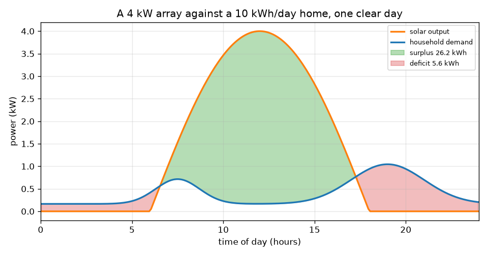
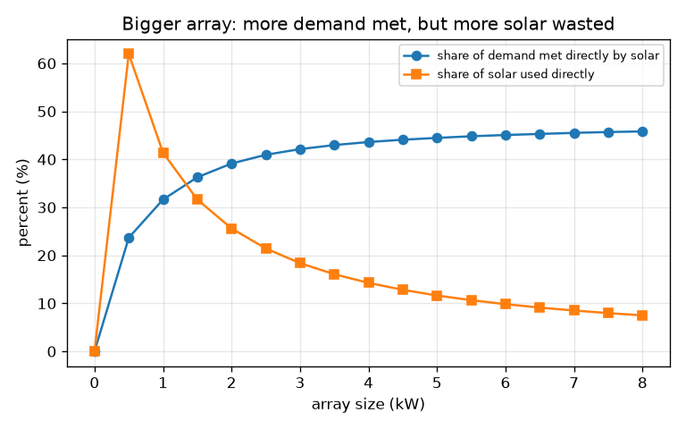

# Session 1: A day of sunshine against a day of demand

[Session 1 — हिन्दी](README.hi.md) · [Session 1 — മലയാളം](README.ml.md) · [Session 1 — தமிழ்](README.ta.md) · [Session 1 — తెలుగు](README.te.md)

*Level 1 (conceptual interactive model) · about 60 minutes · opensolarbattery*

> This is a simplified educational model. It is not a validated design tool and must not be used for real structures, electrical installations, vehicles, industrial processes or medical decisions.

**Prerequisites**

- The sine curve, and the idea that area under a graph adds up energy.
- You have read PRIMER.md and run `python start.py 1` once.
- You understand the difference between **power** (kW, a rate) and **energy** (kWh, a total over time).

**Learning objectives.** After this session you can:

- Draw a bell-shaped solar output curve and a household demand curve on one graph.
- Measure surplus, deficit and direct use as areas, in kWh.
- Compute the energy of a clear day from the array size with one formula.
- Explain why a bigger array alone cannot cover most of a home's demand.

## A. Real-world problem
A neighbour puts a solar array on the roof, yet the evening lights still run on grid power. Why? The sun makes power around noon, but a home uses most of its energy in the morning and the evening. Where the solar curve is above the demand curve there is a surplus nobody can use yet; where it is below, there is a deficit that something else must cover. This session draws both curves and measures the areas. It is an educational model, not an installation design, and nothing here is personal advice.

## B. Concept and theory
Power is the rate of using energy, in kilowatts (kW). Energy is power multiplied by time, in kilowatt-hours (kWh): a 2 kW heater running for 3 hours uses 6 kWh. On a clear day the solar output rises and falls like half a sine wave between sunrise (6 h) and sunset (18 h), so the day's solar energy is the area under that half sine: array rating times 24 divided by pi, about 7.64 kWh for every kW of array (a 1 kW array makes about 7.64 kWh over the whole day). The household demand has a small base load plus a morning and a bigger evening peak. We scale its shape so its area equals the daily energy you choose. Surplus is the area where solar is above demand, deficit the area where demand is above solar, and direct use is the area under the lower of the two curves.

| Symbol | Meaning | Unit |
|---|---|---|
| P_peak | array rating: output in full sun at noon | kW |
| s | sun factor: 1 is a clear day, 0.5 a dull day | no unit |
| P_pv(t) | solar power at time t | kW |
| P_load(t) | household demand at time t | kW |
| E | energy: area under a power curve | kWh |
| t | time of day | hours |

**Assumptions**

- A 12 hour day, sunrise at 6 h and sunset at 18 h.
- The array points well and is not shaded; losses in cables and the inverter are ignored.
- The demand shape is typical, not measured; the daily energy is what you choose.
- Educational model only, not an installation design.

$$ P_{pv}(t)=P_{peak}\,s\,\sin\!\left(\frac{\pi (t-6)}{12}\right),\qquad 6\le t\le 18 $$

$$ E_{pv}=\int_6^{18} P_{pv}\,dt=P_{peak}\,s\,\frac{24}{\pi}\approx 7.64\,P_{peak}\,s\ \ \mathrm{kWh} $$

$$ E_{surplus}=\int \max\!\big(P_{pv}-P_{load},0\big)dt,\qquad E_{deficit}=\int \max\!\big(P_{load}-P_{pv},0\big)dt $$

$$ E_{direct}=\int \min\!\big(P_{pv},P_{load}\big)dt,\qquad E_{pv}=E_{direct}+E_{surplus},\quad E_{load}=E_{direct}+E_{deficit} $$

## C. Visual explanation
The first figure draws a 4 kW array against a 10 kWh per day home on a clear day. The orange solar curve peaks at noon, the blue demand curve has a morning and an evening hump, the green area is surplus (26.2 kWh) and the red areas are deficit (5.6 kWh). The second figure sweeps the array size from 0 to 8 kW. The share of demand met directly by solar creeps up from 0 to only 45.8 percent, while the share of solar that is actually used falls from 41.4 percent (1 kW) to 7.5 percent (8 kW): the extra panels mostly add midday surplus.

*A 4 kW array against a 10 kWh/day home: surplus in green, deficit in red.*

*Bigger array: share of demand met creeps up, share of solar used falls.*

## D. Interactive simulation
Run the lesson (`python start.py 1`), then open the live app: [Session 1: a day of sun against a day of demand](https://krunalpanchal1995.github.io/pan-iit-oss/opensolarbattery/session-01/) (or `app.html` in this folder). Slide the array size up and watch the green surplus area grow while the red deficit barely shrinks. Then switch to the energy-bars view and compare the two bars. Lower the sun factor to see a dull day.

**Challenge.** Make the day's solar energy match the day's demand to within 1 kWh, then read the solar share of demand in the readout: it is still far below 100 percent.

## E. Worked example and experiment
**Problem.** A 4 kW array on a clear day, a home that uses 10 kWh per day. How much solar energy is made? How much is surplus and how much is deficit? Check that the numbers add up.

1. Solar energy = 4 kW x 24 / pi = 4 x 7.639 = 30.56 kWh.
2. From the lesson's area sums: direct use = 4.36 kWh, surplus = 26.20 kWh, deficit = 5.64 kWh.
3. Check the solar side: direct + surplus = 4.36 + 26.20 = 30.56 kWh, which equals the solar energy.
4. Check the demand side: direct + deficit = 4.36 + 5.64 = 10.00 kWh, which equals the demand.
5. Solar share of demand = 4.36 / 10 = 43.6 percent; share of solar used directly = 4.36 / 30.56 = 14.3 percent.

**Answer.** The array makes 30.56 kWh, three times the demand, yet only 4.36 kWh (43.6 percent of demand) is used directly. The surplus is 26.20 kWh and the deficit is 5.64 kWh.

**Experiment.** Read your own electricity meter at 7 in the morning, noon, 6 in the evening and 11 at night for a day (or read a smart-meter graph if you have one) and sketch your demand curve. Compare its shape with the model: real homes have spikes from kettles and pumps that the smooth curve leaves out. A real array also loses a few percent to cables and the inverter, and its output follows weather within the day; the model's perfect half sine is the best case.

## F. Assessment and design challenge
**Question type A: Conceptual.** A home has solar panels that make three times its daily energy on a clear day. Why can it still need the grid every evening?

Hint

Compare when solar is available with when demand is highest.

Step-by-step solution

Energy made and energy needed are measured over the whole day, but they do not happen at the same time. Solar output is near zero in the evening when demand peaks, and large at midday when demand is low, so most of the solar energy is surplus. Without storage the surplus cannot be moved to the evening, so the deficit still comes from the grid.

**Question type B: Numerical.** A 2 kW array on a dull day (sun factor 0.5) feeds a home that uses 10 kWh per day. How much solar energy is made, and what is the smallest possible grid energy that day?

Hint

Solar energy = P_peak x s x 24 / pi. The deficit can never be smaller than demand minus solar energy.

Step-by-step solution

Solar energy = 2 x 0.5 x 7.639 = 7.64 kWh. Even if every kWh were used perfectly, the home still needs at least 10 - 7.64 = 2.36 kWh from elsewhere. In practice the deficit is larger because the timing does not match. Units: kWh.

**Question type C: Graph and simulation interpretation.** In the second figure the share of solar used directly falls as the array grows, while the share of demand met rises. Explain both trends and say what a battery would change.

Hint

Where does the extra energy of a bigger array arrive in the day?

Step-by-step solution

A bigger array adds output mostly at midday, when demand is already met, so the extra energy becomes surplus: the share of solar used falls (41.4 percent at 1 kW to 7.5 percent at 8 kW). The share of demand met rises only slowly (31.6 to 45.8 percent) because evening demand is still uncovered. A battery would store the midday surplus and release it in the evening, raising both shares.

**Question type D: Design and optimisation challenge.** Design: a family wants their solar energy to equal their daily use of 10 kWh on a clear day. What array size is that, and roughly what share of their demand will be met directly by solar? Does this remove their bill?

Hint

Use E = P_peak x 24 / pi, then compare with the sizes in the table printed by the lesson.

Step-by-step solution

P_peak = 10 / 7.639 = 1.31 kW. From the printed table, 1 kW meets 31.6 percent of demand directly and 2 kW meets 39.1 percent, so 1.31 kW is roughly a third. The bill is not removed: two thirds of the demand still comes from the grid at that moment, even though the day's totals match. Trade-off: a bigger array raises the share only slowly without storage, and a clear day is the best case.

Score yourself with [RUBRIC.md](../../RUBRIC.md). Print the [activity sheet](activity_sheet.md) to work on paper.

## Common misconceptions
| Common misconception | What is actually true |
|---|---|
| If the solar energy equals my daily use, I will not need the grid. | Totals match, but timing does not: most solar arrives at midday and most demand in the morning and evening. |
| A bigger array always meets more of my demand in proportion. | Without storage the share of demand met saturates (about 46 percent here); the extra energy becomes surplus. |
| kW and kWh are the same thing. | **kW is power** — how fast energy is made or used at one moment (like speed). **kWh is energy** — the total amount made or used over time (like distance). A 4 kW array running for 7.6 equivalent hours of full sun makes about 30.6 kWh. If you only understand one, think: kW tells you the size of the kettle, kWh tells you how much it costs to run it. |

## Glossary
- **kW (kilowatt)**: a unit of power; how fast energy is made or used
- **kWh (kilowatt-hour)**: a unit of energy: 1 kW for 1 hour
- **surplus**: solar energy above what the home uses at that moment
- **deficit**: demand that solar cannot cover at that moment
- **direct use**: solar energy used by the home at the moment it is made

## Finish
1. Do the three coding tasks in [exercises.md](exercises.md).
2. Run `python start.py 1` again after your changes. It ends with the checkpoint; when it prints `PASS`, you are done. (Checkpoint only: `python start.py check 1`.)

Next: [Session 2](../session-02/README.md)
