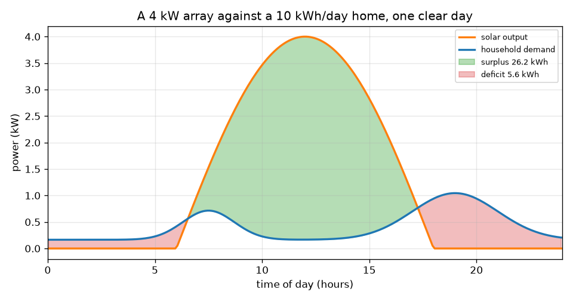
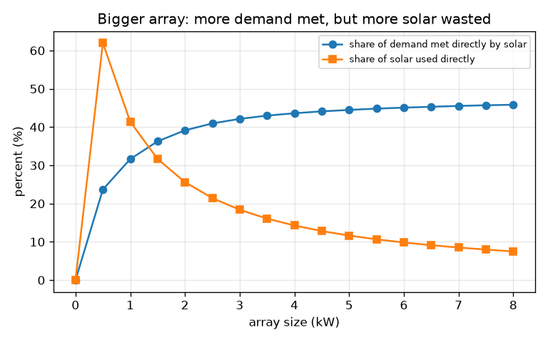

# സെഷൻ 1: ഒരു ദിവസത്തെ സൂര്യപ്രകാശവും ഒരു ദിവസത്തെ ആവശ്യവും

[Session 1 — हिन्दी](README.hi.md)

*ലെവൽ 1 (ആശയപരമായ ഇന്ററാക്ടീവ് മോഡൽ) · ഏകദേശം 60 മിനിറ്റ് · opensolarbattery*

> ഇത് ലളിതമാക്കിയ ഒരു വിദ്യാഭ്യാസ മോഡൽ (educational model) ആണ്. ഇത് സാധൂകരിക്കപ്പെട്ട ഒരു ഡിസൈൻ ഉപകരണമല്ല; യഥാർത്ഥ നിർമ്മിതികൾ, വൈദ്യുത ഇൻസ്റ്റലേഷനുകൾ, വാഹനങ്ങൾ, വ്യാവസായിക പ്രക്രിയകൾ അല്ലെങ്കിൽ വൈദ്യശാസ്ത്ര തീരുമാനങ്ങൾ എന്നിവയ്ക്ക് ഇത് ഉപയോഗിക്കരുത്.

**മുൻ‌അറിവ് (Prerequisites)**

- സൈൻ വക്രവും, ഗ്രാഫിനടിയിലെ വിസ്തീർണ്ണം ഊർജ്ജത്തെ കൂട്ടിച്ചേർക്കുന്നു എന്ന ആശയവും.
- നിങ്ങൾ PRIMER.md വായിക്കുകയും `python start.py 1` ഒരിക്കൽ റൺ ചെയ്യുകയും ചെയ്തിട്ടുണ്ട്.
- **പവർ** (kW, ഒരു നിരക്ക്), **ഊർജ്ജം** (kWh, സമയത്തിലൂടെയുള്ള ആകെത്തുക) എന്നിവ തമ്മിലുള്ള വ്യത്യാസം നിങ്ങൾക്ക് മനസ്സിലായി.

**പഠന ലക്ഷ്യങ്ങൾ (Learning objectives).** ഈ സെഷനു ശേഷം നിങ്ങൾക്ക് കഴിയും:

- മണിയുടെ ആകൃതിയിലുള്ള സൗരോർജ്ജ ഔട്ട്പുട്ട് വക്രവും ഒരു വീടിന്റെ ആവശ്യ വക്രവും ഒരേ ഗ്രാഫിൽ വരയ്ക്കാൻ.
- മിച്ചം, കമ്മി, നേരിട്ടുള്ള ഉപയോഗം എന്നിവ വിസ്തീർണ്ണങ്ങളായി kWh-ൽ അളക്കാൻ.
- ഒരു സൂത്രവാക്യം ഉപയോഗിച്ച് അറേയുടെ വലുപ്പത്തിൽ നിന്ന് തെളിഞ്ഞ ഒരു ദിവസത്തെ ഊർജ്ജം കണക്കാക്കാൻ.
- വലിയ അറേ മാത്രം ഒരു വീടിന്റെ ആവശ്യത്തിന്റെ ഭൂരിഭാഗവും നിറവേറ്റാത്തത് എന്തുകൊണ്ടെന്ന് വിശദീകരിക്കാൻ.

## A. യഥാർത്ഥ ജീവിതത്തിലെ പ്രശ്നം
അയൽക്കാരൻ മേൽക്കൂരയിൽ ഒരു സോളാർ അറേ വച്ചിട്ടും വൈകുന്നേരത്തെ വിളക്കുകൾ ഗ്രിഡ് വൈദ്യുതിയിലാണ് പ്രവർത്തിക്കുന്നത്. എന്തുകൊണ്ട്? സൂര്യൻ ഉച്ചയ്ക്കാണ് വൈദ്യുതി ഉണ്ടാക്കുന്നത്, പക്ഷേ ഒരു വീട് അതിന്റെ ഊർജ്ജത്തിന്റെ ഭൂരിഭാഗവും രാവിലെയും വൈകുന്നേരവുമാണ് ഉപയോഗിക്കുന്നത്. സൗര വക്രം ആവശ്യ വക്രത്തിന് മുകളിലുള്ളിടത്ത് ആർക്കും ഇപ്പോൾ ഉപയോഗിക്കാനാകാത്ത മിച്ചമുണ്ട്; താഴെയുള്ളിടത്ത് മറ്റെന്തെങ്കിലും നികത്തേണ്ട കമ്മിയുണ്ട്. ഈ സെഷൻ രണ്ട് വക്രങ്ങളും വരച്ച് വിസ്തീർണ്ണങ്ങൾ അളക്കുന്നു. ഇതൊരു വിദ്യാഭ്യാസ മോഡലാണ്, ഇൻസ്റ്റലേഷൻ ഡിസൈനല്ല, ഇവിടെയുള്ളതൊന്നും വ്യക്തിപരമായ ഉപദേശമല്ല.

## B. ആശയവും സിദ്ധാന്തവും
പവർ എന്നത് ഊർജ്ജം ഉപയോഗിക്കുന്ന നിരക്കാണ്, കിലോവാട്ടിൽ (kW). ഊർജ്ജം എന്നത് പവറിനെ സമയം കൊണ്ട് ഗുണിച്ചതാണ്, കിലോവാട്ട്-മണിക്കൂറിൽ (kWh): 3 മണിക്കൂർ പ്രവർത്തിക്കുന്ന 2 kW ഹീറ്റർ 6 kWh ഉപയോഗിക്കുന്നു. തെളിഞ്ഞ ദിവസം സൗര ഔട്ട്പുട്ട് സൂര്യോദയത്തിനും (6 മണി) സൂര്യാസ്തമയത്തിനും (18 മണി) ഇടയിൽ പകുതി സൈൻ തരംഗം പോലെ ഉയരുകയും താഴുകയും ചെയ്യുന്നു, അതിനാൽ ദിവസത്തെ സൗരോർജ്ജം ആ പകുതി സൈനിനടിയിലെ വിസ്തീർണ്ണമാണ്: അറേ റേറ്റിംഗ് ഗുണം 24 ഹരിക്കണം pi, ഓരോ kW അറേയ്ക്കും ഏകദേശം 7.64 kWh (1 kW അറേ ദിവസം മുഴുവൻ ഏകദേശം 7.64 kWh ഉണ്ടാക്കുന്നു). വീട്ടിലെ ആവശ്യത്തിന് ചെറിയ അടിസ്ഥാന ലോഡും രാവിലത്തെ ഒരു പീക്കും അതിലും വലിയ വൈകുന്നേരത്തെ പീക്കും ഉണ്ട്. അതിന്റെ വിസ്തീർണ്ണം നിങ്ങൾ തിരഞ്ഞെടുക്കുന്ന ദിവസ ഊർജ്ജത്തിന് തുല്യമാകാൻ അതിന്റെ ആകൃതിയെ നമ്മൾ സ്കെയിൽ ചെയ്യുന്നു. സോളാർ ആവശ്യത്തിന് മുകളിലുള്ള വിസ്തീർണ്ണമാണ് മിച്ചം (surplus), ആവശ്യം സോളാറിന് മുകളിലുള്ള വിസ്തീർണ്ണമാണ് കമ്മി (deficit), രണ്ട് വക്രങ്ങളിൽ താഴ്ന്നതിനടിയിലെ വിസ്തീർണ്ണമാണ് നേരിട്ടുള്ള ഉപയോഗം (direct use).

| ചിഹ്നം | അർത്ഥം | യൂണിറ്റ് |
|---|---|---|
| P_peak | അറേ റേറ്റിംഗ്: ഉച്ചയ്ക്ക് പൂർണ്ണ വെയിലിലെ ഔട്ട്പുട്ട് | kW |
| s | സൺ ഫാക്ടർ: 1 തെളിഞ്ഞ ദിവസം, 0.5 മങ്ങിയ ദിവസം | യൂണിറ്റ് ഇല്ല |
| P_pv(t) | t സമയത്തെ സൗര പവർ | kW |
| P_load(t) | t സമയത്തെ വീട്ടിലെ ആവശ്യം | kW |
| E | ഊർജ്ജം: ഒരു പവർ വക്രത്തിനടിയിലെ വിസ്തീർണ്ണം | kWh |
| t | ദിവസത്തിലെ സമയം | മണിക്കൂർ |

**അനുമാനങ്ങൾ (Assumptions)**

- 12 മണിക്കൂർ ദിവസം, 6 മണിക്ക് സൂര്യോദയം, 18 മണിക്ക് സൂര്യാസ്തമയം.
- അറേ നന്നായി ദിശ ചൂണ്ടുന്നു, നിഴൽ വീഴുന്നില്ല; കേബിളുകളിലെയും ഇൻവെർട്ടറിലെയും നഷ്ടങ്ങൾ അവഗണിക്കുന്നു.
- ആവശ്യത്തിന്റെ ആകൃതി സാധാരണമാണ്, അളന്നതല്ല; ദിവസ ഊർജ്ജം നിങ്ങൾ തിരഞ്ഞെടുക്കുന്നതാണ്.
- വിദ്യാഭ്യാസ മോഡൽ മാത്രം, ഇൻസ്റ്റലേഷൻ ഡിസൈനല്ല.

$$ P_{pv}(t)=P_{peak}\,s\,\sin\!\left(\frac{\pi (t-6)}{12}\right),\qquad 6\le t\le 18 $$

$$ E_{pv}=\int_6^{18} P_{pv}\,dt=P_{peak}\,s\,\frac{24}{\pi}\approx 7.64\,P_{peak}\,s\ \ \mathrm{kWh} $$

$$ E_{surplus}=\int \max\!\big(P_{pv}-P_{load},0\big)dt,\qquad E_{deficit}=\int \max\!\big(P_{load}-P_{pv},0\big)dt $$

$$ E_{direct}=\int \min\!\big(P_{pv},P_{load}\big)dt,\qquad E_{pv}=E_{direct}+E_{surplus},\quad E_{load}=E_{direct}+E_{deficit} $$

## C. ദൃശ്യ വിശദീകരണം
ആദ്യ ചിത്രം തെളിഞ്ഞ ദിവസം 4 kW അറേയെ ദിവസം 10 kWh ഉപയോഗിക്കുന്ന വീടിനോട് ചേർത്ത് വരയ്ക്കുന്നു. ഓറഞ്ച് സൗര വക്രം ഉച്ചയ്ക്ക് ഉയർന്നു നിൽക്കുന്നു, നീല ആവശ്യ വക്രത്തിന് രാവിലെയും വൈകുന്നേരവും ഓരോ കൊടുമുടിയുണ്ട്, പച്ച ഭാഗം മിച്ചമാണ് (26.2 kWh), ചുവപ്പ് ഭാഗങ്ങൾ കമ്മിയാണ് (5.6 kWh). രണ്ടാമത്തെ ചിത്രം അറേയുടെ വലുപ്പം 0 മുതൽ 8 kW വരെ മാറ്റുന്നു. സോളാർ നേരിട്ട് നിറവേറ്റുന്ന ആവശ്യത്തിന്റെ പങ്ക് 0-ൽ നിന്ന് വെറും 45.8 ശതമാനത്തിലേക്ക് മാത്രം ഇഴഞ്ഞുകയറുന്നു, അതേസമയം യഥാർത്ഥത്തിൽ ഉപയോഗിക്കുന്ന സോളാറിന്റെ പങ്ക് 41.4 ശതമാനത്തിൽ (1 kW) നിന്ന് 7.5 ശതമാനത്തിലേക്ക് (8 kW) വീഴുന്നു: അധിക പാനലുകൾ കൂടുതലും ഉച്ചയ്ക്കുള്ള മിച്ചം കൂട്ടുന്നു.

*4 kW അറേ, ദിവസം 10 kWh ഉപയോഗിക്കുന്ന വീടിനെതിരെ: മിച്ചം പച്ചയിൽ, കമ്മി ചുവപ്പിൽ.*

*വലിയ അറേ: നിറവേറ്റുന്ന ആവശ്യത്തിന്റെ പങ്ക് പതുക്കെ ഉയരുന്നു, ഉപയോഗിക്കുന്ന സോളാറിന്റെ പങ്ക് വീഴുന്നു.*

## D. ഇന്ററാക്ടീവ് സിമുലേഷൻ
പാഠം റൺ ചെയ്യുക (`python start.py 1`), എന്നിട്ട് ലൈവ് ആപ്പ് തുറക്കുക: [സെഷൻ 1: ഒരു ദിവസത്തെ സൂര്യൻ, ഒരു ദിവസത്തെ ആവശ്യം](https://krunalpanchal1995.github.io/pan-iit-oss/opensolarbattery/session-01/) (അല്ലെങ്കിൽ ഈ ഫോൾഡറിലെ `app.html`). അറേ വലുപ്പം കൂട്ടി പച്ച മിച്ച വിസ്തീർണ്ണം വളരുന്നതും ചുവപ്പ് കമ്മി ഏറെക്കുറെ ചുരുങ്ങാത്തതും നിരീക്ഷിക്കുക. പിന്നെ ഊർജ്ജ-ബാർ കാഴ്ചയിലേക്ക് മാറി രണ്ട് ബാറുകൾ താരതമ്യം ചെയ്യുക. മങ്ങിയ ദിവസം കാണാൻ സൺ ഫാക്ടർ കുറയ്ക്കുക.

**വെല്ലുവിളി.** ദിവസത്തെ സൗരോർജ്ജം ദിവസത്തെ ആവശ്യത്തോട് 1 kWh-നുള്ളിൽ പൊരുത്തപ്പെടുത്തുക, പിന്നെ റീഡൗട്ടിൽ ആവശ്യത്തിന്റെ സൗര പങ്ക് വായിക്കുക: അത് ഇപ്പോഴും 100 ശതമാനത്തിൽ വളരെ താഴെയാണ്.

## E. ഉദാഹരണവും പരീക്ഷണവും
**പ്രശ്നം.** തെളിഞ്ഞ ദിവസം 4 kW അറേ, ദിവസം 10 kWh ഉപയോഗിക്കുന്ന ഒരു വീട്. എത്ര സൗരോർജ്ജം ഉണ്ടാകുന്നു? എത്ര മിച്ചം, എത്ര കമ്മി? സംഖ്യകൾ ഒത്തുപോകുന്നുണ്ടെന്ന് പരിശോധിക്കുക.

1. സൗരോർജ്ജം = 4 kW x 24 / pi = 4 x 7.639 = 30.56 kWh.
2. പാഠത്തിലെ വിസ്തീർണ്ണ തുകകളിൽ നിന്ന്: നേരിട്ടുള്ള ഉപയോഗം = 4.36 kWh, മിച്ചം = 26.20 kWh, കമ്മി = 5.64 kWh.
3. സൗര വശം പരിശോധിക്കുക: നേരിട്ടുള്ള + മിച്ചം = 4.36 + 26.20 = 30.56 kWh, ഇത് സൗരോർജ്ജത്തിന് തുല്യമാണ്.
4. ആവശ്യ വശം പരിശോധിക്കുക: നേരിട്ടുള്ള + കമ്മി = 4.36 + 5.64 = 10.00 kWh, ഇത് ആവശ്യത്തിന് തുല്യമാണ്.
5. ആവശ്യത്തിന്റെ സൗര പങ്ക് = 4.36 / 10 = 43.6 ശതമാനം; നേരിട്ട് ഉപയോഗിച്ച സോളാറിന്റെ പങ്ക് = 4.36 / 30.56 = 14.3 ശതമാനം.

**ഉത്തരം.** അറേ 30.56 kWh ഉണ്ടാക്കുന്നു, ആവശ്യത്തിന്റെ മൂന്നിരട്ടി, എന്നിട്ടും 4.36 kWh മാത്രമേ (ആവശ്യത്തിന്റെ 43.6 ശതമാനം) നേരിട്ട് ഉപയോഗിക്കുന്നുള്ളൂ. മിച്ചം 26.20 kWh, കമ്മി 5.64 kWh.

**പരീക്ഷണം.** ഒരു ദിവസം രാവിലെ 7 മണിക്കും ഉച്ചയ്ക്കും വൈകുന്നേരം 6 മണിക്കും രാത്രി 11 മണിക്കും നിങ്ങളുടെ വൈദ്യുതി മീറ്റർ വായിക്കുക (അല്ലെങ്കിൽ സ്മാർട്ട് മീറ്റർ ഉണ്ടെങ്കിൽ അതിന്റെ ഗ്രാഫ് വായിക്കുക) നിങ്ങളുടെ ആവശ്യ വക്രം വരയ്ക്കുക. അതിന്റെ ആകൃതി മോഡലുമായി താരതമ്യം ചെയ്യുക: യഥാർത്ഥ വീടുകളിൽ കെറ്റിലും പമ്പും മൂലമുള്ള കൊടുമുടികൾ ഉണ്ട്, മിനുസമുള്ള വക്രം അവ ഒഴിവാക്കുന്നു. യഥാർത്ഥ അറേയ്ക്ക് കേബിളുകളിലും ഇൻവെർട്ടറിലും ഏതാനും ശതമാനം നഷ്ടപ്പെടുന്നു, ഔട്ട്പുട്ട് ദിവസത്തിനുള്ളിൽ കാലാവസ്ഥയെ പിന്തുടരുന്നു; മോഡലിലെ പൂർണ്ണമായ പകുതി സൈൻ ഏറ്റവും മികച്ച സാഹചര്യമാണ്.

## F. വിലയിരുത്തലും ഡിസൈൻ വെല്ലുവിളിയും
**ചോദ്യ തരം A: ആശയപരം.** ഒരു വീടിന് തെളിഞ്ഞ ദിവസം അതിന്റെ ദിവസ ഊർജ്ജത്തിന്റെ മൂന്നിരട്ടി ഉണ്ടാക്കുന്ന സോളാർ പാനലുകൾ ഉണ്ട്. എന്നിട്ടും എല്ലാ വൈകുന്നേരവും ഗ്രിഡ് ആവശ്യമായി വരുന്നത് എന്തുകൊണ്ട്?

സൂചന

സോളാർ ലഭ്യമാകുന്ന സമയവും ആവശ്യം ഏറ്റവും ഉയർന്ന സമയവും താരതമ്യം ചെയ്യുക.

ഘട്ടം ഘട്ടമായുള്ള പരിഹാരം

ഉണ്ടാക്കിയ ഊർജ്ജവും വേണ്ട ഊർജ്ജവും ദിവസം മുഴുവനായാണ് അളക്കുന്നത്, പക്ഷേ അവ ഒരേ സമയത്ത് സംഭവിക്കുന്നില്ല. ആവശ്യം കൂടുതലുള്ള വൈകുന്നേരം സൗര ഔട്ട്പുട്ട് പൂജ്യത്തിനടുത്താണ്, ആവശ്യം കുറവുള്ള ഉച്ചയ്ക്ക് വലുതും, അതിനാൽ സൗരോർജ്ജത്തിന്റെ ഭൂരിഭാഗവും മിച്ചമാണ്. സംഭരണം ഇല്ലെങ്കിൽ മിച്ചം വൈകുന്നേരത്തേക്ക് മാറ്റാനാവില്ല, അതിനാൽ കമ്മി ഇപ്പോഴും ഗ്രിഡിൽ നിന്നാണ് വരുന്നത്.

**ചോദ്യ തരം B: സംഖ്യാപരം.** മങ്ങിയ ദിവസം (സൺ ഫാക്ടർ 0.5) ഒരു 2 kW അറേ ദിവസം 10 kWh ഉപയോഗിക്കുന്ന ഒരു വീടിന് വൈദ്യുതി നൽകുന്നു. എത്ര സൗരോർജ്ജം ഉണ്ടാകുന്നു, ആ ദിവസത്തെ ഏറ്റവും ചെറിയ സാധ്യമായ ഗ്രിഡ് ഊർജ്ജം എത്ര?

സൂചന

സൗരോർജ്ജം = P_peak x s x 24 / pi. കമ്മി ഒരിക്കലും ആവശ്യത്തിൽ നിന്ന് സൗരോർജ്ജം കുറച്ചതിനേക്കാൾ ചെറുതാകില്ല.

ഘട്ടം ഘട്ടമായുള്ള പരിഹാരം

സൗരോർജ്ജം = 2 x 0.5 x 7.639 = 7.64 kWh. ഓരോ kWh-ഉം പൂർണ്ണമായി ഉപയോഗിച്ചാലും വീടിന് മറ്റെവിടെ നിന്നെങ്കിലും കുറഞ്ഞത് 10 - 7.64 = 2.36 kWh വേണം. പ്രായോഗികമായി സമയം പൊരുത്തപ്പെടാത്തതിനാൽ കമ്മി ഇതിലും വലുതാണ്. യൂണിറ്റുകൾ: kWh.

**ചോദ്യ തരം C: ഗ്രാഫും സിമുലേഷനും വ്യാഖ്യാനിക്കൽ.** രണ്ടാമത്തെ ചിത്രത്തിൽ അറേ വളരുമ്പോൾ നേരിട്ട് ഉപയോഗിക്കുന്ന സോളാറിന്റെ പങ്ക് കുറയുന്നു, അതേസമയം നിറവേറ്റുന്ന ആവശ്യത്തിന്റെ പങ്ക് കൂടുന്നു. രണ്ട് പ്രവണതകളും വിശദീകരിക്കുക, ഒരു ബാറ്ററി എന്ത് മാറ്റുമെന്ന് പറയുക.

സൂചന

വലിയ അറേയുടെ അധിക ഊർജ്ജം ദിവസത്തിലെ ഏത് സമയത്താണ് എത്തുന്നത്?

ഘട്ടം ഘട്ടമായുള്ള പരിഹാരം

വലിയ അറേ കൂടുതലായും ഉച്ചയ്ക്കാണ് ഔട്ട്പുട്ട് കൂട്ടുന്നത്, അപ്പോൾ ആവശ്യം ഇതിനകം നിറവേറിയിരിക്കും, അതിനാൽ അധിക ഊർജ്ജം മിച്ചമാകുന്നു: ഉപയോഗിക്കുന്ന സോളാറിന്റെ പങ്ക് കുറയുന്നു (1 kW-ൽ 41.4 ശതമാനത്തിൽ നിന്ന് 8 kW-ൽ 7.5 ശതമാനത്തിലേക്ക്). വൈകുന്നേരത്തെ ആവശ്യം ഇപ്പോഴും നിറവേറാത്തതിനാൽ നിറവേറ്റുന്ന ആവശ്യത്തിന്റെ പങ്ക് സാവധാനം മാത്രമേ ഉയരുന്നുള്ളൂ (31.6 മുതൽ 45.8 ശതമാനം വരെ). ഒരു ബാറ്ററി ഉച്ചയ്ക്കുള്ള മിച്ചം സംഭരിച്ച് വൈകുന്നേരം പുറത്തുവിടും, രണ്ട് പങ്കുകളും ഉയർത്തും.

**ചോദ്യ തരം D: ഡിസൈനും ഒപ്റ്റിമൈസേഷൻ (optimisation) വെല്ലുവിളിയും.** ഡിസൈൻ: തെളിഞ്ഞ ദിവസം തങ്ങളുടെ സൗരോർജ്ജം ദിവസ ഉപയോഗമായ 10 kWh-ന് തുല്യമാകണമെന്ന് ഒരു കുടുംബം ആഗ്രഹിക്കുന്നു. അത് ഏത് അറേ വലുപ്പമാണ്, അവരുടെ ആവശ്യത്തിന്റെ ഏകദേശം എത്ര പങ്ക് സോളാർ നേരിട്ട് നിറവേറ്റും? ഇത് അവരുടെ ബില്ല് ഇല്ലാതാക്കുമോ?

സൂചന

E = P_peak x 24 / pi ഉപയോഗിക്കുക, പിന്നെ പാഠം പ്രിന്റ് ചെയ്യുന്ന പട്ടികയിലെ വലുപ്പങ്ങളുമായി താരതമ്യം ചെയ്യുക.

ഘട്ടം ഘട്ടമായുള്ള പരിഹാരം

P_peak = 10 / 7.639 = 1.31 kW. പ്രിന്റ് ചെയ്ത പട്ടികയിൽ നിന്ന്, 1 kW ആവശ്യത്തിന്റെ 31.6 ശതമാനവും 2 kW 39.1 ശതമാനവും നേരിട്ട് നിറവേറ്റുന്നു, അതിനാൽ 1.31 kW ഏകദേശം മൂന്നിലൊന്നാണ്. ബില്ല് ഇല്ലാതാകുന്നില്ല: ദിവസത്തെ ആകെത്തുകകൾ ഒത്തുപോയാലും ആ നിമിഷത്തെ ആവശ്യത്തിന്റെ മൂന്നിൽ രണ്ട് ഭാഗം ഇപ്പോഴും ഗ്രിഡിൽ നിന്നാണ്. ട്രേഡ്-ഓഫ് (trade-off): സംഭരണം ഇല്ലാതെ വലിയ അറേ പങ്കിനെ സാവധാനം മാത്രമേ ഉയർത്തൂ, തെളിഞ്ഞ ദിവസം ഏറ്റവും മികച്ച സാഹചര്യമാണ്.

[RUBRIC.md](../../RUBRIC.md) ഉപയോഗിച്ച് സ്വയം സ്കോർ ചെയ്യുക. പേപ്പറിൽ ചെയ്യാൻ [ആക്ടിവിറ്റി ഷീറ്റ്](activity_sheet.md) പ്രിന്റ് ചെയ്യുക.

## സാധാരണ തെറ്റിദ്ധാരണകൾ
| സാധാരണ തെറ്റിദ്ധാരണ | യഥാർത്ഥത്തിൽ ശരിയായത് |
|---|---|
| സൗരോർജ്ജം എന്റെ ദിവസ ഉപയോഗത്തിന് തുല്യമാണെങ്കിൽ എനിക്ക് ഗ്രിഡ് വേണ്ടിവരില്ല. | ആകെത്തുകകൾ ഒത്തുപോകുന്നു, പക്ഷേ സമയം ഒത്തുപോകുന്നില്ല: സൗരോർജ്ജത്തിന്റെ ഭൂരിഭാഗവും ഉച്ചയ്ക്കും ആവശ്യത്തിന്റെ ഭൂരിഭാഗവും രാവിലെയും വൈകുന്നേരവുമാണ്. |
| വലിയ അറേ എപ്പോഴും എന്റെ ആവശ്യത്തിന്റെ അനുപാതത്തിൽ കൂടുതൽ നിറവേറ്റുന്നു. | സംഭരണം ഇല്ലാതെ നിറവേറ്റുന്ന ആവശ്യത്തിന്റെ പങ്ക് ഒരു പരിധിയിൽ എത്തുന്നു (ഇവിടെ ഏകദേശം 46 ശതമാനം); അധിക ഊർജ്ജം മിച്ചമാകുന്നു. |
| kW-ഉം kWh-ഉം ഒന്നുതന്നെയാണ്. | **kW പവർ ആണ്** — ഒരു നിമിഷത്തിൽ ഊർജ്ജം എത്ര വേഗത്തിൽ ഉണ്ടാക്കുന്നു അല്ലെങ്കിൽ ഉപയോഗിക്കുന്നു (വേഗത പോലെ). **kWh ഊർജ്ജം ആണ്** — സമയത്തിലൂടെ ഉണ്ടാക്കിയ അല്ലെങ്കിൽ ഉപയോഗിച്ച ആകെ അളവ് (ദൂരം പോലെ). 7.6 തുല്യ പൂർണ്ണ-വെയിൽ മണിക്കൂറുകൾ പ്രവർത്തിക്കുന്ന 4 kW അറേ ഏകദേശം 30.6 kWh ഉണ്ടാക്കുന്നു. ഒന്ന് മാത്രം മനസ്സിലാക്കുന്നെങ്കിൽ ഇങ്ങനെ ചിന്തിക്കുക: kW കെറ്റിലിന്റെ വലുപ്പം പറയുന്നു, kWh അത് പ്രവർത്തിപ്പിക്കാൻ എത്ര ചെലവാകുമെന്ന് പറയുന്നു. |

## പദാവലി (Glossary)
- **kW (കിലോവാട്ട്)**: പവറിന്റെ യൂണിറ്റ്; ഊർജ്ജം എത്ര വേഗത്തിൽ ഉണ്ടാക്കുന്നു അല്ലെങ്കിൽ ഉപയോഗിക്കുന്നു
- **kWh (കിലോവാട്ട്-മണിക്കൂർ)**: ഊർജ്ജത്തിന്റെ യൂണിറ്റ്: 1 മണിക്കൂർ നേരത്തേക്ക് 1 kW
- **മിച്ചം (surplus)**: ആ നിമിഷം വീട് ഉപയോഗിക്കുന്നതിലും കൂടുതലുള്ള സൗരോർജ്ജം
- **കമ്മി (deficit)**: ആ നിമിഷം സോളാറിന് നിറവേറ്റാൻ കഴിയാത്ത ആവശ്യം
- **നേരിട്ടുള്ള ഉപയോഗം (direct use)**: ഉണ്ടാക്കുന്ന നിമിഷം തന്നെ വീട് ഉപയോഗിക്കുന്ന സൗരോർജ്ജം

## പൂർത്തിയാക്കുക
1. [exercises.md](exercises.md)-ലെ മൂന്ന് കോഡിംഗ് ടാസ്കുകൾ ചെയ്യുക.
2. മാറ്റങ്ങൾക്കു ശേഷം `python start.py 1` വീണ്ടും റൺ ചെയ്യുക. അത് ചെക്ക്‌പോയിന്റോടെ (checkpoint) അവസാനിക്കുന്നു; അത് `PASS` എന്ന് പ്രിന്റ് ചെയ്യുമ്പോൾ നിങ്ങൾ പൂർത്തിയാക്കി. (ചെക്ക്‌പോയിന്റ് മാത്രം: `python start.py check 1`.)

അടുത്തത്: [സെഷൻ 2](../session-02/README.md)
