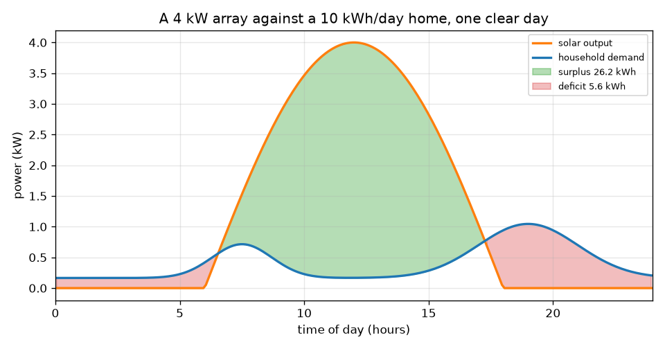
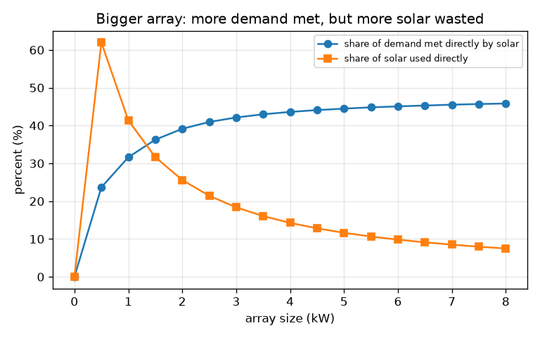

# அமர்வு 1: ஒரு நாள் சூரிய ஒளி, ஒரு நாள் தேவை

[Session 1 — हिन्दी](README.hi.md)

*நிலை 1 (கருத்தியல் ஊடாடும் மாதிரி) · சுமார் 60 நிமிடங்கள் · opensolarbattery*

> இது எளிமைப்படுத்தப்பட்ட ஒரு கல்வி மாதிரி (educational model). இது சரிபார்க்கப்பட்ட வடிவமைப்புக் கருவி அல்ல; உண்மையான கட்டமைப்புகள், மின் நிறுவல்கள், வாகனங்கள், தொழில்துறை செயல்முறைகள் அல்லது மருத்துவ முடிவுகளுக்கு இதைப் பயன்படுத்தக் கூடாது.

**முன்தேவைகள் (Prerequisites)**

- சைன் வளைவு, மேலும் வரைபடத்தின் கீழுள்ள பரப்பு ஆற்றலைக் கூட்டுகிறது என்ற கருத்து.
- நீங்கள் PRIMER.md படித்து `python start.py 1` ஒருமுறை இயக்கியிருக்கிறீர்கள்.
- **திறன்** (kW, ஒரு வீதம்) மற்றும் **ஆற்றல்** (kWh, காலத்தில் மொத்தம்) ஆகியவற்றுக்கிடையிலான வேறுபாட்டை நீங்கள் புரிந்துகொள்கிறீர்கள்.

**கற்றல் நோக்கங்கள் (Learning objectives).** இந்த அமர்வுக்குப் பிறகு உங்களால் முடியும்:

- மணி வடிவ சூரிய வெளியீட்டு வளைவையும் வீட்டுத் தேவை வளைவையும் ஒரே வரைபடத்தில் வரைய.
- உபரி, பற்றாக்குறை, நேரடிப் பயன்பாடு ஆகியவற்றைப் பரப்புகளாக kWh-இல் அளக்க.
- ஒரு சூத்திரத்தால் அணிவரிசையின் அளவிலிருந்து தெளிவான நாளின் ஆற்றலைக் கணக்கிட.
- பெரிய அணிவரிசை மட்டும் ஏன் வீட்டுத் தேவையில் பெரும்பகுதியை ஈடுசெய்ய முடியாது என்று விளக்க.

## A. நிஜ உலகப் பிரச்சினை
ஒரு அண்டை வீட்டுக்காரர் கூரையில் சூரிய அணிவரிசை (solar array) வைத்தும் மாலை விளக்குகள் இன்னும் மின்கட்டமைப்பு மின்சாரத்தில் ஓடுகின்றன. ஏன்? சூரியன் நண்பகலில் மின்சாரம் தருகிறது, ஆனால் ஒரு வீடு தன் ஆற்றலில் பெரும்பகுதியைக் காலையிலும் மாலையிலும் பயன்படுத்துகிறது. சூரிய வளைவு தேவை வளைவுக்கு மேலே இருக்கும் இடத்தில் இப்போது யாரும் பயன்படுத்த முடியாத உபரி உள்ளது; கீழே இருக்கும் இடத்தில் வேறு ஏதாவது ஈடுசெய்ய வேண்டிய பற்றாக்குறை உள்ளது. இந்த அமர்வு இரண்டு வளைவுகளையும் வரைந்து பரப்புகளை அளக்கிறது. இது ஒரு கல்வி மாதிரி, நிறுவல் வடிவமைப்பு அல்ல, இங்குள்ள எதுவும் தனிப்பட்ட ஆலோசனை அல்ல.

## B. கருத்தும் கோட்பாடும்
திறன் என்பது ஆற்றலைப் பயன்படுத்தும் வீதம், கிலோவாட்டில் (kW). ஆற்றல் என்பது திறனை நேரத்தால் பெருக்கியது, கிலோவாட்-மணியில் (kWh): 3 மணி நேரம் ஓடும் 2 kW ஹீட்டர் 6 kWh பயன்படுத்துகிறது. தெளிவான நாளில் சூரிய வெளியீடு சூரிய உதயத்துக்கும் (6 மணி) அஸ்தமனத்துக்கும் (18 மணி) இடையே அரை சைன் அலை போல் ஏறி இறங்குகிறது, எனவே நாளின் சூரிய ஆற்றல் அந்த அரை சைனின் கீழுள்ள பரப்பு: அணிவரிசை மதிப்பீடு பெருக்கல் 24 வகுத்தல் pi, ஒவ்வொரு kW அணிவரிசைக்கும் சுமார் 7.64 kWh (1 kW அணிவரிசை முழு நாளில் சுமார் 7.64 kWh தருகிறது). வீட்டுத் தேவையில் சிறிய அடிப்படைச் சுமையும் காலையில் ஒரு உச்சமும் அதைவிடப் பெரிய மாலை உச்சமும் உள்ளன. அதன் பரப்பு நீங்கள் தேர்ந்தெடுக்கும் தினசரி ஆற்றலுக்குச் சமமாகும்படி அதன் வடிவத்தை அளவுக்கேற்ப மாற்றுகிறோம். சூரியன் தேவைக்கு மேலே இருக்கும் பரப்பு உபரி (surplus), தேவை சூரியனுக்கு மேலே இருக்கும் பரப்பு பற்றாக்குறை (deficit), இரண்டு வளைவுகளில் கீழுள்ளதன் கீழ் உள்ள பரப்பு நேரடிப் பயன்பாடு (direct use).

| குறியீடு | பொருள் | அலகு |
|---|---|---|
| P_peak | அணிவரிசை மதிப்பீடு: நண்பகலில் முழு வெயிலில் வெளியீடு | kW |
| s | சூரியக் காரணி: 1 தெளிவான நாள், 0.5 மங்கலான நாள் | அலகு இல்லை |
| P_pv(t) | நேரம் t-இல் சூரியத் திறன் | kW |
| P_load(t) | நேரம் t-இல் வீட்டுத் தேவை | kW |
| E | ஆற்றல்: ஒரு திறன் வளைவின் கீழுள்ள பரப்பு | kWh |
| t | நாளின் நேரம் | மணி |

**அனுமானங்கள் (Assumptions)**

- 12 மணி நேர நாள், 6 மணிக்கு சூரிய உதயம், 18 மணிக்கு அஸ்தமனம்.
- அணிவரிசை நன்றாகத் திசைப்படுத்தப்பட்டுள்ளது, நிழல் இல்லை; கம்பிகளிலும் இன்வெர்ட்டரிலும் ஏற்படும் இழப்புகள் புறக்கணிக்கப்படுகின்றன.
- தேவையின் வடிவம் வழக்கமானது, அளக்கப்பட்டது அல்ல; தினசரி ஆற்றல் நீங்கள் தேர்ந்தெடுப்பது.
- கல்வி மாதிரி மட்டும், நிறுவல் வடிவமைப்பு அல்ல.

$$ P_{pv}(t)=P_{peak}\,s\,\sin\!\left(\frac{\pi (t-6)}{12}\right),\qquad 6\le t\le 18 $$

$$ E_{pv}=\int_6^{18} P_{pv}\,dt=P_{peak}\,s\,\frac{24}{\pi}\approx 7.64\,P_{peak}\,s\ \ \mathrm{kWh} $$

$$ E_{surplus}=\int \max\!\big(P_{pv}-P_{load},0\big)dt,\qquad E_{deficit}=\int \max\!\big(P_{load}-P_{pv},0\big)dt $$

$$ E_{direct}=\int \min\!\big(P_{pv},P_{load}\big)dt,\qquad E_{pv}=E_{direct}+E_{surplus},\quad E_{load}=E_{direct}+E_{deficit} $$

## C. காட்சி விளக்கம்
முதல் படம் தெளிவான நாளில் 4 kW அணிவரிசையை நாளொன்றுக்கு 10 kWh பயன்படுத்தும் வீட்டுடன் வரைகிறது. ஆரஞ்சு சூரிய வளைவு நண்பகலில் உச்சம் அடைகிறது, நீலத் தேவை வளைவுக்குக் காலையிலும் மாலையிலும் ஒவ்வொரு மேடு உள்ளது, பச்சைப் பரப்பு உபரி (26.2 kWh), சிவப்புப் பரப்புகள் பற்றாக்குறை (5.6 kWh). இரண்டாவது படம் அணிவரிசை அளவை 0 முதல் 8 kW வரை மாற்றுகிறது. சூரியனால் நேரடியாக நிறைவேற்றப்படும் தேவையின் பங்கு 0-விலிருந்து வெறும் 45.8 சதவீதத்துக்கே மெதுவாக ஏறுகிறது, அதே நேரம் உண்மையில் பயன்படுத்தப்படும் சூரிய ஆற்றலின் பங்கு 41.4 சதவீதத்திலிருந்து (1 kW) 7.5 சதவீதத்துக்கு (8 kW) விழுகிறது: கூடுதல் பலகைகள் பெரும்பாலும் நண்பகல் உபரியையே கூட்டுகின்றன.

*4 kW அணிவரிசை நாளொன்றுக்கு 10 kWh வீட்டுக்கு எதிராக: உபரி பச்சையில், பற்றாக்குறை சிவப்பில்.*

*பெரிய அணிவரிசை: நிறைவேற்றப்படும் தேவையின் பங்கு மெதுவாக ஏறுகிறது, பயன்படுத்தப்படும் சூரிய ஆற்றலின் பங்கு விழுகிறது.*

## D. ஊடாடும் உருவகப்படுத்தல் (Interactive simulation)
பாடத்தை இயக்குங்கள் (`python start.py 1`), பிறகு நேரடிச் செயலியைத் திறக்கவும்: [அமர்வு 1: ஒரு நாள் சூரியன், ஒரு நாள் தேவை](https://krunalpanchal1995.github.io/pan-iit-oss/opensolarbattery/session-01/) (அல்லது இந்தக் கோப்புறையில் உள்ள `app.html`). அணிவரிசை அளவை உயர்த்தி பச்சை உபரிப் பரப்பு வளர்வதையும் சிவப்புப் பற்றாக்குறை கிட்டத்தட்டக் குறையாததையும் கவனியுங்கள். பிறகு ஆற்றல்-கம்பிக் காட்சிக்கு மாறி இரண்டு கம்பிகளை ஒப்பிடுங்கள். மங்கலான நாளைப் பார்க்க சூரியக் காரணியைக் குறையுங்கள்.

**சவால்.** நாளின் சூரிய ஆற்றலை நாளின் தேவையுடன் 1 kWh-க்குள் பொருத்துங்கள், பிறகு வாசிப்பில் தேவையின் சூரியப் பங்கைப் படியுங்கள்: அது இன்னும் 100 சதவீதத்தைவிட மிகக் குறைவு.

## E. தீர்க்கப்பட்ட எடுத்துக்காட்டும் சோதனையும்
**கணக்கு.** தெளிவான நாளில் 4 kW அணிவரிசை, நாளொன்றுக்கு 10 kWh பயன்படுத்தும் வீடு. எவ்வளவு சூரிய ஆற்றல் உருவாகிறது? எவ்வளவு உபரி, எவ்வளவு பற்றாக்குறை? எண்கள் கூடுகின்றனவா என்று சரிபாருங்கள்.

1. சூரிய ஆற்றல் = 4 kW x 24 / pi = 4 x 7.639 = 30.56 kWh.
2. பாடத்தின் பரப்புக் கூட்டல்களிலிருந்து: நேரடிப் பயன்பாடு = 4.36 kWh, உபரி = 26.20 kWh, பற்றாக்குறை = 5.64 kWh.
3. சூரியப் பக்கத்தைச் சரிபாருங்கள்: நேரடி + உபரி = 4.36 + 26.20 = 30.56 kWh, இது சூரிய ஆற்றலுக்குச் சமம்.
4. தேவைப் பக்கத்தைச் சரிபாருங்கள்: நேரடி + பற்றாக்குறை = 4.36 + 5.64 = 10.00 kWh, இது தேவைக்குச் சமம்.
5. தேவையின் சூரியப் பங்கு = 4.36 / 10 = 43.6 சதவீதம்; நேரடியாகப் பயன்படுத்தப்பட்ட சூரிய ஆற்றலின் பங்கு = 4.36 / 30.56 = 14.3 சதவீதம்.

**விடை.** அணிவரிசை 30.56 kWh தருகிறது, தேவையைவிட மூன்று மடங்கு, ஆனாலும் 4.36 kWh மட்டுமே (தேவையின் 43.6 சதவீதம்) நேரடியாகப் பயன்படுத்தப்படுகிறது. உபரி 26.20 kWh, பற்றாக்குறை 5.64 kWh.

**சோதனை.** ஒரு நாளில் காலை 7 மணிக்கும், நண்பகலுக்கும், மாலை 6 மணிக்கும், இரவு 11 மணிக்கும் உங்கள் மின் மீட்டரைப் படியுங்கள் (அல்லது ஸ்மார்ட் மீட்டர் இருந்தால் அதன் வரைபடத்தைப் படியுங்கள்) உங்கள் தேவை வளைவை வரையுங்கள். அதன் வடிவத்தை மாதிரியுடன் ஒப்பிடுங்கள்: உண்மையான வீடுகளில் கெட்டில்கள், பம்புகளால் ஏற்படும் கூர்மைகள் உண்டு, மென்மையான வளைவு அவற்றை விட்டுவிடுகிறது. உண்மையான அணிவரிசையும் கம்பிகளிலும் இன்வெர்ட்டரிலும் சில சதவீதம் இழக்கிறது, அதன் வெளியீடு நாளுக்குள் வானிலையைப் பின்பற்றுகிறது; மாதிரியின் சரியான அரை சைன் சிறந்த சூழ்நிலை.

## F. மதிப்பீடும் வடிவமைப்புச் சவாலும்
**கேள்வி வகை A: கருத்தியல்.** ஒரு வீட்டில் தெளிவான நாளில் அதன் தினசரி ஆற்றலின் மூன்று மடங்கு உருவாக்கும் சூரியப் பலகைகள் உள்ளன. அப்படியும் ஒவ்வொரு மாலையும் அதற்கு மின்கட்டமைப்பு ஏன் தேவைப்படலாம்?

குறிப்பு

சூரிய ஆற்றல் கிடைக்கும் நேரத்தையும் தேவை மிக உயர்ந்த நேரத்தையும் ஒப்பிடுங்கள்.

படிப்படியான தீர்வு

உருவாக்கிய ஆற்றலும் தேவையான ஆற்றலும் முழு நாளுக்கும் அளக்கப்படுகின்றன, ஆனால் அவை ஒரே நேரத்தில் நடப்பதில்லை. தேவை உச்சத்தில் இருக்கும் மாலையில் சூரிய வெளியீடு பூஜ்ஜியத்துக்கு அருகில் உள்ளது, தேவை குறைவாக இருக்கும் நண்பகலில் பெரியது, எனவே சூரிய ஆற்றலில் பெரும்பகுதி உபரி. சேமிப்பு இல்லாமல் உபரியை மாலைக்கு நகர்த்த முடியாது, எனவே பற்றாக்குறை இன்னும் மின்கட்டமைப்பிலிருந்தே வருகிறது.

**கேள்வி வகை B: எண்ணியல்.** மங்கலான நாளில் (சூரியக் காரணி 0.5) ஒரு 2 kW அணிவரிசை நாளொன்றுக்கு 10 kWh பயன்படுத்தும் வீட்டுக்கு மின்சாரம் அளிக்கிறது. எவ்வளவு சூரிய ஆற்றல் உருவாகிறது, அந்த நாளின் மிகச் சிறிய சாத்தியமான மின்கட்டமைப்பு ஆற்றல் என்ன?

குறிப்பு

சூரிய ஆற்றல் = P_peak x s x 24 / pi. பற்றாக்குறை ஒருபோதும் தேவையிலிருந்து சூரிய ஆற்றலைக் கழித்ததைவிடச் சிறியதாகாது.

படிப்படியான தீர்வு

சூரிய ஆற்றல் = 2 x 0.5 x 7.639 = 7.64 kWh. ஒவ்வொரு kWh-ஐயும் முழுமையாகப் பயன்படுத்தினாலும் வீட்டுக்கு வேறெங்கிருந்தாவது குறைந்தது 10 - 7.64 = 2.36 kWh தேவை. நடைமுறையில் நேரம் பொருந்தாததால் பற்றாக்குறை இதைவிடப் பெரியது. அலகுகள்: kWh.

**கேள்வி வகை C: வரைபடம் மற்றும் உருவகப்படுத்தல் விளக்கம்.** இரண்டாவது படத்தில் அணிவரிசை வளரும்போது நேரடியாகப் பயன்படுத்தப்படும் சூரிய ஆற்றலின் பங்கு குறைகிறது, நிறைவேற்றப்படும் தேவையின் பங்கு உயர்கிறது. இரு போக்குகளையும் விளக்கி, ஒரு மின்கலம் (battery) எதை மாற்றும் என்று கூறுங்கள்.

குறிப்பு

பெரிய அணிவரிசையின் கூடுதல் ஆற்றல் நாளின் எந்த நேரத்தில் வந்து சேர்கிறது?

படிப்படியான தீர்வு

பெரிய அணிவரிசை பெரும்பாலும் நண்பகலில் வெளியீட்டைக் கூட்டுகிறது, அப்போது தேவை ஏற்கெனவே நிறைவேறியிருக்கும், எனவே கூடுதல் ஆற்றல் உபரியாகிறது: பயன்படுத்தப்படும் சூரிய ஆற்றலின் பங்கு குறைகிறது (1 kW-இல் 41.4 சதவீதத்திலிருந்து 8 kW-இல் 7.5 சதவீதம்). மாலைத் தேவை இன்னும் ஈடுசெய்யப்படாததால் நிறைவேற்றப்படும் தேவையின் பங்கு மெதுவாக மட்டுமே உயர்கிறது (31.6 முதல் 45.8 சதவீதம்). ஒரு மின்கலம் நண்பகல் உபரியைச் சேமித்து மாலையில் வெளியிடும், இரு பங்குகளையும் உயர்த்தும்.

**கேள்வி வகை D: வடிவமைப்பு மற்றும் உகப்பாக்கம் (optimisation) சவால்.** வடிவமைப்பு: தெளிவான நாளில் தங்கள் சூரிய ஆற்றல் தங்கள் தினசரிப் பயன்பாடான 10 kWh-க்குச் சமமாக இருக்க வேண்டும் என்று ஒரு குடும்பம் விரும்புகிறது. அது எந்த அணிவரிசை அளவு, அவர்களின் தேவையில் தோராயமாக எவ்வளவு பங்கு சூரியனால் நேரடியாக நிறைவேற்றப்படும்? இது அவர்களின் கட்டணத்தை நீக்குமா?

குறிப்பு

E = P_peak x 24 / pi பயன்படுத்தி, பாடம் அச்சிடும் அட்டவணையில் உள்ள அளவுகளுடன் ஒப்பிடுங்கள்.

படிப்படியான தீர்வு

P_peak = 10 / 7.639 = 1.31 kW. அச்சிடப்பட்ட அட்டவணையிலிருந்து, 1 kW தேவையில் 31.6 சதவீதத்தையும் 2 kW 39.1 சதவீதத்தையும் நேரடியாக நிறைவேற்றுகின்றன, எனவே 1.31 kW தோராயமாக மூன்றில் ஒரு பங்கு. கட்டணம் நீங்காது: நாளின் மொத்தங்கள் பொருந்தினாலும் அந்த நேரத்தில் தேவையின் மூன்றில் இரண்டு பங்கு இன்னும் மின்கட்டமைப்பிலிருந்தே வருகிறது. பரிமாற்றம் (trade-off): சேமிப்பு இல்லாமல் பெரிய அணிவரிசை பங்கை மெதுவாக மட்டுமே உயர்த்தும், தெளிவான நாள் சிறந்த சூழ்நிலை.

[RUBRIC.md](../../RUBRIC.md) கொண்டு உங்களை மதிப்பிடுங்கள். தாளில் செய்ய [செயல்பாட்டுத் தாள்](activity_sheet.md)-ஐ அச்சிடுங்கள்.

## பொதுவான தவறான கருத்துகள்
| பொதுவான தவறான கருத்து | உண்மையில் சரியானது |
|---|---|
| சூரிய ஆற்றல் என் தினசரிப் பயன்பாட்டுக்குச் சமமாக இருந்தால் எனக்கு மின்கட்டமைப்பு தேவைப்படாது. | மொத்தங்கள் பொருந்துகின்றன, ஆனால் நேரம் பொருந்துவதில்லை: சூரிய ஆற்றலில் பெரும்பகுதி நண்பகலிலும் தேவையில் பெரும்பகுதி காலையிலும் மாலையிலும் வருகிறது. |
| பெரிய அணிவரிசை எப்போதும் என் தேவையில் விகிதத்துக்கு ஏற்ப அதிகமாக நிறைவேற்றும். | சேமிப்பு இல்லாமல் நிறைவேற்றப்படும் தேவையின் பங்கு ஒரு எல்லையை அடைகிறது (இங்கு சுமார் 46 சதவீதம்); கூடுதல் ஆற்றல் உபரியாகிறது. |
| kW-உம் kWh-உம் ஒன்றே. | **kW என்பது திறன்** — ஒரு கணத்தில் ஆற்றல் எவ்வளவு வேகமாக உருவாக்கப்படுகிறது அல்லது பயன்படுத்தப்படுகிறது (வேகம் போல). **kWh என்பது ஆற்றல்** — காலத்தில் உருவாக்கிய அல்லது பயன்படுத்திய மொத்த அளவு (தூரம் போல). 7.6 சமமான முழு-வெயில் மணிகள் ஓடும் 4 kW அணிவரிசை சுமார் 30.6 kWh தருகிறது. ஒன்றை மட்டும் புரிந்துகொள்வதானால் இப்படி நினையுங்கள்: kW கெட்டிலின் அளவைச் சொல்கிறது, kWh அதை ஓட்ட எவ்வளவு செலவாகும் என்று சொல்கிறது. |

## சொற்களஞ்சியம் (Glossary)
- **kW (கிலோவாட்)**: திறனின் அலகு; ஆற்றல் எவ்வளவு வேகமாக உருவாக்கப்படுகிறது அல்லது பயன்படுத்தப்படுகிறது
- **kWh (கிலோவாட்-மணி)**: ஆற்றலின் அலகு: 1 மணி நேரத்துக்கு 1 kW
- **உபரி (surplus)**: அந்த நேரத்தில் வீடு பயன்படுத்துவதைவிட அதிகமான சூரிய ஆற்றல்
- **பற்றாக்குறை (deficit)**: அந்த நேரத்தில் சூரியனால் ஈடுசெய்ய முடியாத தேவை
- **நேரடிப் பயன்பாடு (direct use)**: உருவாகும் கணத்திலேயே வீடு பயன்படுத்தும் சூரிய ஆற்றல்

## முடிவு
1. [exercises.md](exercises.md)-இல் உள்ள மூன்று நிரலாக்கப் பணிகளைச் செய்யுங்கள்.
2. உங்கள் மாற்றங்களுக்குப் பிறகு `python start.py 1` மீண்டும் இயக்குங்கள். அது சோதனைச் சாவடியுடன் (checkpoint) முடிகிறது; அது `PASS` என்று அச்சிடும்போது நீங்கள் முடித்துவிட்டீர்கள். (சோதனைச் சாவடி மட்டும்: `python start.py check 1`.)

அடுத்து: [அமர்வு 2](../session-02/README.md)
