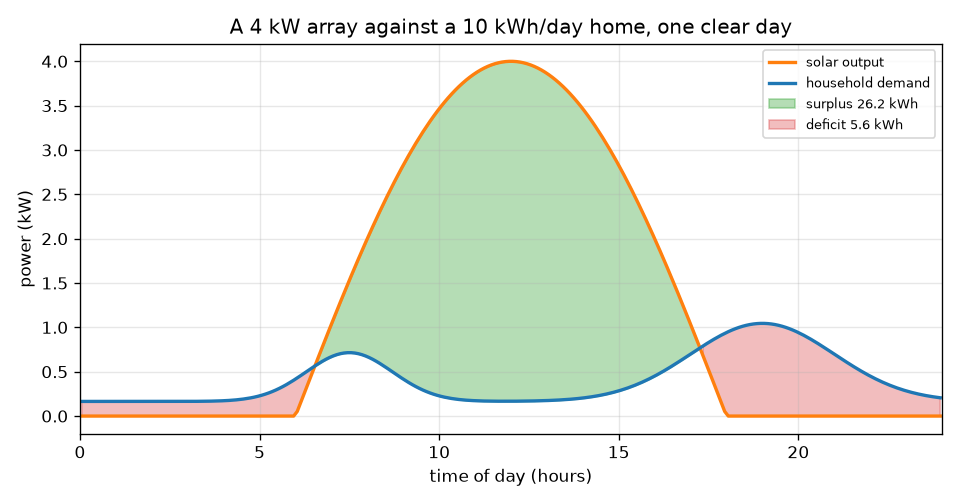
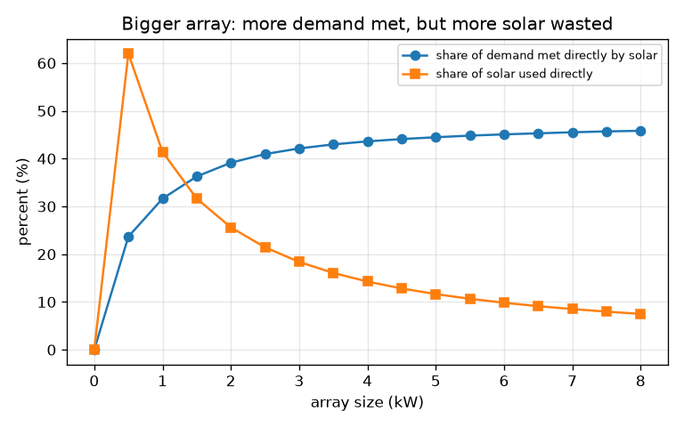

# సెషన్ 1: ఒక రోజు సూర్యకాంతి, ఒక రోజు డిమాండ్

[Session 1 — हिन्दी](README.hi.md)

*స్థాయి 1 (భావనాత్మక ఇంటరాక్టివ్ నమూనా) · సుమారు 60 నిమిషాలు · opensolarbattery*

> ఇది సరళీకరించిన ఒక విద్యా నమూనా (educational model). ఇది ధృవీకరించబడిన డిజైన్ సాధనం కాదు; నిజమైన నిర్మాణాలు, విద్యుత్ ఇన్‌స్టాలేషన్‌లు, వాహనాలు, పారిశ్రామిక ప్రక్రియలు లేదా వైద్య నిర్ణయాల కోసం దీనిని ఉపయోగించకూడదు.

**ముందస్తు జ్ఞానం (Prerequisites)**

- సైన్ వక్రరేఖ, మరియు గ్రాఫ్ కింది వైశాల్యం శక్తిని కలుపుతుంది అనే భావన.
- మీరు PRIMER.md చదివి `python start.py 1` ఒకసారి రన్ చేశారు.
- **పవర్** (kW, ఒక రేటు), **శక్తి** (kWh, కాలంలో మొత్తం) మధ్య తేడా మీకు అర్థమైంది.

**అభ్యాస లక్ష్యాలు (Learning objectives).** ఈ సెషన్ తర్వాత మీరు చేయగలరు:

- గంట ఆకారంలోని సౌర అవుట్‌పుట్ వక్రాన్ని, ఇంటి డిమాండ్ వక్రాన్ని ఒకే గ్రాఫ్‌లో గీయడం.
- మిగులు, లోటు, ప్రత్యక్ష వినియోగాన్ని వైశాల్యాలుగా kWh లో కొలవడం.
- ఒక సూత్రంతో అర్రే పరిమాణం నుండి స్పష్టమైన రోజు శక్తిని లెక్కించడం.
- పెద్ద అర్రే మాత్రమే ఇంటి డిమాండ్‌లో ఎక్కువ భాగాన్ని ఎందుకు తీర్చలేదో వివరించడం.

## A. వాస్తవ ప్రపంచ సమస్య
ఒక పొరుగువారు పైకప్పుపై సోలార్ అర్రే (solar array) పెట్టినా సాయంత్రం లైట్లు ఇంకా గ్రిడ్ విద్యుత్‌తోనే నడుస్తున్నాయి. ఎందుకు? సూర్యుడు మధ్యాహ్నం విద్యుత్ ఇస్తాడు, కానీ ఇల్లు తన శక్తిలో ఎక్కువ భాగం ఉదయం, సాయంత్రం వాడుతుంది. సౌర వక్రం డిమాండ్ వక్రం పైన ఉన్న చోట ఇప్పుడు ఎవరూ వాడలేని మిగులు ఉంటుంది; కింద ఉన్న చోట మరేదైనా భర్తీ చేయాల్సిన లోటు ఉంటుంది. ఈ సెషన్ రెండు వక్రాలను గీసి వైశాల్యాలను కొలుస్తుంది. ఇది ఒక విద్యా నమూనా, ఇన్‌స్టాలేషన్ డిజైన్ కాదు, ఇక్కడ ఏదీ వ్యక్తిగత సలహా కాదు.

## B. భావన మరియు సిద్ధాంతం
పవర్ అంటే శక్తిని వాడే రేటు, కిలోవాట్లలో (kW). శక్తి అంటే పవర్ గుణకారం సమయం, కిలోవాట్-గంటల్లో (kWh): 3 గంటలు నడిచే 2 kW హీటర్ 6 kWh వాడుతుంది. స్పష్టమైన రోజున సౌర అవుట్‌పుట్ సూర్యోదయం (6 గంటలు), సూర్యాస్తమయం (18 గంటలు) మధ్య సగం సైన్ తరంగంలా పెరిగి తగ్గుతుంది, కాబట్టి రోజు సౌర శక్తి ఆ సగం సైన్ కింది వైశాల్యం: అర్రే రేటింగ్ గుణకారం 24 భాగించు pi, ప్రతి kW అర్రేకు సుమారు 7.64 kWh (1 kW అర్రే రోజంతా సుమారు 7.64 kWh తయారు చేస్తుంది). ఇంటి డిమాండ్‌లో చిన్న బేస్ లోడ్, ఉదయం ఒక శిఖరం, అంతకంటే పెద్ద సాయంత్రం శిఖరం ఉంటాయి. దాని వైశాల్యం మీరు ఎంచుకున్న రోజువారీ శక్తికి సమానమయ్యేలా దాని ఆకారాన్ని స్కేల్ చేస్తాం. సోలార్ డిమాండ్ కంటే పైన ఉన్న వైశాల్యం మిగులు (surplus), డిమాండ్ సోలార్ కంటే పైన ఉన్న వైశాల్యం లోటు (deficit), రెండు వక్రాలలో కింది దాని కింది వైశాల్యం ప్రత్యక్ష వినియోగం (direct use).

| చిహ్నం | అర్థం | యూనిట్ |
|---|---|---|
| P_peak | అర్రే రేటింగ్: మధ్యాహ్నం పూర్తి ఎండలో అవుట్‌పుట్ | kW |
| s | సన్ ఫాక్టర్: 1 స్పష్టమైన రోజు, 0.5 మసక రోజు | యూనిట్ లేదు |
| P_pv(t) | సమయం t వద్ద సౌర పవర్ | kW |
| P_load(t) | సమయం t వద్ద ఇంటి డిమాండ్ | kW |
| E | శక్తి: ఒక పవర్ వక్రం కింది వైశాల్యం | kWh |
| t | రోజులో సమయం | గంటలు |

**ఊహలు (Assumptions)**

- 12 గంటల రోజు, 6 గంటలకు సూర్యోదయం, 18 గంటలకు సూర్యాస్తమయం.
- అర్రే బాగా దిశ చూపుతోంది, నీడ లేదు; కేబుళ్లలో, ఇన్వర్టర్‌లో నష్టాలు విస్మరించబడతాయి.
- డిమాండ్ ఆకారం సాధారణమైనది, కొలిచింది కాదు; రోజువారీ శక్తి మీరు ఎంచుకునేది.
- విద్యా నమూనా మాత్రమే, ఇన్‌స్టాలేషన్ డిజైన్ కాదు.

$$ P_{pv}(t)=P_{peak}\,s\,\sin\!\left(\frac{\pi (t-6)}{12}\right),\qquad 6\le t\le 18 $$

$$ E_{pv}=\int_6^{18} P_{pv}\,dt=P_{peak}\,s\,\frac{24}{\pi}\approx 7.64\,P_{peak}\,s\ \ \mathrm{kWh} $$

$$ E_{surplus}=\int \max\!\big(P_{pv}-P_{load},0\big)dt,\qquad E_{deficit}=\int \max\!\big(P_{load}-P_{pv},0\big)dt $$

$$ E_{direct}=\int \min\!\big(P_{pv},P_{load}\big)dt,\qquad E_{pv}=E_{direct}+E_{surplus},\quad E_{load}=E_{direct}+E_{deficit} $$

## C. దృశ్య వివరణ
మొదటి చిత్రం స్పష్టమైన రోజున 4 kW అర్రేను రోజుకు 10 kWh వాడే ఇంటితో గీస్తుంది. నారింజ సౌర వక్రం మధ్యాహ్నం శిఖరం చేరుతుంది, నీలం డిమాండ్ వక్రానికి ఉదయం, సాయంత్రం ఒక్కో మూపురం ఉంది, ఆకుపచ్చ వైశాల్యం మిగులు (26.2 kWh), ఎరుపు వైశాల్యాలు లోటు (5.6 kWh). రెండవ చిత్రం అర్రే పరిమాణాన్ని 0 నుండి 8 kW వరకు మారుస్తుంది. సోలార్ ప్రత్యక్షంగా తీర్చే డిమాండ్ వాటా 0 నుండి కేవలం 45.8 శాతానికే నెమ్మదిగా పెరుగుతుంది, అదే సమయంలో వాస్తవంగా వాడే సౌర శక్తి వాటా 41.4 శాతం (1 kW) నుండి 7.5 శాతానికి (8 kW) పడిపోతుంది: అదనపు ప్యానెళ్లు ఎక్కువగా మధ్యాహ్న మిగులునే పెంచుతాయి.

*4 kW అర్రే రోజుకు 10 kWh ఇంటికి వ్యతిరేకంగా: మిగులు ఆకుపచ్చలో, లోటు ఎరుపులో.*

*పెద్ద అర్రే: తీర్చే డిమాండ్ వాటా నెమ్మదిగా పెరుగుతుంది, వాడే సౌర శక్తి వాటా తగ్గుతుంది.*

## D. ఇంటరాక్టివ్ సిమ్యులేషన్
పాఠాన్ని రన్ చేయండి (`python start.py 1`), తర్వాత లైవ్ యాప్‌ను తెరవండి: [సెషన్ 1: ఒక రోజు సూర్యుడు, ఒక రోజు డిమాండ్](https://krunalpanchal1995.github.io/pan-iit-oss/opensolarbattery/session-01/) (లేదా ఈ ఫోల్డర్‌లోని `app.html`). అర్రే పరిమాణాన్ని పెంచి ఆకుపచ్చ మిగులు వైశాల్యం పెరగడాన్ని, ఎరుపు లోటు దాదాపు తగ్గకపోవడాన్ని గమనించండి. తర్వాత శక్తి-బార్ వీక్షణకు మారి రెండు బార్లను పోల్చండి. మసక రోజును చూడటానికి సన్ ఫాక్టర్ తగ్గించండి.

**సవాలు.** రోజు సౌర శక్తిని రోజు డిమాండ్‌తో 1 kWh లోపు సరిపోల్చండి, తర్వాత రీడౌట్‌లో డిమాండ్ సౌర వాటాను చదవండి: అది ఇంకా 100 శాతం కంటే చాలా తక్కువ.

## E. సాధించిన ఉదాహరణ మరియు ప్రయోగం
**సమస్య.** స్పష్టమైన రోజున 4 kW అర్రే, రోజుకు 10 kWh వాడే ఇల్లు. ఎంత సౌర శక్తి తయారవుతుంది? ఎంత మిగులు, ఎంత లోటు? సంఖ్యలు కూడుతున్నాయో లేదో తనిఖీ చేయండి.

1. సౌర శక్తి = 4 kW x 24 / pi = 4 x 7.639 = 30.56 kWh.
2. పాఠంలోని వైశాల్య మొత్తాల నుండి: ప్రత్యక్ష వినియోగం = 4.36 kWh, మిగులు = 26.20 kWh, లోటు = 5.64 kWh.
3. సౌర వైపు తనిఖీ: ప్రత్యక్ష + మిగులు = 4.36 + 26.20 = 30.56 kWh, ఇది సౌర శక్తికి సమానం.
4. డిమాండ్ వైపు తనిఖీ: ప్రత్యక్ష + లోటు = 4.36 + 5.64 = 10.00 kWh, ఇది డిమాండ్‌కు సమానం.
5. డిమాండ్ సౌర వాటా = 4.36 / 10 = 43.6 శాతం; ప్రత్యక్షంగా వాడిన సౌర శక్తి వాటా = 4.36 / 30.56 = 14.3 శాతం.

**సమాధానం.** అర్రే 30.56 kWh తయారు చేస్తుంది, డిమాండ్ కంటే మూడు రెట్లు, అయినా 4.36 kWh మాత్రమే (డిమాండ్‌లో 43.6 శాతం) ప్రత్యక్షంగా వాడబడుతుంది. మిగులు 26.20 kWh, లోటు 5.64 kWh.

**ప్రయోగం.** ఒక రోజు ఉదయం 7 గంటలకు, మధ్యాహ్నం, సాయంత్రం 6 గంటలకు, రాత్రి 11 గంటలకు మీ విద్యుత్ మీటర్ చదవండి (లేదా స్మార్ట్ మీటర్ ఉంటే దాని గ్రాఫ్ చదవండి) మీ డిమాండ్ వక్రాన్ని గీయండి. దాని ఆకారాన్ని నమూనాతో పోల్చండి: నిజమైన ఇళ్లలో కెటిళ్లు, పంపుల వల్ల శిఖరాలు ఉంటాయి, నునుపైన వక్రం వాటిని వదిలేస్తుంది. నిజమైన అర్రే కూడా కేబుళ్లలో, ఇన్వర్టర్‌లో కొన్ని శాతం కోల్పోతుంది, దాని అవుట్‌పుట్ రోజులో వాతావరణాన్ని అనుసరిస్తుంది; నమూనాలోని పరిపూర్ణ సగం సైన్ అత్యుత్తమ సందర్భం.

## F. మూల్యాంకనం మరియు డిజైన్ సవాలు
**ప్రశ్న రకం A: భావనాత్మక.** ఒక ఇంటికి స్పష్టమైన రోజున దాని రోజువారీ శక్తికి మూడు రెట్లు తయారు చేసే సోలార్ ప్యానెళ్లు ఉన్నాయి. అయినా ప్రతి సాయంత్రం దానికి గ్రిడ్ ఎందుకు అవసరం కావచ్చు?

సూచన

సోలార్ అందుబాటులో ఉండే సమయాన్ని, డిమాండ్ అత్యధికంగా ఉండే సమయంతో పోల్చండి.

దశలవారీ పరిష్కారం

తయారైన శక్తి, అవసరమైన శక్తి మొత్తం రోజు కోసం కొలుస్తారు, కానీ అవి ఒకే సమయంలో జరగవు. డిమాండ్ శిఖరంలో ఉండే సాయంత్రం సౌర అవుట్‌పుట్ సున్నాకు దగ్గరగా ఉంటుంది, డిమాండ్ తక్కువగా ఉండే మధ్యాహ్నం పెద్దగా ఉంటుంది, కాబట్టి సౌర శక్తిలో ఎక్కువ భాగం మిగులు. నిల్వ లేకుండా మిగులును సాయంత్రానికి తరలించలేము, కాబట్టి లోటు ఇంకా గ్రిడ్ నుండే వస్తుంది.

**ప్రశ్న రకం B: సంఖ్యాత్మక.** మసక రోజున (సన్ ఫాక్టర్ 0.5) ఒక 2 kW అర్రే రోజుకు 10 kWh వాడే ఇంటికి విద్యుత్ ఇస్తుంది. ఎంత సౌర శక్తి తయారవుతుంది, ఆ రోజు అతి చిన్న సాధ్యమైన గ్రిడ్ శక్తి ఎంత?

సూచన

సౌర శక్తి = P_peak x s x 24 / pi. లోటు ఎప్పటికీ డిమాండ్ నుండి సౌర శక్తిని తీసివేసిన దానికంటే చిన్నది కాదు.

దశలవారీ పరిష్కారం

సౌర శక్తి = 2 x 0.5 x 7.639 = 7.64 kWh. ప్రతి kWh ను పరిపూర్ణంగా వాడినా ఇంటికి మరెక్కడి నుండైనా కనీసం 10 - 7.64 = 2.36 kWh కావాలి. ఆచరణలో సమయం సరిపోలకపోవడం వల్ల లోటు ఇంకా ఎక్కువ. యూనిట్లు: kWh.

**ప్రశ్న రకం C: గ్రాఫ్ మరియు సిమ్యులేషన్ వ్యాఖ్యానం.** రెండవ చిత్రంలో అర్రే పెరిగేకొద్దీ ప్రత్యక్షంగా వాడే సౌర శక్తి వాటా తగ్గుతుంది, తీర్చే డిమాండ్ వాటా పెరుగుతుంది. రెండు ధోరణులను వివరించి, బ్యాటరీ దేన్ని మారుస్తుందో చెప్పండి.

సూచన

పెద్ద అర్రే అదనపు శక్తి రోజులో ఏ సమయంలో చేరుతుంది?

దశలవారీ పరిష్కారం

పెద్ద అర్రే ఎక్కువగా మధ్యాహ్నం అవుట్‌పుట్‌ను పెంచుతుంది, అప్పుడు డిమాండ్ ఇప్పటికే తీరి ఉంటుంది, కాబట్టి అదనపు శక్తి మిగులు అవుతుంది: వాడే సౌర శక్తి వాటా తగ్గుతుంది (1 kW వద్ద 41.4 శాతం నుండి 8 kW వద్ద 7.5 శాతానికి). సాయంత్రం డిమాండ్ ఇంకా తీరకపోవడం వల్ల తీర్చే డిమాండ్ వాటా నెమ్మదిగా మాత్రమే పెరుగుతుంది (31.6 నుండి 45.8 శాతం). బ్యాటరీ మధ్యాహ్న మిగులును నిల్వ చేసి సాయంత్రం విడుదల చేస్తుంది, రెండు వాటాలనూ పెంచుతుంది.

**ప్రశ్న రకం D: డిజైన్ మరియు ఆప్టిమైజేషన్ (optimisation) సవాలు.** డిజైన్: స్పష్టమైన రోజున తమ సౌర శక్తి తమ రోజువారీ వినియోగమైన 10 kWh కు సమానం కావాలని ఒక కుటుంబం కోరుకుంటుంది. అది ఏ అర్రే పరిమాణం, వారి డిమాండ్‌లో సుమారు ఎంత వాటాను సోలార్ ప్రత్యక్షంగా తీరుస్తుంది? ఇది వారి బిల్లును తొలగిస్తుందా?

సూచన

E = P_peak x 24 / pi వాడి, పాఠం ముద్రించే పట్టికలోని పరిమాణాలతో పోల్చండి.

దశలవారీ పరిష్కారం

P_peak = 10 / 7.639 = 1.31 kW. ముద్రించిన పట్టిక ప్రకారం, 1 kW డిమాండ్‌లో 31.6 శాతాన్ని, 2 kW 39.1 శాతాన్ని ప్రత్యక్షంగా తీరుస్తాయి, కాబట్టి 1.31 kW సుమారు మూడో వంతు. బిల్లు తొలగిపోదు: రోజు మొత్తాలు సరిపోయినా ఆ క్షణంలో డిమాండ్‌లో మూడింట రెండు వంతులు ఇంకా గ్రిడ్ నుండే వస్తుంది. ట్రేడ్-ఆఫ్ (trade-off): నిల్వ లేకుండా పెద్ద అర్రే వాటాను నెమ్మదిగా మాత్రమే పెంచుతుంది, స్పష్టమైన రోజు అత్యుత్తమ సందర్భం.

[RUBRIC.md](../../RUBRIC.md)తో మిమ్మల్ని మీరు స్కోర్ చేసుకోండి. కాగితంపై చేయడానికి [కార్యాచరణ పత్రం](activity_sheet.md) ప్రింట్ చేయండి.

## సాధారణ అపోహలు
| సాధారణ అపోహ | నిజానికి సరైనది |
|---|---|
| సౌర శక్తి నా రోజువారీ వినియోగానికి సమానమైతే నాకు గ్రిడ్ అవసరం ఉండదు. | మొత్తాలు సరిపోతాయి, కానీ సమయం సరిపోదు: సౌర శక్తిలో ఎక్కువ భాగం మధ్యాహ్నం, డిమాండ్‌లో ఎక్కువ భాగం ఉదయం, సాయంత్రం వస్తుంది. |
| పెద్ద అర్రే ఎల్లప్పుడూ నా డిమాండ్‌లో అనుపాతంగా ఎక్కువ తీరుస్తుంది. | నిల్వ లేకుండా తీర్చే డిమాండ్ వాటా ఒక పరిమితికి చేరుతుంది (ఇక్కడ సుమారు 46 శాతం); అదనపు శక్తి మిగులు అవుతుంది. |
| kW, kWh ఒకటే. | **kW అంటే పవర్** — ఒక క్షణంలో శక్తి ఎంత వేగంగా తయారవుతుంది లేదా వాడబడుతుంది (వేగం లాగా). **kWh అంటే శక్తి** — కాలంలో తయారైన లేదా వాడిన మొత్తం పరిమాణం (దూరం లాగా). 7.6 సమాన పూర్తి-ఎండ గంటలు నడిచే 4 kW అర్రే సుమారు 30.6 kWh తయారు చేస్తుంది. ఒకటి మాత్రమే అర్థం చేసుకుంటే ఇలా ఆలోచించండి: kW కెటిల్ పరిమాణాన్ని చెబుతుంది, kWh దాన్ని నడపడానికి ఎంత ఖర్చవుతుందో చెబుతుంది. |

## పదకోశం (Glossary)
- **kW (కిలోవాట్)**: పవర్ యూనిట్; శక్తి ఎంత వేగంగా తయారవుతుంది లేదా వాడబడుతుంది
- **kWh (కిలోవాట్-గంట)**: శక్తి యూనిట్: 1 గంటకు 1 kW
- **మిగులు (surplus)**: ఆ క్షణంలో ఇల్లు వాడే దానికంటే ఎక్కువ ఉన్న సౌర శక్తి
- **లోటు (deficit)**: ఆ క్షణంలో సోలార్ తీర్చలేని డిమాండ్
- **ప్రత్యక్ష వినియోగం (direct use)**: తయారయ్యే క్షణంలోనే ఇల్లు వాడే సౌర శక్తి

## ముగింపు
1. [exercises.md](exercises.md)లోని మూడు కోడింగ్ పనులు చేయండి.
2. మీ మార్పుల తర్వాత `python start.py 1` మళ్ళీ రన్ చేయండి. అది చెక్‌పాయింట్‌తో (checkpoint) ముగుస్తుంది; అది `PASS` అని ప్రింట్ చేసినప్పుడు మీరు పూర్తి చేశారు. (చెక్‌పాయింట్ మాత్రమే: `python start.py check 1`.)

తర్వాత: [సెషన్ 2](../session-02/README.md)
