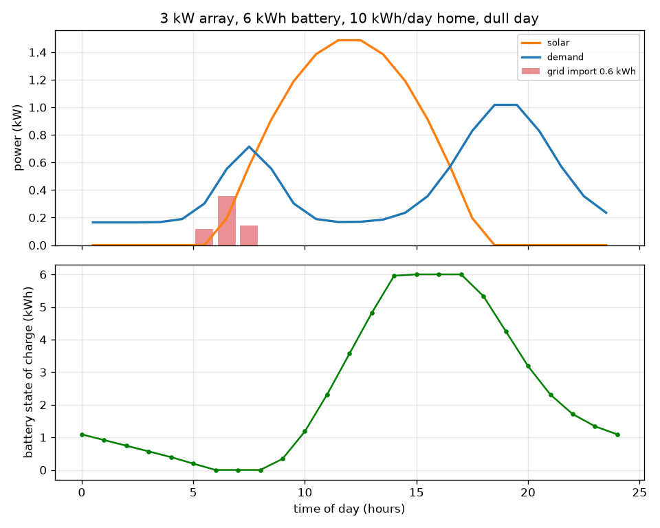
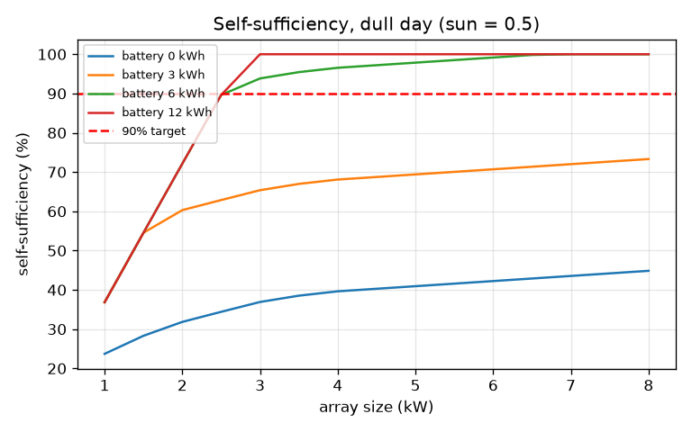

# Session 2: The hourly balance with a battery

*Level 2 (mathematical engineering model) · about 75 minutes · opensolarbattery*

> This is a simplified educational model. It is not a validated design tool and must not be used for real structures, electrical installations, vehicles, industrial processes or medical decisions.

**Prerequisites**

- Session 1: power, energy, surplus and deficit.
- Multiplying and dividing by efficiency fractions.

**Learning objectives.** After this session you can:

- Apply the hourly charge and discharge rules with a power limit, a capacity and an efficiency.
- Track the battery state of charge hour by hour.
- Check a simulation with the energy-conservation equation.
- Solve a design problem: the cheapest array and battery for a self-sufficiency target.

## A. Real-world problem
Session 1 showed that solar alone met less than half of a home's demand. A battery stores the midday surplus and releases it in the evening. But batteries cost money, can only charge and discharge at a limited power, and lose some energy each cycle. How big must the array and the battery be so that the grid supplies only 10 percent of the home's energy on a dull day, and what does each extra kW and kWh add to the cost? All costs here are illustrative units, not market prices, and this is an educational model, not an installation design.

## B. Concept and theory
Work in steps of one hour. In each hour compute the net power: net = solar minus demand. If net is positive the battery charges, limited by its power limit and by the free space; a fraction eta_c of the energy put in is stored. If net is negative the battery discharges, limited by its power limit and by the stored energy; the house receives eta_d times the energy taken out of the store. Anything the battery cannot cover is imported from the grid; surplus it cannot absorb is exported. The round-trip efficiency eta is eta_c times eta_d, so each way is the square root of eta. The state of charge (SOC) changes by eta_c x charge - discharge / eta_d each hour. Self-sufficiency is one minus import divided by demand. The simulation must obey energy conservation.

| Symbol | Meaning | Unit |
|---|---|---|
| P_pv, P_load | solar and demand power in an hour | kW |
| C | usable battery capacity | kWh |
| P_max | battery charge and discharge power limit | kW |
| eta | round-trip efficiency (0.9 means 90 percent) | no unit |
| SOC | state of charge: energy stored | kWh |
| SS | self-sufficiency: share of demand not taken from the grid | no unit |
| cost | illustrative cost: 1000 per kW of array plus 400 per kWh of battery | cost units |

**Assumptions**

- Hourly steps; power is constant within an hour so energy = power x 1 h.
- Battery power limit is half its capacity per hour in the design problem.
- The same day repeats; we run three days and report the last, so the battery starts the day where it ended.
- No battery ageing, temperature effects or minimum state of charge.
- Costs are illustrative units chosen for teaching, not market prices.
- Educational model only, not an installation design.

$$ \mathrm{net}_h=P_{pv,h}-P_{load,h}\ \ \mathrm{(kW)} $$

$$ \mathrm{charge}_h=\min\!\left(\mathrm{net}_h,\ P_{max},\ \frac{C-SOC_h}{\eta_c\,\Delta t}\right)\ \ (\mathrm{net}_h>0) $$

$$ \mathrm{discharge}_h=\min\!\left(-\mathrm{net}_h,\ P_{max},\ \frac{\eta_d\,SOC_h}{\Delta t}\right)\ \ (\mathrm{net}_h<0) $$

$$ SOC_{h+1}=SOC_h+\eta_c\,\mathrm{charge}_h\Delta t-\frac{\mathrm{discharge}_h\Delta t}{\eta_d},\qquad \eta_c=\eta_d=\sqrt{\eta} $$

$$ E_{pv}+E_{import}=E_{load}+E_{export}+\Delta SOC+E_{losses},\qquad SS=1-\frac{E_{import}}{E_{load}} $$

## C. Visual explanation
The first figure shows a dull day (sun factor 0.5) for a 3 kW array with a 6 kWh battery at a home that uses 10 kWh per day. The top panel shows solar, demand and the red grid import bars: the battery covers the evening completely, and the only imports are 0.62 kWh in the early morning (between 5:00 and 8:00) before the sun is up, when the battery is empty. The lower panel shows the state of charge: it falls overnight and is empty by about 6:00, starts to climb after 8:00, is full (6 kWh) from about 15:00 to 17:00, then drains through the evening. The second figure plots self-sufficiency against array size for four battery sizes against the 90 percent target.

*A dull day for a 3 kW array and 6 kWh battery: hourly balance (top) and state of charge (bottom).*

*Self-sufficiency against array size for four battery sizes, with the 90 percent target.*

## D. Interactive simulation
Run the lesson (`python start.py 2`), then open the live app: [Session 2: hourly balance with a battery](https://krunalpanchal1995.github.io/pan-iit-oss/opensolarbattery/session-02/) (or `app.html` in this folder). Start with no battery and add capacity one kWh at a time. Watch the state-of-charge curve and the grid-import bars. Then lower the efficiency and the power limit and see what degrades first.

**Challenge.** Reach at least 90 percent self-sufficiency on the default dull day for 10 kWh per day, spending no more than 5400 illustrative cost units.

## E. Worked example and experiment
**Problem.** Part 1 (hand calculation). A battery with round-trip efficiency 0.81 sees a 2 kW surplus for one hour, and later the house draws 1.62 kW from it for one hour. How much is stored and does it empty? Part 2. Use the lesson's search to find the cheapest design for 90 percent self-sufficiency on the dull day.

1. Each way is sqrt(0.81) = 0.9. Surplus hour: charge 2 kW x 1 h = 2 kWh in, stored = 2 x 0.9 = 1.8 kWh.
2. Discharge hour: the house takes 1.62 kWh. The battery must give up 1.62 / 0.9 = 1.8 kWh of stored energy, so it ends empty and no energy is imported.
3. Round trip: 1.62 / 2 = 0.81, which equals eta. The missing 0.38 kWh went to losses.
4. Design search: try array 1 to 8 kW (step 0.5) and battery 0 to 20 kWh (step 1), power limit half the capacity, sun factor 0.5, demand 10 kWh/day, efficiency 0.9.
5. Cheapest design with SS at least 0.9: 3 kW array and 6 kWh battery, SS = 0.938, cost = 1000 x 3 + 400 x 6 = 5400 units. Lower targets cost less: 0.6 needs 2 kW + 3 kWh (3200), 0.8 needs 2.5 kW + 5 kWh (4500).

**Answer.** Part 1: 1.8 kWh stored, battery ends empty, no import, round trip 0.81. Part 2: 3 kW and 6 kWh, self-sufficiency 0.938, illustrative cost 5400 units.

**Experiment.** Compare with a real battery data sheet: find its round-trip efficiency, usable capacity and maximum power, enter them in the model, and compare the model's hourly state of charge with a logged day if you have access to one. Real batteries differ in several ways the model ignores: efficiency changes with power and temperature, a reserve is kept at the bottom and the top, capacity fades with use, and real weather is not one repeated day.

## F. Assessment and design challenge
**Question type A: Conceptual.** Why does a lower round-trip efficiency increase the grid import even when the array and battery sizes stay the same?

Hint

Follow 1 kWh of surplus into the battery and out again.

Step-by-step solution

Every kWh of surplus that goes through the battery comes back as only eta kWh, so part of the stored solar energy is lost as heat. The evening deficit then needs extra grid energy to make up the difference. For the 3 kW / 6 kWh design on the dull day the grid import rises from 0.31 kWh at eta = 1.0 to 0.62 kWh at 0.9 and 0.94 kWh at 0.8.

**Question type B: Numerical.** A battery with round-trip efficiency 0.64 (0.8 each way) is charged by a 4 kW array while the house uses 1 kW, for one hour. How much energy is stored, and how much can the house later draw from it?

Hint

Net surplus = 3 kW for 1 h. Stored = eta_c x energy. Output = eta_d x stored.

Step-by-step solution

Surplus energy = 3 kW x 1 h = 3 kWh (assuming the power limit and capacity allow it). Stored = 0.8 x 3 = 2.4 kWh. The house can draw 0.8 x 2.4 = 1.92 kWh = 0.64 x 3. Sanity check: the output is smaller than the input, and 1.92 / 3 = 0.64 = eta.

**Question type C: Graph and simulation interpretation.** On the state-of-charge graph of the 3 kW / 6 kWh design, the battery sits at 6 kWh for several hours in the afternoon. What does that flat top tell you, and would a bigger battery change the import?

Hint

What happens to surplus when the battery is full? And when is the import actually happening?

Step-by-step solution

A flat top means the battery is full and surplus solar is exported (1.48 kWh that day), so charging is limited by capacity. A bigger battery would store that surplus, but the imports are in the early morning (0.62 kWh), when the battery is empty after the night. Extra capacity helps only if the array makes enough surplus to fill it; here a larger array or a better-kept charge matters more for the morning gap.

**Question type D: Design and optimisation challenge.** Design: the family accepts 80 percent self-sufficiency instead of 90 on the dull day. Which design is the cheapest, how much is saved, and what is the trade-off?

Hint

Use cheapest_design(0.8) and cost(). Compare with the 90 percent design.

Step-by-step solution

cheapest_design(0.8) gives 2.5 kW and 5 kWh, SS = 0.818, cost 4500 units, against 5400 for the 90 percent design: a saving of 900 units (17 percent) but 12 percentage points less of the demand met without the grid. Assumptions: one repeated dull day, illustrative costs. A real design would also need the whole year, which Session 3 does.

Score yourself with [RUBRIC.md](../../RUBRIC.md). Print the [activity sheet](activity_sheet.md) to work on paper.

## Common misconceptions
| Common misconception | What is actually true |
|---|---|
| A bigger battery always raises self-sufficiency. | Only until it can be filled and used; the array must make the surplus first, and the power limit must allow it to be delivered. |
| A 10 kWh battery gives 10 kWh to the house. | Some energy is lost both ways; at round-trip efficiency 0.9 the house receives about 9 kWh of a full charge. |
| If the simulation looks plausible it must be right. | Check energy conservation: solar + import must equal demand + export + change in storage + losses, to rounding. |

## Glossary
- **state of charge (SOC)**: how much energy is stored in the battery, in kWh
- **round-trip efficiency**: energy out divided by energy in over one full charge and discharge
- **power limit**: the largest rate (kW) at which the battery can charge or discharge
- **self-sufficiency**: share of demand not taken from the grid
- **grid import / export**: energy bought from or sent to the grid
- **conservation of energy**: energy is moved or lost as heat, never created or destroyed

## Finish
1. Do the three coding tasks in [exercises.md](exercises.md).
2. Run `python start.py 2` again after your changes. It ends with the checkpoint; when it prints `PASS`, you are done. (Checkpoint only: `python start.py check 2`.)

Next: [Session 3](../session-03/README.md)
