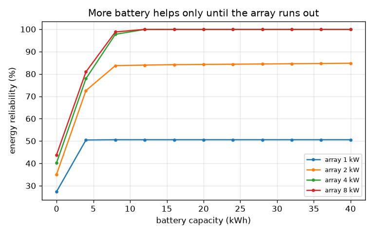
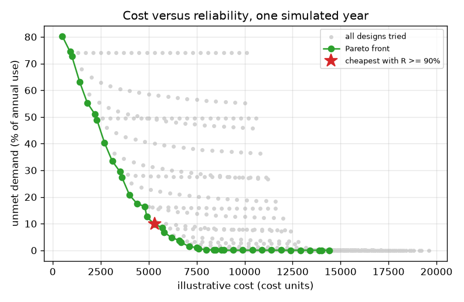
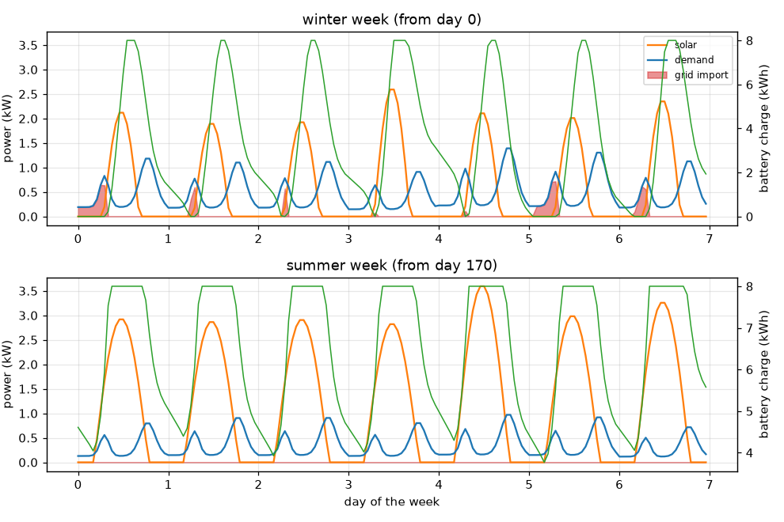

# Session 3: A whole year: reliability and the cost-optimal size

*Level 3 (simulation and validation) · about 90 minutes · opensolarbattery*

> This is a simplified educational model. It is not a validated design tool and must not be used for real structures, electrical installations, vehicles, industrial processes or medical decisions.

**Prerequisites**

- Session 2: the hourly battery rules and the conservation check.
- Averages and random numbers (a seed makes them repeatable).

**Learning objectives.** After this session you can:

- Simulate 8760 hours with seasonal sunshine, seeded random cloudiness and a year of demand.
- Measure reliability and loss-of-load hours, and test the simulator against exact energy rules.
- Run sensitivity tests on cloudiness, demand and the random seed.
- Search designs for the cheapest one that meets a reliability target and read the Pareto front.

## A. Real-world problem
A design that works on one dull day can still fail in a cloudy fortnight in winter. A sizing decision has to hold up over a whole year of changing day length, clouds and demand. How big must the array and battery be so that the grid supplies no more than 10 percent of the home's energy over a year? And why does adding battery capacity not necessarily solve every problem caused by an undersized solar array? Costs are illustrative units, not market prices; the model is educational, not an installation design, and nothing here is personal or financial advice.

## B. Concept and theory
We build the year from three ingredients. Clear-sky solar: day length D(d) and noon strength A(d) follow the seasons, so a clear day gives A x 2D / pi kWh per kW. Clouds: each day gets a cloud cover B between 0 and 1, from a seeded, correlated random sequence (clouds last a few days), and the day's clearness is K = 1 - 0.9 c B, where c is the cloudiness setting. Demand: the daily energy comes from a bill (or a default seasonal pattern), with a seeded 10 percent day-to-day wobble. The battery rules are those of Session 2, carried through all 8760 hours without a reset. Reliability is the energy reliability R = 1 - unmet / demand, where unmet is the grid import, and the loss-of-load hours (LOLH) count the hours in which import occurs. Because no battery can create energy, R can never exceed solar energy divided by demand: this is the ceiling that an undersized array imposes. We validate the code against exact rules, then search a grid of (array, battery) designs and keep the Pareto front: designs for which no other design is both cheaper and more reliable.

| Symbol | Meaning | Unit |
|---|---|---|
| d | day of the year (0 to 364) | days |
| D(d), A(d) | day length and noon strength for day d | hours, no unit |
| c | cloudiness setting, 0 (cloudless) to 1 (very cloudy) | no unit |
| B, K | daily cloud cover and clearness (K multiplies solar) | no unit |
| R | energy reliability = 1 - unmet / demand | no unit |
| LOLH | loss-of-load hours: hours with grid import above 0.001 kW | hours |
| seed | number that makes the random year repeatable | no unit |

**Assumptions**

- A single mid-latitude site; seasons are a smooth sine, illustrative rather than measured.
- Clouds change daily with a persistence of 0.6; the hours inside a day share the same clearness.
- Battery power limit is half its capacity per hour; efficiency 0.9; no ageing.
- Hourly steps; demand shape is typical, daily energy comes from the user.
- Costs are illustrative units chosen for teaching, not market prices.
- A single simulated year is one sample of the weather, not a forecast.
- Educational model only, not an installation design.

$$ D(d)=12+2.5\sin\!\frac{2\pi(d-80)}{365},\qquad A(d)=0.85+0.10\sin\!\frac{2\pi(d-80)}{365} $$

$$ P_{pv}(d,t)=P_{peak}\,K_d\,A(d)\sin\!\frac{\pi (t-t_{rise})}{D(d)},\qquad E_{clear}(d)=P_{peak}A(d)\frac{2D(d)}{\pi} $$

$$ K_d=1-0.9\,c\,B_d,\qquad B_d=\Phi(z_d),\ \ z_d=0.6\,z_{d-1}+0.8\,e_d,\ \ e_d\sim N(0,1) $$

$$ R=1-\frac{E_{import}}{E_{load}},\qquad R\le \min\!\left(1,\frac{E_{pv}}{E_{load}}\right) $$

$$ E_{pv}+E_{import}=E_{load}+E_{export}+\Delta SOC+E_{losses} $$

## C. Visual explanation
The first figure shows a winter week and a summer week for a 4 kW array with an 8 kWh battery: the battery fills and empties every day, and in the winter week the battery runs empty before dawn on most days, so red grid-import patches appear in the early morning; in the summer week there are none. The second figure plots every design tried as a grey dot, cost against unmet demand; the green Pareto front hugs the bottom left, and the red star marks the cheapest design with reliability at least 90 percent (2.5 kW + 7 kWh, cost 5300). The third figure shows the reliability against battery size for four array sizes: the 1 kW array stalls at 50.6 percent no matter how large the battery, the 2 kW array at about 85 percent, while 4 kW and 8 kW reach 99.9 percent.

*Reliability against battery capacity: small arrays stall below the ceiling.*

*Every design tried (grey), the Pareto front (green) and the cheapest design with reliability at least 90 percent (star).*

*A winter week and a summer week for a 4 kW array and an 8 kWh battery.*

## D. Interactive simulation
Run the lesson (`python start.py 3`), then open the live app: [Session 3: a simulated year](https://krunalpanchal1995.github.io/pan-iit-oss/opensolarbattery/session-03/) (or `app.html` in this folder). Change the battery size and watch reliability on the battery view flatten at its ceiling, then raise cloudiness and demand and see which designs fail. Look at the monthly view to see when the grid is needed.

**Challenge.** Find an array and battery that give at least 95 percent reliability at the default cloudiness 0.5 and 10 kWh per day, for no more than 6200 illustrative cost units.

## E. Worked example and experiment
**Problem.** Part 1 (analytic reference). Check the hourly clear-sky model against the exact formula A x 2D / pi summed over the year. Part 2. Find the cost-optimal design for R at least 0.9 with cloudiness 0.5, seed 1, demand 10 kWh per day on average (3642 kWh in the simulated year), and check how robust it is.

1. Sum over the 365 days of A(d) x 2D(d) / pi: 2399 kWh per kW. The hourly simulator adds 365 x 24 hourly values: 2401 kWh per kW. They agree to better than 0.1 percent.
2. With clouds (cloudiness 0.5, seed 1) the year gives 1936 kWh per kW: mean clearness 0.805 against the expected 1 - 0.45 x 0.5 = 0.775 (one random year differs from the average).
3. Check the energy conservation: solar + import - (demand + export + change in storage + losses) = 0 within rounding for the whole year.
4. Search 20 array sizes (0.5 to 10 kW) x 25 battery sizes (0 to 24 kWh) = 500 designs. The cheapest with R at least 0.9 is 2.5 kW + 7 kWh: R = 0.902, loss-of-load hours 1117, cost 1000 x 2.5 + 400 x 7 = 5300 units.
5. Robustness: run the same design on 100 other random years. It reaches R at least 0.9 in only 15 of 100, and its 5th-percentile reliability is 0.884. The design 3 kW + 8 kWh (cost 6200) reaches it in all 100 years (5th percentile 0.938).

**Answer.** Hourly clear-sky energy 2401 kWh per kW matches the analytic 2399 kWh per kW. The cheapest design for one simulated year is 2.5 kW + 7 kWh (cost 5300, R = 0.902), but it is only lucky in that year; 3 kW + 8 kWh (cost 6200) is reliable in all 100 test years.

**Experiment.** Download a year of real hourly solar irradiance for your city from a public weather dataset (for example from a national weather agency), convert it to kW per kW of array, and run the same battery code on it, using your own demand. Compare the monthly solar totals with the clear-sky-plus-clouds model: real years have more variety (monsoon, haze, snow), correlated demand peaks, panel temperature effects and shading, none of which are in the model. Use the comparison to say how far the model can be trusted, and for what.

## Real-world application and mini-project: Size a system from your own electricity bill
Take 12 monthly electricity readings in kWh from a household (your own, a relative's, or invent a realistic set). Use `monthly_to_daily` and `size_from_bill` from Session 3 to find the cheapest array and battery for 90 percent energy reliability, then test it against a cloudier year. Treat the output as a classroom estimate: it is not an installation design, and the costs are illustrative units.

**Deliverable:** A script that prints the chosen array (kW), battery (kWh), illustrative cost, reliability and loss-of-load hours for your bill, and the reliability of the same design when the cloudiness is raised from 0.5 to 0.75, plus a short paragraph on what limits your design.

**Success looks like:** Reliability of at least 0.90 at cloudiness 0.5 and at least 0.85 at cloudiness 0.75, and the energy-conservation residual printed as zero (below 1e-6 kWh).

## F. Assessment and design challenge
**Question type A: Conceptual.** Why does increasing the battery capacity not necessarily solve every problem caused by an undersized solar array?

Hint

Compare the energy the array makes in a year with the energy the home uses, and think about winter weeks.

Step-by-step solution

A battery only moves energy in time; it cannot create it. If the array makes less energy than the home needs, no battery can close the gap: reliability is capped at solar energy divided by demand (0.531 for the 1 kW array in the simulated year, and the 1 kW array stays at 50.6 percent with 8, 16 or 40 kWh). Even when the yearly total is enough (the 2 kW array reaches only about 85 percent), cloudy winter weeks leave the battery empty, and an extra kWh of capacity is not filled because there is no surplus to fill it. The array must grow first.

**Question type B: Numerical.** A 4 kW array and an 8 kWh battery give reliability 0.977 for a home with 3642 kWh of demand in the simulated year. How much energy did the home import? If the demand is 30 percent higher, reliability falls to 0.901: how many more kWh were imported?

Hint

Import = (1 - R) x demand. New demand = 1.3 x 3642.

Step-by-step solution

Import = (1 - 0.977) x 3642 = 83 kWh (the code prints 82.7 kWh). With demand scaled by 1.3 the demand is 4735 kWh and the import is (1 - 0.901) x 4735 = 469 kWh, so about 386 kWh more. Units: kWh. Sanity check: demand rose 30 percent but import rose more than five times, because the extra evening demand finds the battery empty.

**Question type C: Graph and simulation interpretation.** In the sensitivity results for the 4 kW / 8 kWh design, reliability is 0.982 at cloudiness 0, 0.977 at 0.5, 0.956 at 0.75 and 0.897 at 1.0. What do the loss-of-load hours (188, 218, 477, 1028) add?

Hint

Compare how quickly each measure changes.

Step-by-step solution

Reliability measures the share of energy that is unmet, while loss-of-load hours count how often the home needs the grid. Between cloudiness 0.5 and 0.75, reliability falls only 2.1 percentage points but the hours of import more than double (218 to 477), and at cloudiness 1.0 the grid is needed for 1028 hours (about 12 percent of the year). The change is gentle at first and steep at the cloudy end: a design can look fine on energy and still involve many hours of dependence.

**Question type D: Design and optimisation challenge.** Design: choose the array and battery for 95 percent reliability and justify your choice against the Pareto front. Would you pick the single-year optimum or something larger?

Hint

Use cheapest(designs, 0.95), then test the design on other seeds with pv_unit_year(0.5, seed).

Step-by-step solution

The single-year optimum for R at least 0.95 is 3 kW + 8 kWh (R = 0.953, cost 6200). Because one year is one sample of the weather, test it on other seeds: a design sitting exactly at the target will miss it in many years. Choose a margin: for example 3.5 kW + 9 kWh, then check the 5th-percentile reliability over 100 years. Trade-off: each step along the Pareto front buys a smaller reliability gain for a larger cost (4 kW + 9 kWh costs 7600 for R = 0.994), so the choice depends on how a failure is valued. This is an illustrative classroom model, not a design.

Score yourself with [RUBRIC.md](../../RUBRIC.md). Print the [activity sheet](activity_sheet.md) to work on paper.

## Common misconceptions
| Common misconception | What is actually true |
|---|---|
| If a design meets the target in the simulated year, it will meet it every year. | One year is one random sample; the cost-optimal design for seed 1 meets the target in only 15 of 100 other years. |
| Sensitivity tests are not needed if the code runs without errors. | A model that runs is not a model that is right: test it against exact energy rules and against changes in cloudiness, demand and seed. |
| More battery always fixes a shortfall. | A battery moves energy in time but cannot create it; reliability is capped by solar energy divided by demand. |

## Glossary
- **reliability (energy)**: the share of demand met without the grid: 1 - unmet / demand
- **loss-of-load hours**: the number of hours in which the system could not meet the demand and the grid was needed
- **clearness**: a daily multiplier (0.55 to 1) for how much of the clear-sky solar output survives the clouds
- **seed**: a number that starts a random generator, so the same 'random' year is repeatable
- **Pareto front**: the designs for which no other design is both cheaper and more reliable
- **sensitivity**: how much the result changes when one input changes

## Finish
1. Do the three coding tasks in [exercises.md](exercises.md).
2. Run `python start.py 3` again after your changes. It ends with the checkpoint; when it prints `PASS`, you are done. (Checkpoint only: `python start.py check 3`.)

Next: the [roadmap](../../promo/roadmap.md). Session 4 is yours to build.
