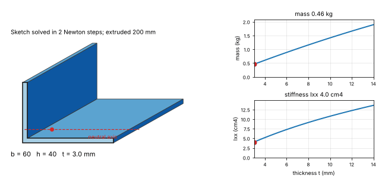
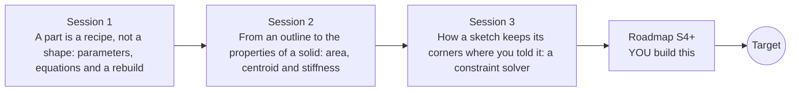

# opensolidmodel

[](https://github.com/KrunalPanchal1995/pan-iit-oss/actions/workflows/tests.yml)   [](https://colab.research.google.com/github/KrunalPanchal1995/pan-iit-oss/blob/main/opensolidmodel/sessions/session-01/lesson.ipynb) [](https://krunalpanchal1995.github.io/pan-iit-oss/opensolidmodel/)

**Learn how a parametric CAD program stores, rebuilds and measures a part, in three sessions.**

opensolidmodel teaches how a parametric CAD kernel like SolidWorks keeps a part editable: a recipe of named parameters and equations that rebuilds the part, the area, centroid and stiffness of any flat outline, and a constraint solver that finds the corner points of a sketch from dimensions, using only Python and a browser.

- **Start from the question.** Session 1 asks how a customer change of 6 holes instead of 4 can rebuild a whole plate, with no redrawing.
- **See it move.** Every session ships a slider app that runs in the browser, with labelled graphs, a drawing of the part and bar charts.
- **Know you got it right.** Each session ends with a checkpoint that prints PASS or FAIL against hand calculations, a second independent method and the refusal of unsafe input.
- **Build the missing half.** The repo stops at Session 3 on purpose; the roadmap shows the path to the Target.

[Target](#the-target) · [Who is this for](#who-is-this-for) · [Quick start](#quick-start) · [Sessions](#sessions) · [Roadmap](#roadmap) · [Contribute](#contribute) · [Explainer PDF](docs/explainer.pdf)

> **This repo is incomplete on purpose.** Sessions 1 to 3 are here and fully working. The finished Target below is a preview of what the community can build next. We show you the path, not the code. Sessions 4 and up are yours.

## The Target
A parametric L-bracket is rebuilt while its thickness is changed from 3 mm to 14 mm. On the left, the solved sketch is extruded to a solid with its centroid and neutral axis, and the corner points move so that every dimension stays true. On the right, the mass of the bracket and its second moment of area Ixx are plotted against the thickness, with a marker at the current value. The Target combines all three sessions into one feature tree and adds the stiffness; the repo treats the recipe, the section and the sketch separately. Your goal over the coming sessions is to build it yourself.



*Target: a parametric L-bracket in a feature-tree CAD program: change the thickness and the sketch, the solid, the mass and the stiffness rebuild together*

How the Target was made is shown only as a path in [promo/roadmap.md](promo/roadmap.md).

## Who is this for
**diploma/undergrad to advanced undergrad (levels 2-4).** Topic area: Mechanical Engineering.

Prerequisites:

- Area, volume and the coordinates of a point at school level.
- Basic algebra, including solving two equations together; Session 3 uses a table of numbers (a matrix) but explains it.
- Python 3.10 or newer; if `python --version` works, you are ready. PRIMER.md explains the rest.
- No prior GitHub or CAD experience is needed.

New to Python? Read [PRIMER.md](PRIMER.md) first (10 minutes).

## Quick start

No installation knowledge needed. You need [Git](https://git-scm.com/downloads) and [Python 3.10+](https://www.python.org/downloads/) (Windows: tick "Add Python to PATH"). On Mac and Linux type `python3` wherever this page says `python`.

```bash
git clone https://github.com/KrunalPanchal1995/pan-iit-oss.git
cd pan-iit-oss/opensolidmodel
python start.py 1
```

`start.py` creates a private environment, installs what is needed and runs Session 1 with its checkpoint. Next: `python start.py 2`, `python start.py 3`, or `python start.py test` to check everything. Only a checkpoint: `python start.py check 1`.

<!-- friendly-help -->
<details>
<summary><b>Not working? Common fixes (no Git, "python not found", no internet)</b></summary>

- **No Git?** You do not need it. On the main page of this collection click the green **Code** button, then **Download ZIP**, unzip it, open a terminal inside the folder `pan-iit-oss-main/opensolidmodel` and run `python start.py 1`. The ZIP holds every project, so it is large; the live apps need no download at all.
- **"python is not recognized" or "command not found".** On Windows try `py start.py 1`. On Mac and Linux try `python3 start.py 1`. If neither works, install Python from [python.org](https://www.python.org/downloads/) and tick "Add Python to PATH".
- **Needs internet once.** The first run downloads NumPy and Matplotlib into a private folder (`.venv`); after that it works offline.
- **Rather not install anything?** Open the [live apps](https://krunalpanchal1995.github.io/pan-iit-oss/opensolidmodel/) in your browser, or use the Colab badge at the top of this page.
- **Still stuck?** [Open an issue](https://github.com/KrunalPanchal1995/pan-iit-oss/issues/new?title=%5Bopensolidmodel%5D%20) with your operating system and the message you see. Questions from beginners are welcome.

</details>

Four lines turn the idea of Session 1 into a result (they work as they are). Save them as `try.py` and run it with `python start.py run try.py`:

```python
w, n = 120, 4                          # plate width (mm) and number of holes
s = w / (n + 1)                        # an equation: the spacing follows the width
print(s, round(0.4 * s, 1))            # -> 24.0 9.6: spacing and hole diameter (40 percent of the spacing)
```

Every session also opens in your browser with sliders (no install): [live apps](https://krunalpanchal1995.github.io/pan-iit-oss/opensolidmodel/). Or use the Colab badge above for the notebook.

## Sessions

| # | Session | Model level | Time | Live app |
|---|---|---|---|---|
| 1 | [A part is a recipe, not a shape: parameters, equations and a rebuild](sessions/session-01/README.md) | Level 2: mathematical engineering model | 60 min | [open](https://krunalpanchal1995.github.io/pan-iit-oss/opensolidmodel/session-01/) |
| 2 | [From an outline to the properties of a solid: area, centroid and stiffness](sessions/session-02/README.md) | Level 3: simulation and validation | 75 min | [open](https://krunalpanchal1995.github.io/pan-iit-oss/opensolidmodel/session-02/) |
| 3 | [How a sketch keeps its corners where you told it: a constraint solver](sessions/session-03/README.md) | Level 3: simulation and validation | 75 min | [open](https://krunalpanchal1995.github.io/pan-iit-oss/opensolidmodel/session-03/) |

Each session follows the same six steps: A real-world problem, B concept and theory, C visual explanation, D interactive simulation, E worked example and experiment, F assessment and design challenge. Each ends with `checkpoint.py`, which prints `PASS` or `FAIL` against reference numbers. Session 3 also contains the real-world mini-project: **Estimate the mass and the stiffness of an L-shaped shelf bracket for a customer's drawing**.

## Architecture



| Folder or file | What is inside |
|---|---|
| `sessions/` | three sessions: README (A-F), `lesson.py`, notebook, live app, exercises, activity sheet, checkpoint |
| `promo/` | the Target: media and the roadmap (path only) |
| `docs/` | `explainer.tex` and the built `explainer.pdf` |
| `tests/` | runs every lesson and checkpoint headless, and checks every live app |
| `start.py` | one command to set up and run anything |
| `QUALITY.md`, `RUBRIC.md` | the quality checklist and the scoring rubric |
| `.github/` | CI, PDF build, Pages deploy, issue and PR templates |

## Roadmap

| Milestone | What you will build | Difficulty |
|---|---|---|
| Session 4: Arcs and circles in the sketch | Add a circle (centre point and radius) and the statements 'radius is r', 'point on circle' and 'line tangent to circle' to the solver of Session 3. | intermediate |
| Session 5: A feature tree with extrude, cut and revolve | Extend the rebuild of Session 1 to a list of extrude, cut and revolve features, each with parameters, and recompute the volume after every change. | intermediate |
| Session 6: Volume, centre of mass and inertia of a solid | Add the centre of mass and the moment of inertia about an axis for extruded and revolved parts. | advanced |
| Session 7: Fillets and chamfers on the outline | A function that replaces a convex corner of a polygon by a tangent arc and returns the new area and second moment of area. | intermediate |
| Session 8: Assemblies and mates | Give every part a position and an angle and solve the mates with the same Newton method as the sketch. | advanced |

Full detail with a checkpoint per milestone: [promo/roadmap.md](promo/roadmap.md).

## Contribute
New to GitHub? Read [CONTRIBUTING.md](CONTRIBUTING.md); it starts from zero. Pick an issue labelled `good first issue`. Translations into Hindi, Telugu, Tamil and Malayalam are welcome.

<details>
<summary>Development</summary>

```bash
python start.py test        # runs every lesson and checkpoint, and checks every live app
```
Lessons use `# %%` cell markers so they open as notebooks in VS Code. See [QUALITY.md](QUALITY.md) for the standard every session meets.
</details>

## License
MIT. See [LICENSE](LICENSE). Media in `promo/media` is (c) Krunal Panchal, CC BY 4.0.

## Acknowledgments
Part of the [PAN IIT OSS](https://hellofoss.tech-iitb.org/projects) open-source teaching collection, modelled on the structure of [openspline](https://github.com/openspline/openspline).
