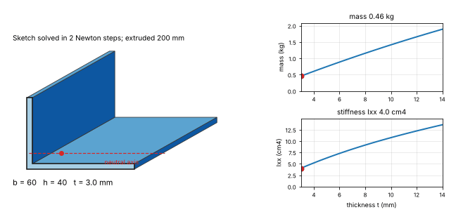

# What you are building toward

A parametric L-bracket is rebuilt while its thickness is changed from 3 mm to 14 mm. On the left, the solved sketch is extruded to a solid with its centroid and neutral axis, and the corner points move so that every dimension stays true. On the right, the mass of the bracket and its second moment of area Ixx are plotted against the thickness, with a marker at the current value. The Target combines all three sessions into one feature tree and adds the stiffness; the repo treats the recipe, the section and the sketch separately. Your goal over the coming sessions is to build it yourself.

*Target: a parametric L-bracket in a feature-tree CAD program: change the thickness and the sketch, the solid, the mass and the stiffness rebuild together*

The code behind the Target is not published; the roadmap shows the path so you can build your own.
