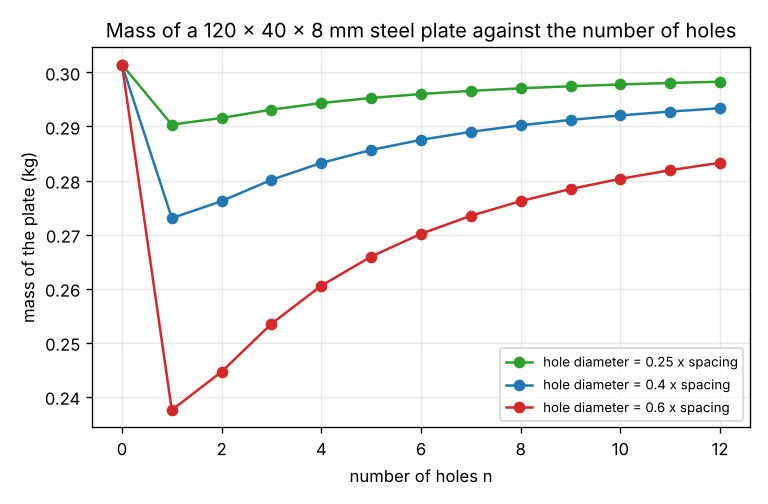
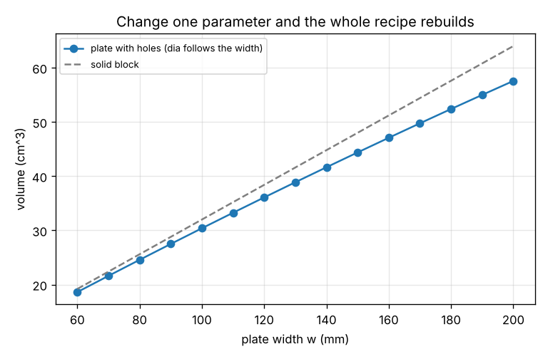

# Session 1: A part is a recipe, not a shape: parameters, equations and a rebuild

*Level 2 (mathematical engineering model) · about 60 minutes · opensolidmodel*

> This is a simplified educational model. It is not a validated design tool and must not be used for real structures, electrical installations, vehicles, industrial processes or medical decisions.

**Prerequisites**

- Volume of a block and of a cylinder at school level.
- Reading a formula with a few letters, such as s = w / (n + 1).

**Learning objectives.** After this session you can:

- Say what a CAD program stores instead of a picture: parameters, equations and a list of features.
- Evaluate an equation between parameters safely, without running arbitrary code.
- Rebuild a part after one parameter changes and read off its volume, mass and number of faces.
- Explain why tying one dimension to another by an equation keeps a part consistent when it is edited.

## A. Real-world problem
A customer asks for the same mounting plate with 6 holes instead of 4, and 20 mm wider. In a drawing you would redraw it. A CAD program stores a recipe instead and rebuilds the part when one number changes. How is such a recipe stored, and how do we get the volume and the mass of the rebuilt part? The plate in this repo is 120 x 40 x 8 mm steel with 4 holes: how much does it weigh, and what happens to the weight when the customer's change is made?

## B. Concept and theory
A parametric part is stored as three things. First, a dictionary of named parameters (width w, depth d, thickness h, number of holes n, hole ratio). Second, a list of equations that compute other dimensions from the parameters, for example the hole spacing s = w / (n + 1) and the hole diameter dia = ratio x s; these are stored as text and evaluated with the current values. Third, a list of features applied in order: a block w x d x h, then n round through-holes of diameter dia in a row, s apart. To rebuild, we change the parameters, evaluate the equations in order (a later equation may use an earlier one), check that the recipe still makes sense (the holes must not touch each other or the edges), and recompute the geometry. For this plate the volume is the block minus the holes, V = w d h - n (pi / 4) dia^2 h, and the mass is the density times the volume, with rho = 7850 kg/m^3 for steel. Because the diameter is tied to the spacing, a change of w or n moves every hole and resizes it. The equation evaluator must never run arbitrary code, because a recipe can come from another person: it accepts only numbers, names, + - * / **, brackets and a short list of functions, and refuses everything else, including huge powers that would hang the program.

| Symbol | Meaning | Unit |
|---|---|---|
| w, d, h | width, depth and thickness of the plate | mm |
| n | number of holes (a whole number) | no unit |
| ratio | hole diameter as a fraction of the hole spacing | no unit |
| s | hole spacing, w / (n + 1) | mm |
| dia | hole diameter, ratio x s | mm |
| V | volume of the plate with its holes | mm^3 |
| rho | density of steel | kg/m^3 (7850) |

**Assumptions**

- The plate is a rectangular block with round through-holes in one row along the width.
- Steel with a constant density of 7850 kg/m^3.
- Only the volume and the mass are computed; no chamfers, fillets or tolerances.
- Lengths are in millimetres, masses in kilograms.

$$ s = \frac{w}{n + 1},\qquad \mathrm{dia} = \mathrm{ratio}\cdot s $$

$$ V = w\,d\,h - n\,\frac{\pi}{4}\,\mathrm{dia}^{2}\,h $$

$$ m = \rho\,V\cdot 10^{-9}\quad(V\text{ in }\mathrm{mm}^3,\ m\text{ in kg}) $$

## C. Visual explanation
The first figure plots the mass of the plate against the number of holes for three hole ratios. The curves first drop and then slowly rise: because the diameter follows the spacing, more holes means smaller holes, and the total removed volume is proportional to n / (n + 1)^2, which is largest for one hole. The second figure changes only the width: the volume of the plate with holes (solid line) follows the solid block (dashed) because every dimension follows w.

*Mass of the plate against the number of holes, for three hole ratios.*

*Volume against the width: one parameter changes, the whole recipe rebuilds.*

## D. Interactive simulation
Run the lesson (`python start.py 1`), then open the live app: [Session 1: a part is a recipe](https://krunalpanchal1995.github.io/pan-iit-oss/opensolidmodel/session-01/) (or `app.html` in this folder). Slide the width and watch the holes move and resize in the drawing. Slide the number of holes and see that the plate does not get lighter for ever.

**Challenge.** Make a plate at least 100 mm wide with at least 6 holes that weighs at most 0.25 kg.

## E. Worked example and experiment
**Problem.** The customer wants 6 holes instead of 4 and a width of 140 mm, with the same hole ratio of 0.4, depth 40 mm and thickness 8 mm. Find the spacing, the hole diameter, the volume and the mass of the new plate.

1. Spacing: s = w / (n + 1) = 140 / 7 = 20.0 mm.
2. Diameter: dia = 0.4 x 20.0 = 8.0 mm. The holes fit: 8.0 is smaller than the spacing (20.0) and the depth (40).
3. Block: 140 x 40 x 8 = 44800 mm3.
4. Holes: 6 x (pi / 4) x 8.0^2 x 8 = 2413 mm3.
5. Volume: 44800 - 2413 = 42387 mm3, which is 42.39 cm3.
6. Mass: 7850 x 42387 x 1e-9 = 0.333 kg.

**Answer.** The new plate has holes of 8.0 mm, 20.0 mm apart, a volume of 42.4 cm3 and a mass of 0.333 kg, compared with 0.283 kg for the original.

**Experiment.** Measure a real mounting plate or a flat metal bracket with a ruler or a caliper. Write down its width, depth, thickness and the number of holes, and compute the hole spacing and the volume as in the lesson. Weigh it on a kitchen scale and compare with the mass the model gives for steel (7850 kg/m^3) or aluminium (2700 kg/m^3). A difference of a few percent is normal: real parts have rounded corners, chamfers and an uncertain alloy. A difference of a factor 3 means the material is a different one.

## F. Assessment and design challenge
**Question type A: Conceptual.** Why does the recipe store the hole spacing and the diameter as equations instead of as two numbers?

Hint

Think about what you would have to do by hand when the customer asks for a wider plate.

Step-by-step solution

With two stored numbers, a change of the width leaves the spacing and diameter unchanged, so the holes are no longer spread evenly and one may end up on the edge; the designer must remember to edit every dependent number, and one will be forgotten. As equations, s = w / (n + 1) and dia = ratio x s are recomputed at every rebuild, so one change gives a consistent plate. The price is that the equations must be evaluated safely and checked: for example n = -1 would divide by zero and a ratio above 1 would make the holes touch.

**Question type B: Numerical.** A smaller plate has w = 100 mm, d = 30 mm, h = 6 mm, 3 holes and a ratio of 0.5. Find the spacing, the hole diameter, the volume and the mass.

Hint

s = w / (n + 1), dia = ratio x s, then V = w d h - n (pi / 4) dia^2 h and m = 7850 V 1e-9.

Step-by-step solution

s = 100 / 4 = 25.0 mm and dia = 0.5 x 25 = 12.5 mm (smaller than s and d, so the plate is valid). Block: 100 x 30 x 6 = 18000 mm3. Holes: 3 x (pi / 4) x 12.5^2 x 6 = 2209 mm3. Volume = 15791 mm3 = 15.79 cm3 and mass = 7850 x 15791 x 1e-9 = 0.124 kg. Sanity check: the block alone would weigh 0.141 kg and the holes remove about 11 percent of it.

**Question type C: Graph and simulation interpretation.** On the graph of mass against the number of holes (ratio 0.4), the curve is lowest at one hole and rises afterwards. Does a plate with more holes weigh less? Explain with the equation.

Hint

Write the removed volume with s = w / (n + 1) and find how it depends on n.

Step-by-step solution

No. The removed volume is n (pi / 4) (ratio w / (n + 1))^2 h = (pi / 4) ratio^2 w^2 h x n / (n + 1)^2. The factor n / (n + 1)^2 is 0.250 for n = 1, 0.222 for n = 2, 0.188 for n = 3 and 0.160 for n = 4: it falls, because the holes shrink faster than they multiply. The masses are 0.273 kg for one hole, 0.276, 0.280 and 0.283 kg for four holes. To remove more material with more holes, the diameter must not be tied to the spacing, which is a different recipe and shows that the equations are a design decision, not a law.

**Question type D: Design and optimisation challenge.** Design: the customer wants the 120 x 40 x 8 mm plate with 4 holes to weigh at most 0.28 kg. Find the smallest hole ratio, to two decimals, and the hole diameter it gives.

Hint

Try the rebuild for ratios from 0.40 upward, or solve m = 0.28 for the ratio with the equations of Section B.

Step-by-step solution

The mass must drop from 0.2833 kg to 0.28 kg, so the holes must remove 0.28326 - 0.28 = 0.00326 kg more than now. Solving gives ratio = 0.4344, so the smallest two-decimal ratio is 0.44 (0.43 gives 0.2804 kg, just too heavy). With ratio 0.44 the diameter is 0.44 x 24 = 10.56 mm and the mass 0.2794 kg. The holes are still smaller than the spacing (24 mm) and the depth (40 mm), so the plate is valid. Assumption: the plate is steel; the holes cost strength, which this model does not check.

Score yourself with [RUBRIC.md](../../RUBRIC.md). Print the [activity sheet](activity_sheet.md) to work on paper.

## Common misconceptions
| Common misconception | What is actually true |
|---|---|
| A CAD file is a picture of the part. | A parametric file is a recipe. The shape you see is the result of rebuilding it, and changing one parameter rebuilds the whole part. |
| More holes always means a lighter plate. | Only if the hole size is kept. Here the diameter follows the spacing, so more holes are smaller and the plate gets heavier after one hole. |
| An equation in a CAD program can safely be any Python code. | An evaluator that runs arbitrary code can be made to delete files or hang. A good one accepts only a small safe language, as ours does. |
| The rebuild changes the stored recipe. | The rebuild works on a copy. The stored parameters stay as they were until the designer chooses to change them. |

## Glossary
- **parameter**: a named number that drives a dimension, such as the width w
- **equation**: a rule that computes one dimension from others, stored as text
- **feature**: one step in the recipe, such as a block or a hole
- **rebuild**: recomputing the geometry after a parameter has changed
- **face**: a flat or curved surface that bounds the solid
- **evaluator**: the code that turns the text of an equation into a number

## Finish
1. Do the three coding tasks in [exercises.md](exercises.md).
2. Run `python start.py 1` again after your changes. It ends with the checkpoint; when it prints `PASS`, you are done. (Checkpoint only: `python start.py check 1`.)

Next: [Session 2](../session-02/README.md)
