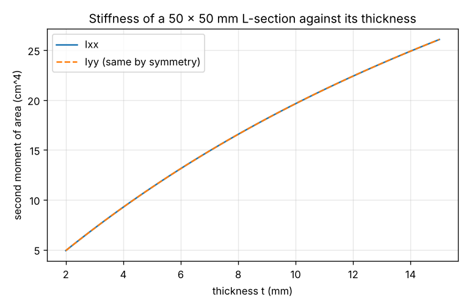
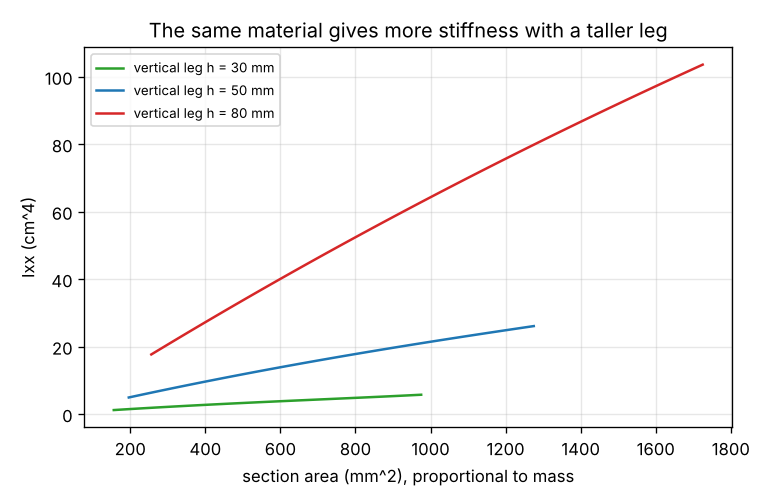

# Session 2: From an outline to the properties of a solid: area, centroid and stiffness

*Level 3 (simulation and validation) · about 75 minutes · opensolidmodel*

> This is a simplified educational model. It is not a validated design tool and must not be used for real structures, electrical installations, vehicles, industrial processes or medical decisions.

**Prerequisites**

- Session 1, or the idea of a part rebuilt from parameters.
- The area of a rectangle and a circle, and what a centre (centroid) of a flat shape is.
- Sums with a Greek sigma, which are explained when they first appear.

**Learning objectives.** After this session you can:

- Compute the area, centroid and second moments of area of a polygon from its corner points.
- Combine several shapes, adding material and removing holes, with the parallel-axis rule.
- Explain why the second moment of area, and not the area alone, decides how stiff a section is in bending.
- Extrude a section to a solid and find its mass and the bending stress in it.

## A. Real-world problem
A shelf bracket is cut from an L-shaped steel section. Two sections with the same mass can bend very differently under the same load. Which numbers of the outline decide how stiff it is, and how do we compute them from the corner points of a sketch? For an L of 50 x 50 x 5 mm carrying a bending moment of 100 N m, how large is the stress?

## B. Concept and theory
A sketch outline is a list of corner points joined by straight edges, and a hole is a circle. Three numbers describe how the area is spread. The area A is the amount of material. The centroid (Cx, Cy) is the balance point of the outline. The second moment of area Ixx = integral of y^2 dA, with y measured from the horizontal line through the centroid, measures how far the material lies from that line, squared. In bending, the stress at a distance c from the neutral axis is sigma = M c / Ixx, so for the same moment M a section with a larger Ixx has smaller stress and bends less. For corner points listed counter-clockwise, with cross_i = x_i y_(i+1) - x_(i+1) y_i, the area is A = 1/2 sum cross_i, and the centroid and the moments about the origin follow from similar sums (the formulas are in the lesson). A hole is a shape whose moments are subtracted. To move the second moment from the origin to the centroid we use the parallel-axis rule, Ixx = Ix0 - A Cy^2. An extruded section of length l has the volume A l and the mass rho A l. The key idea is that Ixx weights each piece of area by the square of its distance from the axis, so material far from the axis is far more useful than material near it.

| Symbol | Meaning | Unit |
|---|---|---|
| A | area of the section | mm^2 |
| Cx, Cy | centroid of the section | mm |
| Ixx, Iyy | second moment of area about the horizontal and vertical lines through the centroid | mm^4 |
| M | bending moment | N mm (1 N m = 1000 N mm) |
| c | distance from the neutral axis to the outer edge | mm |
| sigma | bending stress, M c / Ixx | MPa (N/mm^2) |
| l | length of the extruded part | mm |

**Assumptions**

- The outline is flat, with straight edges and round holes, and the holes lie inside it.
- The section is uniform along its length (a simple extrusion).
- Bending is about the horizontal axis through the centroid and the material is elastic, so the stress is sigma = M c / Ixx.
- Steel with a density of 7850 kg/m^3; nothing about buckling or connections is checked.

$$ A = \tfrac12\sum_i \left(x_i y_{i+1} - x_{i+1} y_i\right) $$

$$ I_{xx} = I_{x0} - A\,C_y^{2}\qquad\text{(parallel-axis rule)} $$

$$ \sigma = \frac{M\,c}{I_{xx}},\qquad m = \rho\,A\,\ell\cdot 10^{-9} $$

## C. Visual explanation
The first figure shows Ixx of a 50 x 50 mm L-section rising with its thickness t: a thin section is flexible and a thick one is stiff, but the curve also costs material. The second figure plots Ixx against the area, which is proportional to mass, for three heights of the vertical leg. At the same area, the taller leg is stiffer, because its material lies farther from the neutral axis.

*Ixx and Iyy of a 50 x 50 L-section against its thickness.*

*Ixx against the area for three leg heights: the same material, more stiffness.*

## D. Interactive simulation
Run the lesson (`python start.py 2`), then open the live app: [Session 2: from an outline to stiffness](https://krunalpanchal1995.github.io/pan-iit-oss/opensolidmodel/session-02/) (or `app.html` in this folder). Change the legs and the thickness and watch the centroid and the neutral axis move. Compare the L with a solid square of the same area in the bar chart.

**Challenge.** Carry a bending moment of at least 100 N m with a bending stress of at most 25 MPa, using at most 3 kg of steel per metre.

## E. Worked example and experiment
**Problem.** An L-section has a horizontal leg b = 60 mm, a vertical leg h = 40 mm and a thickness t = 10 mm. Find the area, the centroid, Ixx and Iyy, and the mass of a 300 mm length of steel.

1. Split it into two rectangles: the horizontal leg 60 x 10 (area 600 mm2, centre (30, 5)) and the rest of the vertical leg 10 x 30 (area 300 mm2, centre (5, 25)).
2. Area: 600 + 300 = 900 mm2.
3. Centroid: Cx = (600 x 30 + 300 x 5) / 900 = 21.67 mm and Cy = (600 x 5 + 300 x 25) / 900 = 11.67 mm.
4. Ixx: 60 x 10^3 / 12 + 600 x (11.67 - 5)^2 + 10 x 30^3 / 12 + 300 x (25 - 11.67)^2 = 5000 + 26667 + 22500 + 53333 = 107500 mm4.
5. Iyy: 10 x 60^3 / 12 + 600 x (30 - 21.67)^2 + 30 x 10^3 / 12 + 300 x (21.67 - 5)^2 = 180000 + 41667 + 2500 + 83333 = 307500 mm4.
6. Mass: 7850 x 900 x 300 x 1e-9 = 2.12 kg. The lesson code, which uses the polygon sums, gives the same numbers.

**Answer.** A = 900 mm2, centroid (21.67, 11.67) mm, Ixx = 107 500 mm4, Iyy = 307 500 mm4 and a mass of 2.12 kg for 300 mm.

**Experiment.** Compare two pieces of cardboard or a plastic ruler. Lay a ruler flat across two books 20 cm apart and press in the middle with the same weight (a mug) on a flat ruler and on the same ruler standing on its edge. The flat ruler bends a lot, the one on its edge hardly at all, although the mass and the material are the same: Ixx = b h^3 / 12 depends on the height h cubed. Be careful: a tall thin section can twist or buckle sideways, which this model does not describe.

## F. Assessment and design challenge
**Question type A: Conceptual.** Two sections have the same area. Why can one be much stiffer in bending than the other?

Hint

Compare how Ixx weights a piece of material at distance y from the axis.

Step-by-step solution

Ixx is the sum of y^2 dA: each piece of area counts with the square of its distance from the neutral axis. Material far from the axis counts a lot and material near the axis almost nothing. A solid square of the area 475 mm2 has Ixx = A^2 / 12 = 18802 mm4, while an L of 50 x 50 x 5 with the same area has 112503 mm4, about 6 times as much, because its legs reach far from the centroid.

**Question type B: Numerical.** A flat steel plate is 100 mm wide and 20 mm thick, with a 10 mm hole at its centre. Find its area and Ixx about the horizontal line through the centre.

Hint

Ixx = b h^3 / 12 for the rectangle, minus pi r^4 / 4 for the round hole whose centre is on the axis.

Step-by-step solution

Area: 100 x 20 - pi x 5^2 = 2000 - 78.54 = 1921.5 mm2. Ixx = 100 x 20^3 / 12 - pi x 5^4 / 4 = 66 667 - 491 = 66176 mm4. The hole removes 3.9 percent of the area but only 0.7 percent of the stiffness, because it lies on the neutral axis where material matters least. Check: the lesson code, which treats the hole as a circle, gives the same number.

**Question type C: Graph and simulation interpretation.** On the graph of Ixx against the area, compare three L-sections with a 50 mm horizontal leg and vertical legs of 30, 50 and 80 mm, all with the area 475 mm2. Which is stiffest, and by how much?

Hint

Read the three curves at the same area, or find the thickness t that gives 475 mm2 for each leg.

Step-by-step solution

The thickness that gives 475 mm2 is t = 6.46 mm for h = 30, 5.00 mm for h = 50 and 3.76 mm for h = 80. The matching values are Ixx = 31405, 112503 and 320954 mm4. So the 80 mm leg is 2.9 times as stiff as the 50 mm leg and 10 times as stiff as the 30 mm leg for the same mass. A taller leg with a thinner wall is the better use of material, until it buckles, which the model does not show.

**Question type D: Design and optimisation challenge.** Design: a 50 x 50 mm L-section needs Ixx of at least 150 000 mm4. Find the smallest thickness, and say what the extra stiffness costs in material.

Hint

Try t from 5 mm upward with the lesson code, or find where the curve of Figure 1 reaches 15 cm4.

Step-by-step solution

Ixx reaches 150 000 mm4 at t = 7.06 mm, so t = 7.1 mm is enough (7.0 mm is not). The area is then 656 mm2, which is 5.15 kg per metre. Compared with the 5 mm section (475 mm2, 3.73 kg/m), a gain of 33 percent in stiffness costs 38 percent more material. Assumption: the same 50 mm legs; a taller leg would be a cheaper way to gain stiffness, as in Question C.

Score yourself with [RUBRIC.md](../../RUBRIC.md). Print the [activity sheet](activity_sheet.md) to work on paper.

## Common misconceptions
| Common misconception | What is actually true |
|---|---|
| A heavier section is always stiffer. | Stiffness depends on where the material is. Question C shows three sections with the same mass whose stiffness differs by a large factor. |
| The centroid is the middle of the bounding box. | It is the balance point of the area. For an L it lies well inside the corner, at 14.3 mm for a 50 x 50 x 5 section, not at 25 mm. |
| The stiffness of a section is the same in every direction. | Ixx and Iyy differ unless the shape is symmetric: the L of Worked Example has Iyy almost three times Ixx. |
| A hole always weakens a beam by the percentage of area it removes. | A hole on the neutral axis removes very little stiffness. Where the hole sits matters as much as its size. |

## Glossary
- **centroid**: the balance point of a flat shape
- **second moment of area**: the sum of y^2 dA; how far the material is from the axis, squared
- **neutral axis**: the line through the centroid that does not stretch when the beam bends
- **parallel-axis rule**: I about the centroid = I about another parallel axis - A d^2
- **extrusion**: sweeping a flat outline along a straight line to make a solid
- **MPa**: megapascal, 1 N per square millimetre

## Finish
1. Do the three coding tasks in [exercises.md](exercises.md).
2. Run `python start.py 2` again after your changes. It ends with the checkpoint; when it prints `PASS`, you are done. (Checkpoint only: `python start.py check 2`.)

Next: [Session 3](../session-03/README.md)
