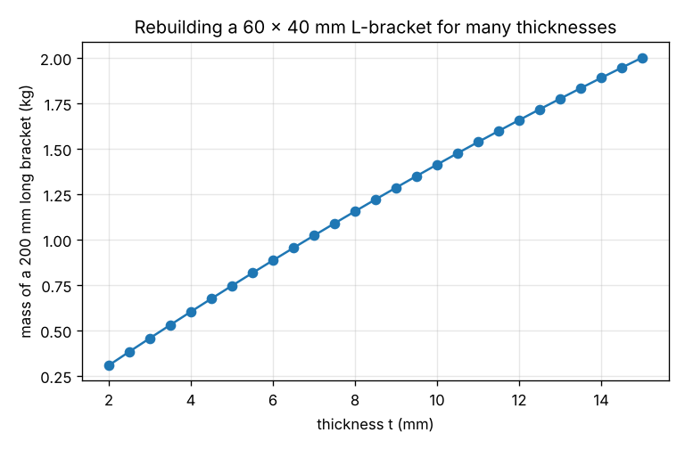
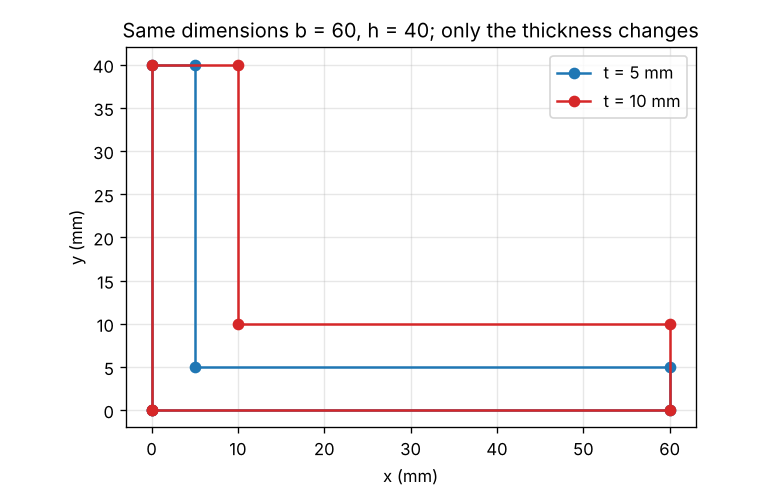

# Session 3: How a sketch keeps its corners where you told it: a constraint solver

*Level 3 (simulation and validation) · about 75 minutes · opensolidmodel*

> This is a simplified educational model. It is not a validated design tool and must not be used for real structures, electrical installations, vehicles, industrial processes or medical decisions.

**Prerequisites**

- Sessions 1 and 2, or the idea of an outline made of corner points.
- Distance between two points (Pythagoras) and what perpendicular means.
- A table of numbers (a matrix) and the idea of solving equations; the lesson explains Newton's method for several unknowns step by step.

**Learning objectives.** After this session you can:

- Write sketch statements (fixed, distance, horizontal, vertical, perpendicular) as equations that must be zero.
- Explain Newton's method for several unknowns and why it needs a good first guess.
- Count the degrees of freedom of a sketch from the rank of the Jacobian and tell fully constrained from under-constrained.
- Recognise redundant and contradicting statements, and rebuild a parametric L-bracket by solving again.

## A. Real-world problem
In a CAD sketch you do not type coordinates. You say 'this line is horizontal, this one is 40 mm long, these two are perpendicular', and the program finds the corner points. When you change 40 to 60, the points move and the sketch stays consistent. How can a program find the points from such statements, know whether you have said enough, and notice when two statements contradict each other? What are the six corner points of an L-bracket of 50 x 50 x 5 mm, and how much does a 200 mm length weigh?

## B. Concept and theory
The unknowns are all the coordinates (x0, y0, x1, y1, ...). Each statement is turned into one or two residuals, numbers that are zero when the statement is true: 'point i is at (X, Y)' gives x_i - X and y_i - Y; 'points i and j are d apart' gives |p_j - p_i| - d; 'the line i-j is horizontal' gives y_j - y_i; 'vertical' gives x_j - x_i; and 'the angle i-j-k is 90 degrees' gives (p_i - p_j) . (p_k - p_j). We need the points where all residuals are zero together. Newton's method does this from a first guess x: compute the vector of residuals r and the Jacobian J, the table of how each residual changes with each coordinate; solve J dx = -r for the correction dx (least squares, which takes the smallest correction when there is freedom left); move x by dx and repeat until r is zero. A step that makes the residual worse is halved. The first guess matters because several sketches satisfy the same statements, for example a mirror image, and Newton's method finds the one near the guess. At the solution the rank of J counts the independent statements: degrees of freedom = 2 x (number of points) - rank(J). Zero means the sketch is fully constrained, more than zero means it can still be dragged. If there are more statements than the rank, some are redundant (fine if they agree), and if the residuals cannot be brought to zero the statements contradict each other.

| Symbol | Meaning | Unit |
|---|---|---|
| x | all point coordinates in one list (x0, y0, x1, y1, ...) | mm |
| r | vector of residuals, zero when the statements are true | mm |
| J | Jacobian: change of each residual per change of each coordinate | no unit |
| dx | Newton correction, found from J dx = -r | mm |
| DOF | degrees of freedom = 2 (number of points) - rank(J) | no unit |
| b, h, t | legs and thickness of the L-bracket | mm |

**Assumptions**

- The sketch is in a plane and made of points joined by straight lines.
- Only five kinds of statement are supported: fixed point, distance, horizontal, vertical and perpendicular.
- Newton's method starts from a rough guess that is close to the wanted sketch.
- A sketch has at most a few dozen points; the solver uses dense tables of numbers.

$$ \mathbf r(\mathbf x) = \mathbf 0,\qquad \mathbf r\ \text{from}\ x_i - X,\ \ |p_j - p_i| - d,\ \ y_j - y_i,\ \ x_j - x_i,\ \ (p_i - p_j)\cdot(p_k - p_j) $$

$$ J\,\Delta\mathbf x = -\mathbf r,\qquad \mathbf x \leftarrow \mathbf x + \Delta\mathbf x $$

$$ \mathrm{DOF} = 2n_{\text{points}} - \operatorname{rank}(J) $$

## C. Visual explanation
The first figure plots the mass of a 60 x 40 mm L-bracket, 200 mm long, for 27 thicknesses, each found by solving the sketch again from the previous solution. The second figure shows the same sketch for two thicknesses: the points move so that every length stays true, and the shape keeps its orientation.

*Mass of a 200 mm long L-bracket against its thickness, rebuilt by the solver.*

*The same L-bracket sketch for two thicknesses.*

## D. Interactive simulation
Run the lesson (`python start.py 3`), then open the live app: [Session 3: a sketch constraint solver](https://krunalpanchal1995.github.io/pan-iit-oss/opensolidmodel/session-03/) (or `app.html` in this folder). Change the dimensions and watch the solver move the six points from the rough first guess (dashed) to the solved sketch, with the number of Newton steps in the readout.

**Challenge.** Make a bracket at least 8 mm thick and at least 150 mm long that weighs at most 0.8 kg.

## E. Worked example and experiment
**Problem.** A triangle has one corner p0 fixed at the origin, p1 on the horizontal axis 4 mm from it, p2 at 3 mm from p0 and 5 mm from p1. Which statements does that make, and where are the points? Then find the area of the L-bracket 50 x 50 x 5 and its mass for 200 mm.

1. Statements: fix p0 at (0, 0) (2 residuals), p0-p1 horizontal (1), |p0 p1| = 4 (1), |p0 p2| = 3 (1), |p1 p2| = 5 (1): six residuals for six coordinates, so the sketch can be fully constrained.
2. Newton's method from the rough guess (0, 0), (3, 0.5), (0.5, 2) converges in 4 steps to p1 = (4, 0) and p2 = (0, 3): the 3-4-5 triangle, with a right angle at p0 that we never asked for.
3. A guess with p2 below the axis gives the mirror image p2 = (0, -3): the guess chooses between valid sketches.
4. L-bracket: 6 points, 12 coordinates; p0 is fixed (2), five lines are horizontal or vertical (5) and five lengths are given (5): 12 equations, so DOF = 0. The solver gives [[0.0, -0.0], [50.0, -0.0], [50.0, 5.0], [5.0, 5.0], [5.0, 50.0], [0.0, 50.0]].
5. Area from the corner points by the shoelace formula: 475 mm2, equal to b t + (h - t) t = 250 + 225. Mass of 200 mm: 7850 x 475 x 200 x 1e-9 = 0.746 kg.

**Answer.** The triangle is (0, 0), (4, 0), (0, 3); the L-bracket is fully constrained with area 475 mm2 and a mass of 0.746 kg for 200 mm.

**Experiment.** Cut two strips of card, 100 mm and 70 mm long, and join them end to end with a paper fastener. Pin the free end of the long strip to a sheet of paper. The far end of the short strip can be moved around: the linkage has 2 degrees of freedom, the two strip angles. Now pin the far end at a point 120 mm from the first pin. Both angles are fixed except for one choice: the elbow can bend up or down, two mirror-image sketches, exactly as in the lesson. Try a point 200 mm away: the strips cannot reach it, which is a set of statements that contradict each other.

## F. Assessment and design challenge
**Question type A: Conceptual.** A sketch of three points has p0 fixed, p0-p1 horizontal and the two distances |p0 p1| = 4 and |p0 p2| = 3. How many degrees of freedom are left, and what can you drag?

Hint

Count the unknowns (6) and the independent statements (2 + 1 + 1 + 1).

Step-by-step solution

There are 6 unknowns and 5 independent residuals, so the degrees of freedom are 6 - 5 = 1. In the solver, the triangle without its last distance shows exactly this: under-constrained: 1 degree(s) of freedom left. What can still move is p2 on the circle of radius 3 around p0. Adding |p1 p2| = 5 fixes it at (0, 3) or its mirror image (0, -3).

**Question type B: Numerical.** Why does the solver need a first guess, and what happens if the first guess has the corner p2 below the axis?

Hint

Think about the 3-4-5 triangle: how many sketches satisfy all the statements?

Step-by-step solution

Newton's method looks for zeros of the residuals near its start. Two sketches, p2 = (0, 3) and p2 = (0, -3), satisfy all five statements (a reflection in the horizontal axis keeps every length and every angle), so the equations alone cannot choose, and the guess does. A guess with p2 below the axis converges to (0, -3). When the dimensions are edited, solving again from the previous solution keeps the sketch from flipping.

**Question type C: Graph and simulation interpretation.** To the 3-4-5 triangle add the statement that the angle at p0 is 90 degrees. What does the solver report, and why is this not an error? Then change |p1 p2| = 5 to 8: what happens?

Hint

Compare the number of statements with the rank, and look at the residual after the last step.

Step-by-step solution

The right angle is already a consequence of the lengths 3, 4 and 5, so the new statement is redundant: the solver reports 'fully constrained (1 redundant, consistent)', and the sketch is unchanged. With |p1 p2| = 8 no triangle has the sides 3, 4 and 8 (3 + 4 is less than 8), so the residual cannot be brought to zero and the solver reports a contradiction with a residual of 2.1. In a CAD program the same is shown as an over-defined sketch, usually with the conflicting statements highlighted.

**Question type D: Design and optimisation challenge.** Design: a 60 x 40 mm L-bracket, 200 mm long, must weigh at most 0.8 kg. Find the largest thickness, to 0.01 mm, using area = b t + (h - t) t.

Hint

Area = 100 t - t^2 for these legs; the mass is 7850 x area x 200 x 1e-9. Solve the quadratic equation or try values with `bracket_mass_kg`.

Step-by-step solution

The largest area is 0.8 / (7850 x 200 x 1e-9) = 509.6 mm2. Solving t^2 - 100 t + 509.6 = 0 gives t = 5.39 mm (the other root, 94.6 mm, is larger than the legs). The solver agrees: t = 5.38 mm weighs 0.7992 kg and t = 5.39 mm weighs 0.8006 kg. For comparison, t = 5 mm weighs 0.746 kg and t = 10 mm weighs 1.413 kg. Assumption: steel and a sharp inside corner.

Score yourself with [RUBRIC.md](../../RUBRIC.md). Print the [activity sheet](activity_sheet.md) to work on paper.

## Common misconceptions
| Common misconception | What is actually true |
|---|---|
| A sketch constraint solver finds the one answer. | It finds an answer near the first guess. Several sketches, such as a mirror image, can satisfy the same statements. |
| A sketch that moves when you drag it is wrong. | It is under-constrained: not enough statements were given. That is correct information, and the degrees of freedom say how many are missing. |
| A redundant statement is always an error. | If it agrees with the others it is harmless; only a statement that contradicts the others makes the solve fail. |
| Newton's method always converges. | It needs a good start. A very bad guess can leave the residual stuck, which is why the solver shortens steps that make things worse and stops with an error when it cannot reach zero. |

## Glossary
- **constraint**: a statement about the sketch, such as 'this line is horizontal'
- **residual**: a number that is zero when a statement is true
- **Jacobian**: the table of how each residual changes when each coordinate changes
- **Newton's method**: repeated correction using J dx = -r
- **degrees of freedom**: how many independent ways the sketch can still move
- **fully constrained**: zero degrees of freedom: the shape is fixed

## Finish
1. Do the three coding tasks in [exercises.md](exercises.md).
2. Run `python start.py 3` again after your changes. It ends with the checkpoint; when it prints `PASS`, you are done. (Checkpoint only: `python start.py check 3`.)

Next: the [roadmap](../../promo/roadmap.md): Sessions 4 and up are yours to build.
