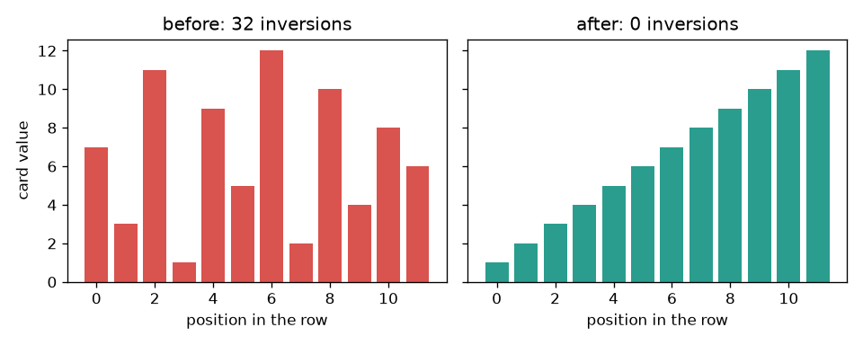
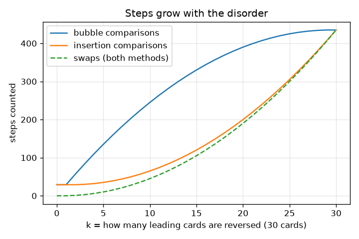

# सत्र 1: हाथ से पत्तों को क्रम में लगाना एक एल्गोरिदम है

*स्तर 1 (वैचारिक इंटरैक्टिव मॉडल) · लगभग 60 मिनट · opensorting*

> यह एक सरलीकृत शैक्षिक मॉडल है। यह कोई प्रमाणित डिज़ाइन उपकरण नहीं है और इसका उपयोग वास्तविक संरचनाओं, विद्युत स्थापनाओं, वाहनों, औद्योगिक प्रक्रियाओं या चिकित्सा संबंधी निर्णयों के लिए नहीं किया जाना चाहिए।

**पूर्वापेक्षाएँ (Prerequisites)**

- संख्याएँ गिनना और उनकी तुलना करना।
- आपने PRIMER.md पढ़ लिया है और `python start.py 1` एक बार चला लिया है।

**सीखने के उद्देश्य (Learning objectives)।** इस सत्र के बाद आप:

- बबल सॉर्ट (bubble sort) और इंसर्शन सॉर्ट (insertion sort) को ऐसे चरण-दर-चरण नियमों के रूप में बता सकेंगे जिनका कोई भी पालन कर सके।
- पत्तों की एक छोटी पंक्ति के लिए हाथ से और Python में तुलनाएँ (comparisons) और अदला-बदली (swaps) गिन सकेंगे।
- समझा सकेंगे कि अदला-बदली की संख्या गलत क्रम वाले युग्मों की संख्या के बराबर क्यों होती है।
- एक दंड चित्र (bar picture) और पंक्ति कितनी अव्यवस्थित है इसके सापेक्ष चरणों का ग्राफ़ पढ़ सकेंगे।

## A. वास्तविक दुनिया की समस्या
आपको पाँच पत्ते बाँटे जाते हैं और आप बिना सोचे उन्हें क्रम में लगा देते हैं। कंप्यूटर सोच नहीं सकता, इसलिए उसे नियम ठीक-ठीक लिखे हुए चाहिए। नियमों के दो समूह पालन करने में आसान हैं: पड़ोसियों को देखिए और यदि वे गलत क्रम में हों तो उन्हें बदल दीजिए (बबल सॉर्ट), या हर नया पत्ता लीजिए और उसे तब तक बाईं ओर खिसकाइए जब तक वह फ़िट न हो जाए (इंसर्शन सॉर्ट)। दोनों एक ही क्रमबद्ध पंक्ति देते हैं। क्या वे समान संख्या में चरण लेते हैं? और क्या यह इस पर निर्भर करता है कि शुरुआत में पत्ते कितने मिले-जुले थे?

## B. अवधारणा और सिद्धांत
n पत्तों की पंक्ति तब क्रमबद्ध (sorted) है जब कोई भी पत्ता अपने दाएँ वाले पत्ते से बड़ा न हो। एक तुलना दो पत्तों को देखती है। एक अदला-बदली दो पड़ोसियों को बदलती है। बबल सॉर्ट पंक्ति पर चलता है और गलत क्रम वाले पड़ोसियों को बदलता है, इसलिए सबसे बड़ा पत्ता बुलबुले की तरह अंत तक पहुँच जाता है; वह बची हुई छोटी पंक्ति पर दोहराता है, और बिना अदला-बदली वाले चक्कर के बाद जल्दी रुक जाता है। इंसर्शन सॉर्ट अगला पत्ता लेता है और उसे हर बड़े पत्ते के पार एक-एक स्थान बाईं ओर खिसकाता है। एक व्युत्क्रम (inversion) पत्तों का ऐसा युग्म है जिसमें बड़ा पत्ता छोटे के बाईं ओर है। दो पड़ोसियों की अदला-बदली ठीक एक व्युत्क्रम हटाती है, इसलिए दोनों विधियाँ उतनी ही अदला-बदली करती हैं जितने शुरुआत में व्युत्क्रम होते हैं। क्रमबद्ध पंक्ति में 0 व्युत्क्रम होते हैं; n पत्तों की उलटी पंक्ति में n(n-1)/2, जो संभव अधिकतम है।

| प्रतीक | अर्थ | इकाई |
|---|---|---|
| n | पंक्ति में पत्तों की संख्या | पत्ते |
| k | शुरुआत के कितने पत्ते उलटे क्रम में शुरू होते हैं | पत्ते |
| comparisons | कितनी बार दो पत्तों को देखा गया | गिनती |
| swaps | कितनी बार दो पड़ोसियों को बदला गया | गिनती |
| inversions | गलत क्रम वाले पत्तों के युग्म | गिनती |

**मान्यताएँ (Assumptions)**

- पत्ते संख्याएँ हैं और 'से कम' से उनकी तुलना की जा सकती है।
- एक अदला-बदली केवल दो पड़ोसी पत्तों को (एक स्थान) खिसकाती है।
- हर तुलना और हर अदला-बदली एक चरण गिनी जाती है, वास्तविक कंप्यूटर के लिए उसकी लागत चाहे जो हो।
- यह इस बात का सरलीकृत शैक्षिक मॉडल है कि क्रमबद्ध करना कितना तेज़ है।

$$ \text{swaps}=\text{inversions}=\#\{(i,j):\ i<j,\ a_i>a_j\} $$

$$ \text{inversions of a reversed row}=\frac{n(n-1)}{2} $$

$$ \text{bubble sort on a sorted row: } n-1 \text{ comparisons, } 0 \text{ swaps} $$

## C. दृश्य व्याख्या
बायाँ चित्र 12 पत्तों की एक पंक्ति को क्रमबद्ध करने से पहले और बाद में दंडों के रूप में दिखाता है: मिली हुई पंक्ति में गलत क्रम वाले 32 युग्म हैं और क्रमबद्ध पंक्ति में कोई नहीं। दायाँ चित्र 30 पत्तों की पंक्ति के लिए गिने गए चरणों को आलेखित करता है जैसे-जैसे उसका अगला भाग अधिक से अधिक उलटा किया जाता है। अदला-बदली वक्र (दोनों विधियों के लिए समान) सहजता से बढ़ता है; बबल सॉर्ट की तुलनाएँ इंसर्शन सॉर्ट की तुलनाओं से बहुत ऊपर रहती हैं जब तक पूरी पंक्ति उलटी न हो जाए, जहाँ दोनों 435 तक पहुँचती हैं।

*दंडों के रूप में 12 पत्तों की पंक्ति: पहले गलत क्रम वाले 32 युग्म, बाद में कोई नहीं।*

*जैसे-जैसे अगला भाग अधिक उलटा होता है, 30 पत्तों के लिए गिने गए चरण: अदला-बदली दोनों विधियों के लिए समान है, तुलनाएँ नहीं।*

## D. इंटरैक्टिव सिमुलेशन
पाठ चलाइए (`python start.py 1`), फिर लाइव ऐप खोलिए: [सत्र 1: पत्तों की एक पंक्ति क्रमबद्ध कीजिए](https://krunalpanchal1995.github.io/pan-iit-oss/opensorting/session-01/) (या इसी फ़ोल्डर में `app.html`)। पत्तों की संख्या और पंक्ति का कितना भाग मिला-जुला शुरू होता है, यह बदलने के लिए स्लाइडर खिसकाइए। दंडों को हरे (सही स्थान पर) से लाल होते देखिए, फिर चरणों का ग्राफ़ खोलिए और दोनों विधियों की तुलना कीजिए।

**चुनौती।** दोनों विधियों को 400 से अधिक अदला-बदली की आवश्यकता वाला बनाइए।

## E. हल किया गया उदाहरण और प्रयोग
**समस्या।** पत्तों 5 2 4 1 3 को बबल सॉर्ट से और इंसर्शन सॉर्ट से क्रमबद्ध कीजिए। हर एक के लिए तुलनाएँ और अदला-बदली गिनिए, और गलत क्रम वाले युग्मों की संख्या से जाँचिए।

1. गलत क्रम वाले युग्म: (5,2), (5,4), (5,1), (5,3), (2,1), (4,1), (4,3), इसलिए 7 व्युत्क्रम। दोनों विधियों को 7 अदला-बदली करनी होंगी।
2. बबल चक्कर 1 तुलना करता है (5,2) अदला-बदली, (5,4) अदला-बदली, (5,1) अदला-बदली, (5,3) अदला-बदली: 4 तुलनाएँ, 4 अदला-बदली, पंक्ति 2 4 1 3 5।
3. बबल चक्कर 2 तुलना करता है (2,4) अदला-बदली नहीं, (4,1) अदला-बदली, (4,3) अदला-बदली: 3 तुलनाएँ, 2 अदला-बदली, पंक्ति 2 1 3 4 5। चक्कर 3 तुलना करता है (2,1) अदला-बदली, (2,3) अदला-बदली नहीं: 2 तुलनाएँ, 1 अदला-बदली, पंक्ति 1 2 3 4 5। चक्कर 4 तुलना करता है (1,2): 1 तुलना, कोई अदला-बदली नहीं, इसलिए वह रुक जाता है। कुल 4 + 3 + 2 + 1 = 10 तुलनाएँ और 4 + 2 + 1 = 7 अदला-बदली।
4. इंसर्शन सॉर्ट: 2 को 1 तुलना (अदला-बदली) लगती है; 4 को 2 तुलनाएँ चाहिए (एक अदला-बदली); 1, 5, 4 और 2 के पार खिसकता है (3 तुलनाएँ, 3 अदला-बदली); 3, 5 और 4 के पार खिसकता है और 2 पर रुकता है (3 तुलनाएँ, 2 अदला-बदली)। कुल 1 + 2 + 3 + 3 = 9 तुलनाएँ और 1 + 1 + 3 + 2 = 7 अदला-बदली।

**उत्तर।** बबल सॉर्ट: 10 तुलनाएँ और 7 अदला-बदली। इंसर्शन सॉर्ट: 9 तुलनाएँ और 7 अदला-बदली। दोनों की अदला-बदली की संख्या 7 व्युत्क्रमों के बराबर है।

**प्रयोग।** पाँच असली पत्ते बाँटिए, उन पर संख्याएँ 5 2 4 1 3 लिखिए और हर नियम से उन्हें क्रमबद्ध कीजिए, ज़ोर से गिनते हुए। आपको 10 और 9 तुलनाएँ मिलनी चाहिए। एक व्यक्ति आमतौर पर कम तुलनाएँ करता है क्योंकि आँख पूरी पंक्ति एक साथ देखती है। मॉडल केवल एक सख़्त नियम के चरण गिनता है; मनुष्य ऐसे शॉर्टकट उपयोग करता है जो प्रोग्राम नहीं कर सकता।

## F. मूल्यांकन और डिज़ाइन चुनौती
**प्रश्न प्रकार A: वैचारिक।** पत्तों 5 2 4 1 3 के लिए बबल सॉर्ट और इंसर्शन सॉर्ट को ठीक समान संख्या में अदला-बदली की आवश्यकता क्यों होती है, जबकि वे अलग तरह से काम करते हैं?

संकेत

सोचिए कि दो पड़ोसियों की एक अदला-बदली गलत क्रम वाले युग्मों के साथ क्या करती है।

चरण-दर-चरण हल

दो पड़ोसी पत्तों की अदला-बदली केवल उसी एक युग्म का क्रम बदलती है, और जब बायाँ पत्ता बड़ा होता है तो वह उस युग्म को ठीक कर देती है। इसलिए हर अदला-बदली गलत क्रम वाला ठीक एक युग्म हटाती है। पंक्ति 5 2 4 1 3 ऐसे 7 युग्मों से शुरू होती है और किसी पर भी समाप्त नहीं होती, इसलिए केवल पड़ोसियों की अदला-बदली करने वाली किसी भी विधि को ठीक 7 अदला-बदली चाहिए। विधियाँ केवल इसमें अलग हैं कि वे कितनी तुलनाएँ व्यर्थ करती हैं (बबल सॉर्ट के लिए 10, इंसर्शन सॉर्ट के लिए 9)।

**प्रश्न प्रकार B: संख्यात्मक।** 30 पत्तों की एक पंक्ति पूरी तरह उलटी है (30 से 1 तक)। इंसर्शन सॉर्ट को कितनी तुलनाएँ और अदला-बदली चाहिए? एक सूत्र से अपना उत्तर जाँचिए।

संकेत

हर युग्म गलत क्रम में है। 30 पत्तों में कितने युग्म हैं?

चरण-दर-चरण हल

30 पत्तों में युग्मों की संख्या 30 * 29 / 2 = 435 है। ये सभी गलत क्रम में हैं, इसलिए 435 अदला-बदली चाहिए, और इंसर्शन सॉर्ट हर पत्ते की तुलना उसके बाईं ओर के हर पत्ते से करता है, इसलिए 435 तुलनाएँ भी हैं। इकाई: चरणों की गिनती। जाँच: 30 की क्रमबद्ध पंक्ति को केवल 29 तुलनाएँ चाहिए, इसलिए 435 बहुत बड़ा है, जैसा सबसे खराब स्थिति के लिए होना चाहिए।

**प्रश्न प्रकार C: ग्राफ़ और सिमुलेशन की व्याख्या।** 30 पत्तों के चरण ग्राफ़ में, k = 10 पर (पहले 10 पत्ते उलटे), किस विधि को कम तुलनाएँ चाहिए और कितनी कम? उन्हें कितनी अदला-बदली चाहिए?

संकेत

k = 10 पर लाल और नीले वक्र पढ़िए। अदला-बदली वक्र दोनों के लिए समान है।

चरण-दर-चरण हल

बबल सॉर्ट को 245 तुलनाएँ और इंसर्शन सॉर्ट को 65 चाहिए, इसलिए इंसर्शन सॉर्ट को 180 कम चाहिए। दोनों को 45 अदला-बदली = 10 * 9 / 2 चाहिए, गलत क्रम वाले युग्मों की संख्या। इंसर्शन सॉर्ट जीतता है क्योंकि पंक्ति का जो भाग पहले से क्रम में है, उसे प्रति पत्ता एक तुलना से पार कर लिया जाता है, जबकि बबल सॉर्ट उसमें बार-बार चलता रहता है।

**प्रश्न प्रकार D: डिज़ाइन और अनुकूलन चुनौती।** डिज़ाइन: एक शिक्षक आपको 30 पत्ते देता है जो क्रमबद्ध हैं सिवाय इसके कि पहले 20 उलटे क्रम में हैं। आपको बबल सॉर्ट या इंसर्शन सॉर्ट चुनना है और कक्षा को बताना है कि कितनी तुलनाओं की अपेक्षा करें। आप कौन सा चुनेंगे और क्यों? यदि पत्ते पहले से क्रमबद्ध होते तो आप क्या चुनते?

संकेत

'पहले 20 उलटे' पैटर्न का उपयोग कीजिए और दोनों विधियों की तुलनाओं की तुलना कीजिए; दूसरे भाग के लिए क्रमबद्ध पंक्ति पर तुलनाएँ गिनिए।

चरण-दर-चरण हल

30 में से पहले 20 पत्ते उलटे होने पर गलत क्रम वाले 20 * 19 / 2 = 190 युग्म हैं, इसलिए दोनों विधियाँ 190 बार अदला-बदली करती हैं। बबल सॉर्ट को 390 तुलनाएँ और इंसर्शन सॉर्ट को 200 चाहिए, इसलिए इंसर्शन सॉर्ट चुनिए: लगभग आधा काम। पहले से क्रमबद्ध पंक्ति के लिए दोनों को केवल 29 तुलनाएँ और कोई अदला-बदली नहीं चाहिए, इसलिए चुनाव से कोई फ़र्क नहीं पड़ता। समझौता (trade-off): 30 पत्तों के लिए दोनों ठीक हैं, पर गिनतियाँ पत्तों की संख्या के वर्ग के साथ बढ़ती हैं, जिसे सत्र 2 समझाता है।

[RUBRIC.md](../../RUBRIC.md) से स्वयं को अंक दीजिए। कागज़ पर काम करने के लिए [गतिविधि पत्रक](activity_sheet.md) प्रिंट कीजिए।

## आम भ्रांतियाँ
| आम भ्रांति | वास्तव में क्या सच है |
|---|---|
| एक पंक्ति को क्रमबद्ध करने में हमेशा समान संख्या में चरण लगते हैं। | चरण इस पर निर्भर करते हैं कि शुरुआत में पंक्ति कितनी मिली-जुली है: 30 पत्तों की क्रमबद्ध पंक्ति को 29 तुलनाएँ चाहिए, उलटी को 435। |
| एक ही क्रमबद्ध उत्तर देने वाले दो एल्गोरिदम को समान समय लेना चाहिए। | उत्तर वही है पर चरणों की संख्या बहुत अलग हो सकती है। वही अंतर यह रिपॉज़िटरी मापती है। |
| कम अदला-बदली का अर्थ हमेशा कम काम है। | तुलनाएँ भी गिनी जाती हैं, और बबल तथा इंसर्शन सॉर्ट समान अदला-बदली पर अलग संख्या में तुलनाएँ करते हैं। |
| बबल सॉर्ट क्रमबद्ध करने का सबसे अच्छा तरीका है क्योंकि वह सबसे सरल है। | उसका वर्णन करना सबसे सरल है, पर उसी पंक्ति पर उसे अक्सर इंसर्शन सॉर्ट से अधिक तुलनाएँ चाहिए। |

## शब्दावली
- **एल्गोरिदम (algorithm)**: सटीक चरणों की एक सूची जो किसी समस्या को हल करती है
- **तुलना (comparison)**: दो वस्तुओं को देखकर तय करना कि कौन बड़ी है
- **अदला-बदली (swap)**: दो वस्तुओं के स्थान आपस में बदलना
- **व्युत्क्रम (inversion)**: वस्तुओं का ऐसा युग्म जिसमें बड़ी वस्तु बाईं ओर हो
- **बबल सॉर्ट (bubble sort)**: गलत क्रम वाले पड़ोसियों की बार-बार अदला-बदली करना
- **इंसर्शन सॉर्ट (insertion sort)**: हर नई वस्तु को तब तक बाईं ओर खिसकाना जब तक वह अपने से पहले की क्रमबद्ध वस्तुओं में फ़िट न हो जाए

## समापन
1. [exercises.md](exercises.md) में दिए तीन कोडिंग कार्य कीजिए।
2. अपने बदलावों के बाद `python start.py 1` फिर से चलाइए। यह चेकपॉइंट (checkpoint) पर समाप्त होता है; जब यह `PASS` छापे, तो आपका काम पूरा है। (केवल चेकपॉइंट: `python start.py check 1`।)

अगला: [सत्र 2](../session-02/README.md)
