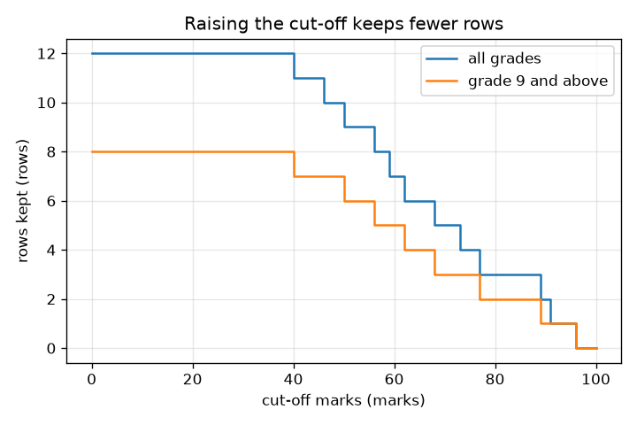
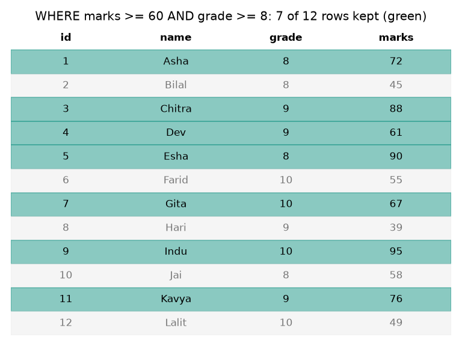

# सत्र 1: तालिका (table) एक ग्रिड है, क्वेरी (query) उससे एक प्रश्न पूछती है

*स्तर 1 (वैचारिक इंटरैक्टिव मॉडल) · लगभग 60 मिनट · opensql*

> यह एक सरलीकृत शैक्षिक मॉडल है। यह कोई प्रमाणित डिज़ाइन उपकरण नहीं है और इसका उपयोग वास्तविक संरचनाओं, विद्युत संस्थापनों, वाहनों, औद्योगिक प्रक्रियाओं या चिकित्सा निर्णयों के लिए नहीं किया जाना चाहिए।

**पूर्वापेक्षाएँ (Prerequisites)**

- स्प्रेडशीट (spreadsheet) का उपयोग किया हो: पंक्तियाँ और स्तंभ।
- आपने PRIMER.md पढ़ लिया है और एक बार `python start.py 1` चला लिया है।

**सीखने के उद्देश्य (Learning objectives)।** इस सत्र के बाद आप:

- तालिका का वर्णन पंक्तियों (rows) (रिकॉर्ड, records) और स्तंभों (columns) (फ़ील्ड, fields) के रूप में कर सकेंगे।
- SELECT ... FROM ... WHERE क्वेरी पढ़ और लिख सकेंगे।
- अनुमान लगा सकेंगे कि एक फ़िल्टर (filter) कितनी पंक्तियाँ रखता है, और साधारण Python से उसकी जाँच कर सकेंगे।
- कट-ऑफ़ (cut-off) के सापेक्ष रखी गई पंक्तियों का ग्राफ़ पढ़ सकेंगे।

## A. वास्तविक दुनिया की समस्या
एक स्कूल सैकड़ों विद्यार्थियों के अंक रखता है। शिक्षक पूछते हैं 'किसने कम-से-कम 60 अंक पाए?' या 'कौन कक्षा 9 या उससे ऊपर है और जिसने कम-से-कम 70 अंक पाए?'। कोई भी हर पंक्ति पढ़ना नहीं चाहता। एक डेटाबेस (database) पंक्तियों को एक तालिका में रखता है, और एक क्वेरी हमारे लिए प्रश्न पूछती है। हम प्रश्न को कैसे लिखें ताकि कंप्यूटर उसका उत्तर दे सके, और हमें कैसे पता चले कि उत्तर सही है? (यहाँ के सभी नाम और अंक कृत्रिम (synthetic) हैं।)

## B. अवधारणा और सिद्धांत
एक तालिका एक ग्रिड है। हर पंक्ति एक रिकॉर्ड है (एक विद्यार्थी) और हर स्तंभ एक तथ्य है (नाम, कक्षा, अंक) जो हर रिकॉर्ड के लिए संग्रहित है। एक क्वेरी तालिका से पूछा गया प्रश्न है। SQL में, SELECT बताता है कि कौन-से स्तंभ दिखाने हैं, FROM बताता है कि कौन-सी तालिका, और WHERE केवल वे पंक्तियाँ रखता है जिनके लिए कोई शर्त सत्य हो; बाक़ी पंक्तियाँ हटा दी जाती हैं। एक क्वेरी केवल पढ़ती है: वह तालिका को कभी नहीं बदलती। शर्तें तुलनाओं (>=, >, =) का उपयोग करती हैं और उन्हें AND (दोनों सत्य हों) या OR (कोई एक सत्य हो) से जोड़ा जा सकता है। हम हमेशा एक क्वेरी की जाँच एक स्वतंत्र गणना से करते हैं, यहाँ एक Python लिस्ट कॉम्प्रिहेंशन (list comprehension) और एक numpy मास्क (mask) से।

| प्रतीक | अर्थ | इकाई |
|---|---|---|
| m | शर्त marks >= m में अंकों का कट-ऑफ़ | अंक |
| g | शर्त grade >= g में कक्षा का कट-ऑफ़ | कक्षा |
| n_kept | फ़िल्टर पास करने वाली पंक्तियों की संख्या | पंक्तियाँ |
| N | तालिका में पंक्तियों की संख्या (12) | पंक्तियाँ |

**मान्यताएँ (Assumptions)**

- आँकड़े कृत्रिम हैं: 12 काल्पनिक विद्यार्थी।
- हर पंक्ति की एक अद्वितीय id है (प्राथमिक कुंजी (primary key), सत्र 2 में समझाई गई)।
- डेटाबेस मेमोरी में रहता है (sqlite3 के साथ :memory:) और प्रोग्राम समाप्त होने पर ग़ायब हो जाता है।

$$ n_{\text{kept}}=\left|\{\,r : \text{marks}(r)\ge m \ \wedge\ \text{grade}(r)\ge g\,\}\right| $$

$$ \text{percent kept}=100\,\frac{n_{\text{kept}}}{N} $$

## C. दृश्य व्याख्या
पहला चित्र 12-पंक्ति वाली तालिका दिखाता है, जिसमें 'marks >= 60 AND grade >= 8' पास करने वाली पंक्तियाँ हरी और अस्वीकृत पंक्तियाँ धूसर हैं: 12 में से 7 पंक्तियाँ बचती हैं। दूसरा चित्र कट-ऑफ़ के सापेक्ष रखी गई पंक्तियों की संख्या दिखाता है। यह एक सीढ़ी (staircase) है जो कट-ऑफ़ बढ़ने पर केवल नीचे जाती है, क्योंकि एक सख़्त शर्त कभी अधिक पंक्तियाँ नहीं रख सकती; दूसरा वक्र (कक्षा 9 और ऊपर) पहले के नीचे है।

*कट-ऑफ़ के सापेक्ष रखी गई पंक्तियाँ: एक सीढ़ी जो कट-ऑफ़ बढ़ने पर केवल गिरती है।*

*12-पंक्ति वाली तालिका, जिसमें 'marks >= 60 AND grade >= 8' पास करने वाली पंक्तियाँ हरी हैं।*

## D. इंटरैक्टिव सिमुलेशन
पाठ चलाएँ (`python start.py 1`), फिर लाइव ऐप खोलें: [सत्र 1: तालिका को फ़िल्टर करें](https://krunalpanchal1995.github.io/pan-iit-oss/opensql/session-01/) (या इस फ़ोल्डर में `app.html`)। अंकों के कट-ऑफ़ और न्यूनतम कक्षा वाले स्लाइडरों को खिसकाएँ और पंक्तियों को हरा या धूसर होते और SQL पाठ को बदलते देखें। फिर ग्राफ़ दृश्य खोलें और देखें कि सीढ़ी कहाँ गिरती है।

**चुनौती।** फ़िल्टर से ठीक 3 पंक्तियाँ रखवाएँ।

## E. हल किया गया उदाहरण और प्रयोग
**समस्या।** 12-पंक्ति वाली तालिका का उपयोग करके, कौन-से विद्यार्थी कक्षा 9 या उससे ऊपर हैं और जिन्होंने कम-से-कम 70 अंक पाए? शुरुआत में कक्षा 9 या उससे ऊपर कितनी पंक्तियाँ हैं?

1. grade >= 9 वाली पंक्तियाँ: Chitra (9), Dev (9), Farid (10), Gita (10), Hari (9), Indu (10), Kavya (9), Lalit (10)। यह 8 पंक्तियाँ हैं।
2. उनमें से, marks >= 70: Chitra 88 हाँ, Dev 61 नहीं, Farid 55 नहीं, Gita 67 नहीं, Hari 39 नहीं, Indu 95 हाँ, Kavya 76 हाँ, Lalit 49 नहीं।
3. तीन पंक्तियाँ पास होती हैं: Chitra, Indu, Kavya।
4. SQL: SELECT name FROM students WHERE grade >= 9 AND marks >= 70 ORDER BY id; वही तीन नाम देता है।

**उत्तर।** Chitra, Indu और Kavya (3 पंक्तियाँ), कक्षा 9 या उससे ऊपर की 8 पंक्तियों में से चुनी गईं।

**प्रयोग।** 12 पंक्तियों को एक स्प्रेडशीट में टाइप करें, फ़िल्टर 'अंक कम-से-कम 70, कक्षा कम-से-कम 9' लगाएँ और दिखाई देने वाली पंक्तियाँ गिनें; आपको 3 मिलनी चाहिए। फिर `python start.py 1` चलाएँ और SQL उत्तर से तुलना करें। स्प्रेडशीट और डेटाबेस सहमत हैं क्योंकि दोनों एक ही नियम लागू करते हैं; डेटाबेस तब जीतता है जब लाखों पंक्तियाँ हों, जब बहुत से लोग एक साथ आँकड़ों का उपयोग करें, या जब नियम को एक प्रोग्राम द्वारा हर बार एक जैसे लागू करना हो।

## F. मूल्यांकन और डिज़ाइन चुनौती
**प्रश्न प्रकार A: वैचारिक।** क्या SELECT क्वेरी चलाने से तालिका बदलती है? उत्तर में पंक्तियों के क्रम के लिए ORDER BY की आवश्यकता क्यों है?

संकेत

सोचें कि 'पढ़ना' और 'लिखना' का क्या अर्थ है, और क्या तालिका किसी क्रम का वादा करती है।

चरण-दर-चरण हल

नहीं: SELECT केवल पढ़ता है। आँकड़े बदलने के लिए INSERT, UPDATE या DELETE चाहिए। एक तालिका पंक्तियों का एक समुच्चय (set) है और उन्हें किसी विशेष क्रम में लौटाने का वादा नहीं करती, इसलिए यदि क्रम मायने रखता है (उदाहरण के लिए सबसे अधिक अंक पहले) तो आपको इसे ORDER BY से कहना होगा।

**प्रश्न प्रकार B: संख्यात्मक।** कितनी पंक्तियों में कक्षा 10 और कम-से-कम 50 अंक हैं? यह पूरी तालिका का कितना प्रतिशत है?

संकेत

पहले कक्षा 10 की चार पंक्तियाँ सूचीबद्ध करें, फिर marks >= 50 लागू करें।

चरण-दर-चरण हल

कक्षा 10 की पंक्तियाँ: Farid 55, Gita 67, Indu 95, Lalit 49। marks >= 50 से Farid, Gita और Indu बचते हैं: 3 पंक्तियाँ। प्रतिशत = 100 * 3 / 12 = 25 प्रतिशत। सामान्य जाँच (sanity check): 3, कक्षा 10 की 4 पंक्तियों से अधिक नहीं है।

**प्रश्न प्रकार C: ग्राफ़ और सिमुलेशन की व्याख्या।** सभी कक्षाओं वाले सीढ़ी ग्राफ़ पर, 90 के कट-ऑफ़ पर कितनी पंक्तियाँ रखी जाती हैं, और पहला पूर्ण-संख्या कट-ऑफ़ कौन-सा है जो 0 पंक्तियाँ रखता है?

संकेत

90 या अधिक अंक: तालिका में सबसे बड़े अंक खोजें।

चरण-दर-चरण हल

marks >= 90: Esha 90 और Indu 95, इसलिए 2 पंक्तियाँ। सबसे बड़ा अंक 95 है, इसलिए 95 का कट-ऑफ़ 1 पंक्ति रखता है और 96 पहला कट-ऑफ़ है जो 0 पंक्तियाँ रखता है। सीढ़ी 95 के ठीक बाद 0 पर गिर जाती है।

**प्रश्न प्रकार D: डिज़ाइन और अनुकूलन (optimisation) चुनौती।** डिज़ाइन: एक छात्रवृत्ति साक्षात्कार में अंकों के आधार पर 12 में से ठीक शीर्ष 3 विद्यार्थी (25 प्रतिशत) शामिल होने चाहिए। 'marks >= cut-off' के लिए एक कट-ऑफ़ चुनें। कौन-से कट-ऑफ़ काम करते हैं, और आप कौन-सा चुनेंगे?

संकेत

शीर्ष अंक 95, 90, 88, 76 हैं। पहले तीन को रखने लेकिन चौथे को नहीं रखने के लिए कट-ऑफ़ कहाँ होना चाहिए?

चरण-दर-चरण हल

कट-ऑफ़ 76 से ऊपर होना चाहिए (वरना Kavya रह जाती है) और अधिकतम 88 (वरना Chitra छूट जाती है)। इसलिए 77 से 88 तक के पूर्ण-संख्या कट-ऑफ़ ठीक 3 पंक्तियाँ रखते हैं। 80 का कट-ऑफ़ एक समझदार चुनाव है क्योंकि यह 76 और 88 के बीच के अंतराल के बीच में है और समझाना आसान है। समझौता (trade-off): वास्तविक आँकड़ों के साथ, सीमा पर बराबर अंक (ties) होने से पंक्तियों की संख्या उछल सकती है।

[RUBRIC.md](../../RUBRIC.md) से स्वयं को अंक दें। काग़ज़ पर काम करने के लिए [गतिविधि पत्रक](activity_sheet.md) प्रिंट करें।

## सामान्य भ्रांतियाँ (Common misconceptions)
| सामान्य भ्रांति | वास्तव में क्या सही है |
|---|---|
| SELECT क्वेरी आँकड़े बदलती या मिटाती है। | SELECT केवल पढ़ता है। INSERT, UPDATE और DELETE आँकड़े बदलते हैं। |
| पंक्तियाँ उसी क्रम में निकलती हैं जिसमें उन्हें संग्रहित किया गया था। | तालिका किसी क्रम का वादा नहीं करती; जब क्रम मायने रखता हो तो ORDER BY का उपयोग करें। |
| >= और > के उपयोग से कोई अंतर नहीं पड़ता। | सीमा पर वे भिन्न हैं: marks >= 61 ठीक 61 वाले विद्यार्थी को रखता है, marks > 61 नहीं रखता। |
| SQL के लिए एक सर्वर और इंस्टॉलेशन चाहिए। | Python का अंतर्निहित (built-in) sqlite3 मॉड्यूल आपके प्रोग्राम के अंदर, मेमोरी में या एक फ़ाइल में, एक पूरा SQL डेटाबेस चलाता है। |

## शब्दावली (Glossary)
- **तालिका (table)**: आँकड़ों का एक ग्रिड: पंक्तियाँ रिकॉर्ड हैं और स्तंभ फ़ील्ड हैं
- **पंक्ति (row)**: एक रिकॉर्ड, उदाहरण के लिए एक विद्यार्थी
- **स्तंभ (column)**: हर रिकॉर्ड के लिए संग्रहित एक तथ्य, उदाहरण के लिए अंक
- **क्वेरी (query)**: SQL में डेटाबेस से पूछा गया प्रश्न
- **फ़िल्टर (filter)**: केवल वे पंक्तियाँ रखना जिनके लिए कोई शर्त सत्य हो (WHERE भाग)

## समापन
1. [exercises.md](exercises.md) में दिए तीन कोडिंग कार्य करें।
2. अपने बदलावों के बाद `python start.py 1` फिर से चलाएँ। यह चेकपॉइंट (checkpoint) के साथ समाप्त होता है; जब यह `PASS` प्रिंट करे, तो आपका काम पूरा है। (केवल चेकपॉइंट: `python start.py check 1`।)

आगे: [सत्र 2](../session-02/README.md)
