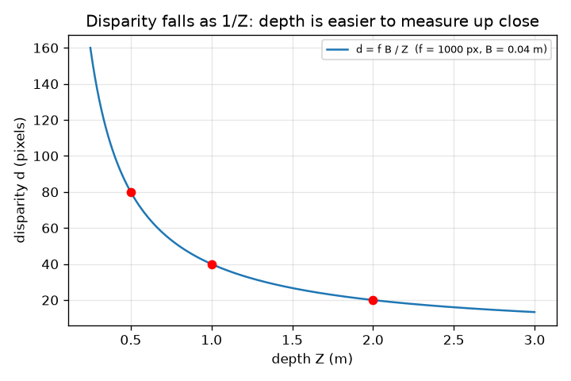
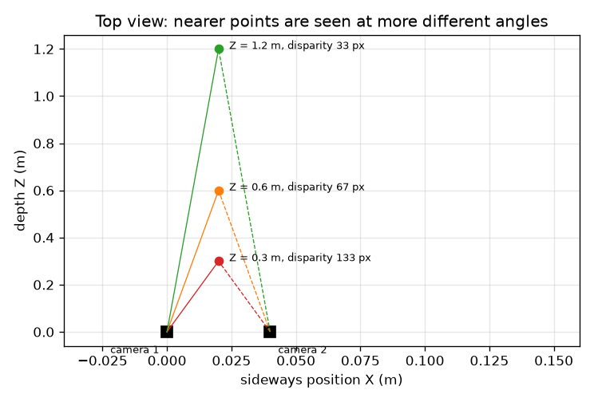

# सत्र 1: एक कैमरा दुनिया को सपाट करता है; दो कैमरे गहराई वापस लाते हैं

*स्तर 1 (संकल्पनात्मक इंटरैक्टिव मॉडल) · लगभग 60 मिनट · openstereodic*

> यह एक सरलीकृत शैक्षिक मॉडल है। यह कोई प्रमाणित डिज़ाइन टूल नहीं है और इसका उपयोग वास्तविक संरचनाओं, विद्युत स्थापनाओं, वाहनों, औद्योगिक प्रक्रियाओं या चिकित्सा निर्णयों के लिए नहीं किया जाना चाहिए।

**पूर्व-आवश्यकताएँ (Prerequisites)**

- स्कूल ज्यामिति से समरूप त्रिभुज।
- आपने PRIMER.md पढ़ लिया है और `python start.py 1` एक बार चला लिया है।

**सीखने के उद्देश्य (Learning objectives)।** इस सत्र के बाद आप:

- यह पता लगाने के लिए कि कोई 3D बिंदु छवि में कहाँ पड़ता है, सूचिछिद्र नियम (pinhole rule) u = f X / Z का उपयोग कर सकेंगे।
- समझा सकेंगे कि दो कैमरों द्वारा देखा गया बिंदु बगल में इतना क्यों उछलता है जो केवल उसकी गहराई (depth) पर निर्भर करता है।
- विषमता (disparity) से गहराई Z = f B / d से, हाथ से और Python में, निकाल सकेंगे।
- समझा सकेंगे कि दूर के बिंदु पास के बिंदुओं की तुलना में कम सटीकता से क्यों मापे जाते हैं।

## A. वास्तविक दुनिया की समस्या
एक आँख बंद कीजिए, एक उँगली हाथ भर की दूरी पर रखिए और आँखें बदलिए: उँगली पृष्ठभूमि के सामने उछलती है, पीछे की दीवार से कहीं अधिक। एक अकेली फ़ोटो आपको नहीं बता सकती कि चीज़ें कितनी दूर हैं, पर कुछ सेंटीमीटर के अंतर पर ली गई दो फ़ोटो बता सकती हैं। प्रयोगशालाएँ ठीक इसी का उपयोग भार डाली गई रबर की पट्टी के आकार को बिना छुए मापने के लिए करती हैं। दो सपाट चित्रों से एक 3D स्थिति कैसे ज्ञात की जाती है?

## B. संकल्पना और सिद्धांत
एक सूचिछिद्र कैमरा (pinhole camera) किसी बिंदु (X, Y, Z) से आने वाले प्रकाश को एक छोटे छेद से गुज़रने देता है और उसके पीछे दूरी f पर एक संवेदक (sensor) पर गिराता है। समरूप त्रिभुजों से गिरने का स्थान बगल में u = f X / Z और ऊपर v = f Y / Z है। हम f को पिक्सेल में गिनते हैं, इसलिए u और v छवि के मध्य से पिक्सेल में हैं। कैमरा 2 को कैमरा 1 के दाईं ओर दूरी B (आधार रेखा, baseline) पर रखिए, दोनों सीधे आगे देख रहे हैं। कैमरा 2 के लिए बिंदु B उतना बाईं ओर पास है, इसलिए u2 = f (X - B) / Z। बगल का उछाल d = u1 - u2 (विषमता) f B / Z है: इसमें कोई X नहीं है, केवल गहराई Z। इसे उलटिए तो Z = f B / d।

| प्रतीक | अर्थ | इकाई |
|---|---|---|
| X, Y, Z | बिंदु की स्थिति: बगल में, ऊपर, कैमरा 1 के सामने दूरी | m |
| f | पिक्सेल में मापी गई फ़ोकस दूरी (focal length) | px |
| B | आधार रेखा: दोनों कैमरों के बीच की दूरी | m |
| u1, u2 | कैमरा 1 और 2 में छवि केंद्र से बगल का छवि निर्देशांक | px |
| d | विषमता u1 - u2 | px |

**मान्यताएँ (Assumptions)**

- बिना लेंस विरूपण (lens distortion) वाले सूचिछिद्र कैमरे।
- दोनों कैमरे सीधे आगे, समानांतर, समान ऊँचाई पर, समान f के साथ देखते हैं।
- f और B ठीक-ठीक ज्ञात हैं।

$$ u=\frac{fX}{Z},\qquad v=\frac{fY}{Z} $$

$$ u_1=\frac{fX}{Z},\qquad u_2=\frac{f(X-B)}{Z} $$

$$ d=u_1-u_2=\frac{fB}{Z}\quad\Longleftrightarrow\quad Z=\frac{fB}{d} $$

## C. दृश्य व्याख्या
पहला चित्र एक ऊपरी दृश्य है जिसमें 0.04 m के अंतर पर दो कैमरे और 0.3, 0.6 और 1.2 m की गहराइयों पर तीन बिंदु हैं: दोनों कैमरों से पास के बिंदु तक की किरणें एक चौड़ा कोण बनाती हैं (विषमता 133 px) और दूर के बिंदु तक एक संकरा (33 px)। दूसरा चित्र f = 1000 px और B = 0.04 m के लिए गहराई के विरुद्ध विषमता आलेखित करता है; वक्र 1 / Z के अनुसार गिरता है, इसलिए यह पास में खड़ा और दूर लगभग सपाट है, यही कारण है कि पास में गहराई मापना आसान और दूर कठिन है।

*गहराई के विरुद्ध विषमता: f = 1000 px और B = 0.04 m के लिए 1 / Z वक्र।*

*ऊपरी दृश्य: बिंदु जितना पास, दोनों किरणों के बीच कोण उतना चौड़ा और विषमता उतनी बड़ी।*

## D. इंटरैक्टिव सिमुलेशन
पाठ चलाइए (`python start.py 1`), फिर लाइव ऐप खोलिए: [सत्र 1: दो कैमरे और एक बिंदु](https://krunalpanchal1995.github.io/pan-iit-oss/openstereodic/session-01/) (या इसी फ़ोल्डर में `app.html`)। गहराई स्लाइडर खिसकाइए और ऊपरी दृश्य में दोनों किरणों को खुलते और बंद होते देखिए; फिर ग्राफ़ पर जाइए और बिंदु को 1 / Z वक्र पर फिसलते देखिए। आधार रेखा बदलिए और धूसर वक्र से तुलना कीजिए।

**चुनौती।** विषमता को 100 px बनाइए (2 px के भीतर)।

## E. हल किया गया उदाहरण और प्रयोग
**समस्या।** f = 1000 px और B = 0.04 m के साथ, एक बिंदु X = 0.02 m, Y = 0.01 m, Z = 0.5 m पर है। हर कैमरा उसे कहाँ देखता है, विषमता क्या है, और क्या Z = f B / d वापस 0.5 m देता है?

1. कैमरा 1: u1 = 1000 * 0.02 / 0.5 = 40 px और v = 1000 * 0.01 / 0.5 = 20 px।
2. कैमरा 2: u2 = 1000 * (0.02 - 0.04) / 0.5 = -40 px (बिंदु उसकी केंद्र रेखा के बाईं ओर है), v = 20 px।
3. विषमता d = u1 - u2 = 40 - (-40) = 80 px। f B / Z से जाँच: 1000 * 0.04 / 0.5 = 80 px।
4. विषमता से वापस गहराई: Z = f B / d = 1000 * 0.04 / 80 = 0.5 m।

**उत्तर।** कैमरा 1 (40, 20) px देखता है, कैमरा 2 (-40, 20) px देखता है, विषमता 80 px है और गहराई 0.5 m के रूप में वापस मिलती है।

**प्रयोग।** एक दीवार से 2 m दूर खड़े होइए और एक पेंसिल 0.5 m पर पकड़िए। फ़ोन को 4 cm बगल में खिसकाकर (मेज़ पर एक स्केल रखिए) दो फ़ोन फ़ोटो लीजिए। किसी इमेज व्यूअर में पेंसिल का उछाल पिक्सेल में मापिए और अपने फ़ोन की पिक्सेल में फ़ोकस दूरी (मुख्य कैमरे के लिए छवि की पिक्सेल चौड़ाई का लगभग 0.8 से 1.2 गुना) का उपयोग करके f B / Z से तुलना कीजिए। लगभग 10 प्रतिशत तक सहमति की अपेक्षा कीजिए: असली लेंस में विरूपण होता है, फ़ोन थोड़ा घूम सकता है, और आप पिक्सेल केवल लगभग एक पिक्सेल तक पढ़ सकते हैं।

## F. मूल्यांकन और डिज़ाइन चुनौती
**प्रश्न प्रकार A: संकल्पनात्मक।** विषमता बिंदु की बगल वाली स्थिति X पर निर्भर क्यों नहीं करती?

संकेत

u1 - u2 लिखिए और देखिए कि X वाले पदों का क्या होता है।

चरण-दर-चरण हल

u1 = f X / Z और u2 = f (X - B) / Z, इसलिए u1 - u2 = f X / Z - f X / Z + f B / Z = f B / Z। X वाले पद कट जाते हैं। दोनों कैमरे बिंदु को बगल में समान मात्रा f X / Z से खिसका हुआ देखते हैं; केवल आधार रेखा वाला पद f B / Z बचता है, और वह गहराई पर निर्भर करता है।

**प्रश्न प्रकार B: संख्यात्मक।** f = 1000 px वाले 0.06 m के अंतर पर दो कैमरे 25 px की विषमता मापते हैं। बिंदु कितनी दूर है? क्या उत्तर समझदारी भरा है?

संकेत

Z = f B / d। इकाइयाँ जाँचिए: px * m / px = m।

चरण-दर-चरण हल

Z = 1000 * 0.06 / 25 = 2.4 m। समझदारी जाँच (sanity check): बड़ी विषमता का अर्थ है पास, और 25 px उस 60 px से छोटा है जो हमें 1 m पर मिलता, इसलिए 1 m से आगे का बिंदु संगत है। इकाइयाँ: px * m / px = m।

**प्रश्न प्रकार C: ग्राफ़ और सिमुलेशन की व्याख्या।** गहराई के विरुद्ध विषमता के ग्राफ़ में, जब गहराई 0.5 m से 1.0 m तक दोगुनी होती है तो विषमता का क्या होता है, और सटीकता के लिए इसका क्या अर्थ है?

संकेत

0.5 m, 1 m और 2 m पर मान पढ़िए।

चरण-दर-चरण हल

हर बार गहराई दोगुनी होने पर विषमता आधी हो जाती है: 0.5 m पर 80 px, 1 m पर 40 px, 2 m पर 20 px (1 / Z आकार)। वक्र पास में अधिक खड़ा है, इसलिए विषमता की एक पिक्सेल त्रुटि 0.5 m पर गहराई के 6.2 mm के बराबर है पर 2 m पर 95 mm के। समान मिलान (matching) सटीकता दूर पर कहीं बुरी गहराई देती है।

**प्रश्न प्रकार D: डिज़ाइन और इष्टतमीकरण (optimisation) चुनौती।** डिज़ाइन: f = 1000 px के साथ, ऐसी आधार रेखा चुनिए कि 0.5 m पर विषमता का एक पिक्सेल गहराई के अधिकतम 5 mm के बराबर हो। लंबी आधार रेखा की क़ीमत क्या है?

संकेत

एक पिक्सेल परिवर्तन के लिए depth step = Z squared / (f B + Z) का उपयोग कीजिए, और B के लिए हल कीजिए।

चरण-दर-चरण हल

हमें 0.25 / (1000 B + 0.5) <= 0.005 चाहिए, इसलिए 1000 B + 0.5 >= 50 और B >= 0.0495 m। 0.05 m की आधार रेखा 4.95 mm का चरण और 0.5 m पर 100 px की विषमता देती है। क़ीमत: कैमरे अधिक दूर होने पर हर एक वस्तु को अधिक भिन्न कोण से देखता है, इसलिए दोनों चित्र कम ओवरलैप होते हैं, मिलान कठिन हो जाता है (बड़ी खोज सीमा और अधिक परिप्रेक्ष्य परिवर्तन), और उपकरण (rig) भारी-भरकम हो जाता है। मान्यता: समानांतर कैमरे और सटीक f।

[RUBRIC.md](../../RUBRIC.md) से स्वयं को अंक दीजिए। कागज़ पर काम करने के लिए [गतिविधि पत्रक](activity_sheet.md) प्रिंट कीजिए।

## सामान्य भ्रांतियाँ (Common misconceptions)
| सामान्य भ्रांति | वास्तव में क्या सच है |
|---|---|
| विषमता इस पर निर्भर करती है कि बिंदु कितना बाएँ या दाएँ है। | केवल उसकी गहराई Z पर (d = f B / Z)। दोनों छवियों को घटाने पर बगल की स्थिति कट जाती है। |
| बड़ी विषमता का अर्थ है कि बिंदु अधिक दूर है। | इसका उलटा: पास के बिंदु अधिक उछलते हैं। Z = f B / d, इसलिए बड़े d का अर्थ है छोटा Z। |
| दो कैमरे हर दूरी पर समान रूप से अच्छी गहराई मापते हैं। | इस उपकरण के साथ एक पिक्सेल विषमता चरण 0.5 m पर 6 mm और 2 m पर लगभग 95 mm है; सटीकता दूरी के वर्ग के अनुसार गिरती है। |

## शब्दावली (Glossary)
- **सूचिछिद्र कैमरा (pinhole camera)**: सबसे सरल कैमरा मॉडल: प्रकाश एक बिंदु से गुज़रता है और एक संवेदक पर गिरता है
- **फ़ोकस दूरी (पिक्सेल में) (focal length)**: सूचिछिद्र से संवेदक तक की दूरी, पिक्सेल चौड़ाइयों में गिनी गई
- **आधार रेखा (baseline)**: दोनों कैमरों के बीच की दूरी
- **विषमता (disparity)**: दोनों छवियों के बीच कोई बिंदु बगल में कितना उछलता है, पिक्सेल में
- **लंबन (parallax)**: दृष्टिकोण बदलने पर दूर की वस्तुओं के सामने पास की वस्तुओं का आभासी खिसकाव

## समापन
1. [exercises.md](exercises.md) में दिए गए तीन कोडिंग कार्य कीजिए।
2. अपने बदलावों के बाद `python start.py 1` फिर से चलाइए। यह checkpoint के साथ समाप्त होता है; जब यह `PASS` छापे, तो आपका काम पूरा है। (केवल checkpoint: `python start.py check 1`।)

अगला: [सत्र 2](../session-02/README.md)
