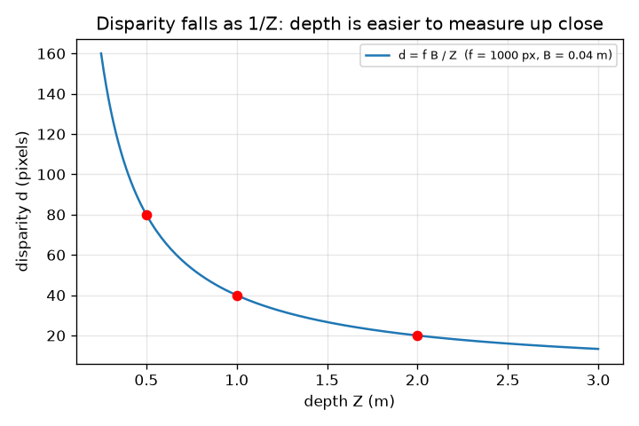
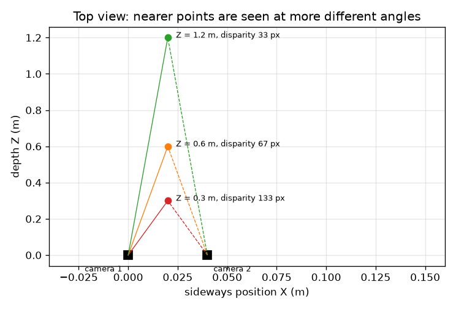

# സെഷൻ 1: ഒരു ക്യാമറ ലോകത്തെ പരത്തുന്നു; രണ്ടു ക്യാമറകൾ ആഴം വീണ്ടെടുക്കുന്നു

[Session 1 — हिन्दी](README.hi.md)

*തലം 1 (ആശയപരമായ സംവേദനാത്മക മാതൃക) · ഏകദേശം 60 മിനിറ്റ് · openstereodic*

> ഇതൊരു ലളിതവൽക്കരിച്ച വിദ്യാഭ്യാസ മാതൃകയാണ്. ഇത് സാധൂകരിച്ച ഡിസൈൻ ഉപകരണമല്ല; യഥാർഥ നിർമിതികൾ, വൈദ്യുത ഇൻസ്റ്റലേഷനുകൾ, വാഹനങ്ങൾ, വ്യാവസായിക പ്രക്രിയകൾ, വൈദ്യശാസ്ത്ര തീരുമാനങ്ങൾ എന്നിവയ്ക്ക് ഇത് ഉപയോഗിക്കരുത്.

**മുൻവിജ്ഞാനം (Prerequisites)**

- സ്കൂൾ ജ്യാമിതിയിലെ സദൃശ ത്രികോണങ്ങൾ.
- നിങ്ങൾ PRIMER.md വായിക്കുകയും `python start.py 1` ഒരു തവണ റൺ ചെയ്യുകയും ചെയ്തിരിക്കണം.

**പഠനലക്ഷ്യങ്ങൾ (Learning objectives).** ഈ സെഷനു ശേഷം നിങ്ങൾക്ക്:

- ഒരു 3D ബിന്ദു ചിത്രത്തിൽ എവിടെ പതിക്കുമെന്ന് കണ്ടെത്താൻ പിൻഹോൾ നിയമം u = f X / Z ഉപയോഗിക്കാം.
- രണ്ടു ക്യാമറകൾ കാണുന്ന ഒരു ബിന്ദു ആഴത്തെ മാത്രം ആശ്രയിക്കുന്ന അളവിൽ വശത്തേക്കു ചാടുന്നത് എന്തുകൊണ്ടെന്ന് വിശദീകരിക്കാം.
- അസമത (disparity) ഉപയോഗിച്ച് ആഴം Z = f B / d എന്ന സൂത്രവാക്യത്തിലൂടെ കൈകൊണ്ടും Python-ലും കണക്കാക്കാം.
- അടുത്തുള്ള ബിന്ദുക്കളെക്കാൾ ദൂരെയുള്ളവ കൃത്യത കുറഞ്ഞ രീതിയിൽ അളക്കപ്പെടുന്നത് എന്തുകൊണ്ടെന്ന് വിശദീകരിക്കാം.

## A. യഥാർഥ ജീവിത പ്രശ്നം
ഒരു കണ്ണടയ്ക്കുക, കൈ നീട്ടി ഒരു വിരൽ പിടിക്കുക, എന്നിട്ട് കണ്ണുകൾ മാറ്റുക: വിരൽ പശ്ചാത്തലത്തിനെതിരെ ചാടുന്നു, പിന്നിലെ ചുമരിനെക്കാൾ വളരെ കൂടുതൽ. ഒറ്റ ഫോട്ടോഗ്രാഫിന് വസ്തുക്കൾ എത്ര ദൂരെയാണെന്നു പറയാൻ കഴിയില്ല, എന്നാൽ ഏതാനും സെന്റിമീറ്റർ അകലത്തിൽ എടുത്ത രണ്ടു ഫോട്ടോഗ്രാഫുകൾക്ക് കഴിയും. ഭാരം വച്ച ഒരു റബ്ബർ പട്ടയുടെ ആകൃതി തൊടാതെ അളക്കാൻ ലാബുകൾ ഇതുതന്നെ ഉപയോഗിക്കുന്നു. രണ്ടു പരന്ന ചിത്രങ്ങളിൽ നിന്ന് 3D സ്ഥാനം എങ്ങനെ കണ്ടെത്താം?

## B. ആശയവും സിദ്ധാന്തവും
ഒരു പിൻഹോൾ ക്യാമറ (X, Y, Z) എന്ന ബിന്ദുവിൽ നിന്നുള്ള പ്രകാശത്തെ ഒരു ചെറുദ്വാരത്തിലൂടെ കടത്തി അതിനു പിന്നിൽ f അകലെയുള്ള സെൻസറിൽ പതിപ്പിക്കുന്നു. സദൃശ ത്രികോണങ്ങളാൽ പതിയുന്ന സ്ഥാനം വശത്തേക്ക് u = f X / Z, മുകളിലേക്ക് v = f Y / Z ആണ്. നാം f പിക്സലുകളിൽ എണ്ണുന്നു, അതിനാൽ u, v ചിത്രത്തിന്റെ മധ്യത്തിൽ നിന്നുള്ള പിക്സലുകളിലാണ്. ക്യാമറ 2-നെ ക്യാമറ 1-ന്റെ വലതുവശത്ത് B അകലത്തിൽ (ബേസ്‌ലൈൻ, baseline) വയ്ക്കുക, രണ്ടും നേരെ മുന്നോട്ടു നോക്കുന്നു. ക്യാമറ 2-ന് ബിന്ദു ഇടതുവശത്തേക്ക് B അടുത്താണ്, അതിനാൽ u2 = f (X - B) / Z. വശത്തേക്കുള്ള ചാട്ടം d = u1 - u2 (അസമത) f B / Z ആണ്: അതിൽ X ഇല്ല, ആഴം Z മാത്രമേയുള്ളൂ. തിരിച്ചാക്കിയാൽ Z = f B / d.

| ചിഹ്നം | അർഥം | യൂണിറ്റ് |
|---|---|---|
| X, Y, Z | ബിന്ദുവിന്റെ സ്ഥാനം: വശത്തേക്ക്, മുകളിലേക്ക്, ക്യാമറ 1-ന്റെ മുന്നിലെ ദൂരം | m |
| f | പിക്സലുകളിൽ അളന്ന ഫോക്കൽ ദൈർഘ്യം | px |
| B | ബേസ്‌ലൈൻ: രണ്ടു ക്യാമറകൾ തമ്മിലുള്ള ദൂരം | m |
| u1, u2 | ചിത്രമധ്യത്തിൽ നിന്ന്, ക്യാമറ 1, 2-ലെ വശത്തേക്കുള്ള ചിത്ര നിർദേശാങ്കം | px |
| d | അസമത u1 - u2 | px |

**അനുമാനങ്ങൾ (Assumptions)**

- ലെൻസ് വികലതയില്ലാത്ത പിൻഹോൾ ക്യാമറകൾ.
- രണ്ടു ക്യാമറകളും നേരെ മുന്നോട്ട്, സമാന്തരമായി, ഒരേ ഉയരത്തിൽ, ഒരേ f-ഓടെ നോക്കുന്നു.
- f-ഉം B-യും കൃത്യമായി അറിയാം.

$$ u=\frac{fX}{Z},\qquad v=\frac{fY}{Z} $$

$$ u_1=\frac{fX}{Z},\qquad u_2=\frac{f(X-B)}{Z} $$

$$ d=u_1-u_2=\frac{fB}{Z}\quad\Longleftrightarrow\quad Z=\frac{fB}{d} $$

## C. ദൃശ്യ വിശദീകരണം
ആദ്യ ചിത്രം 0.04 m അകലത്തിലുള്ള രണ്ടു ക്യാമറകളും 0.3, 0.6, 1.2 m ആഴങ്ങളിലെ മൂന്നു ബിന്ദുക്കളുമുള്ള മേൽക്കാഴ്ചയാണ്: രണ്ടു ക്യാമറകളിൽ നിന്ന് അടുത്ത ബിന്ദുവിലേക്കുള്ള കിരണങ്ങൾ വിശാലമായ കോൺ ഉണ്ടാക്കുന്നു (അസമത 133 px), ദൂരെയുള്ളതിലേക്ക് ഇടുങ്ങിയ കോൺ (33 px). രണ്ടാമത്തെ ചിത്രം f = 1000 px, B = 0.04 m എന്നിവയ്ക്ക് ആഴത്തിനെതിരെ അസമത വരയ്ക്കുന്നു; വക്രം 1 / Z പോലെ താഴുന്നു, അതിനാൽ അടുത്ത് കുത്തനെയും ദൂരെ ഏതാണ്ട് പരന്നതുമാണ്, അതുകൊണ്ടാണ് അടുത്ത് ആഴം അളക്കാൻ എളുപ്പവും ദൂരെ ബുദ്ധിമുട്ടുമായത്.

*ആഴത്തിനെതിരെ അസമത: f = 1000 px, B = 0.04 m എന്നിവയ്ക്കുള്ള 1 / Z വക്രം.*

*മേൽക്കാഴ്ച: ബിന്ദു അടുത്താകുന്തോറും രണ്ടു കിരണങ്ങൾക്കിടയിലെ കോൺ വിശാലവും അസമത വലുതുമാകുന്നു.*

## D. സംവേദനാത്മക സിമുലേഷൻ
പാഠം റൺ ചെയ്യുക (`python start.py 1`), എന്നിട്ട് ലൈവ് ആപ്പ് തുറക്കുക: [സെഷൻ 1: രണ്ടു ക്യാമറകളും ഒരു ബിന്ദുവും](https://krunalpanchal1995.github.io/pan-iit-oss/openstereodic/session-01/) (അല്ലെങ്കിൽ ഈ ഫോൾഡറിലെ `app.html`). ആഴം സ്ലൈഡർ നീക്കി മേൽക്കാഴ്ചയിൽ രണ്ടു കിരണങ്ങൾ തുറക്കുന്നതും അടയുന്നതും കാണുക; പിന്നെ ഗ്രാഫിലേക്കു മാറി ബിന്ദു 1 / Z വക്രത്തിലൂടെ നീങ്ങുന്നത് കാണുക. ബേസ്‌ലൈൻ മാറ്റി ചാരനിറ വക്രവുമായി താരതമ്യം ചെയ്യുക.

**വെല്ലുവിളി.** അസമത 100 px ആക്കുക (2 px-നുള്ളിൽ).

## E. ഉദാഹരണവും പരീക്ഷണവും
**പ്രശ്നം.** f = 1000 px, B = 0.04 m ആയിരിക്കെ, ഒരു ബിന്ദു X = 0.02 m, Y = 0.01 m, Z = 0.5 m-ൽ സ്ഥിതി ചെയ്യുന്നു. ഓരോ ക്യാമറയും അതിനെ എവിടെ കാണുന്നു, അസമത എത്ര, Z = f B / d വീണ്ടും 0.5 m തരുന്നുണ്ടോ?

1. ക്യാമറ 1: u1 = 1000 * 0.02 / 0.5 = 40 px, v = 1000 * 0.01 / 0.5 = 20 px.
2. ക്യാമറ 2: u2 = 1000 * (0.02 - 0.04) / 0.5 = -40 px (ബിന്ദു അതിന്റെ മധ്യരേഖയുടെ ഇടതുവശത്താണ്), v = 20 px.
3. അസമത d = u1 - u2 = 40 - (-40) = 80 px. f B / Z = 1000 * 0.04 / 0.5 = 80 px കൊണ്ട് പരിശോധിക്കുക.
4. അസമതയിൽ നിന്ന് ആഴം തിരികെ: Z = f B / d = 1000 * 0.04 / 80 = 0.5 m.

**ഉത്തരം.** ക്യാമറ 1 (40, 20) px കാണുന്നു, ക്യാമറ 2 (-40, 20) px കാണുന്നു, അസമത 80 px, ആഴം 0.5 m ആയി വീണ്ടെടുക്കപ്പെടുന്നു.

**പരീക്ഷണം.** ഒരു ചുമരിൽ നിന്ന് 2 m അകലെ നിൽക്കുക, 0.5 m-ൽ ഒരു പെൻസിൽ പിടിക്കുക. ഫോൺ 4 cm വശത്തേക്കു നീക്കി (മേശയിൽ ഒരു സ്കെയിൽ വയ്ക്കുക) രണ്ടു ഫോൺ ഫോട്ടോകൾ എടുക്കുക. ഒരു ഇമേജ് വ്യൂവറിൽ പെൻസിലിന്റെ ചാട്ടം പിക്സലുകളിൽ അളന്ന്, ഫോണിന്റെ ഫോക്കൽ ദൈർഘ്യം പിക്സലുകളിൽ (മുഖ്യ ക്യാമറയ്ക്ക് ചിത്രത്തിന്റെ പിക്സൽ വീതിയുടെ ഏകദേശം 0.8 മുതൽ 1.2 മടങ്ങ്) ഉപയോഗിച്ച് f B / Z-മായി താരതമ്യം ചെയ്യുക. ഏകദേശം 10 ശതമാനം വരെ യോജിപ്പ് പ്രതീക്ഷിക്കാം: യഥാർഥ ലെൻസിന് വികലതയുണ്ട്, ഫോൺ അല്പം തിരിഞ്ഞേക്കാം, ഏകദേശം ഒരു പിക്സൽ വരെ മാത്രമേ നിങ്ങൾക്ക് പിക്സലുകൾ വായിക്കാനാകൂ.

## F. മൂല്യനിർണയവും ഡിസൈൻ വെല്ലുവിളിയും
**ചോദ്യ തരം A: ആശയപരം.** അസമത ബിന്ദുവിന്റെ വശത്തേക്കുള്ള സ്ഥാനമായ X-നെ ആശ്രയിക്കാത്തത് എന്തുകൊണ്ട്?

സൂചന

u1 - u2 എഴുതി X അടങ്ങിയ പദങ്ങൾക്ക് എന്തു സംഭവിക്കുന്നു എന്നു നോക്കുക.

ഘട്ടം ഘട്ടമായ പരിഹാരം

u1 = f X / Z, u2 = f (X - B) / Z, അതിനാൽ u1 - u2 = f X / Z - f X / Z + f B / Z = f B / Z. X പദങ്ങൾ റദ്ദാകുന്നു. രണ്ടു ക്യാമറകളും ബിന്ദുവിനെ ഒരേ അളവിൽ f X / Z വശത്തേക്കു മാറ്റിയാണ് കാണുന്നത്; ബേസ്‌ലൈൻ പദം f B / Z മാത്രം ശേഷിക്കുന്നു, അത് ആഴത്തെ ആശ്രയിക്കുന്നു.

**ചോദ്യ തരം B: സംഖ്യാപരം.** 0.06 m അകലത്തിലുള്ള, f = 1000 px ആയ രണ്ടു ക്യാമറകൾ 25 px അസമത അളക്കുന്നു. ബിന്ദു എത്ര ദൂരെയാണ്? ഉത്തരം യുക്തിസഹമാണോ?

സൂചന

Z = f B / d. യൂണിറ്റുകൾ പരിശോധിക്കുക: px * m / px = m.

ഘട്ടം ഘട്ടമായ പരിഹാരം

Z = 1000 * 0.06 / 25 = 2.4 m. യുക്തിപരിശോധന: വലിയ അസമത അടുത്തതാണെന്ന് അർഥമാക്കുന്നു, 25 px, 1 m-ൽ കിട്ടുമായിരുന്ന 60 px-നെക്കാൾ ചെറുതാണ്, അതിനാൽ 1 m-ന് അപ്പുറമുള്ള ബിന്ദു യോജിക്കുന്നു. യൂണിറ്റുകൾ: px * m / px = m.

**ചോദ്യ തരം C: ഗ്രാഫും സിമുലേഷനും വ്യാഖ്യാനിക്കൽ.** ആഴത്തിനെതിരെ അസമതയുടെ ഗ്രാഫിൽ ആഴം 0.5 m-ൽ നിന്ന് 1.0 m ആയി ഇരട്ടിയാക്കുമ്പോൾ അസമതയ്ക്ക് എന്തു സംഭവിക്കുന്നു, അത് കൃത്യതയെക്കുറിച്ച് എന്താണ് അർഥമാക്കുന്നത്?

സൂചന

0.5 m, 1 m, 2 m എന്നിവിടങ്ങളിലെ മൂല്യങ്ങൾ വായിക്കുക.

ഘട്ടം ഘട്ടമായ പരിഹാരം

ആഴം ഇരട്ടിയാകുമ്പോഴെല്ലാം അസമത പകുതിയാകുന്നു: 0.5 m-ൽ 80 px, 1 m-ൽ 40 px, 2 m-ൽ 20 px (1 / Z രൂപം). വക്രം അടുത്ത് കുത്തനെയാണ്, അതിനാൽ ഒരു പിക്സൽ അസമതാ പിശക് 0.5 m-ൽ 6.2 mm ആഴത്തിനും 2 m-ൽ 95 mm-നും തുല്യമാണ്. അതേ പൊരുത്ത കൃത്യത ദൂരെ വളരെ മോശം ആഴം നൽകുന്നു.

**ചോദ്യ തരം D: ഡിസൈൻ, ഒപ്റ്റിമൈസേഷൻ വെല്ലുവിളി.** ഡിസൈൻ: f = 1000 px ആയിരിക്കെ, 0.5 m-ൽ ഒരു പിക്സൽ അസമത പരമാവധി 5 mm ആഴത്തിനു തുല്യമാകുന്ന ബേസ്‌ലൈൻ തിരഞ്ഞെടുക്കുക. നീളമുള്ള ബേസ്‌ലൈനിന്റെ വില എന്താണ്?

സൂചന

ഒരു പിക്സൽ മാറ്റത്തിന് ആഴ ഘട്ടം = Z^2 / (f B + Z) ഉപയോഗിക്കുക, B-ക്കായി നിർധാരണം ചെയ്യുക.

ഘട്ടം ഘട്ടമായ പരിഹാരം

നമുക്ക് 0.25 / (1000 B + 0.5) <= 0.005 വേണം, അതിനാൽ 1000 B + 0.5 >= 50, B >= 0.0495 m. 0.05 m ബേസ്‌ലൈൻ 4.95 mm ഘട്ടവും 0.5 m-ൽ 100 px അസമതയും നൽകുന്നു. വില: ക്യാമറകൾ കൂടുതൽ അകലെയാകുമ്പോൾ ഓരോന്നും വസ്തുവിനെ കൂടുതൽ വ്യത്യസ്ത കോണിൽ നിന്ന് കാണുന്നു, അതിനാൽ രണ്ടു ചിത്രങ്ങളും കുറച്ചേ ഓവർലാപ്പ് ചെയ്യൂ, പൊരുത്തപ്പെടുത്തൽ കൂടുതൽ ബുദ്ധിമുട്ടുന്നു (വലിയ തിരച്ചിൽ പരിധിയും കൂടുതൽ വീക്ഷണമാറ്റവും), ഉപകരണക്കൂട്ടം വലുതുമാകുന്നു. അനുമാനം: സമാന്തര ക്യാമറകളും കൃത്യമായ f-ഉം.

[RUBRIC.md](../../RUBRIC.md) ഉപയോഗിച്ച് സ്വയം മാർക്കിടുക. കടലാസിൽ ചെയ്യാൻ [പ്രവർത്തന ഷീറ്റ്](activity_sheet.md) പ്രിന്റ് ചെയ്യുക.

## സാധാരണ തെറ്റിദ്ധാരണകൾ
| സാധാരണ തെറ്റിദ്ധാരണ | യഥാർഥത്തിൽ ശരിയായത് |
|---|---|
| അസമത ബിന്ദു എത്ര ഇടത്തോ വലത്തോ ആണെന്നതിനെ ആശ്രയിക്കുന്നു. | അതിന്റെ ആഴം Z-നെ മാത്രം (d = f B / Z). രണ്ടു ചിത്രങ്ങളും കുറയ്ക്കുമ്പോൾ വശത്തേക്കുള്ള സ്ഥാനം റദ്ദാകുന്നു. |
| വലിയ അസമത എന്നാൽ ബിന്ദു കൂടുതൽ ദൂരെയാണെന്നാണ്. | നേർവിപരീതം: അടുത്ത ബിന്ദുക്കൾ കൂടുതൽ ചാടുന്നു. Z = f B / d, അതിനാൽ വലിയ d എന്നാൽ ചെറിയ Z. |
| രണ്ടു ക്യാമറകൾ എല്ലാ ദൂരത്തിലും ഒരുപോലെ നന്നായി ആഴം അളക്കുന്നു. | ഈ ഉപകരണക്കൂട്ടത്തിൽ ഒരു പിക്സൽ അസമതാ ഘട്ടം 0.5 m-ൽ 6 mm ഉം 2 m-ൽ ഏകദേശം 95 mm ഉം ആണ്; ദൂരത്തിന്റെ വർഗത്തിനനുസരിച്ച് കൃത്യത കുറയുന്നു. |

## പദാവലി (Glossary)
- **പിൻഹോൾ ക്യാമറ (pinhole camera)**: ഏറ്റവും ലളിതമായ ക്യാമറ മാതൃക: പ്രകാശം ഒരു ബിന്ദുവിലൂടെ കടന്ന് സെൻസറിൽ പതിക്കുന്നു
- **ഫോക്കൽ ദൈർഘ്യം (പിക്സലുകളിൽ) (focal length)**: പിൻഹോളിൽ നിന്ന് സെൻസറിലേക്കുള്ള ദൂരം, പിക്സൽ വീതികളിൽ എണ്ണിയത്
- **ബേസ്‌ലൈൻ (baseline)**: രണ്ടു ക്യാമറകൾ തമ്മിലുള്ള ദൂരം
- **അസമത (disparity)**: രണ്ടു ചിത്രങ്ങൾക്കിടയിൽ ഒരു ബിന്ദു വശത്തേക്ക് എത്ര ചാടുന്നു, പിക്സലുകളിൽ
- **ദൃഷ്ടിഭേദം (parallax)**: വീക്ഷണസ്ഥാനം മാറ്റുമ്പോൾ ദൂരെയുള്ളവയ്ക്കെതിരെ അടുത്ത വസ്തുക്കൾക്കുണ്ടാകുന്ന പ്രത്യക്ഷ സ്ഥാനമാറ്റം

## പൂർത്തിയാക്കൽ
1. [exercises.md](exercises.md)-ലെ മൂന്ന് കോഡിങ് ജോലികൾ ചെയ്യുക.
2. മാറ്റങ്ങൾക്കു ശേഷം `python start.py 1` വീണ്ടും റൺ ചെയ്യുക. അത് ചെക്ക്പോയിന്റോടെ അവസാനിക്കുന്നു; `PASS` എന്ന് പ്രിന്റ് ചെയ്താൽ നിങ്ങൾ പൂർത്തിയാക്കി. (ചെക്ക്പോയിന്റ് മാത്രം: `python start.py check 1`.)

അടുത്തത്: [സെഷൻ 2](../session-02/README.md)
