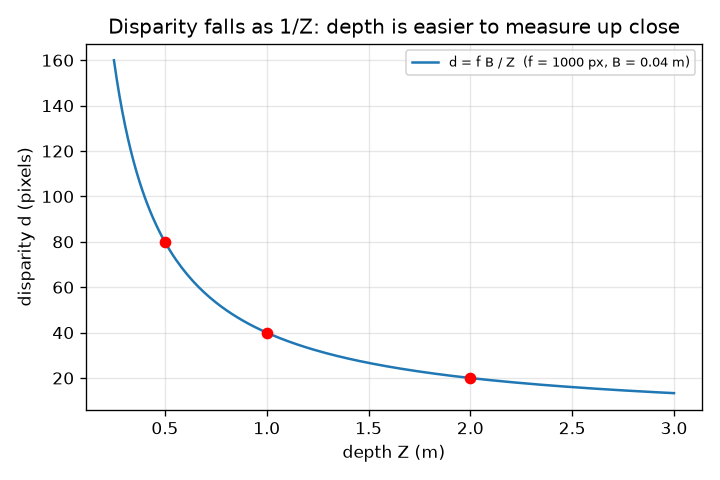
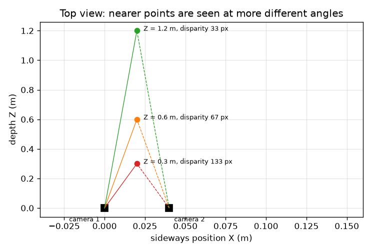

# அமர்வு 1: ஒரு கேமரா உலகைத் தட்டையாக்குகிறது; இரு கேமராக்கள் ஆழத்தை மீட்கின்றன

[Session 1 — हिन्दी](README.hi.md)

*நிலை 1 (கருத்தியல் ஊடாடும் மாதிரி) · சுமார் 60 நிமிடங்கள் · openstereodic*

> இது எளிமைப்படுத்தப்பட்ட கல்வி மாதிரி. இது சரிபார்க்கப்பட்ட வடிவமைப்புக் கருவி அல்ல; உண்மையான கட்டமைப்புகள், மின் நிறுவல்கள், வாகனங்கள், தொழில்துறை செயல்முறைகள் அல்லது மருத்துவ முடிவுகளுக்கு இதைப் பயன்படுத்தக் கூடாது.

**முன்தேவைகள் (Prerequisites)**

- பள்ளி வடிவியலில் ஒத்த முக்கோணங்கள்.
- நீங்கள் PRIMER.md ஐப் படித்து, `python start.py 1` ஐ ஒருமுறை இயக்கியிருக்க வேண்டும்.

**கற்றல் நோக்கங்கள் (Learning objectives).** இந்த அமர்வுக்குப் பிறகு உங்களால்:

- ஒரு 3D புள்ளி படத்தில் எங்கு விழும் என்பதைக் காண பின்ஹோல் விதி u = f X / Z ஐப் பயன்படுத்த முடியும்.
- இரு கேமராக்கள் காணும் புள்ளி ஆழத்தை மட்டுமே சார்ந்த அளவில் பக்கவாட்டில் தாவுவது ஏன் என்பதை விளக்க முடியும்.
- பிறழ்வு (disparity) மூலம் ஆழத்தை Z = f B / d என்ற சூத்திரத்தால் கையால் மற்றும் Python இல் கணக்கிட முடியும்.
- அருகிலுள்ள புள்ளிகளை விடத் தொலைவிலுள்ளவை குறைந்த துல்லியத்தில் அளக்கப்படுவது ஏன் என்பதை விளக்க முடியும்.

## A. நிஜ வாழ்க்கைப் பிரச்சினை
ஒரு கண்ணை மூடுங்கள், கையை நீட்டி ஒரு விரலைப் பிடியுங்கள், பின் கண்களை மாற்றுங்கள்: விரல் பின்னணிக்கு எதிராகத் தாவுகிறது, பின்னால் உள்ள சுவரை விட மிக அதிகமாக. ஒற்றைப் புகைப்படம் பொருட்கள் எவ்வளவு தொலைவில் உள்ளன என்று சொல்ல முடியாது, ஆனால் சில சென்டிமீட்டர் இடைவெளியில் எடுத்த இரு புகைப்படங்களால் முடியும். சுமை ஏற்றிய ரப்பர் பட்டையின் வடிவத்தைத் தொடாமல் அளக்க ஆய்வகங்கள் இதையே பயன்படுத்துகின்றன. இரு தட்டையான படங்களிலிருந்து 3D நிலையை எவ்வாறு கண்டறிவது?

## B. கருத்தும் கோட்பாடும்
ஒரு பின்ஹோல் கேமரா (X, Y, Z) என்ற புள்ளியிலிருந்து வரும் ஒளியை ஒரு சிறு துளை வழியாக அனுமதித்து, அதற்குப் பின்னால் f தொலைவில் உள்ள சென்சாரில் விழச் செய்கிறது. ஒத்த முக்கோணங்களால் விழும் இடம் பக்கவாட்டில் u = f X / Z, மேல்நோக்கி v = f Y / Z ஆகும். f ஐ பிக்சல்களில் எண்ணுகிறோம், எனவே u, v படத்தின் மையத்திலிருந்து பிக்சல்களில் உள்ளன. கேமரா 2 ஐ கேமரா 1 இன் வலப்புறம் B தொலைவில் (அடிக்கோடு, baseline) வையுங்கள், இரண்டும் நேராக முன்னோக்கிப் பார்க்கின்றன. கேமரா 2 க்குப் புள்ளி இடப்புறம் B நெருக்கமாக உள்ளது, எனவே u2 = f (X - B) / Z. பக்கவாட்டுத் தாவல் d = u1 - u2 (பிறழ்வு) f B / Z: அதில் X இல்லை, ஆழம் Z மட்டுமே உள்ளது. திருப்பிப் போட்டால் Z = f B / d.

| குறியீடு | பொருள் | அலகு |
|---|---|---|
| X, Y, Z | புள்ளியின் நிலை: பக்கவாட்டில், மேல்நோக்கி, கேமரா 1 க்கு முன் தொலைவு | m |
| f | பிக்சல்களில் அளந்த குவிய நீளம் | px |
| B | அடிக்கோடு: இரு கேமராக்களுக்கு இடையிலான தூரம் | m |
| u1, u2 | படமையத்திலிருந்து, கேமரா 1, 2 இல் பக்கவாட்டுப் பட ஆயம் | px |
| d | பிறழ்வு u1 - u2 | px |

**அனுமானங்கள் (Assumptions)**

- லென்ஸ் திரிபு இல்லாத பின்ஹோல் கேமராக்கள்.
- இரு கேமராக்களும் நேராக முன்னோக்கி, இணையாக, ஒரே உயரத்தில், ஒரே f உடன் பார்க்கின்றன.
- f உம் B உம் துல்லியமாகத் தெரியும்.

$$ u=\frac{fX}{Z},\qquad v=\frac{fY}{Z} $$

$$ u_1=\frac{fX}{Z},\qquad u_2=\frac{f(X-B)}{Z} $$

$$ d=u_1-u_2=\frac{fB}{Z}\quad\Longleftrightarrow\quad Z=\frac{fB}{d} $$

## C. காட்சி விளக்கம்
முதல் படம் 0.04 m இடைவெளியில் உள்ள இரு கேமராக்களும் 0.3, 0.6, 1.2 m ஆழங்களில் உள்ள மூன்று புள்ளிகளும் கொண்ட மேல்பார்வை: இரு கேமராக்களிலிருந்து அருகிலுள்ள புள்ளிக்குச் செல்லும் கதிர்கள் அகன்ற கோணத்தை (பிறழ்வு 133 px), தொலைவிலுள்ளதற்கு குறுகிய கோணத்தை (33 px) ஏற்படுத்துகின்றன. இரண்டாவது படம் f = 1000 px, B = 0.04 m க்கு ஆழத்துக்கு எதிராகப் பிறழ்வை வரைகிறது; வளைவு 1 / Z போல இறங்குகிறது, எனவே அருகில் செங்குத்தாகவும் தொலைவில் கிட்டத்தட்ட தட்டையாகவும் உள்ளது, அதனால்தான் அருகில் ஆழம் அளவிடுவது எளிது, தொலைவில் கடினம்.

*ஆழத்துக்கு எதிரான பிறழ்வு: f = 1000 px, B = 0.04 m க்கான 1 / Z வளைவு.*

*மேல்பார்வை: புள்ளி நெருக்கமாக இருக்கும்தோறும் இரு கதிர்களுக்கு இடையிலான கோணம் அகன்றும் பிறழ்வு பெரிதாகவும் இருக்கும்.*

## D. ஊடாடும் உருவகப்படுத்தல்
பாடத்தை இயக்குங்கள் (`python start.py 1`), பின் நேரடி பயன்பாட்டைத் திறக்கவும்: [அமர்வு 1: இரு கேமராக்களும் ஒரு புள்ளியும்](https://krunalpanchal1995.github.io/pan-iit-oss/openstereodic/session-01/) (அல்லது இந்தக் கோப்புறையில் உள்ள `app.html`). ஆழ ஸ்லைடரை நகர்த்தி மேல்பார்வையில் இரு கதிர்கள் திறப்பதையும் மூடுவதையும் பாருங்கள்; பின் வரைபடத்துக்கு மாறி புள்ளி 1 / Z வளைவில் சறுக்குவதைப் பாருங்கள். அடிக்கோட்டை மாற்றி சாம்பல் வளைவுடன் ஒப்பிடுங்கள்.

**சவால்.** பிறழ்வை 100 px ஆக்குங்கள் (2 px க்குள்).

## E. தீர்க்கப்பட்ட எடுத்துக்காட்டும் சோதனையும்
**சிக்கல்.** f = 1000 px, B = 0.04 m உடன், ஒரு புள்ளி X = 0.02 m, Y = 0.01 m, Z = 0.5 m இல் உள்ளது. ஒவ்வொரு கேமராவும் அதை எங்கே காண்கிறது, பிறழ்வு என்ன, Z = f B / d மீண்டும் 0.5 m ஐத் தருகிறதா?

1. கேமரா 1: u1 = 1000 * 0.02 / 0.5 = 40 px, v = 1000 * 0.01 / 0.5 = 20 px.
2. கேமரா 2: u2 = 1000 * (0.02 - 0.04) / 0.5 = -40 px (புள்ளி அதன் மையக் கோட்டின் இடப்புறம்), v = 20 px.
3. பிறழ்வு d = u1 - u2 = 40 - (-40) = 80 px. f B / Z = 1000 * 0.04 / 0.5 = 80 px உடன் சரிபாருங்கள்.
4. பிறழ்விலிருந்து ஆழம் திரும்ப: Z = f B / d = 1000 * 0.04 / 80 = 0.5 m.

**விடை.** கேமரா 1 (40, 20) px ஐக் காண்கிறது, கேமரா 2 (-40, 20) px ஐக் காண்கிறது, பிறழ்வு 80 px, ஆழம் 0.5 m ஆக மீட்கப்படுகிறது.

**சோதனை.** ஒரு சுவரிலிருந்து 2 m தொலைவில் நின்று 0.5 m இல் ஒரு பென்சிலைப் பிடியுங்கள். ஃபோனை 4 cm பக்கவாட்டில் நகர்த்தி (மேசையில் ஒரு அளவுகோலை வையுங்கள்) இரு ஃபோன் புகைப்படங்கள் எடுங்கள். பட வியூவரில் பென்சிலின் தாவலை பிக்சல்களில் அளந்து, ஃபோனின் குவிய நீளத்தை பிக்சல்களில் (முதன்மைக் கேமராவுக்குப் படத்தின் பிக்சல் அகலத்தின் சுமார் 0.8 முதல் 1.2 மடங்கு) பயன்படுத்தி f B / Z உடன் ஒப்பிடுங்கள். சுமார் 10 சதவீதம் வரை ஒத்திசைவை எதிர்பாருங்கள்: உண்மையான லென்ஸுக்குத் திரிபு உண்டு, ஃபோன் சற்றுத் திரும்பலாம், நீங்கள் பிக்சல்களை சுமார் ஒரு பிக்சல் வரை மட்டுமே படிக்க முடியும்.

## F. மதிப்பீடும் வடிவமைப்புச் சவாலும்
**கேள்வி வகை A: கருத்தியல்.** பிறழ்வு புள்ளியின் பக்கவாட்டு நிலையான X ஐச் சார்ந்திராதது ஏன்?

குறிப்பு

u1 - u2 ஐ எழுதி X உள்ள உறுப்புகளுக்கு என்ன ஆகிறது என்று பாருங்கள்.

படிப்படியான தீர்வு

u1 = f X / Z, u2 = f (X - B) / Z, எனவே u1 - u2 = f X / Z - f X / Z + f B / Z = f B / Z. X உறுப்புகள் ரத்தாகின்றன. இரு கேமராக்களும் புள்ளியை ஒரே அளவு f X / Z பக்கவாட்டில் நகர்ந்ததாகக் காண்கின்றன; அடிக்கோட்டு உறுப்பு f B / Z மட்டுமே எஞ்சுகிறது, அது ஆழத்தைச் சார்ந்தது.

**கேள்வி வகை B: எண்சார்ந்த.** 0.06 m இடைவெளியில், f = 1000 px உடைய இரு கேமராக்கள் 25 px பிறழ்வை அளக்கின்றன. புள்ளி எவ்வளவு தொலைவில் உள்ளது? விடை நியாயமானதா?

குறிப்பு

Z = f B / d. அலகுகளைச் சரிபாருங்கள்: px * m / px = m.

படிப்படியான தீர்வு

Z = 1000 * 0.06 / 25 = 2.4 m. நியாயச் சரிபார்ப்பு: பெரிய பிறழ்வு அருகில் என்று பொருள், 25 px, 1 m இல் கிடைக்கும் 60 px ஐ விடச் சிறியது, எனவே 1 m க்கு அப்பால் உள்ள புள்ளி பொருந்துகிறது. அலகுகள்: px * m / px = m.

**கேள்வி வகை C: வரைபடம் மற்றும் உருவகப்படுத்தல் விளக்கம்.** ஆழத்துக்கு எதிரான பிறழ்வு வரைபடத்தில் ஆழம் 0.5 m இலிருந்து 1.0 m ஆக இரட்டிப்பாகும்போது பிறழ்வுக்கு என்ன ஆகிறது, அது துல்லியத்துக்கு என்ன பொருள்?

குறிப்பு

0.5 m, 1 m, 2 m இல் உள்ள மதிப்புகளைப் படியுங்கள்.

படிப்படியான தீர்வு

ஆழம் இரட்டிப்பாகும் ஒவ்வொரு முறையும் பிறழ்வு பாதியாகிறது: 0.5 m இல் 80 px, 1 m இல் 40 px, 2 m இல் 20 px (1 / Z வடிவம்). வளைவு அருகில் செங்குத்தாக உள்ளது, எனவே ஒரு பிக்சல் பிறழ்வுப் பிழை 0.5 m இல் 6.2 mm ஆழத்துக்கும் 2 m இல் 95 mm க்கும் சமம். அதே பொருத்தத் துல்லியம் தொலைவில் மிக மோசமான ஆழத்தைத் தருகிறது.

**கேள்வி வகை D: வடிவமைப்பு மற்றும் மேம்படுத்தல் சவால்.** வடிவமைப்பு: f = 1000 px உடன், 0.5 m இல் ஒரு பிக்சல் பிறழ்வு அதிகபட்சம் 5 mm ஆழத்துக்குச் சமமாக இருக்கும் அடிக்கோட்டைத் தேர்ந்தெடுங்கள். நீண்ட அடிக்கோட்டின் விலை என்ன?

குறிப்பு

ஒரு பிக்சல் மாற்றத்துக்கு ஆழப் படி = Z^2 / (f B + Z) ஐப் பயன்படுத்தி, B க்குத் தீர்க்கவும்.

படிப்படியான தீர்வு

நமக்கு 0.25 / (1000 B + 0.5) <= 0.005 வேண்டும், எனவே 1000 B + 0.5 >= 50, B >= 0.0495 m. 0.05 m அடிக்கோடு 4.95 mm படியையும் 0.5 m இல் 100 px பிறழ்வையும் தருகிறது. விலை: கேமராக்கள் மேலும் விலகும்போது ஒவ்வொன்றும் பொருளை அதிக வேறுபட்ட கோணத்தில் காண்கிறது, எனவே இரு படங்களும் குறைவாகவே மேற்பொருந்துகின்றன, பொருத்துதல் கடினமாகிறது (பெரிய தேடல் வீச்சு, அதிக பார்வை மாற்றம்), கருவித்தொகுப்பும் பருமனாகிறது. அனுமானம்: இணைக் கேமராக்களும் துல்லியமான f உம்.

[RUBRIC.md](../../RUBRIC.md) மூலம் உங்களை நீங்களே மதிப்பிடுங்கள். தாளில் வேலை செய்ய [செயல்பாட்டுத் தாளை](activity_sheet.md) அச்சிடுங்கள்.

## பொதுவான தவறான புரிதல்கள்
| பொதுவான தவறான புரிதல் | உண்மையில் சரியானது |
|---|---|
| புள்ளி எவ்வளவு இடப்புறம் அல்லது வலப்புறம் உள்ளது என்பதைப் பிறழ்வு சார்ந்தது. | அதன் ஆழம் Z ஐ மட்டுமே சார்ந்தது (d = f B / Z). இரு படங்களையும் கழிக்கும்போது பக்கவாட்டு நிலை ரத்தாகிறது. |
| பெரிய பிறழ்வு என்றால் புள்ளி அதிகத் தொலைவில் உள்ளது. | நேர் எதிர்: அருகிலுள்ள புள்ளிகள் அதிகமாகத் தாவுகின்றன. Z = f B / d, எனவே பெரிய d என்றால் சிறிய Z. |
| இரு கேமராக்கள் எல்லாத் தொலைவிலும் சமமாக நன்றாக ஆழத்தை அளக்கின்றன. | இந்தக் கருவித்தொகுப்பில் ஒரு பிக்சல் பிறழ்வுப் படி 0.5 m இல் 6 mm உம் 2 m இல் சுமார் 95 mm உம்; தூரத்தின் வர்க்கத்தின்படி துல்லியம் குறைகிறது. |

## சொற்களஞ்சியம் (Glossary)
- **பின்ஹோல் கேமரா (pinhole camera)**: எளிமையான கேமரா மாதிரி: ஒளி ஒரு புள்ளி வழியாகச் சென்று சென்சாரில் விழுகிறது
- **குவிய நீளம் (பிக்சல்களில்) (focal length)**: பின்ஹோலிலிருந்து சென்சார் வரையிலான தூரம், பிக்சல் அகலங்களில் எண்ணியது
- **அடிக்கோடு (baseline)**: இரு கேமராக்களுக்கு இடையிலான தூரம்
- **பிறழ்வு (disparity)**: இரு படங்களுக்கு இடையே ஒரு புள்ளி பக்கவாட்டில் எவ்வளவு தாவுகிறது, பிக்சல்களில்
- **இடமாறு தோற்றப்பிழை (parallax)**: பார்வைப் புள்ளியை மாற்றும்போது தொலைவிலுள்ளவற்றுக்கு எதிராக அருகிலுள்ள பொருட்களுக்கு ஏற்படும் தோற்ற இடப்பெயர்ச்சி

## முடிவு
1. [exercises.md](exercises.md) இல் உள்ள மூன்று நிரலாக்கப் பணிகளைச் செய்யுங்கள்.
2. உங்கள் மாற்றங்களுக்குப் பிறகு `python start.py 1` ஐ மீண்டும் இயக்குங்கள். அது சோதனைச்சாவடியுடன் முடிகிறது; அது `PASS` என அச்சிட்டால், நீங்கள் முடித்துவிட்டீர்கள். (சோதனைச்சாவடி மட்டும்: `python start.py check 1`.)

அடுத்தது: [அமர்வு 2](../session-02/README.md)
