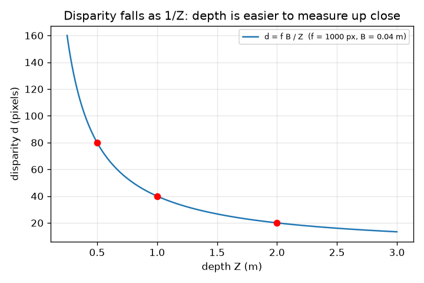
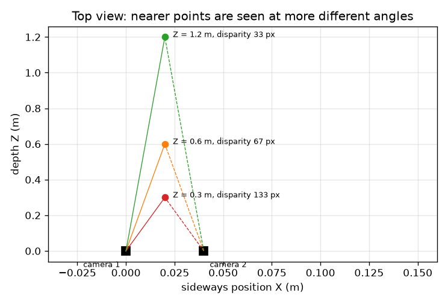

# సెషన్ 1: ఒక కెమెరా ప్రపంచాన్ని చదును చేస్తుంది; రెండు కెమెరాలు లోతును తిరిగి రాబడతాయి

[Session 1 — हिन्दी](README.hi.md)

*స్థాయి 1 (భావనాత్మక ఇంటరాక్టివ్ మోడల్) · సుమారు 60 నిమిషాలు · openstereodic*

> ఇది సరళీకరించిన విద్యా మోడల్. ఇది ధృవీకరించబడిన డిజైన్ సాధనం కాదు; నిజమైన నిర్మాణాలు, విద్యుత్ ఇన్‌స్టాలేషన్‌లు, వాహనాలు, పారిశ్రామిక ప్రక్రియలు లేదా వైద్య నిర్ణయాల కోసం దీనిని ఉపయోగించకూడదు.

**ముందస్తు అవసరాలు (Prerequisites)**

- పాఠశాల జ్యామితిలో సరూప త్రిభుజాలు.
- మీరు PRIMER.md చదివి, `python start.py 1` ను ఒకసారి రన్ చేసి ఉండాలి.

**అభ్యాస లక్ష్యాలు (Learning objectives).** ఈ సెషన్ తర్వాత మీరు:

- ఒక 3D బిందువు చిత్రంలో ఎక్కడ పడుతుందో కనుగొనడానికి పిన్‌హోల్ నియమం u = f X / Z ఉపయోగించగలరు.
- రెండు కెమెరాలు చూసే బిందువు లోతుపై మాత్రమే ఆధారపడే మొత్తంలో పక్కకు ఎందుకు దూకుతుందో వివరించగలరు.
- అసమానత (disparity) నుండి లోతును Z = f B / d తో చేతితో, Python లో లెక్కించగలరు.
- దగ్గరి బిందువుల కంటే దూరపు బిందువులు తక్కువ ఖచ్చితత్వంతో ఎందుకు కొలవబడతాయో వివరించగలరు.

## A. నిజ జీవిత సమస్య
ఒక కన్ను మూసి, చేయి చాచి ఒక వేలిని పట్టుకుని, కళ్ళను మార్చండి: వేలు నేపథ్యానికి వ్యతిరేకంగా దూకుతుంది, వెనుక గోడ కంటే చాలా ఎక్కువగా. ఒకే ఫోటో వస్తువులు ఎంత దూరంలో ఉన్నాయో చెప్పలేదు, కానీ కొన్ని సెంటీమీటర్ల దూరంలో తీసిన రెండు ఫోటోలు చెప్పగలవు. బరువు పెట్టిన రబ్బరు పట్టీ ఆకారాన్ని తాకకుండా కొలవడానికి ల్యాబ్‌లు సరిగ్గా దీనినే ఉపయోగిస్తాయి. రెండు చదునైన చిత్రాల నుండి 3D స్థానాన్ని ఎలా కనుగొనాలి?

## B. భావన మరియు సిద్ధాంతం
పిన్‌హోల్ కెమెరా (X, Y, Z) బిందువు నుండి కాంతిని ఒక చిన్న రంధ్రం గుండా పంపి, దాని వెనుక f దూరంలో ఉన్న సెన్సర్‌పై పడేలా చేస్తుంది. సరూప త్రిభుజాల ద్వారా పడే చోటు పక్కకు u = f X / Z, పైకి v = f Y / Z. మనం f ను పిక్సెల్స్‌లో లెక్కిస్తాము, కాబట్టి u, v చిత్రం మధ్య నుండి పిక్సెల్స్‌లో ఉంటాయి. కెమెరా 2 ను కెమెరా 1 కుడివైపు B దూరంలో (బేస్‌లైన్, baseline) ఉంచండి, రెండూ నేరుగా ముందుకు చూస్తాయి. కెమెరా 2 కు బిందువు ఎడమకు B దగ్గరగా ఉంది, కాబట్టి u2 = f (X - B) / Z. పక్క దూకుడు d = u1 - u2 (అసమానత) f B / Z: దానిలో X లేదు, లోతు Z మాత్రమే ఉంది. తిప్పితే Z = f B / d.

| చిహ్నం | అర్థం | యూనిట్ |
|---|---|---|
| X, Y, Z | బిందువు స్థానం: పక్కకు, పైకి, కెమెరా 1 ముందు దూరం | m |
| f | పిక్సెల్స్‌లో కొలిచిన ఫోకల్ పొడవు | px |
| B | బేస్‌లైన్: రెండు కెమెరాల మధ్య దూరం | m |
| u1, u2 | చిత్రం మధ్య నుండి, కెమెరా 1, 2 లో పక్క చిత్ర నిరూపకం | px |
| d | అసమానత u1 - u2 | px |

**ఊహలు (Assumptions)**

- లెన్స్ వక్రీకరణ లేని పిన్‌హోల్ కెమెరాలు.
- రెండు కెమెరాలూ నేరుగా ముందుకు, సమాంతరంగా, ఒకే ఎత్తులో, ఒకే f తో చూస్తాయి.
- f, B ఖచ్చితంగా తెలుసు.

$$ u=\frac{fX}{Z},\qquad v=\frac{fY}{Z} $$

$$ u_1=\frac{fX}{Z},\qquad u_2=\frac{f(X-B)}{Z} $$

$$ d=u_1-u_2=\frac{fB}{Z}\quad\Longleftrightarrow\quad Z=\frac{fB}{d} $$

## C. దృశ్య వివరణ
మొదటి చిత్రం 0.04 m దూరంలోని రెండు కెమెరాలు, 0.3, 0.6, 1.2 m లోతుల్లోని మూడు బిందువులతో పై నుండి వీక్షణం: రెండు కెమెరాల నుండి దగ్గరి బిందువుకు కిరణాలు విశాల కోణాన్ని (అసమానత 133 px), దూరపు బిందువుకు ఇరుకైన కోణాన్ని (33 px) ఏర్పరుస్తాయి. రెండవ చిత్రం f = 1000 px, B = 0.04 m కు లోతుకు వ్యతిరేకంగా అసమానతను గీస్తుంది; వక్రం 1 / Z లా తగ్గుతుంది, కాబట్టి దగ్గర నిటారుగా, దూరంలో దాదాపు చదునుగా ఉంటుంది, అందుకే దగ్గర లోతు కొలవడం సులభం, దూరంలో కష్టం.

*లోతుకు వ్యతిరేకంగా అసమానత: f = 1000 px, B = 0.04 m కు 1 / Z వక్రం.*

*పై వీక్షణం: బిందువు దగ్గరగా ఉన్న కొద్దీ రెండు కిరణాల మధ్య కోణం విశాలంగా, అసమానత పెద్దదిగా ఉంటుంది.*

## D. ఇంటరాక్టివ్ సిమ్యులేషన్
పాఠాన్ని రన్ చేయండి (`python start.py 1`), తర్వాత లైవ్ యాప్‌ను తెరవండి: [సెషన్ 1: రెండు కెమెరాలు, ఒక బిందువు](https://krunalpanchal1995.github.io/pan-iit-oss/openstereodic/session-01/) (లేదా ఈ ఫోల్డర్‌లోని `app.html`). లోతు స్లైడర్‌ను జరిపి పై వీక్షణంలో రెండు కిరణాలు తెరుచుకోవడం, మూసుకోవడం చూడండి; తర్వాత గ్రాఫ్‌కు మారి బిందువు 1 / Z వక్రంపై జారడం చూడండి. బేస్‌లైన్ మార్చి బూడిద వక్రంతో పోల్చండి.

**సవాలు.** అసమానతను 100 px చేయండి (2 px లోపు).

## E. సాధించిన ఉదాహరణ మరియు ప్రయోగం
**సమస్య.** f = 1000 px, B = 0.04 m తో, ఒక బిందువు X = 0.02 m, Y = 0.01 m, Z = 0.5 m వద్ద ఉంది. ప్రతి కెమెరా దానిని ఎక్కడ చూస్తుంది, అసమానత ఎంత, Z = f B / d మళ్ళీ 0.5 m ఇస్తుందా?

1. కెమెరా 1: u1 = 1000 * 0.02 / 0.5 = 40 px, v = 1000 * 0.01 / 0.5 = 20 px.
2. కెమెరా 2: u2 = 1000 * (0.02 - 0.04) / 0.5 = -40 px (బిందువు దాని మధ్య రేఖకు ఎడమవైపు ఉంది), v = 20 px.
3. అసమానత d = u1 - u2 = 40 - (-40) = 80 px. f B / Z = 1000 * 0.04 / 0.5 = 80 px తో సరిచూడండి.
4. అసమానత నుండి లోతు తిరిగి: Z = f B / d = 1000 * 0.04 / 80 = 0.5 m.

**సమాధానం.** కెమెరా 1 (40, 20) px చూస్తుంది, కెమెరా 2 (-40, 20) px చూస్తుంది, అసమానత 80 px, లోతు 0.5 m గా తిరిగి రాబట్టబడింది.

**ప్రయోగం.** ఒక గోడ నుండి 2 m దూరంలో నిలబడి 0.5 m వద్ద ఒక పెన్సిల్ పట్టుకోండి. ఫోన్‌ను 4 cm పక్కకు జరిపి (బల్లపై స్కేలు ఉంచండి) రెండు ఫోన్ ఫోటోలు తీయండి. ఇమేజ్ వ్యూయర్‌లో పెన్సిల్ దూకును పిక్సెల్స్‌లో కొలిచి, మీ ఫోన్ ఫోకల్ పొడవును పిక్సెల్స్‌లో (ప్రధాన కెమెరాకు చిత్రం పిక్సెల్ వెడల్పుకు సుమారు 0.8 నుండి 1.2 రెట్లు) ఉపయోగించి f B / Z తో పోల్చండి. సుమారు 10 శాతం వరకు సరిపోలికను ఆశించండి: నిజమైన లెన్స్‌కు వక్రీకరణ ఉంది, ఫోన్ కొంచెం తిరగవచ్చు, మీరు పిక్సెల్స్‌ను సుమారు ఒక పిక్సెల్ వరకు మాత్రమే చదవగలరు.

## F. మూల్యాంకనం మరియు డిజైన్ సవాలు
**ప్రశ్న రకం A: భావనాత్మక.** అసమానత బిందువు పక్క స్థానం X పై ఆధారపడకపోవడానికి కారణం ఏమిటి?

సూచన

u1 - u2 రాసి X ఉన్న పదాలకు ఏమి జరుగుతుందో చూడండి.

దశలవారీ పరిష్కారం

u1 = f X / Z, u2 = f (X - B) / Z, కాబట్టి u1 - u2 = f X / Z - f X / Z + f B / Z = f B / Z. X పదాలు రద్దవుతాయి. రెండు కెమెరాలూ బిందువును ఒకే మొత్తం f X / Z పక్కకు జరిగినట్లు చూస్తాయి; బేస్‌లైన్ పదం f B / Z మాత్రమే మిగులుతుంది, అది లోతుపై ఆధారపడుతుంది.

**ప్రశ్న రకం B: సంఖ్యాత్మక.** 0.06 m దూరంలో f = 1000 px ఉన్న రెండు కెమెరాలు 25 px అసమానతను కొలుస్తాయి. బిందువు ఎంత దూరంలో ఉంది? సమాధానం సహేతుకమా?

సూచన

Z = f B / d. యూనిట్లు సరిచూడండి: px * m / px = m.

దశలవారీ పరిష్కారం

Z = 1000 * 0.06 / 25 = 2.4 m. సహేతుక పరీక్ష: పెద్ద అసమానత అంటే దగ్గర, 25 px, 1 m వద్ద వచ్చే 60 px కంటే చిన్నది, కాబట్టి 1 m కు అవతల ఉన్న బిందువు సరిపోతుంది. యూనిట్లు: px * m / px = m.

**ప్రశ్న రకం C: గ్రాఫ్ మరియు సిమ్యులేషన్ వ్యాఖ్యానం.** లోతుకు వ్యతిరేకంగా అసమానత గ్రాఫ్‌లో లోతు 0.5 m నుండి 1.0 m కు రెట్టింపు అయినప్పుడు అసమానతకు ఏమి జరుగుతుంది, అది ఖచ్చితత్వానికి ఏమి సూచిస్తుంది?

సూచన

0.5 m, 1 m, 2 m వద్ద విలువలు చదవండి.

దశలవారీ పరిష్కారం

లోతు రెట్టింపు అయిన ప్రతిసారీ అసమానత సగం అవుతుంది: 0.5 m వద్ద 80 px, 1 m వద్ద 40 px, 2 m వద్ద 20 px (1 / Z ఆకారం). వక్రం దగ్గర నిటారుగా ఉంది, కాబట్టి ఒక పిక్సెల్ అసమానత లోపం 0.5 m వద్ద 6.2 mm లోతుకు, 2 m వద్ద 95 mm కు సమానం. అదే సరిపోల్చే ఖచ్చితత్వం దూరంలో చాలా దారుణమైన లోతును ఇస్తుంది.

**ప్రశ్న రకం D: డిజైన్ మరియు ఆప్టిమైజేషన్ సవాలు.** డిజైన్: f = 1000 px తో, 0.5 m వద్ద ఒక పిక్సెల్ అసమానత గరిష్ఠంగా 5 mm లోతుకు సమానమయ్యేలా బేస్‌లైన్ ఎంచుకోండి. పొడవైన బేస్‌లైన్ ఖరీదు ఏమిటి?

సూచన

ఒక పిక్సెల్ మార్పుకు లోతు అడుగు = Z^2 / (f B + Z) ఉపయోగించి, B కోసం సాధించండి.

దశలవారీ పరిష్కారం

మనకు 0.25 / (1000 B + 0.5) <= 0.005 కావాలి, కాబట్టి 1000 B + 0.5 >= 50, B >= 0.0495 m. 0.05 m బేస్‌లైన్ 4.95 mm అడుగును, 0.5 m వద్ద 100 px అసమానతను ఇస్తుంది. ఖరీదు: కెమెరాలు మరింత దూరంగా ఉన్నప్పుడు ప్రతి ఒక్కటీ వస్తువును మరింత భిన్న కోణం నుండి చూస్తుంది, కాబట్టి రెండు చిత్రాలు తక్కువగా అతివ్యాప్తి చెందుతాయి, సరిపోల్చడం కష్టమవుతుంది (పెద్ద శోధన పరిధి, ఎక్కువ దృక్కోణ మార్పు), పరికరం కూడా స్థూలంగా మారుతుంది. ఊహ: సమాంతర కెమెరాలు, ఖచ్చితమైన f.

[RUBRIC.md](../../RUBRIC.md) తో మిమ్మల్ని మీరు స్కోర్ చేసుకోండి. కాగితంపై పని చేయడానికి [కార్యాచరణ షీట్](activity_sheet.md) ప్రింట్ చేయండి.

## సాధారణ అపోహలు
| సాధారణ అపోహ | వాస్తవంగా నిజమైనది |
|---|---|
| బిందువు ఎంత ఎడమ లేదా కుడి ఉందనే దానిపై అసమానత ఆధారపడుతుంది. | దాని లోతు Z పై మాత్రమే (d = f B / Z). రెండు చిత్రాలను తీసివేసినప్పుడు పక్క స్థానం రద్దవుతుంది. |
| పెద్ద అసమానత అంటే బిందువు ఎక్కువ దూరంలో ఉంది. | దానికి వ్యతిరేకం: దగ్గరి బిందువులు ఎక్కువగా దూకుతాయి. Z = f B / d, కాబట్టి పెద్ద d అంటే చిన్న Z. |
| రెండు కెమెరాలు అన్ని దూరాల్లో సమానంగా బాగా లోతును కొలుస్తాయి. | ఈ పరికరంలో ఒక పిక్సెల్ అసమానత అడుగు 0.5 m వద్ద 6 mm, 2 m వద్ద సుమారు 95 mm; దూరం వర్గం ప్రకారం ఖచ్చితత్వం తగ్గుతుంది. |

## పదకోశం (Glossary)
- **పిన్‌హోల్ కెమెరా (pinhole camera)**: సరళమైన కెమెరా మోడల్: కాంతి ఒక బిందువు గుండా వెళ్ళి సెన్సర్‌పై పడుతుంది
- **ఫోకల్ పొడవు (పిక్సెల్స్‌లో) (focal length)**: పిన్‌హోల్ నుండి సెన్సర్ వరకు దూరం, పిక్సెల్ వెడల్పుల్లో లెక్కించినది
- **బేస్‌లైన్ (baseline)**: రెండు కెమెరాల మధ్య దూరం
- **అసమానత (disparity)**: రెండు చిత్రాల మధ్య ఒక బిందువు పక్కకు ఎంత దూకుతుంది, పిక్సెల్స్‌లో
- **పారలాక్స్ (parallax)**: వీక్షణ స్థానాన్ని మార్చినప్పుడు దూరపు వాటికి వ్యతిరేకంగా దగ్గరి వస్తువులకు కలిగే తోచే స్థానచలనం

## ముగింపు
1. [exercises.md](exercises.md) లోని మూడు కోడింగ్ పనులు చేయండి.
2. మీ మార్పుల తర్వాత `python start.py 1` ను మళ్ళీ రన్ చేయండి. అది చెక్‌పాయింట్‌తో ముగుస్తుంది; అది `PASS` అని ప్రింట్ చేసినప్పుడు, మీరు పూర్తి చేసినట్లు. (చెక్‌పాయింట్ మాత్రమే: `python start.py check 1`.)

తదుపరి: [సెషన్ 2](../session-02/README.md)
