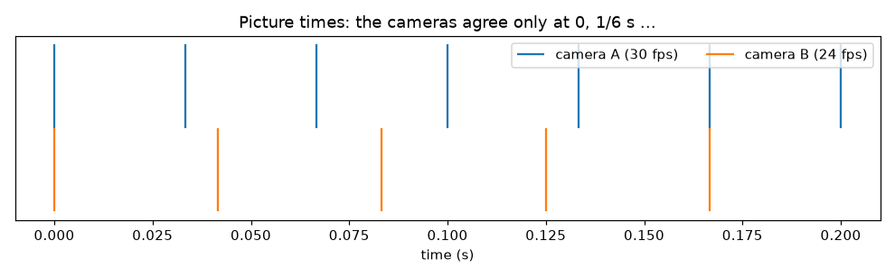
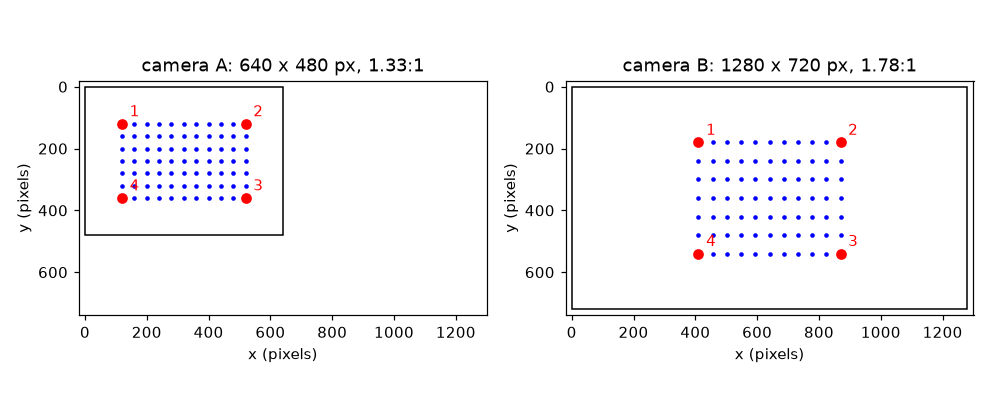

# सत्र 1: दो कैमरे असहमत क्यों होते हैं

*स्तर 1 (वैचारिक इंटरैक्टिव मॉडल) · लगभग 60 मिनट · openstitchdic*

> यह एक सरलीकृत शैक्षिक मॉडल (simplified educational model) है। यह कोई सत्यापित डिज़ाइन टूल नहीं है और इसका उपयोग वास्तविक संरचनाओं, बिजली की स्थापनाओं, वाहनों, औद्योगिक प्रक्रियाओं या चिकित्सा निर्णयों के लिए नहीं किया जाना चाहिए।

**पूर्व-आवश्यकताएँ (Prerequisites)**

- स्कूल त्रिकोणमिति: किसी कोण का कोसाइन।
- आपने PRIMER.md पढ़ लिया है और `python start.py 1` एक बार चला लिया है।

**सीखने के उद्देश्य (Learning objectives).** इस सत्र के बाद आप:

- तीन तरीके समझा सकेंगे जिनसे दो कैमरे असहमत हो सकते हैं: दृष्टिकोण (viewpoint), चित्र का आकार और आकृति, और समय (timing)।
- निकाल सकेंगे कि कैमरे को किसी कोण से घुमाने पर एक बग़ल की दूरी कितनी सिकुड़ती है।
- दो चित्रों के बीच पहचान-चिह्नों (landmarks) का मिलान कर सकेंगे और वह खिंचाव (stretch) निकाल सकेंगे जो एक को दूसरे पर ले आता है।
- निकाल सकेंगे कि दो फ्रेम दरें (frame rates) कब मेल खाती हैं और बीच में समय का अंतराल कितना बड़ा है।

## A. वास्तविक दुनिया की समस्या
आप एक धब्बेदार (speckled) रबर शीट को दो कैमरों से फ़िल्माते हैं ताकि माप सकें कि वह कैसे विकृत होती है (यह स्टीरियो डिजिटल इमेज कोरिलेशन, DIC, है)। कैमरा A सीधे शीट को देखता है। कैमरा B एक तरफ़ खड़ा है, उसका चित्र चौड़ा है और वह 24 चित्र प्रति सेकंड पर चलता है जबकि A 30 पर। अगर आप कुछ भी समायोजित न करें, तो कुछ भी मेल नहीं खाता: दोनों कोणों से शीट का ग्रिड अलग दिखता है, चित्रों के आकार अलग हैं, और हर चित्र का क्षण अलग है। ये अंतर कितने बड़े हैं, और क्या एक सरल सुधार उन्हें हटा सकता है? (यह एक माप विधि के बारे में सामान्य शिक्षा है, कोई सत्यापित माप प्रक्रिया नहीं।)

## B. अवधारणा और सिद्धांत
तीन अंतर। (1) दृष्टिकोण: जो कैमरा एक तरफ़ yaw कोण से घुमाया गया है, वह सपाट शीट पर बग़ल की दूरियों को cos(yaw) से सिकुड़ा हुआ देखता है, जबकि ऊपर-नीचे की दूरियाँ समान रहती हैं। यह सबसे सरल मॉडल है, दूर रखे कैमरे के लिए मान्य; सत्र 2 पूर्ण परिप्रेक्ष्य (perspective) जोड़ता है। (2) चित्र का आकार और आकृति: कैमरा A 640 x 480 पिक्सेल (4:3) का है और कैमरा B 1280 x 720 (16:9) का, और हर एक की शीट की प्रति इकाई पिक्सेल संख्या अपनी है। B को A पर लाने वाला खिंचाव पहचान-चिह्नों से निकाला जाता है: A में दो पहचान-चिह्नों के बीच की दूरी को B में उसी दूरी से भाग दीजिए, एक बार बग़ल में और एक बार ऊपर-नीचे। अगर दोनों संख्याएँ अलग हैं, तो एक आकार-परिवर्तन गुणक (resize factor) इसे ठीक नहीं कर सकता। (3) समय: A, k/30 s पर चित्र लेता है और B, m/24 s पर। वे केवल तब मेल खाते हैं जब k/30 = m/24, जो हर 1/gcd(30, 24) = 1/6 s पर होता है। बीच में, निकटतम B चित्र अधिकतम 1/60 s दूर होता है, और एक चलता नमूना उस समय में चाल गुणा अंतराल जितना चलता है।

| प्रतीक | अर्थ | इकाई |
|---|---|---|
| yaw | वह कोण जिससे कैमरा एक तरफ़ घुमाया गया है | डिग्री |
| cos(yaw) | बग़ल का सिकुड़न गुणक | कोई इकाई नहीं |
| k | शीट की प्रति इकाई पिक्सेल (चित्र पैमाना) | पिक्सेल प्रति इकाई |
| sx, sy | चित्र B से चित्र A पर खिंचाव, बग़ल में और ऊपर-नीचे | कोई इकाई नहीं |
| fps | किसी कैमरे के प्रति सेकंड चित्र | 1/s |
| gap | किसी A चित्र से निकटतम B चित्र तक का समय | s |
| v | चित्र में नमूने की चाल | पिक्सेल प्रति सेकंड |

**मान्यताएँ (Assumptions)**

- शीट सपाट है और कैमरे दूर हैं, इसलिए घुमाया गया कैमरा केवल बग़ल की दूरियों को सिकोड़ता है।
- दोनों घड़ियाँ t = 0 पर एक साथ शुरू होती हैं और स्थिर रूप से चलती हैं।
- फ्रेम दरें पूर्ण संख्याएँ हैं।

$$ x_{\mathrm{pix}}=c_x+k\cos(\mathrm{yaw})\,x,\qquad y_{\mathrm{pix}}=c_y+k\,y $$

$$ s_x=\frac{x_{A,2}-x_{A,1}}{x_{B,2}-x_{B,1}}=\frac{k_A}{k_B\cos(\mathrm{yaw}_B)},\qquad s_y=\frac{k_A}{k_B} $$

$$ T_{\mathrm{agree}}=\frac{1}{\gcd(f_A,\,f_B)} $$

$$ \Delta x = v\cdot \mathrm{gap} $$

## C. दृश्य व्याख्या
पहला चित्र बिंदुओं का वही 11 x 7 ग्रिड बनाता है जैसा दोनों कैमरे उसे देखते हैं, और हर चित्र एक ही पिक्सेल पैमाने पर बनाया गया है: A एक 4:3 फ्रेम है जिसमें ग्रिड वर्गाकार दिखता है, B एक चौड़ा 16:9 फ्रेम है जिसमें ग्रिड संकरा दिखता है क्योंकि कैमरा 40 डिग्री घुमाया गया है। चार लाल पहचान-चिह्न (शीट के कोने) दोनों चित्रों में क्रमांकित हैं ताकि आप उन्हें आँख से मिला सकें। दूसरा चित्र दोनों कैमरों के चित्र-समयों को एक समय अक्ष पर रखता है: 30 fps के निशान और 24 fps के निशान 0 पर और 1/6 s पर मिलते हैं और बीच में निकटतम निशान अधिकतम 16.7 ms दूर होते हैं।

*दोनों कैमरों के चित्र-समय: वे केवल हर 1/6 s पर मेल खाते हैं।*

*दोनों कैमरों द्वारा देखा गया वही ग्रिड: अलग चित्र आकृति, आकार और सिकुड़न।*

## D. इंटरैक्टिव सिमुलेशन
पाठ चलाइए (`python start.py 1`), फिर लाइव ऐप खोलिए: [सत्र 1: दो दृश्य और दो घड़ियाँ](https://krunalpanchal1995.github.io/pan-iit-oss/openstitchdic/session-01/) (या इस फ़ोल्डर में `app.html`)। yaw स्लाइडर से कैमरा B घुमाइए और उसके ग्रिड को संकरा होते देखिए, फिर समय दृश्य खोलिए, B की फ्रेम दर बदलिए और निकटतम B चित्र तक की दूरी देखिए। रीडआउट बताता है कि चुनी गई चाल वाला नमूना सबसे बुरे अंतराल में कितनी दूर चलता है।

**चुनौती (Challenge).** सिकुड़न को 0.8 या बेहतर (yaw 36 डिग्री या कम) रखिए और 120 px/s से चलते नमूने के लिए सबसे बुरी समय त्रुटि 1 px से कम कीजिए।

## E. हल किया गया उदाहरण और प्रयोग
**समस्या.** कैमरा B 40 डिग्री घुमाया गया है। शीट पर एक वर्ग कैमरा A (सीधे देखते हुए) में 100 पिक्सेल चौड़ा है। B द्वारा उसी पैमाने पर लिए गए चित्र में वह बग़ल में कितना चौड़ा दिखता है? और 30 fps और 24 fps कैमरों के बीच सबसे बुरे समय अंतराल में 120 px/s से चलता नमूना कितनी दूर चलता है?

1. सिकुड़न = cos 40 = 0.766।
2. उसी पैमाने पर B में चौड़ाई = 100 * 0.766 = 76.6 पिक्सेल।
3. कैमरे हर 1/gcd(30, 24) = 1/6 s पर मेल खाते हैं। एक चक्र में A के चित्र 0, 1/30, 2/30, 3/30, 4/30 s पर हैं और B के चित्र 0, 1/24, 2/24, 3/24 s पर।
4. पाँच A चित्रों के लिए निकटतम-B दूरियाँ 0, 8.33, 16.67, 16.67 और 8.33 ms हैं। सबसे बुरा अंतराल 16.7 ms = 1/60 s है।
5. चली गई दूरी = 120 px/s * (1/60) s = 2.0 px।

**उत्तर.** वर्ग 76.6 पिक्सेल चौड़ा दिखता है, और 16.7 ms का सबसे बुरा समय अंतराल 120 px/s वाले नमूने को 2.0 px खिसका देता है, जो पिक्सेल के सौवें भाग का लक्ष्य रखने वाले माप में बड़ी त्रुटि है।

**प्रयोग (Experiment).** कागज़ की शीट पर 10 x 6 का ग्रिड बनाइए, फ़ोन से उसका सामने से और फिर बग़ल से फ़ोटो लीजिए, और इमेज व्यूअर से दोनों फ़ोटो में ग्रिड की चौड़ाई मापिए। चौड़ाइयों का अनुपात आपके देखने के कोण के कोसाइन के पास होना चाहिए। अंतर परिप्रेक्ष्य (पास का किनारा दूर के किनारे से बड़ा), लेंस विकृति (lens distortion) और गलत मापे गए कोण से आते हैं: मॉडल समान रूप से सिकोड़ता है, वास्तविक कैमरा नहीं।

## F. मूल्यांकन और डिज़ाइन चुनौती
**प्रश्न प्रकार A: वैचारिक (Conceptual).** इस व्यवस्था में एक आकार-परिवर्तन गुणक कैमरा B के चित्र को कैमरा A के चित्र पर क्यों नहीं ला सकता?

संकेत

शीट के कोनों से बग़ल और ऊपर-नीचे का खिंचाव निकालिए और उनकी तुलना कीजिए।

चरण-दर-चरण हल

बग़ल का खिंचाव 40 / (60 cos 40) = 0.870 है और ऊपर-नीचे का खिंचाव 40 / 60 = 0.667 है। ये अलग हैं क्योंकि B घुमाया गया है (उसकी बग़ल की दूरियाँ cos 40 से सिकुड़ी हैं) और चित्रों के पैमाने अलग हैं। एक आकार-परिवर्तन गुणक केवल एक संख्या लागू कर सकता है, इसलिए अलग बग़ल और ऊपर-नीचे भागों वाला रूपांतरण (transform) चाहिए (और सामान्यतः परिप्रेक्ष्य भी, जो सत्र 2 में है)।

**प्रश्न प्रकार B: संख्यात्मक (Numerical).** एक कैमरा एक तरफ़ 60 डिग्री घुमाया गया है। सामने से लिए चित्र में एक बग़ल की दूरी 100 पिक्सेल है। वह कितनी लंबी दिखती है? 90 px/s वाले नमूने को 1/60 s दूर वाले चित्र से जोड़ा जाता है: वह कितनी दूर चल चुका है?

संकेत

सिकुड़न = cos(yaw) और दूरी = चाल * अंतराल का उपयोग कीजिए।

चरण-दर-चरण हल

cos 60 = 0.5, इसलिए दूरी 100 * 0.5 = 50 पिक्सेल दिखती है (इकाई: पिक्सेल)। नमूना 90 * (1/60) = 1.5 px चलता है। तर्कसंगतता जाँच (sanity check): 90 डिग्री पर सिकुड़न 0 होगी, शीट किनारे से दिखेगी, इसीलिए बहुत बड़े कोण बेकार हैं।

**प्रश्न प्रकार C: ग्राफ़ और सिमुलेशन की व्याख्या.** समय ग्राफ़ में (B की फ्रेम दर = 24), वक्र अधिकतम कहाँ तक पहुँचता है, और लाल बिंदु आपको क्या बताते हैं?

संकेत

वक्र निकटतम B चित्र तक की दूरी है; बिंदु A चित्र-समयों पर पढ़े गए हैं।

चरण-दर-चरण हल

वक्र दो B चित्रों के ठीक बीच में आधे B आवर्तकाल, 1/48 s = 20.8 ms, तक पहुँचता है। A चित्र-समयों पर लाल बिंदु एक 1/6 s चक्र में 0, 8.33, 16.67, 16.67 और 8.33 ms पढ़ते हैं, इसलिए किसी भी A चित्र द्वारा देखा गया सबसे बुरा अंतराल 16.7 ms है, जो वक्र के शिखर से नीचे है क्योंकि A चित्र B अंतराल के ठीक बीच में नहीं पड़ते।

**प्रश्न प्रकार D: डिज़ाइन और अनुकूलन (optimisation) चुनौती.** डिज़ाइन: कैमरा A 30 fps पर चलता है। इनमें से कौन-सी B फ्रेम दरें सबसे बुरे अंतराल को 10 ms या उससे कम रखती हैं: 24, 25, 30, 48, 50, 60? आप कौन-सी चुनेंगे, और आप क्या छोड़ देते हैं?

संकेत

समय दृश्य या lesson.py में worst_gap(30, fps) का उपयोग कीजिए।

चरण-दर-चरण हल

सबसे बुरे अंतराल हैं 16.7 ms (24), 20 ms (25), 0 (30), 8.3 ms (48), 6.7 ms (50) और 0 (60)। इसलिए 30, 48, 50 और 60, 10 ms के भीतर हैं। 30 या 60 सटीक मेल (अंतराल 0) देते हैं पर केवल तभी जब दोनों घड़ियाँ एक साथ शुरू हों; 60 डेटा को दोगुना करता है और अधिक प्रकाश और भंडारण चाहिए। समझौता (trade-off): पूरी तरह मेल खाती जोड़ी समय अंतर्वेशन (time interpolation) की ज़रूरत हटा देती है, पर अक्सर आप चुन नहीं सकते, इसलिए सत्र 2 दिखाता है कि इसके बजाय अंतर्वेशन कैसे करें।

[RUBRIC.md](../../RUBRIC.md) से स्वयं को अंक दीजिए। कागज़ पर काम करने के लिए [गतिविधि पत्रक](activity_sheet.md) प्रिंट कीजिए।

## सामान्य भ्रांतियाँ
| सामान्य भ्रांति (misconception) | वास्तव में क्या सच है |
|---|---|
| 30 और 24 fps वाले दो कैमरों को बस फ्रेम-दर-फ्रेम जोड़ा जा सकता है। | A का फ्रेम k और B का फ्रेम k अलग-अलग समय (k/30 s और k/24 s) पर लिए जाते हैं; वे केवल हर 1/6 s पर मेल खाते हैं। |
| घुमाया गया कैमरा बस पूरे चित्र को छोटा कर देता है। | यह बग़ल की दूरियों को cos(yaw) से सिकोड़ता है और ऊपर-नीचे की दूरियों को वैसा ही छोड़ता है, इसलिए केवल आकार नहीं, आकृतियाँ भी बदलती हैं। |
| चित्र का आकार और चित्र की आकृति एक ही चीज़ हैं। | आकार पिक्सेल की संख्या है; आकृति पक्ष अनुपात (aspect ratio: 4:3 या 16:9) है। दो कैमरे एक में मेल खा सकते हैं और दूसरे में अलग हो सकते हैं। |

## शब्दावली
- **डिजिटल इमेज कोरिलेशन (digital image correlation, DIC)**: चित्रों में धब्बा पैटर्न का अनुसरण करके यह मापना कि कोई सतह कैसे चलती या विकृत होती है
- **yaw**: वह कोण जिससे कैमरा बग़ल में घुमाया गया है
- **पक्ष अनुपात (aspect ratio)**: किसी चित्र की चौड़ाई भाग ऊँचाई, जैसे 4:3 या 16:9
- **पहचान-चिह्न (landmark)**: एक बिंदु जिसे आप दोनों चित्रों में पहचान सकते हैं, जैसे शीट का कोना
- **फ्रेम दर (frame rate, fps)**: प्रति सेकंड चित्र

## समापन
1. [exercises.md](exercises.md) में दिए तीन कोडिंग कार्य कीजिए।
2. अपने बदलावों के बाद `python start.py 1` फिर से चलाइए। यह चेकपॉइंट (checkpoint) के साथ समाप्त होता है; जब यह `PASS` छापे, तो आपका काम पूरा है। (केवल चेकपॉइंट: `python start.py check 1`।)

आगे: [सत्र 2](../session-02/README.md)
