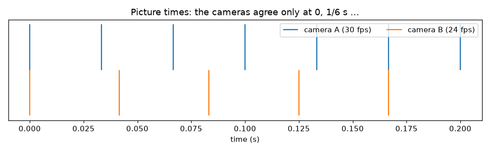
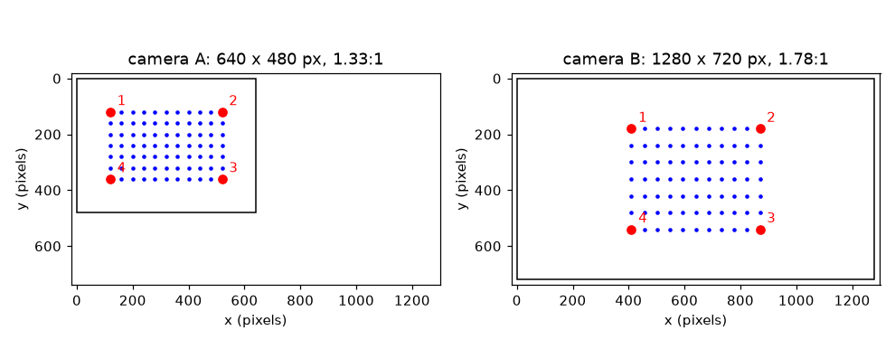

# സെഷൻ 1: രണ്ട് ക്യാമറകൾ വിയോജിക്കുന്നത് എന്തുകൊണ്ട്

[Session 1 — हिन्दी](README.hi.md) · [Session 1 — മലയാളം](README.ml.md)

*ലെവൽ 1 (ആശയപരമായ ഇന്ററാക്ടീവ് മോഡൽ) · ഏകദേശം 60 മിനിറ്റ് · openstitchdic*

> ഇത് ലളിതമാക്കിയ ഒരു വിദ്യാഭ്യാസ മോഡലാണ്. ഇത് സാധൂകരിക്കപ്പെട്ട (validated) ഒരു ഡിസൈൻ ഉപകരണമല്ല; യഥാർത്ഥ നിർമ്മിതികൾ, ഇലക്ട്രിക്കൽ ഇൻസ്റ്റലേഷനുകൾ, വാഹനങ്ങൾ, വ്യാവസായിക പ്രക്രിയകൾ അല്ലെങ്കിൽ മെഡിക്കൽ തീരുമാനങ്ങൾ എന്നിവയ്ക്ക് ഇത് ഉപയോഗിക്കരുത്.

**മുൻ‌വ്യവസ്ഥകൾ (Prerequisites)**

- സ്കൂൾ ത്രികോണമിതി: ഒരു കോണിന്റെ കോസൈൻ.
- നിങ്ങൾ PRIMER.md വായിക്കുകയും `python start.py 1` ഒരിക്കൽ റൺ ചെയ്യുകയും ചെയ്തിട്ടുണ്ട്.

**പഠന ലക്ഷ്യങ്ങൾ (Learning objectives).** ഈ സെഷനു ശേഷം നിങ്ങൾക്ക് കഴിയും:

- രണ്ട് ക്യാമറകൾ വിയോജിക്കാവുന്ന മൂന്ന് വഴികൾ വിശദീകരിക്കാൻ: കാഴ്ചപ്പാട്, ചിത്രത്തിന്റെ വലുപ്പവും ആകൃതിയും, സമയക്രമം.
- ഒരു ക്യാമറ ഒരു കോണിൽ തിരിക്കുമ്പോൾ ഒരു വശത്തേക്കുള്ള ദൂരം എത്ര ഞെരുങ്ങുന്നുവെന്ന് കണക്കാക്കാൻ.
- രണ്ട് ചിത്രങ്ങൾക്കിടയിൽ അടയാളസ്ഥലങ്ങൾ (landmarks) പൊരുത്തപ്പെടുത്തി ഒന്നിനെ മറ്റൊന്നിലേക്ക് കൊണ്ടുവരുന്ന വലിവ് (stretch) കണ്ടെത്താൻ.
- രണ്ട് ഫ്രെയിം റേറ്റുകൾ എപ്പോൾ യോജിക്കുന്നുവെന്നും ഇടയിലെ സമയ വിടവ് എത്ര വലുതാണെന്നും കണക്കാക്കാൻ.

## A. യഥാർത്ഥ ലോക പ്രശ്നം
ഒരു പുള്ളിക്കുത്തുള്ള റബ്ബർ ഷീറ്റ് എങ്ങനെ രൂപഭേദം വരുന്നുവെന്ന് അളക്കാൻ നിങ്ങൾ രണ്ട് ക്യാമറകൾ കൊണ്ട് ചിത്രീകരിക്കുന്നു (ഇത് സ്റ്റീരിയോ ഡിജിറ്റൽ ഇമേജ് കോറിലേഷൻ, DIC). ക്യാമറ A ഷീറ്റിലേക്ക് നേരെ നോക്കുന്നു. ക്യാമറ B ഒരു വശത്ത് നിൽക്കുന്നു, വിശാലമായ ചിത്രമുണ്ട്, സെക്കൻഡിൽ 24 ചിത്രങ്ങൾ എടുക്കുന്നു, A 30 എടുക്കുന്നു. ഒന്നും ക്രമീകരിച്ചില്ലെങ്കിൽ ഒന്നും ഒത്തുവരില്ല: ഷീറ്റിലെ ഗ്രിഡ് രണ്ട് കോണുകളിൽ നിന്ന് വ്യത്യസ്തമായി കാണപ്പെടുന്നു, ചിത്രങ്ങൾക്ക് വ്യത്യസ്ത വലുപ്പമുണ്ട്, ഓരോ ചിത്രത്തിന്റെയും നിമിഷം വ്യത്യസ്തമാണ്. ഈ വ്യത്യാസങ്ങൾ എത്ര വലുതാണ്, ഒരു ലളിതമായ തിരുത്തൽ കൊണ്ട് അവ നീക്കാൻ കഴിയുമോ? (ഇത് ഒരു അളവെടുപ്പ് രീതിയെക്കുറിച്ചുള്ള പൊതു വിദ്യാഭ്യാസമാണ്, സാധൂകരിക്കപ്പെട്ട അളവെടുപ്പ് നടപടിക്രമമല്ല.)

## B. ആശയവും സിദ്ധാന്തവും
മൂന്ന് വ്യത്യാസങ്ങൾ. (1) കാഴ്ചപ്പാട്: yaw കോണിൽ വശത്തേക്ക് തിരിഞ്ഞ ക്യാമറ, പരന്ന ഷീറ്റിലെ വശത്തേക്കുള്ള ദൂരങ്ങൾ cos(yaw) കൊണ്ട് ഞെരുങ്ങിയതായി കാണുന്നു, മുകളിലേക്കും താഴേക്കുമുള്ള ദൂരങ്ങൾ മാറുന്നില്ല. ഇത് ഏറ്റവും ലളിതമായ മോഡലാണ്, അകലെയുള്ള ക്യാമറയ്ക്ക് സാധുവാണ്; സെഷൻ 2 പൂർണ്ണ പെഴ്സ്പെക്ടീവ് ചേർക്കുന്നു. (2) ചിത്രത്തിന്റെ വലുപ്പവും ആകൃതിയും: ക്യാമറ A 640 x 480 പിക്സൽ (4:3), ക്യാമറ B 1280 x 720 (16:9), ഓരോന്നിനും ഷീറ്റിന്റെ ഓരോ യൂണിറ്റിനും സ്വന്തം പിക്സൽ എണ്ണമുണ്ട്. B-യെ A-യിലേക്ക് കൊണ്ടുവരുന്ന വലിവ് അടയാളസ്ഥലങ്ങളിൽ നിന്ന് കണ്ടെത്തുന്നു: A-യിലെ രണ്ട് അടയാളസ്ഥലങ്ങൾ തമ്മിലുള്ള ദൂരത്തെ B-യിലെ അതേ ദൂരം കൊണ്ട് ഹരിക്കുക, ഒരിക്കൽ വശത്തേക്കും ഒരിക്കൽ മുകളിൽ-താഴേക്കും. രണ്ട് സംഖ്യകളും വ്യത്യസ്തമാണെങ്കിൽ, ഒരൊറ്റ വലുപ്പമാറ്റ ഘടകത്തിന് അത് ശരിയാക്കാൻ കഴിയില്ല. (3) സമയക്രമം: A ചിത്രങ്ങൾ k/30 s-ലും B m/24 s-ലും എടുക്കുന്നു. k/30 = m/24 ആകുമ്പോൾ മാത്രമേ അവ യോജിക്കൂ, അത് ഓരോ 1/gcd(30, 24) = 1/6 s-ലും സംഭവിക്കുന്നു. ഇടയിൽ, ഏറ്റവും അടുത്ത B ചിത്രം 1/60 s വരെ അകലെയാകാം, ചലിക്കുന്ന സാമ്പിൾ ആ സമയത്ത് വേഗം ഗുണം വിടവ് ദൂരം സഞ്ചരിക്കുന്നു.

| ചിഹ്നം | അർത്ഥം | യൂണിറ്റ് |
|---|---|---|
| yaw | ക്യാമറ വശത്തേക്ക് തിരിച്ച കോൺ | ഡിഗ്രി |
| cos(yaw) | വശത്തേക്കുള്ള ഞെരുക്ക ഘടകം | യൂണിറ്റ് ഇല്ല |
| k | ഷീറ്റിന്റെ ഓരോ യൂണിറ്റിനുമുള്ള പിക്സലുകൾ (ചിത്ര സ്കെയിൽ) | പിക്സൽ ഓരോ യൂണിറ്റ് |
| sx, sy | ചിത്രം B-യിൽ നിന്ന് ചിത്രം A-യിലേക്കുള്ള വലിവ്, വശത്തേക്കും മുകളിൽ-താഴേക്കും | യൂണിറ്റ് ഇല്ല |
| fps | ഒരു ക്യാമറയുടെ സെക്കൻഡിലെ ചിത്രങ്ങൾ | 1/s |
| gap | ഒരു A ചിത്രത്തിൽ നിന്ന് ഏറ്റവും അടുത്ത B ചിത്രത്തിലേക്കുള്ള സമയം | s |
| v | ചിത്രത്തിലെ സാമ്പിളിന്റെ വേഗം | പിക്സൽ ഓരോ സെക്കൻഡ് |

**അനുമാനങ്ങൾ (Assumptions)**

- ഷീറ്റ് പരന്നതാണ്, ക്യാമറകൾ അകലെയാണ്, അതിനാൽ തിരിഞ്ഞ ക്യാമറ വശത്തേക്കുള്ള ദൂരങ്ങളെ മാത്രം ഞെരുക്കുന്നു.
- രണ്ട് ക്ലോക്കുകളും t = 0-ൽ ഒരുമിച്ച് ആരംഭിച്ച് സ്ഥിരമായി ഓടുന്നു.
- ഫ്രെയിം റേറ്റുകൾ പൂർണ്ണസംഖ്യകളാണ്.

$$ x_{\mathrm{pix}}=c_x+k\cos(\mathrm{yaw})\,x,\qquad y_{\mathrm{pix}}=c_y+k\,y $$

$$ s_x=\frac{x_{A,2}-x_{A,1}}{x_{B,2}-x_{B,1}}=\frac{k_A}{k_B\cos(\mathrm{yaw}_B)},\qquad s_y=\frac{k_A}{k_B} $$

$$ T_{\mathrm{agree}}=\frac{1}{\gcd(f_A,\,f_B)} $$

$$ \Delta x = v\cdot \mathrm{gap} $$

## C. ദൃശ്യ വിശദീകരണം
ആദ്യ ചിത്രം രണ്ട് ക്യാമറകൾ കാണുന്ന അതേ 11 x 7 പുള്ളി ഗ്രിഡ് വരയ്ക്കുന്നു, ഓരോ ചിത്രവും ഒരേ പിക്സൽ സ്കെയിലിൽ: A ചതുരം പോലെ തോന്നുന്ന ഗ്രിഡുള്ള 4:3 ഫ്രെയിമാണ്, B വിശാലമായ 16:9 ഫ്രെയിമാണ്, ക്യാമറ 40 ഡിഗ്രി തിരിഞ്ഞതിനാൽ അതിൽ ഗ്രിഡ് ഇടുങ്ങിയതായി കാണപ്പെടുന്നു. നാല് ചുവന്ന അടയാളസ്ഥലങ്ങൾ (ഷീറ്റ് മൂലകൾ) രണ്ട് ചിത്രങ്ങളിലും അക്കമിട്ടിരിക്കുന്നു, അതിനാൽ കണ്ണുകൊണ്ട് പൊരുത്തപ്പെടുത്താം. രണ്ടാമത്തെ ചിത്രം രണ്ട് ക്യാമറകളുടെയും ചിത്ര സമയങ്ങൾ ഒരു സമയ അക്ഷത്തിൽ വയ്ക്കുന്നു: 30 fps, 24 fps ടിക്കുകൾ 0-ലും 1/6 s-ലും കൂടിച്ചേരുന്നു, ഇടയിൽ ഏറ്റവും അടുത്ത ടിക്കുകൾ 16.7 ms വരെ അകലെയാണ്.

*രണ്ട് ക്യാമറകളുടെയും ചിത്ര സമയങ്ങൾ: അവ ഓരോ 1/6 s-ലും മാത്രമേ യോജിക്കൂ.*

*രണ്ട് ക്യാമറകൾ കാണുന്ന അതേ ഗ്രിഡ്: വ്യത്യസ്ത ചിത്ര ആകൃതി, വലുപ്പം, ഞെരുക്കം.*

## D. ഇന്ററാക്ടീവ് സിമുലേഷൻ
പാഠം റൺ ചെയ്യുക (`python start.py 1`), തുടർന്ന് ലൈവ് ആപ്പ് തുറക്കുക: [സെഷൻ 1: രണ്ട് കാഴ്ചകളും രണ്ട് ക്ലോക്കുകളും](https://krunalpanchal1995.github.io/pan-iit-oss/openstitchdic/session-01/) (അല്ലെങ്കിൽ ഈ ഫോൾഡറിലെ `app.html`). yaw സ്ലൈഡർ ഉപയോഗിച്ച് ക്യാമറ B തിരിച്ച് അതിന്റെ ഗ്രിഡ് ഇടുങ്ങുന്നത് നിരീക്ഷിക്കുക, പിന്നെ ടൈമിംഗ് വ്യൂ തുറന്ന് B-യുടെ ഫ്രെയിം റേറ്റ് മാറ്റി ഏറ്റവും അടുത്ത B ചിത്രത്തിലേക്കുള്ള ദൂരം നിരീക്ഷിക്കുക. തിരഞ്ഞെടുത്ത വേഗത്തിലുള്ള ഒരു സാമ്പിൾ ഏറ്റവും മോശം വിടവിൽ എത്ര ദൂരം നീങ്ങുന്നുവെന്ന് റീഡൗട്ട് പറയുന്നു.

**വെല്ലുവിളി (Challenge).** ഞെരുക്കം 0.8 അല്ലെങ്കിൽ അതിലും മികച്ചതായി നിലനിർത്തുക (yaw 36 ഡിഗ്രിയോ അതിൽ കുറവോ), 120 px/s-ൽ ചലിക്കുന്ന സാമ്പിളിന് ഏറ്റവും മോശം സമയ പിശക് 1 px-ൽ താഴെയാക്കുക.

## E. പരിഹരിച്ച ഉദാഹരണവും പരീക്ഷണവും
**പ്രശ്നം.** ക്യാമറ B 40 ഡിഗ്രി തിരിഞ്ഞിരിക്കുന്നു. ഷീറ്റിലെ ഒരു ചതുരം ക്യാമറ A-യിൽ (നേരെ നോക്കുന്നത്) 100 പിക്സൽ വീതിയുള്ളതാണ്. അതേ സ്കെയിലിൽ B എടുത്ത ചിത്രത്തിൽ അത് വശത്തേക്ക് എത്ര വീതിയിൽ കാണപ്പെടും? 30 fps, 24 fps ക്യാമറകൾക്കിടയിലെ ഏറ്റവും മോശം സമയ വിടവിൽ 120 px/s-ൽ ചലിക്കുന്ന സാമ്പിൾ എത്ര ദൂരം സഞ്ചരിക്കും?

1. ഞെരുക്കം = cos 40 = 0.766.
2. അതേ സ്കെയിലിൽ B-യിലെ വീതി = 100 * 0.766 = 76.6 പിക്സൽ.
3. ക്യാമറകൾ ഓരോ 1/gcd(30, 24) = 1/6 s-ലും യോജിക്കുന്നു. ഒരു ചക്രത്തിൽ A ചിത്രങ്ങൾ 0, 1/30, 2/30, 3/30, 4/30 s-ലും B ചിത്രങ്ങൾ 0, 1/24, 2/24, 3/24 s-ലും ആണ്.
4. അഞ്ച് A ചിത്രങ്ങൾക്കുള്ള ഏറ്റവും അടുത്ത B ദൂരങ്ങൾ 0, 8.33, 16.67, 16.67, 8.33 ms ആണ്. ഏറ്റവും മോശം വിടവ് 16.7 ms = 1/60 s.
5. സഞ്ചരിച്ച ദൂരം = 120 px/s * (1/60) s = 2.0 px.

**ഉത്തരം.** ചതുരം 76.6 പിക്സൽ വീതിയിൽ കാണപ്പെടുന്നു, 16.7 ms-ന്റെ ഏറ്റവും മോശം സമയ വിടവ് 120 px/s സാമ്പിളിനെ 2.0 px നീക്കുന്നു, ഒരു പിക്സലിന്റെ നൂറിലൊന്ന് ലക്ഷ്യമിടുന്ന അളവെടുപ്പിൽ ഇത് വലിയ പിശകാണ്.

**പരീക്ഷണം.** ഒരു പേപ്പറിൽ 10 x 6 ഗ്രിഡ് വരയ്ക്കുക, ഫോൺ ഉപയോഗിച്ച് നേരെ മുന്നിൽ നിന്നും പിന്നീട് വശത്തു നിന്നും ഫോട്ടോ എടുക്കുക, ഒരു ഇമേജ് വ്യൂവറിൽ രണ്ട് ഫോട്ടോകളിലെയും ഗ്രിഡ് വീതി അളക്കുക. വീതികളുടെ അനുപാതം നിങ്ങളുടെ നോക്കുന്ന കോണിന്റെ കോസൈനിനോട് അടുത്തായിരിക്കണം. വ്യത്യാസങ്ങൾ പെഴ്സ്പെക്ടീവ് (അടുത്ത അറ്റം അകലെയുള്ള അറ്റത്തേക്കാൾ വലുതാണ്), ലെൻസ് വികൃതി, മോശമായി അളന്ന കോൺ എന്നിവയിൽ നിന്ന് വരുന്നു: മോഡൽ ഒരേപോലെ ഞെരുക്കുന്നു, യഥാർത്ഥ ക്യാമറ അങ്ങനെയല്ല.

## F. വിലയിരുത്തലും ഡിസൈൻ വെല്ലുവിളിയും
**ചോദ്യ തരം A: ആശയപരം.** ഈ ക്രമീകരണത്തിൽ ക്യാമറ B-യുടെ ചിത്രത്തെ ക്യാമറ A-യുടെ ചിത്രത്തിലേക്ക് കൊണ്ടുവരാൻ ഒരൊറ്റ വലുപ്പമാറ്റ ഘടകത്തിന് കഴിയാത്തത് എന്തുകൊണ്ട്?

സൂചന

ഷീറ്റ് മൂലകളിൽ നിന്ന് വശത്തേക്കും മുകളിൽ-താഴേക്കുമുള്ള വലിവ് കണക്കാക്കി താരതമ്യം ചെയ്യുക.

ഘട്ടം ഘട്ടമായുള്ള പരിഹാരം

വശത്തേക്കുള്ള വലിവ് 40 / (60 cos 40) = 0.870, മുകളിൽ-താഴേക്കുള്ള വലിവ് 40 / 60 = 0.667. B തിരിഞ്ഞതിനാലും (അതിന്റെ വശത്തേക്കുള്ള ദൂരങ്ങൾ cos 40 കൊണ്ട് ഞെരുങ്ങുന്നു) ചിത്രങ്ങൾക്ക് വ്യത്യസ്ത സ്കെയിലുകൾ ഉള്ളതിനാലും അവ വ്യത്യസ്തമാണ്. ഒരൊറ്റ വലുപ്പമാറ്റ ഘടകത്തിന് ഒരു സംഖ്യ മാത്രമേ പ്രയോഗിക്കാൻ കഴിയൂ, അതിനാൽ വശത്തേക്കും മുകളിൽ-താഴേക്കും വ്യത്യസ്ത ഭാഗങ്ങളുള്ള (പൊതുവേ പെഴ്സ്പെക്ടീവും, അത് സെഷൻ 2) ഒരു രൂപാന്തരം ആവശ്യമാണ്.

**ചോദ്യ തരം B: സംഖ്യാപരം.** ഒരു ക്യാമറ വശത്തേക്ക് 60 ഡിഗ്രി തിരിഞ്ഞിരിക്കുന്നു. നേരെയുള്ള ചിത്രത്തിൽ ഒരു വശത്തേക്കുള്ള ദൂരം 100 പിക്സലാണ്. അത് എത്ര നീളത്തിൽ കാണപ്പെടും? 90 px/s-ലെ ഒരു സാമ്പിൾ 1/60 s അകലെയുള്ള ചിത്രവുമായി ജോടിയാക്കി: അത് എത്ര ദൂരം നീങ്ങിയിരിക്കുന്നു?

സൂചന

ഞെരുക്കം = cos(yaw), ദൂരം = വേഗം * വിടവ് ഉപയോഗിക്കുക.

ഘട്ടം ഘട്ടമായുള്ള പരിഹാരം

cos 60 = 0.5, അതിനാൽ ദൂരം 100 * 0.5 = 50 പിക്സൽ ആയി കാണപ്പെടുന്നു (യൂണിറ്റ്: പിക്സൽ). സാമ്പിൾ 90 * (1/60) = 1.5 px നീങ്ങുന്നു. യുക്തിപരിശോധന (sanity check): 90 ഡിഗ്രിയിൽ ഞെരുക്കം 0 ആയിരിക്കും, ഷീറ്റ് അരികിൽ നിന്ന് കാണുന്നു, അതുകൊണ്ടാണ് വളരെ വലിയ കോണുകൾ ഉപയോഗശൂന്യമാകുന്നത്.

**ചോദ്യ തരം C: ഗ്രാഫ്, സിമുലേഷൻ വ്യാഖ്യാനം.** ടൈമിംഗ് ഗ്രാഫിൽ (B-യുടെ ഫ്രെയിം റേറ്റ് = 24) വക്രം എത്ര ഉയരത്തിൽ എത്തുന്നു, ചുവന്ന പുള്ളികൾ എന്താണ് പറയുന്നത്?

സൂചന

വക്രം ഏറ്റവും അടുത്ത B ചിത്രത്തിലേക്കുള്ള ദൂരമാണ്; പുള്ളികൾ A ചിത്ര സമയങ്ങളിൽ വായിക്കുന്നു.

ഘട്ടം ഘട്ടമായുള്ള പരിഹാരം

രണ്ട് B ചിത്രങ്ങൾക്കിടയിലെ മധ്യത്തിൽ വക്രം ഒരു B ആവർത്തന കാലത്തിന്റെ പകുതിയിൽ, 1/48 s = 20.8 ms-ൽ എത്തുന്നു. A ചിത്ര സമയങ്ങളിലെ ചുവന്ന പുള്ളികൾ ഒരു 1/6 s ചക്രത്തിൽ 0, 8.33, 16.67, 16.67, 8.33 ms വായിക്കുന്നു, അതിനാൽ ഏതെങ്കിലും A ചിത്രം കാണുന്ന ഏറ്റവും മോശം വിടവ് 16.7 ms ആണ്, വക്രത്തിന്റെ ഉച്ചത്തേക്കാൾ താഴെ, കാരണം A ചിത്രങ്ങൾ ഒരു B ഇടവേളയുടെ കൃത്യം മധ്യത്തിൽ വീഴുന്നില്ല.

**ചോദ്യ തരം D: ഡിസൈൻ, ഒപ്റ്റിമൈസേഷൻ വെല്ലുവിളി.** ഡിസൈൻ: ക്യാമറ A 30 fps-ൽ ഓടുന്നു. ഈ B ഫ്രെയിം റേറ്റുകളിൽ ഏതൊക്കെ ഏറ്റവും മോശം വിടവ് 10 ms-നോ അതിൽ താഴെയോ നിലനിർത്തുന്നു: 24, 25, 30, 48, 50, 60? ഏത് തിരഞ്ഞെടുക്കും, എന്താണ് വിട്ടുകൊടുക്കുന്നത്?

സൂചന

ടൈമിംഗ് വ്യൂ അല്ലെങ്കിൽ lesson.py-ലെ worst_gap(30, fps) ഉപയോഗിക്കുക.

ഘട്ടം ഘട്ടമായുള്ള പരിഹാരം

ഏറ്റവും മോശം വിടവുകൾ 16.7 ms (24), 20 ms (25), 0 (30), 8.3 ms (48), 6.7 ms (50), 0 (60) എന്നിവയാണ്. അതിനാൽ 30, 48, 50, 60 എന്നിവ 10 ms-നുള്ളിലാണ്. 30 അല്ലെങ്കിൽ 60 കൃത്യമായ യോജിപ്പ് (വിടവ് 0) നൽകുന്നു, പക്ഷേ രണ്ട് ക്ലോക്കുകളും ഒരുമിച്ച് ആരംഭിച്ചാൽ മാത്രം; 60 ഡാറ്റ ഇരട്ടിയാക്കുകയും കൂടുതൽ വെളിച്ചവും സംഭരണവും ആവശ്യപ്പെടുകയും ചെയ്യുന്നു. വിട്ടുവീഴ്ച (trade-off): പൂർണ്ണമായി പൊരുത്തപ്പെടുന്ന ജോടി സമയ ഇന്റർപോളേഷന്റെ ആവശ്യം ഒഴിവാക്കുന്നു, പക്ഷേ പലപ്പോഴും തിരഞ്ഞെടുക്കാൻ കഴിയില്ല, അതിനാൽ പകരം ഇന്റർപോളേറ്റ് ചെയ്യുന്നത് എങ്ങനെയെന്ന് സെഷൻ 2 കാണിക്കുന്നു.

[RUBRIC.md](../../RUBRIC.md) ഉപയോഗിച്ച് സ്വയം സ്കോർ ചെയ്യുക. കടലാസിൽ പ്രവർത്തിക്കാൻ [ആക്ടിവിറ്റി ഷീറ്റ്](activity_sheet.md) പ്രിന്റ് ചെയ്യുക.

## സാധാരണ തെറ്റിദ്ധാരണകൾ
| സാധാരണ തെറ്റിദ്ധാരണ | യഥാർത്ഥത്തിൽ സത്യം എന്താണ് |
|---|---|
| 30, 24 fps ക്യാമറകൾ ഫ്രെയിം ഫ്രെയിമായി ജോടിയാക്കാം. | A-യുടെ ഫ്രെയിം k-യും B-യുടെ ഫ്രെയിം k-യും വ്യത്യസ്ത സമയങ്ങളിൽ (k/30 s, k/24 s) എടുക്കുന്നു; അവ ഓരോ 1/6 s-ലും മാത്രമേ യോജിക്കൂ. |
| തിരിഞ്ഞ ക്യാമറ മുഴുവൻ ചിത്രത്തെയും ചുരുക്കുക മാത്രം ചെയ്യുന്നു. | അത് വശത്തേക്കുള്ള ദൂരങ്ങളെ cos(yaw) കൊണ്ട് ഞെരുക്കുന്നു, മുകളിൽ-താഴേക്കുള്ളവയെ വിടുന്നു, അതിനാൽ വലുപ്പം മാത്രമല്ല ആകൃതിയും മാറുന്നു. |
| ചിത്രത്തിന്റെ വലുപ്പവും ആകൃതിയും ഒന്നുതന്നെയാണ്. | വലുപ്പം പിക്സലുകളുടെ എണ്ണമാണ്; ആകൃതി ആസ്പെക്ട് അനുപാതമാണ് (4:3 അല്ലെങ്കിൽ 16:9). രണ്ട് ക്യാമറകൾ ഒന്നിൽ യോജിക്കുകയും മറ്റൊന്നിൽ വ്യത്യസ്തമാവുകയും ചെയ്യാം. |

## പദാവലി (Glossary)
- **ഡിജിറ്റൽ ഇമേജ് കോറിലേഷൻ (digital image correlation, DIC)**: ചിത്രങ്ങളിലെ പുള്ളിക്കുത്ത് മാതൃക പിന്തുടർന്ന് ഒരു പ്രതലം എങ്ങനെ ചലിക്കുന്നു അല്ലെങ്കിൽ രൂപഭേദം വരുന്നുവെന്ന് അളക്കൽ
- **യാവ് (yaw)**: ക്യാമറ വശത്തേക്ക് തിരിച്ച കോൺ
- **ആസ്പെക്ട് അനുപാതം (aspect ratio)**: ഒരു ചിത്രത്തിന്റെ വീതിയെ ഉയരം കൊണ്ട് ഹരിച്ചത്, ഉദാഹരണത്തിന് 4:3 അല്ലെങ്കിൽ 16:9
- **അടയാളസ്ഥലം (landmark)**: രണ്ട് ചിത്രങ്ങളിലും തിരിച്ചറിയാവുന്ന ഒരു ബിന്ദു, ഉദാഹരണത്തിന് ഷീറ്റിന്റെ മൂല
- **ഫ്രെയിം റേറ്റ് (frame rate, fps)**: സെക്കൻഡിലെ ചിത്രങ്ങൾ

## പൂർത്തിയാക്കുക
1. [exercises.md](exercises.md)-ലെ മൂന്ന് കോഡിംഗ് ടാസ്കുകൾ ചെയ്യുക.
2. നിങ്ങളുടെ മാറ്റങ്ങൾക്കു ശേഷം `python start.py 1` വീണ്ടും റൺ ചെയ്യുക. അത് ചെക്ക്‌പോയിന്റോടെ അവസാനിക്കുന്നു; അത് `PASS` പ്രിന്റ് ചെയ്യുമ്പോൾ, നിങ്ങൾ പൂർത്തിയാക്കി. (ചെക്ക്‌പോയിന്റ് മാത്രം: `python start.py check 1`.)

അടുത്തത്: [സെഷൻ 2](../session-02/README.md)
