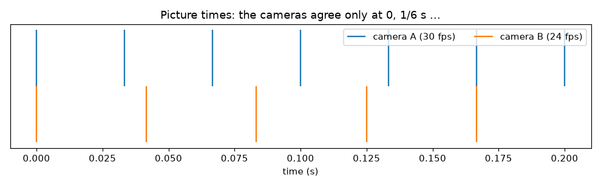
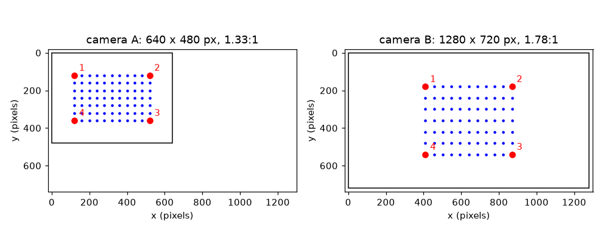

# அமர்வு 1: இரு கேமராக்கள் ஏன் முரண்படுகின்றன

[Session 1 — हिन्दी](README.hi.md) · [Session 1 — മലയാളം](README.ml.md) · [Session 1 — தமிழ்](README.ta.md)

*நிலை 1 (கருத்துசார் ஊடாடும் மாதிரி) · சுமார் 60 நிமிடங்கள் · openstitchdic*

> இது எளிமைப்படுத்தப்பட்ட ஒரு கல்வி மாதிரி. இது சரிபார்க்கப்பட்ட (validated) வடிவமைப்புக் கருவி அல்ல; உண்மையான கட்டமைப்புகள், மின் நிறுவல்கள், வாகனங்கள், தொழில் செயல்முறைகள் அல்லது மருத்துவ முடிவுகளுக்கு இதைப் பயன்படுத்த வேண்டாம்.

**முன்தேவைகள் (Prerequisites)**

- பள்ளி முக்கோணவியல்: ஒரு கோணத்தின் கொசைன்.
- நீங்கள் PRIMER.md-ஐப் படித்து `python start.py 1` ஐ ஒருமுறை இயக்கியிருக்க வேண்டும்.

**கற்றல் நோக்கங்கள் (Learning objectives).** இந்த அமர்வுக்குப் பிறகு உங்களால் முடியும்:

- இரு கேமராக்கள் முரண்படும் மூன்று வழிகளை விளக்க: பார்வைக்கோணம், படத்தின் அளவும் வடிவமும், நேரக்கணிப்பு.
- கேமரா ஒரு கோணத்தில் திருப்பப்படும்போது பக்கவாட்டுத் தூரம் எவ்வளவு நெருக்கப்படுகிறது என்று கணக்கிட.
- இரு படங்களுக்கு இடையே அடையாளப் புள்ளிகளைப் (landmarks) பொருத்தி, ஒன்றை மற்றொன்றின் மீது கொண்டுவரும் நீட்சியைக் (stretch) கண்டறிய.
- இரு பிரேம் வீதங்கள் எப்போது ஒத்துப்போகின்றன, இடையே நேர இடைவெளி எவ்வளவு பெரியது என்று கணக்கிட.

## A. நிஜ உலகப் பிரச்சினை
புள்ளிகள் உள்ள ஒரு ரப்பர் தாள் எப்படி உருமாறுகிறது என்று அளக்க இரண்டு கேமராக்களால் படம் பிடிக்கிறீர்கள் (இது ஸ்டீரியோ டிஜிட்டல் இமேஜ் கோரிலேஷன், DIC). கேமரா A தாளை நேராகப் பார்க்கிறது. கேமரா B ஒரு பக்கத்தில் நிற்கிறது, அகலமான படம் கொண்டது, விநாடிக்கு 24 படங்கள் எடுக்கிறது, A 30 எடுக்கிறது. எதையும் சரிசெய்யாவிட்டால் எதுவும் பொருந்தாது: தாளில் உள்ள கட்டம் இரு கோணங்களிலிருந்து வேறுபட்டுத் தெரிகிறது, படங்களுக்கு வெவ்வேறு அளவுகள் உள்ளன, ஒவ்வொரு படத்தின் தருணமும் வேறுபடுகிறது. இந்த வேறுபாடுகள் எவ்வளவு பெரியவை, ஒரு எளிய திருத்தத்தால் அவற்றை நீக்க முடியுமா? (இது ஓர் அளவீட்டு முறை பற்றிய பொதுக் கல்வி, சரிபார்க்கப்பட்ட அளவீட்டு நடைமுறை அல்ல.)

## B. கருத்தும் கோட்பாடும்
மூன்று வேறுபாடுகள். (1) பார்வைக்கோணம்: yaw கோணத்தில் பக்கவாட்டில் திரும்பிய கேமரா, தட்டையான தாளில் பக்கவாட்டுத் தூரங்களை cos(yaw) ஆல் நெருக்கப்பட்டதாகப் பார்க்கிறது, மேல்-கீழ் தூரங்கள் மாறுவதில்லை. இது எளிமையான மாதிரி, தொலைவில் உள்ள கேமராவுக்குச் செல்லுபடியாகும்; அமர்வு 2 முழு நோக்குநிலையைச் (perspective) சேர்க்கிறது. (2) படத்தின் அளவும் வடிவமும்: கேமரா A 640 x 480 பிக்சல் (4:3), கேமரா B 1280 x 720 (16:9), ஒவ்வொன்றுக்கும் தாளின் ஓர் அலகுக்குத் தன் சொந்தப் பிக்சல் எண்ணிக்கை உண்டு. B-ஐ A-மீது கொண்டுவரும் நீட்சி அடையாளப் புள்ளிகளிலிருந்து கண்டறியப்படுகிறது: A-இல் இரு அடையாளப் புள்ளிகளுக்கு இடையிலான தூரத்தை B-இல் அதே தூரத்தால் வகுக்கவும், ஒருமுறை பக்கவாட்டிலும் ஒருமுறை மேல்-கீழும். இரு எண்களும் வேறுபட்டால், ஒரே அளவுமாற்றக் காரணி அதைச் சரிசெய்ய முடியாது. (3) நேரக்கணிப்பு: A படங்களை k/30 s-இலும் B m/24 s-இலும் எடுக்கிறது. k/30 = m/24 ஆகும்போது மட்டுமே அவை ஒத்துப்போகின்றன, இது ஒவ்வொரு 1/gcd(30, 24) = 1/6 s-க்கும் நிகழ்கிறது. இடையில், அருகிலுள்ள B படம் 1/60 s வரை தொலைவில் இருக்கலாம், நகரும் மாதிரி அந்த நேரத்தில் வேகம் பெருக்கல் இடைவெளி தூரம் பயணிக்கிறது.

| குறியீடு | பொருள் | அலகு |
|---|---|---|
| yaw | கேமரா பக்கவாட்டில் திருப்பப்பட்ட கோணம் | பாகை |
| cos(yaw) | பக்கவாட்டு நெருக்கக் காரணி | அலகு இல்லை |
| k | தாளின் ஓர் அலகுக்குப் பிக்சல்கள் (பட அளவுகோல்) | பிக்சல் ஓர் அலகுக்கு |
| sx, sy | படம் B-இலிருந்து படம் A-க்கு நீட்சி, பக்கவாட்டிலும் மேல்-கீழும் | அலகு இல்லை |
| fps | கேமராவின் விநாடிக்குப் படங்கள் | 1/s |
| gap | A படத்திலிருந்து அருகிலுள்ள B படத்துக்கு உள்ள நேரம் | s |
| v | படத்தில் மாதிரியின் வேகம் | பிக்சல் ஒரு விநாடிக்கு |

**அனுமானங்கள் (Assumptions)**

- தாள் தட்டையானது, கேமராக்கள் தொலைவில் உள்ளன, எனவே திரும்பிய கேமரா பக்கவாட்டுத் தூரங்களை மட்டும் நெருக்குகிறது.
- இரு கடிகாரங்களும் t = 0 இல் ஒன்றாகத் தொடங்கி சீராக ஓடுகின்றன.
- பிரேம் வீதங்கள் முழு எண்கள்.

$$ x_{\mathrm{pix}}=c_x+k\cos(\mathrm{yaw})\,x,\qquad y_{\mathrm{pix}}=c_y+k\,y $$

$$ s_x=\frac{x_{A,2}-x_{A,1}}{x_{B,2}-x_{B,1}}=\frac{k_A}{k_B\cos(\mathrm{yaw}_B)},\qquad s_y=\frac{k_A}{k_B} $$

$$ T_{\mathrm{agree}}=\frac{1}{\gcd(f_A,\,f_B)} $$

$$ \Delta x = v\cdot \mathrm{gap} $$

## C. காட்சி விளக்கம்
முதல் படம் இரு கேமராக்களும் பார்க்கும் அதே 11 x 7 புள்ளிக் கட்டத்தை வரைகிறது, ஒவ்வொரு படமும் ஒரே பிக்சல் அளவுகோலில்: A சதுரமாகத் தோன்றும் கட்டத்துடன் கூடிய 4:3 சட்டம், B அகலமான 16:9 சட்டம், கேமரா 40 பாகை திரும்பியதால் அதில் கட்டம் குறுகலாகத் தெரிகிறது. நான்கு சிவப்பு அடையாளப் புள்ளிகள் (தாள் மூலைகள்) இரு படங்களிலும் எண்ணிடப்பட்டுள்ளன, எனவே கண்ணால் பொருத்தலாம். இரண்டாவது படம் இரு கேமராக்களின் பட நேரங்களை ஒரே நேர அச்சில் வைக்கிறது: 30 fps, 24 fps குறிகள் 0 இலும் 1/6 s இலும் சந்திக்கின்றன, இடையே அருகிலுள்ள குறிகள் 16.7 ms வரை தொலைவில் உள்ளன.

*இரு கேமராக்களின் பட நேரங்கள்: அவை ஒவ்வொரு 1/6 s-க்கும் மட்டுமே ஒத்துப்போகின்றன.*

*இரு கேமராக்களும் பார்க்கும் அதே கட்டம்: வெவ்வேறு பட வடிவம், அளவு, நெருக்கம்.*

## D. ஊடாடும் உருவகப்படுத்துதல்
பாடத்தை இயக்கவும் (`python start.py 1`), பின்னர் நேரடி செயலியைத் திறக்கவும்: [அமர்வு 1: இரு பார்வைகளும் இரு கடிகாரங்களும்](https://krunalpanchal1995.github.io/pan-iit-oss/openstitchdic/session-01/) (அல்லது இந்தக் கோப்புறையில் உள்ள `app.html`). yaw ஸ்லைடரால் கேமரா B-ஐத் திருப்பி அதன் கட்டம் குறுகுவதைப் பாருங்கள், பின்னர் நேரக்கணிப்புக் காட்சியைத் திறந்து B-இன் பிரேம் வீதத்தை மாற்றி அருகிலுள்ள B படத்துக்கான தூரத்தைக் கவனியுங்கள். தேர்ந்தெடுத்த வேகத்தில் ஒரு மாதிரி மிக மோசமான இடைவெளியில் எவ்வளவு நகர்கிறது என்பதை வாசிப்புக் காட்டி சொல்கிறது.

**சவால் (Challenge).** நெருக்கத்தை 0.8 அல்லது அதைவிடச் சிறப்பாக வைத்திருங்கள் (yaw 36 பாகை அல்லது குறைவு), 120 px/s இல் நகரும் மாதிரிக்கு மிக மோசமான நேரப் பிழையை 1 px-க்குக் கீழே ஆக்குங்கள்.

## E. தீர்க்கப்பட்ட எடுத்துக்காட்டும் சோதனையும்
**சிக்கல்.** கேமரா B 40 பாகை திரும்பியுள்ளது. தாளில் ஒரு சதுரம் கேமரா A-இல் (நேராகப் பார்ப்பது) 100 பிக்சல் அகலம். அதே அளவுகோலில் B எடுத்த படத்தில் அது பக்கவாட்டில் எவ்வளவு அகலமாகத் தெரியும்? 30 fps, 24 fps கேமராக்களுக்கு இடையிலான மிக மோசமான நேர இடைவெளியில் 120 px/s இல் நகரும் மாதிரி எவ்வளவு தூரம் பயணிக்கும்?

1. நெருக்கம் = cos 40 = 0.766.
2. அதே அளவுகோலில் B-இல் அகலம் = 100 * 0.766 = 76.6 பிக்சல்.
3. கேமராக்கள் ஒவ்வொரு 1/gcd(30, 24) = 1/6 s-க்கும் ஒத்துப்போகின்றன. ஒரு சுழற்சியில் A படங்கள் 0, 1/30, 2/30, 3/30, 4/30 s-இலும் B படங்கள் 0, 1/24, 2/24, 3/24 s-இலும் உள்ளன.
4. ஐந்து A படங்களுக்கான அருகிலுள்ள B தூரங்கள் 0, 8.33, 16.67, 16.67, 8.33 ms. மிக மோசமான இடைவெளி 16.7 ms = 1/60 s.
5. நகர்ந்த தூரம் = 120 px/s * (1/60) s = 2.0 px.

**விடை.** சதுரம் 76.6 பிக்சல் அகலமாகத் தெரிகிறது, 16.7 ms மிக மோசமான நேர இடைவெளி 120 px/s மாதிரியை 2.0 px நகர்த்துகிறது, ஒரு பிக்சலின் நூறில் ஒரு பங்கை இலக்காகக் கொண்ட அளவீட்டில் இது பெரிய பிழை.

**சோதனை.** ஒரு காகிதத்தில் 10 x 6 கட்டம் வரையுங்கள், தொலைபேசியால் நேராகவும் பின்னர் பக்கவாட்டிலிருந்தும் படம் எடுங்கள், பட பார்வையாளரில் இரு படங்களிலும் கட்ட அகலங்களை அளவிடுங்கள். அகலங்களின் விகிதம் உங்கள் பார்வைக் கோணத்தின் கொசைனுக்கு அருகில் இருக்க வேண்டும். வேறுபாடுகள் நோக்குநிலை (அருகிலுள்ள ஓரம் தொலைவில் உள்ளதை விடப் பெரியது), லென்ஸ் சிதைவு, தவறாக அளந்த கோணம் ஆகியவற்றிலிருந்து வருகின்றன: மாதிரி ஒரே சீராக நெருக்குகிறது, உண்மையான கேமரா அப்படிச் செய்வதில்லை.

## F. மதிப்பீடும் வடிவமைப்புச் சவாலும்
**கேள்வி வகை A: கருத்துசார்.** இந்த அமைப்பில் கேமரா B-இன் படத்தை கேமரா A-இன் படத்தின் மீது கொண்டுவர ஒரே அளவுமாற்றக் காரணியால் முடியாதது ஏன்?

குறிப்பு

தாள் மூலைகளிலிருந்து பக்கவாட்டு, மேல்-கீழ் நீட்சியைக் கணக்கிட்டு ஒப்பிடுங்கள்.

படிப்படியான தீர்வு

பக்கவாட்டு நீட்சி 40 / (60 cos 40) = 0.870, மேல்-கீழ் நீட்சி 40 / 60 = 0.667. B திரும்பியிருப்பதாலும் (அதன் பக்கவாட்டுத் தூரங்கள் cos 40 ஆல் நெருக்கப்படுகின்றன) படங்களுக்கு வெவ்வேறு அளவுகோல்கள் இருப்பதாலும் அவை வேறுபடுகின்றன. ஒரே அளவுமாற்றக் காரணி ஒரு எண்ணை மட்டுமே பயன்படுத்த முடியும், எனவே பக்கவாட்டு, மேல்-கீழ் பகுதிகள் வேறுபடும் (பொதுவாக நோக்குநிலையும், அது அமர்வு 2) ஒரு உருமாற்றம் தேவை.

**கேள்வி வகை B: எண்சார்.** ஒரு கேமரா பக்கவாட்டில் 60 பாகை திரும்பியுள்ளது. நேரான படத்தில் ஒரு பக்கவாட்டுத் தூரம் 100 பிக்சல். அது எவ்வளவு நீளமாகத் தெரியும்? 90 px/s இல் ஒரு மாதிரி 1/60 s தொலைவில் உள்ள படத்துடன் இணைக்கப்பட்டுள்ளது: அது எவ்வளவு நகர்ந்துள்ளது?

குறிப்பு

நெருக்கம் = cos(yaw), தூரம் = வேகம் * இடைவெளி பயன்படுத்துங்கள்.

படிப்படியான தீர்வு

cos 60 = 0.5, எனவே தூரம் 100 * 0.5 = 50 பிக்சலாகத் தெரிகிறது (அலகு: பிக்சல்). மாதிரி 90 * (1/60) = 1.5 px நகர்கிறது. நியாயச் சரிபார்ப்பு (sanity check): 90 பாகையில் நெருக்கம் 0 ஆக இருக்கும், தாள் ஓரத்திலிருந்து பார்க்கப்படும், அதனால்தான் மிகப் பெரிய கோணங்கள் பயனற்றவை.

**கேள்வி வகை C: வரைபடம், உருவகப்படுத்துதல் விளக்கம்.** நேரக்கணிப்பு வரைபடத்தில் (B-இன் பிரேம் வீதம் = 24) வளைவு எவ்வளவு உயரத்தை எட்டுகிறது, சிவப்புப் புள்ளிகள் என்ன சொல்கின்றன?

குறிப்பு

வளைவு அருகிலுள்ள B படத்துக்கான தூரம்; புள்ளிகள் A பட நேரங்களில் வாசிக்கப்படுகின்றன.

படிப்படியான தீர்வு

இரு B படங்களுக்கு இடையிலான நடுவில் வளைவு ஒரு B காலத்தின் பாதியான 1/48 s = 20.8 ms-ஐ எட்டுகிறது. A பட நேரங்களில் உள்ள சிவப்புப் புள்ளிகள் ஒரு 1/6 s சுழற்சியில் 0, 8.33, 16.67, 16.67, 8.33 ms வாசிக்கின்றன, எனவே எந்த A படமும் காணும் மிக மோசமான இடைவெளி 16.7 ms, வளைவின் உச்சத்துக்குக் கீழே, ஏனெனில் A படங்கள் B இடைவெளியின் சரியான நடுவில் விழுவதில்லை.

**கேள்வி வகை D: வடிவமைப்பு, உகப்பாக்கச் சவால்.** வடிவமைப்பு: கேமரா A 30 fps இல் ஓடுகிறது. இந்த B பிரேம் வீதங்களில் எவை மிக மோசமான இடைவெளியை 10 ms அல்லது அதற்குக் கீழே வைத்திருக்கின்றன: 24, 25, 30, 48, 50, 60? எதைத் தேர்வீர்கள், எதை விட்டுக்கொடுக்கிறீர்கள்?

குறிப்பு

நேரக்கணிப்புக் காட்சி அல்லது lesson.py இல் உள்ள worst_gap(30, fps) ஐப் பயன்படுத்துங்கள்.

படிப்படியான தீர்வு

மிக மோசமான இடைவெளிகள் 16.7 ms (24), 20 ms (25), 0 (30), 8.3 ms (48), 6.7 ms (50), 0 (60). எனவே 30, 48, 50, 60 ஆகியவை 10 ms-க்குள் உள்ளன. 30 அல்லது 60 சரியான ஒத்திசைவைத் (இடைவெளி 0) தருகின்றன, ஆனால் இரு கடிகாரங்களும் ஒன்றாகத் தொடங்கினால் மட்டுமே; 60 தரவை இரட்டிப்பாக்கி, அதிக ஒளியும் சேமிப்பும் தேவைப்படுத்துகிறது. சமரசம் (trade-off): முழுமையாகப் பொருந்திய இணை நேர இடைச்செருகலின் தேவையை நீக்குகிறது, ஆனால் பெரும்பாலும் தேர்ந்தெடுக்க முடியாது, எனவே அதற்குப் பதிலாக எப்படி இடைச்செருகுவது என்று அமர்வு 2 காட்டுகிறது.

[RUBRIC.md](../../RUBRIC.md) ஐப் பயன்படுத்தி நீங்களே மதிப்பெண் இடுங்கள். காகிதத்தில் வேலை செய்ய [செயல்பாட்டுத் தாள்](activity_sheet.md) ஐ அச்சிடுங்கள்.

## பொதுவான தவறான புரிதல்கள்
| பொதுவான தவறான புரிதல் | உண்மையில் என்ன |
|---|---|
| 30, 24 fps கேமராக்களை பிரேம் பிரேமாக இணைத்துவிடலாம். | A-இன் பிரேம் k-உம் B-இன் பிரேம் k-உம் வெவ்வேறு நேரங்களில் (k/30 s, k/24 s) எடுக்கப்படுகின்றன; அவை ஒவ்வொரு 1/6 s-க்கும் மட்டுமே ஒத்துப்போகின்றன. |
| திரும்பிய கேமரா முழுப் படத்தையும் சுருக்குகிறது. | அது பக்கவாட்டுத் தூரங்களை cos(yaw) ஆல் நெருக்கி, மேல்-கீழ் தூரங்களை அப்படியே விடுகிறது, எனவே அளவு மட்டுமல்ல வடிவமும் மாறுகிறது. |
| படத்தின் அளவும் வடிவமும் ஒன்றே. | அளவு என்பது பிக்சல் எண்ணிக்கை; வடிவம் என்பது விகித விகிதம் (4:3 அல்லது 16:9). இரு கேமராக்கள் ஒன்றில் பொருந்தி மற்றொன்றில் வேறுபடலாம். |

## சொற்பட்டியல் (Glossary)
- **டிஜிட்டல் இமேஜ் கோரிலேஷன் (digital image correlation, DIC)**: படங்களில் புள்ளி வடிவத்தைப் பின்தொடர்ந்து ஒரு மேற்பரப்பு எப்படி நகர்கிறது அல்லது உருமாறுகிறது என்று அளத்தல்
- **யா (yaw)**: கேமரா பக்கவாட்டில் திருப்பப்பட்ட கோணம்
- **விகித விகிதம் (aspect ratio)**: ஒரு படத்தின் அகலத்தை உயரத்தால் வகுத்தது, எ.கா. 4:3 அல்லது 16:9
- **அடையாளப் புள்ளி (landmark)**: இரு படங்களிலும் அடையாளம் காணக்கூடிய புள்ளி, எ.கா. தாளின் மூலை
- **பிரேம் வீதம் (frame rate, fps)**: விநாடிக்குப் படங்கள்

## முடிக்கவும்
1. [exercises.md](exercises.md) இல் உள்ள மூன்று நிரலாக்கப் பணிகளைச் செய்யுங்கள்.
2. உங்கள் மாற்றங்களுக்குப் பிறகு `python start.py 1` ஐ மீண்டும் இயக்கவும். அது சோதனைச்சாவடியுடன் முடிகிறது; அது `PASS` என்று அச்சிடும்போது, நீங்கள் முடித்துவிட்டீர்கள். (சோதனைச்சாவடி மட்டும்: `python start.py check 1`.)

அடுத்தது: [அமர்வு 2](../session-02/README.md)
