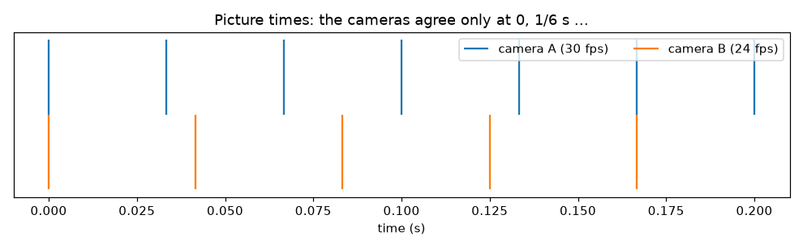
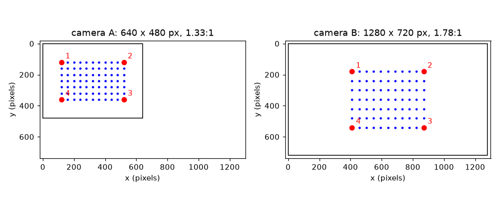

# సెషన్ 1: రెండు కెమెరాలు ఎందుకు విభేదిస్తాయి

[Session 1 — हिन्दी](README.hi.md) · [Session 1 — മലയാളം](README.ml.md) · [Session 1 — தமிழ்](README.ta.md) · [Session 1 — తెలుగు](README.te.md)

*స్థాయి 1 (భావనాత్మక ఇంటరాక్టివ్ నమూనా) · సుమారు 60 నిమిషాలు · openstitchdic*

> ఇది సరళీకృత విద్యా నమూనా. ఇది ధ్రువీకరించిన (validated) డిజైన్ సాధనం కాదు; నిజమైన నిర్మాణాలు, విద్యుత్ ఏర్పాట్లు, వాహనాలు, పారిశ్రామిక ప్రక్రియలు లేదా వైద్య నిర్ణయాలకు దీనిని ఉపయోగించవద్దు.

**ముందస్తు అవసరాలు (Prerequisites)**

- పాఠశాల త్రికోణమితి: ఒక కోణం కొసైన్.
- మీరు PRIMER.md చదివి `python start.py 1` ను ఒకసారి నడిపి ఉండాలి.

**అభ్యాస లక్ష్యాలు (Learning objectives).** ఈ సెషన్ తర్వాత మీరు చేయగలరు:

- రెండు కెమెరాలు విభేదించే మూడు మార్గాలను వివరించడం: దృక్కోణం, చిత్రం పరిమాణం, ఆకారం, సమయం.
- కెమెరాను ఒక కోణంలో తిప్పినప్పుడు పక్క దూరం ఎంత ఒత్తబడుతుందో లెక్కించడం.
- రెండు చిత్రాల మధ్య గుర్తు బిందువులను (landmarks) సరిపోల్చి, ఒకదాన్ని మరొకదానిపైకి తెచ్చే సాగదీతను (stretch) కనుగొనడం.
- రెండు ఫ్రేమ్ రేట్లు ఎప్పుడు ఏకీభవిస్తాయో, మధ్యలో సమయ అంతరం ఎంత పెద్దదో లెక్కించడం.

## A. వాస్తవ ప్రపంచ సమస్య
చుక్కలున్న రబ్బరు షీట్ ఎలా వికృతమవుతుందో కొలవడానికి మీరు రెండు కెమెరాలతో చిత్రీకరిస్తారు (ఇది స్టీరియో డిజిటల్ ఇమేజ్ కోరిలేషన్, DIC). కెమెరా A షీట్‌ను నేరుగా చూస్తుంది. కెమెరా B ఒక పక్కన నిలబడి ఉంది, వెడల్పాటి చిత్రం ఉంది, సెకనుకు 24 చిత్రాలు తీస్తుంది, A 30 తీస్తుంది. ఏమీ సర్దుబాటు చేయకపోతే ఏదీ సరిపోదు: షీట్‌పై గ్రిడ్ రెండు కోణాల నుండి భిన్నంగా కనిపిస్తుంది, చిత్రాలకు వేర్వేరు పరిమాణాలు ఉన్నాయి, ప్రతి చిత్రం క్షణం భిన్నం. ఈ తేడాలు ఎంత పెద్దవి, ఒక సాధారణ సవరణతో వాటిని తొలగించగలమా? (ఇది ఒక కొలత పద్ధతి గురించిన సాధారణ విద్య, ధ్రువీకరించిన కొలత విధానం కాదు.)

## B. భావన మరియు సిద్ధాంతం
మూడు తేడాలు. (1) దృక్కోణం: yaw కోణంలో పక్కకు తిరిగిన కెమెరా, సమతల షీట్‌పై పక్క దూరాలను cos(yaw) తో ఒత్తబడినట్లు చూస్తుంది, పైకీ కిందికీ దూరాలు మారవు. ఇది అత్యంత సరళమైన నమూనా, దూరంగా ఉన్న కెమెరాకు చెల్లుతుంది; సెషన్ 2 పూర్తి దృక్పథాన్ని (perspective) జోడిస్తుంది. (2) చిత్రం పరిమాణం, ఆకారం: కెమెరా A 640 x 480 పిక్సెల్ (4:3), కెమెరా B 1280 x 720 (16:9), ప్రతిదానికీ షీట్ యూనిట్‌కు సొంత పిక్సెల్ సంఖ్య ఉంది. B ను A పైకి తెచ్చే సాగదీత గుర్తు బిందువుల నుండి కనుగొంటాం: A లో రెండు గుర్తు బిందువుల మధ్య దూరాన్ని B లో అదే దూరంతో భాగించండి, ఒకసారి పక్కకు, ఒకసారి పైకీ కిందికీ. రెండు సంఖ్యలూ భిన్నంగా ఉంటే, ఒకే పరిమాణమార్పు కారకం దాన్ని సరిచేయలేదు. (3) సమయం: A చిత్రాలను k/30 s వద్ద, B m/24 s వద్ద తీస్తాయి. k/30 = m/24 అయినప్పుడు మాత్రమే అవి ఏకీభవిస్తాయి, ఇది ప్రతి 1/gcd(30, 24) = 1/6 s కు జరుగుతుంది. మధ్యలో, అత్యంత సమీప B చిత్రం 1/60 s వరకు దూరంగా ఉండవచ్చు, కదిలే నమూనా ఆ సమయంలో వేగం రెట్లు అంతరం దూరం ప్రయాణిస్తుంది.

| గుర్తు | అర్థం | ప్రమాణం |
|---|---|---|
| yaw | కెమెరా పక్కకు తిప్పిన కోణం | డిగ్రీలు |
| cos(yaw) | పక్క ఒత్తిడి కారకం | ప్రమాణం లేదు |
| k | షీట్ యూనిట్‌కు పిక్సెళ్లు (చిత్ర స్కేల్) | పిక్సెల్ ప్రతి యూనిట్ |
| sx, sy | చిత్రం B నుండి చిత్రం A కు సాగదీత, పక్కకు, పైకీ కిందికీ | ప్రమాణం లేదు |
| fps | కెమెరా సెకనుకు చిత్రాలు | 1/s |
| gap | A చిత్రం నుండి సమీప B చిత్రానికి సమయం | s |
| v | చిత్రంలో నమూనా వేగం | పిక్సెల్ ప్రతి సెకను |

**ఊహలు (Assumptions)**

- షీట్ సమతలం, కెమెరాలు దూరంగా ఉన్నాయి, కాబట్టి తిరిగిన కెమెరా పక్క దూరాలను మాత్రమే ఒత్తుతుంది.
- రెండు గడియారాలు t = 0 వద్ద కలిసి మొదలై స్థిరంగా నడుస్తాయి.
- ఫ్రేమ్ రేట్లు పూర్ణ సంఖ్యలు.

$$ x_{\mathrm{pix}}=c_x+k\cos(\mathrm{yaw})\,x,\qquad y_{\mathrm{pix}}=c_y+k\,y $$

$$ s_x=\frac{x_{A,2}-x_{A,1}}{x_{B,2}-x_{B,1}}=\frac{k_A}{k_B\cos(\mathrm{yaw}_B)},\qquad s_y=\frac{k_A}{k_B} $$

$$ T_{\mathrm{agree}}=\frac{1}{\gcd(f_A,\,f_B)} $$

$$ \Delta x = v\cdot \mathrm{gap} $$

## C. దృశ్య వివరణ
మొదటి చిత్రం రెండు కెమెరాలు చూసే అదే 11 x 7 చుక్కల గ్రిడ్‌ను గీస్తుంది, ప్రతి చిత్రం ఒకే పిక్సెల్ స్కేల్‌లో: A చతురస్రంగా కనిపించే గ్రిడ్ ఉన్న 4:3 ఫ్రేమ్, B వెడల్పాటి 16:9 ఫ్రేమ్, కెమెరా 40 డిగ్రీలు తిరిగినందున అందులో గ్రిడ్ ఇరుకుగా కనిపిస్తుంది. నాలుగు ఎరుపు గుర్తు బిందువులు (షీట్ మూలలు) రెండు చిత్రాల్లోనూ సంఖ్యలతో ఉన్నాయి, కాబట్టి కంటితో సరిపోల్చవచ్చు. రెండవ చిత్రం రెండు కెమెరాల చిత్ర సమయాలను ఒకే సమయ అక్షంపై ఉంచుతుంది: 30 fps, 24 fps టిక్కులు 0 వద్ద, 1/6 s వద్ద కలుస్తాయి, మధ్యలో సమీప టిక్కులు 16.7 ms వరకు దూరంగా ఉంటాయి.

*రెండు కెమెరాల చిత్ర సమయాలు: అవి ప్రతి 1/6 s కు మాత్రమే ఏకీభవిస్తాయి.*

*రెండు కెమెరాలు చూసే అదే గ్రిడ్: వేర్వేరు చిత్ర ఆకారం, పరిమాణం, ఒత్తిడి.*

## D. ఇంటరాక్టివ్ అనుకరణ
పాఠాన్ని నడపండి (`python start.py 1`), ఆ తర్వాత లైవ్ యాప్‌ను తెరవండి: [సెషన్ 1: రెండు దృశ్యాలు, రెండు గడియారాలు](https://krunalpanchal1995.github.io/pan-iit-oss/openstitchdic/session-01/) (లేదా ఈ ఫోల్డర్‌లోని `app.html`). yaw స్లైడర్‌తో కెమెరా B ని తిప్పి దాని గ్రిడ్ ఇరుకవడం చూడండి, ఆ తర్వాత టైమింగ్ వీక్షణను తెరిచి B ఫ్రేమ్ రేట్‌ను మార్చి సమీప B చిత్రానికి దూరాన్ని గమనించండి. ఎంచుకున్న వేగంతో ఒక నమూనా అత్యంత చెడ్డ అంతరంలో ఎంత దూరం కదులుతుందో రీడౌట్ చెబుతుంది.

**సవాలు (Challenge).** ఒత్తిడిని 0.8 లేదా అంతకంటే మెరుగ్గా ఉంచండి (yaw 36 డిగ్రీలు లేదా తక్కువ), 120 px/s తో కదిలే నమూనాకు అత్యంత చెడ్డ సమయ దోషాన్ని 1 px కంటే తక్కువ చేయండి.

## E. సాధించిన ఉదాహరణ మరియు ప్రయోగం
**సమస్య.** కెమెరా B 40 డిగ్రీలు తిరిగింది. షీట్‌పై ఒక చతురస్రం కెమెరా A లో (నేరుగా చూస్తున్నది) 100 పిక్సెళ్ల వెడల్పు. అదే స్కేల్‌లో B తీసిన చిత్రంలో అది పక్కకు ఎంత వెడల్పుగా కనిపిస్తుంది? 30 fps, 24 fps కెమెరాల మధ్య అత్యంత చెడ్డ సమయ అంతరంలో 120 px/s తో కదిలే నమూనా ఎంత దూరం ప్రయాణిస్తుంది?

1. ఒత్తిడి = cos 40 = 0.766.
2. అదే స్కేల్‌లో B లో వెడల్పు = 100 * 0.766 = 76.6 పిక్సెళ్లు.
3. కెమెరాలు ప్రతి 1/gcd(30, 24) = 1/6 s కు ఏకీభవిస్తాయి. ఒక చక్రంలో A చిత్రాలు 0, 1/30, 2/30, 3/30, 4/30 s వద్ద, B చిత్రాలు 0, 1/24, 2/24, 3/24 s వద్ద ఉంటాయి.
4. ఐదు A చిత్రాలకు సమీప-B దూరాలు 0, 8.33, 16.67, 16.67, 8.33 ms. అత్యంత చెడ్డ అంతరం 16.7 ms = 1/60 s.
5. కదిలిన దూరం = 120 px/s * (1/60) s = 2.0 px.

**జవాబు.** చతురస్రం 76.6 పిక్సెళ్ల వెడల్పుగా కనిపిస్తుంది, 16.7 ms అత్యంత చెడ్డ సమయ అంతరం 120 px/s నమూనాను 2.0 px కదిలిస్తుంది, ఒక పిక్సెల్‌లో వందవ వంతును లక్ష్యంగా పెట్టుకున్న కొలతలో ఇది పెద్ద దోషం.

**ప్రయోగం.** కాగితంపై 10 x 6 గ్రిడ్ గీయండి, ఫోన్‌తో నేరుగా ముందు నుండి, ఆ తర్వాత పక్క నుండి ఫోటో తీయండి, ఇమేజ్ వ్యూయర్‌లో రెండు ఫోటోల్లో గ్రిడ్ వెడల్పులను కొలవండి. వెడల్పుల నిష్పత్తి మీ చూసే కోణం కొసైన్‌కు దగ్గరగా ఉండాలి. తేడాలు దృక్పథం (దగ్గరి అంచు దూరపు అంచు కంటే పెద్దది), లెన్స్ వికృతి, తప్పుగా కొలిచిన కోణం నుండి వస్తాయి: నమూనా ఒకేలా ఒత్తుతుంది, నిజమైన కెమెరా అలా చేయదు.

## F. మూల్యాంకనం మరియు డిజైన్ సవాలు
**ప్రశ్న రకం A: భావనాత్మక.** ఈ ఏర్పాటులో కెమెరా B చిత్రాన్ని కెమెరా A చిత్రంపైకి తేవడానికి ఒకే పరిమాణమార్పు కారకం ఎందుకు సరిపోదు?

సూచన

షీట్ మూలల నుండి పక్క, పైకీ కిందికీ సాగదీతను లెక్కించి పోల్చండి.

దశలవారీ పరిష్కారం

పక్క సాగదీత 40 / (60 cos 40) = 0.870, పైకీ కిందికీ సాగదీత 40 / 60 = 0.667. B తిరిగి ఉండటం వల్ల (దాని పక్క దూరాలు cos 40 తో ఒత్తబడతాయి), చిత్రాలకు వేర్వేరు స్కేళ్లు ఉండటం వల్ల అవి భిన్నంగా ఉంటాయి. ఒకే పరిమాణమార్పు కారకం ఒక సంఖ్యనే వర్తింపజేయగలదు, కాబట్టి పక్క, పైకీ కిందికీ భాగాలు వేర్వేరుగా ఉండే (సాధారణంగా దృక్పథం కూడా, అది సెషన్ 2) పరివర్తన అవసరం.

**ప్రశ్న రకం B: సంఖ్యాత్మక.** ఒక కెమెరా పక్కకు 60 డిగ్రీలు తిరిగింది. నేరు చిత్రంలో ఒక పక్క దూరం 100 పిక్సెళ్లు. అది ఎంత పొడవుగా కనిపిస్తుంది? 90 px/s వద్ద ఒక నమూనా 1/60 s దూరంలో ఉన్న చిత్రంతో జతచేయబడింది: అది ఎంత దూరం కదిలింది?

సూచన

ఒత్తిడి = cos(yaw), దూరం = వేగం * అంతరం ఉపయోగించండి.

దశలవారీ పరిష్కారం

cos 60 = 0.5, కాబట్టి దూరం 100 * 0.5 = 50 పిక్సెళ్లుగా కనిపిస్తుంది (ప్రమాణం: పిక్సెళ్లు). నమూనా 90 * (1/60) = 1.5 px కదులుతుంది. తార్కిక తనిఖీ (sanity check): 90 డిగ్రీల వద్ద ఒత్తిడి 0 అవుతుంది, షీట్ అంచు నుండి కనిపిస్తుంది, అందుకే చాలా పెద్ద కోణాలు పనికిరావు.

**ప్రశ్న రకం C: గ్రాఫ్, అనుకరణ వివరణ.** టైమింగ్ గ్రాఫ్‌లో (B ఫ్రేమ్ రేట్ = 24) వక్రం ఎంత ఎత్తు చేరుతుంది, ఎరుపు చుక్కలు ఏం చెబుతాయి?

సూచన

వక్రం సమీప B చిత్రానికి దూరం; చుక్కలు A చిత్ర సమయాల్లో చదవబడతాయి.

దశలవారీ పరిష్కారం

రెండు B చిత్రాల మధ్య మధ్యలో వక్రం ఒక B కాలంలో సగం, 1/48 s = 20.8 ms చేరుతుంది. A చిత్ర సమయాల్లోని ఎరుపు చుక్కలు ఒక 1/6 s చక్రంలో 0, 8.33, 16.67, 16.67, 8.33 ms చదువుతాయి, కాబట్టి ఏ A చిత్రమైనా చూసే అత్యంత చెడ్డ అంతరం 16.7 ms, వక్రం శిఖరం కంటే తక్కువ, ఎందుకంటే A చిత్రాలు B విరామం సరిగ్గా మధ్యలో పడవు.

**ప్రశ్న రకం D: డిజైన్, ఆప్టిమైజేషన్ సవాలు.** డిజైన్: కెమెరా A 30 fps వద్ద నడుస్తుంది. ఈ B ఫ్రేమ్ రేట్లలో ఏవి అత్యంత చెడ్డ అంతరాన్ని 10 ms లేదా తక్కువగా ఉంచుతాయి: 24, 25, 30, 48, 50, 60? ఏది ఎంచుకుంటారు, దేన్ని వదులుకుంటారు?

సూచన

టైమింగ్ వీక్షణ లేదా lesson.py లోని worst_gap(30, fps) ఉపయోగించండి.

దశలవారీ పరిష్కారం

అత్యంత చెడ్డ అంతరాలు 16.7 ms (24), 20 ms (25), 0 (30), 8.3 ms (48), 6.7 ms (50), 0 (60). కాబట్టి 30, 48, 50, 60 లు 10 ms లోపు ఉన్నాయి. 30 లేదా 60 ఖచ్చితమైన ఏకీభావాన్ని (అంతరం 0) ఇస్తాయి, కానీ రెండు గడియారాలు కలిసి మొదలైతేనే; 60 డేటాను రెట్టింపు చేసి, ఎక్కువ కాంతి, నిల్వ అవసరం చేస్తుంది. రాజీ (trade-off): పూర్తిగా సరిపోలిన జత సమయ అంతర్వేశం అవసరాన్ని తొలగిస్తుంది, కానీ తరచుగా ఎంచుకోలేము, కాబట్టి బదులుగా అంతర్వేశం ఎలా చేయాలో సెషన్ 2 చూపుతుంది.

[RUBRIC.md](../../RUBRIC.md) ఉపయోగించి మీరే స్కోర్ చేసుకోండి. కాగితంపై పని చేయడానికి [కార్యకలాప పత్రం](activity_sheet.md) ను ప్రింట్ చేయండి.

## సాధారణ అపోహలు
| సాధారణ అపోహ | వాస్తవం ఏమిటి |
|---|---|
| 30, 24 fps కెమెరాలను ఫ్రేమ్ ఫ్రేమ్‌గా జతచేయవచ్చు. | A ఫ్రేమ్ k, B ఫ్రేమ్ k వేర్వేరు సమయాల్లో (k/30 s, k/24 s) తీయబడతాయి; అవి ప్రతి 1/6 s కు మాత్రమే ఏకీభవిస్తాయి. |
| తిరిగిన కెమెరా మొత్తం చిత్రాన్ని చిన్నదిగా చేస్తుంది. | అది పక్క దూరాలను cos(yaw) తో ఒత్తి, పైకీ కిందికీ దూరాలను వదిలేస్తుంది, కాబట్టి పరిమాణం మాత్రమే కాక ఆకారం మారుతుంది. |
| చిత్రం పరిమాణం, ఆకారం ఒకటే. | పరిమాణం పిక్సెళ్ల సంఖ్య; ఆకారం ఆస్పెక్ట్ నిష్పత్తి (4:3 లేదా 16:9). రెండు కెమెరాలు ఒకదానిలో సరిపోయి మరొకదానిలో భిన్నంగా ఉండవచ్చు. |

## పదకోశం (Glossary)
- **డిజిటల్ ఇమేజ్ కోరిలేషన్ (digital image correlation, DIC)**: చిత్రాల్లో చుక్కల నమూనాను అనుసరించి ఒక ఉపరితలం ఎలా కదులుతుందో లేదా వికృతమవుతుందో కొలవడం
- **యా (yaw)**: కెమెరా పక్కకు తిప్పిన కోణం
- **ఆస్పెక్ట్ నిష్పత్తి (aspect ratio)**: చిత్రం వెడల్పును ఎత్తుతో భాగించినది, ఉదాహరణకు 4:3 లేదా 16:9
- **గుర్తు బిందువు (landmark)**: రెండు చిత్రాల్లోనూ గుర్తించగల బిందువు, ఉదాహరణకు షీట్ మూల
- **ఫ్రేమ్ రేట్ (frame rate, fps)**: సెకనుకు చిత్రాలు

## పూర్తి చేయండి
1. [exercises.md](exercises.md) లోని మూడు కోడింగ్ పనులు చేయండి.
2. మీ మార్పుల తర్వాత `python start.py 1` ను మళ్ళీ నడపండి. అది చెక్‌పాయింట్‌తో ముగుస్తుంది; అది `PASS` అని ప్రింట్ చేస్తే, మీరు పూర్తి చేసినట్లే. (చెక్‌పాయింట్ మాత్రమే: `python start.py check 1`.)

తదుపరిది: [సెషన్ 2](../session-02/README.md)
