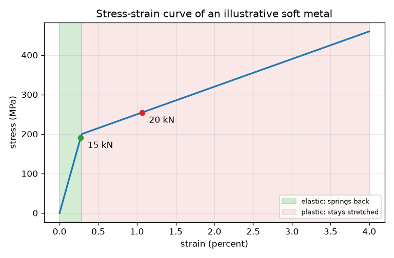
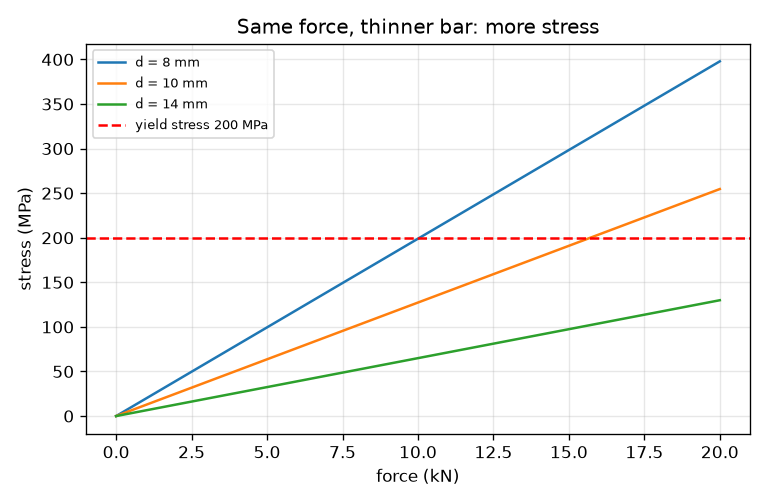

# सत्र 1: एक छड़ को खींचना: प्रतिबल, विकृति और वक्र

*स्तर 1 (वैचारिक इंटरैक्टिव मॉडल) · लगभग 60 मिनट · openstressstrain*

> यह एक सरलीकृत शैक्षिक मॉडल है। यह कोई प्रमाणित डिज़ाइन उपकरण नहीं है और इसका उपयोग वास्तविक संरचनाओं, विद्युत संस्थापनों, वाहनों, औद्योगिक प्रक्रियाओं या चिकित्सा निर्णयों के लिए नहीं किया जाना चाहिए।

**पूर्व-आवश्यकताएँ (Prerequisites)**

- वृत्त का क्षेत्रफल, और बल की इकाइयाँ (न्यूटन, किलोन्यूटन)।
- आपने PRIMER.md पढ़ लिया है और एक बार `python start.py 1` चला लिया है।

**सीखने के उद्देश्य (Learning objectives)।** इस सत्र के बाद आप:

- खींची गई छड़ के लिए प्रतिबल (stress) (बल भाग क्षेत्रफल) और विकृति (strain) (विस्तार भाग लंबाई) निकाल सकेंगे।
- समझा सकेंगे कि इंजीनियर बल और विस्तार के बजाय प्रतिबल और विकृति का उपयोग क्यों करते हैं।
- प्रतिबल-विकृति वक्र (stress-strain curve) पढ़ सकेंगे और प्रत्यास्थ क्षेत्र (elastic region) तथा सुघट्य क्षेत्र (plastic region) चिह्नित कर सकेंगे।
- बता सकेंगे कि हर क्षेत्र में भार हटाने पर छड़ का क्या होता है।

## A. वास्तविक जीवन की समस्या
लिफ़्ट की केबल, साइकिल की तीली और पेपर क्लिप, सभी खींचे या मोड़े जाते हैं। पेपर क्लिप को थोड़ा खींचिए तो वह वापस आ जाती है; ज़ोर से खींचिए तो वह मुड़ी रह जाती है। हम इसे ऐसी संख्याओं से कैसे वर्णित करें जो इस पर निर्भर न हों कि पुर्ज़ा कितना मोटा या लंबा है? यह सत्र विचार सिखाने के लिए गोल-मोल काल्पनिक संख्याओं वाली एक उदाहरणात्मक नरम धातु का उपयोग करता है। यह एक शिक्षण मॉडल है, डिज़ाइन उपकरण नहीं, और किसी वास्तविक मिश्रधातु का डेटा नहीं।

## B. अवधारणा और सिद्धांत
एक छड़ को बल F से खींचिए। पदार्थ प्रतिबल महसूस करता है: अनुप्रस्थ-काट क्षेत्रफल (cross-section area) A पर फैला हुआ बल। छड़ विस्तार dL से लंबी हो जाती है; मूल लंबाई L0 से भाग देने पर विकृति मिलती है, जिसकी कोई इकाई नहीं है। विकृति के विरुद्ध प्रतिबल का आलेख प्रतिबल-विकृति वक्र है, और यह पदार्थ का वर्णन करता है, नमूने का नहीं। कम प्रतिबल पर छड़ प्रत्यास्थ (elastic) होती है: छोड़ने पर वह अपनी मूल लंबाई पर लौट आती है, और विकृति प्रतिबल के समानुपाती होती है। पराभव प्रतिबल (yield stress) के बाद वह सुघट्य (plastic) होती है: वह अधिक आसानी से खिंचती है और भार हटाने पर खिंचाव का कुछ भाग रह जाता है (स्थायी विकृति (permanent set))।

| प्रतीक | अर्थ | इकाई |
|---|---|---|
| F | खींचने वाला बल | kN |
| A | अनुप्रस्थ-काट क्षेत्रफल, गोल छड़ के लिए pi d^2 / 4 | mm^2 |
| d | छड़ का व्यास | mm |
| sigma | प्रतिबल = F / A (1 N/mm^2 = 1 MPa) | MPa |
| dL | विस्तार | mm |
| L0 | मूल लंबाई (यहाँ 500 mm) | mm |
| eps | विकृति = dL / L0 | कोई इकाई नहीं (0.01, 1 प्रतिशत है) |
| E | उदाहरणात्मक धातु की कठोरता (stiffness) (70 000) | MPa |
| sigma_y | उदाहरणात्मक धातु का पराभव प्रतिबल (200) | MPa |

**मान्यताएँ (Assumptions)**

- खिंचाव छड़ के साथ सीधा है और क्षेत्रफल पर समान रूप से फैला है।
- प्रतिबल और विकृति 'इंजीनियरिंग' मान हैं: क्षेत्रफल और लंबाई मूल वाले हैं।
- धातु एक काल्पनिक नरम धातु है जिसमें E = 70 GPa, पराभव 200 MPa और पराभव के बाद हल्की ढलान है; यह किसी वास्तविक मिश्रधातु का डेटा नहीं है।
- कोई ग्रीवन (necking) नहीं, तापमान या गति के कोई प्रभाव नहीं। यह डिज़ाइन उपकरण नहीं है।

$$ \sigma=\frac{F}{A},\qquad A=\frac{\pi d^2}{4} $$

$$ \varepsilon=\frac{\Delta L}{L_0} $$

$$ \sigma=E\,\varepsilon\quad(\sigma\le\sigma_y),\qquad \varepsilon_{\text{permanent}}=\varepsilon-\frac{\sigma}{E} $$

## C. दृश्य व्याख्या
पहला चित्र उदाहरणात्मक धातु का प्रतिबल-विकृति वक्र है। हरी पट्टी प्रत्यास्थ क्षेत्र है, एक सीधी खड़ी रेखा जो 200 MPa के पराभव प्रतिबल (विकृति 0.29 प्रतिशत) पर समाप्त होती है। गुलाबी पट्टी सुघट्य क्षेत्र है, जहाँ वक्र बहुत अधिक सपाट है। दो बिंदु 10 mm छड़ पर 15 kN (प्रत्यास्थ पट्टी के अंदर) और 20 kN (सुघट्य पट्टी में) के खिंचाव को चिह्नित करते हैं। दूसरा चित्र दिखाता है कि एक ही बल के लिए पतली छड़ में अधिक प्रतिबल होता है, और लाल डैश रेखा पराभव प्रतिबल है जिसे पतली छड़ें पहले पार करती हैं।

*प्रत्यास्थ और सुघट्य क्षेत्रों के साथ उदाहरणात्मक धातु का प्रतिबल-विकृति वक्र।*

*तीन व्यासों के लिए बल के विरुद्ध प्रतिबल; पतली छड़ें पराभव प्रतिबल तक जल्दी पहुँचती हैं।*

## D. इंटरैक्टिव सिमुलेशन
पाठ चलाएँ (`python start.py 1`), फिर लाइव ऐप खोलें: [सत्र 1: एक छड़ खींचें](https://krunalpanchal1995.github.io/pan-iit-oss/openstressstrain/session-01/) (या इसी फ़ोल्डर में `app.html`)। बल और व्यास के स्लाइडर हिलाएँ और छड़ को खिंचते, बिंदु को वक्र पर चलते, और डैश वाली भार-मुक्ति (unloading) रेखा को यह दिखाते देखें कि कितना खिंचाव रह जाएगा।

**चुनौती।** अधिकतम 15 kN बल का उपयोग करते हुए छड़ को सुघट्य बनाएँ (प्रतिबल 205 MPa से ऊपर)।

## E. हल किया गया उदाहरण और प्रयोग
**समस्या।** 10 mm व्यास और 500 mm लंबाई वाली एक गोल छड़ को 15 kN से खींचा जाता है। प्रतिबल, विकृति और विस्तार ज्ञात करें, और बताएँ कि क्या यह प्रत्यास्थ है। पराभव प्रतिबल 200 MPa है और E 70 000 MPa है।

1. क्षेत्रफल A = pi * 10^2 / 4 = 78.54 mm^2।
2. प्रतिबल = 15 * 1000 N / 78.54 mm^2 = 191.0 MPa।
3. 191.0 MPa, 200 MPa पराभव से नीचे है, इसलिए छड़ प्रत्यास्थ है और विकृति = प्रतिबल / E = 191.0 / 70 000 = 0.002728।
4. विस्तार = विकृति * L0 = 0.002728 * 500 = 1.364 mm।
5. जाँच (sanity check): 500 mm में 1.4 mm एक छोटा अंश है (0.27 प्रतिशत), जैसा एक कठोर धातु के लिए अपेक्षित है।

**उत्तर।** प्रतिबल 191.0 MPa, विकृति 0.00273, विस्तार 1.36 mm, प्रत्यास्थ। 20 kN पर प्रतिबल 254.6 MPa है, छड़ सुघट्य है, विकृति 0.01066 (5.33 mm) है और भार-मुक्ति के बाद 0.00703 (3.51 mm) खिंचाव रह जाता है।

**प्रयोग।** एक पतला स्टील का तार या रबर की एक लंबी पट्टी हुक से लटकाएँ, ज्ञात भार जोड़ें और रूलर से खिंचाव मापें। खिंचाव के विरुद्ध भार आलेखित करें: सीधी रेखा का अर्थ है प्रत्यास्थ। पेपर क्लिप के लिए, एक छोटा कोण मोड़ें (वह वापस आ जाती है) और फिर एक बड़ा कोण (वह मुड़ी रह जाती है) ताकि प्रत्यास्थ और सुघट्य क्षेत्रों को महसूस कर सकें। मॉडल वास्तविकता से भिन्न है क्योंकि वास्तविक धातुएँ पराभव में चिकने ढंग से मुड़ती हैं, और क्योंकि क्लैंप, तार की सिलवटें और रूलर का पठन एक मिलीमीटर या अधिक की त्रुटियाँ जोड़ते हैं।

## F. मूल्यांकन और डिज़ाइन चुनौती
**प्रश्न प्रकार A: वैचारिक।** इंजीनियर बल के विरुद्ध विस्तार के बजाय विकृति के विरुद्ध प्रतिबल क्यों आलेखित करते हैं?

संकेत

एक ही धातु की एक मोटी और एक पतली छड़ के बारे में सोचें। क्या उन्हें तोड़ने के लिए एक जैसा बल चाहिए?

चरण-दर-चरण हल

एक मोटी छड़ को उतनी ही क्षति तक पहुँचने के लिए पतली छड़ से बड़ा बल चाहिए, और एक लंबी छड़ छोटी से अधिक खिंचती है। बल को क्षेत्रफल से और विस्तार को लंबाई से भाग देने पर नमूने का आकार हट जाता है, इसलिए एक वक्र पदार्थ का वर्णन करता है और किसी भी आकार के लिए उपयोग किया जा सकता है।

**प्रश्न प्रकार B: संख्यात्मक।** 8 mm व्यास और 500 mm लंबाई वाली एक छड़ को 10 kN से खींचा जाता है (पराभव 200 MPa, E = 70 000 MPa)। प्रतिबल, विकृति और विस्तार ज्ञात करें। क्या यह प्रत्यास्थ है?

संकेत

पहले A = pi d^2 / 4, फिर प्रतिबल = F / A।

चरण-दर-चरण हल

A = pi * 8^2 / 4 = 50.27 mm^2। प्रतिबल = 10 000 / 50.27 = 198.9 MPa। यह 200 MPa पराभव से ठीक नीचे है, इसलिए छड़ प्रत्यास्थ है। विकृति = 198.9 / 70 000 = 0.002842 और विस्तार = 0.002842 * 500 = 1.42 mm। इकाइयाँ: MPa, कोई इकाई नहीं, mm। जाँच: प्रतिबल पराभव के क़रीब है, इसलिए छड़ लगभग अपनी सीमा पर है।

**प्रश्न प्रकार C: ग्राफ़ और सिमुलेशन की व्याख्या।** प्रतिबल-विकृति वक्र पर, किस विकृति पर वक्र मुड़ता है, और वहाँ ढलान कैसे बदलती है?

संकेत

पराभव पर विकृति = पराभव प्रतिबल / E। पराभव के बाद ढलान 7 000 MPa है।

चरण-दर-चरण हल

मोड़ विकृति 200 / 70 000 = 0.00286 (0.29 प्रतिशत) पर है। उससे पहले ढलान E = 70 000 MPa है; उसके बाद ढलान 7 000 MPa है, दस गुना सपाट। सपाट वक्र का अर्थ है कि धातु को और खिंचने के लिए बहुत कम अतिरिक्त प्रतिबल चाहिए, और खिंचाव अब वापस नहीं आता।

**प्रश्न प्रकार D: डिज़ाइन और अनुकूलन (optimisation) चुनौती।** डिज़ाइन: पूरे मिलीमीटर में सबसे छोटा व्यास चुनें ताकि 18 kN का खिंचाव प्रतिबल को पराभव प्रतिबल के 90 प्रतिशत या उससे कम रखे। अपने चुनाव का प्रतिबल और विस्तार बताएँ।

संकेत

अनुमत प्रतिबल 0.9 * 200 = 180 MPa है, इसलिए A कम से कम F भाग उतना होना चाहिए।

चरण-दर-चरण हल

A >= 18 000 / 180 = 100 mm^2, इसलिए d >= sqrt(4 * 100 / pi) = 11.28 mm; सबसे छोटा पूरा मिलीमीटर 12 mm है। जाँच: A = 113.1 mm^2, प्रतिबल = 159.2 MPa (पराभव का लगभग 80 प्रतिशत), विकृति = 0.002274 और विस्तार = 1.14 mm। d = 11 mm से 189.4 MPa मिलेगा, पराभव के बहुत क़रीब। समझौता (trade-off): मोटी छड़ अधिक सुरक्षित है पर भारी और महँगी है।

[RUBRIC.md](../../RUBRIC.md) से स्वयं को अंक दें। काग़ज़ पर काम करने के लिए [गतिविधि पत्रक (activity sheet)](activity_sheet.md) प्रिंट करें।

## सामान्य भ्रांतियाँ (Common misconceptions)
| सामान्य भ्रांति | वास्तव में क्या सच है |
|---|---|
| अधिक मज़बूत छड़ हमेशा कम खिंचती है। | भार के तहत खिंचाव कठोरता (E) पर निर्भर करता है, इस पर नहीं कि पदार्थ कितना मज़बूत है; सामर्थ्य बताती है कि वह कब पराभव करता है। |
| प्रतिबल बल के समान है। | प्रतिबल प्रति क्षेत्रफल बल है; एक ही बल पतली छड़ में अधिक और मोटी छड़ में कम प्रतिबल पैदा करता है। |
| पराभव के बाद छड़ टूट चुकी है। | पराभव का अर्थ केवल यह है कि स्थायी खिंचाव शुरू होता है; विफल होने से पहले छड़ अभी भी अधिक भार उठा सकती है। |

## शब्दावली (Glossary)
- **प्रतिबल (stress)**: बल भाग अनुप्रस्थ-काट क्षेत्रफल; इकाई MPa
- **विकृति (strain)**: विस्तार भाग मूल लंबाई; कोई इकाई नहीं
- **प्रत्यास्थ (elastic)**: भार हटाने पर अपने मूल आकार में लौट आता है
- **सुघट्य (plastic)**: भार हटाने के बाद विरूपण का कुछ भाग रख लेता है
- **पराभव प्रतिबल (yield stress)**: वह प्रतिबल जिस पर स्थायी खिंचाव शुरू होता है
- **स्थायी विकृति (permanent set)**: भार-मुक्ति के बाद रह जाने वाली विकृति

## समापन
1. [exercises.md](exercises.md) में दिए गए तीन कोडिंग कार्य करें।
2. अपने बदलावों के बाद `python start.py 1` फिर से चलाएँ। यह चेकपॉइंट के साथ समाप्त होता है; जब यह `PASS` छापे, तो आपका काम पूरा हो गया। (केवल चेकपॉइंट: `python start.py check 1`।)

आगे: [सत्र 2](../session-02/README.md)
