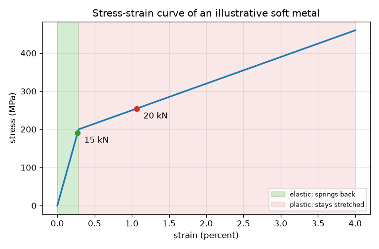
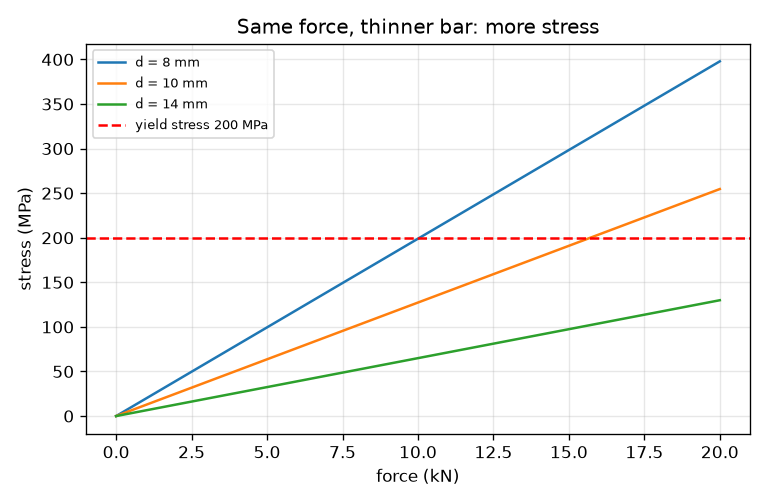

# സെഷൻ 1: ഒരു കമ്പി വലിക്കുമ്പോൾ: സ്ട്രെസ്, സ്ട്രെയിൻ, വക്രം

[Session 1 — हिन्दी](README.hi.md) · [Session 1 — മലയാളം](README.ml.md)

*ലെവൽ 1 (ആശയപരമായ ഇന്ററാക്ടീവ് മോഡൽ) · ഏകദേശം 60 മിനിറ്റ് · openstressstrain*

> ഇത് ലളിതമാക്കിയ ഒരു വിദ്യാഭ്യാസ മോഡലാണ്. ഇത് സാധൂകരിക്കപ്പെട്ട (validated) ഡിസൈൻ ഉപകരണമല്ല; യഥാർത്ഥ ഘടനകൾ, വൈദ്യുത സംവിധാനങ്ങൾ, വാഹനങ്ങൾ, വ്യാവസായിക പ്രക്രിയകൾ അല്ലെങ്കിൽ വൈദ്യശാസ്ത്ര തീരുമാനങ്ങൾ എന്നിവയ്ക്ക് ഇത് ഉപയോഗിക്കരുത്.

**മുൻ‌അറിവ് (Prerequisites)**

- വൃത്തത്തിന്റെ വിസ്തീർണ്ണം, ബലത്തിന്റെ യൂണിറ്റുകൾ (ന്യൂട്ടൺ, കിലോന്യൂട്ടൺ).
- നിങ്ങൾ PRIMER.md വായിക്കുകയും `python start.py 1` ഒരിക്കൽ പ്രവർത്തിപ്പിക്കുകയും ചെയ്തിട്ടുണ്ട്.

**പഠന ലക്ഷ്യങ്ങൾ (Learning objectives).** ഈ സെഷനു ശേഷം നിങ്ങൾക്ക് കഴിയും:

- വലിക്കപ്പെടുന്ന ഒരു കമ്പിയുടെ സ്ട്രെസ് (ബലം ഹരിക്കണം വിസ്തീർണ്ണം), സ്ട്രെയിൻ (നീളം കൂടൽ ഹരിക്കണം നീളം) എന്നിവ കണക്കാക്കാൻ.
- എൻജിനീയർമാർ ബലത്തിനും നീളം കൂടലിനും പകരം സ്ട്രെസും സ്ട്രെയിനും ഉപയോഗിക്കുന്നത് എന്തുകൊണ്ടെന്ന് വിശദീകരിക്കാൻ.
- ഒരു സ്ട്രെസ്-സ്ട്രെയിൻ വക്രം വായിച്ച് ഇലാസ്തിക മേഖലയും പ്ലാസ്റ്റിക് മേഖലയും അടയാളപ്പെടുത്താൻ.
- ഓരോ മേഖലയിലും ഭാരം നീക്കം ചെയ്യുമ്പോൾ കമ്പിക്ക് എന്തു സംഭവിക്കുന്നു എന്ന് പറയാൻ.

## A. യഥാർത്ഥ ലോക പ്രശ്നം
ഒരു ലിഫ്റ്റ് കേബിൾ, ഒരു സൈക്കിൾ സ്പോക്ക്, ഒരു പേപ്പർ ക്ലിപ്പ് എന്നിവയെല്ലാം വലിക്കപ്പെടുകയോ വളയ്ക്കപ്പെടുകയോ ചെയ്യുന്നു. ഒരു പേപ്പർ ക്ലിപ്പ് അല്പം വലിച്ചാൽ അത് തിരികെ വരുന്നു; ശക്തമായി വലിച്ചാൽ അത് വളഞ്ഞുതന്നെ നിൽക്കുന്നു. ഭാഗത്തിന്റെ കനത്തെയോ നീളത്തെയോ ആശ്രയിക്കാത്ത സംഖ്യകൾ കൊണ്ട് ഇത് എങ്ങനെ വിവരിക്കാം? ഈ ആശയം പഠിപ്പിക്കാൻ ഈ സെഷൻ വൃത്താകൃതിയിലുള്ള, കണ്ടുപിടിച്ച സംഖ്യകളുള്ള ഒരു ഉദാഹരണ മൃദു ലോഹം ഉപയോഗിക്കുന്നു. ഇത് ഒരു പഠന മോഡലാണ്, ഡിസൈൻ ഉപകരണമല്ല, ഏതെങ്കിലും യഥാർത്ഥ ലോഹസങ്കരത്തിന്റെ ഡാറ്റയുമല്ല.

## B. ആശയവും സിദ്ധാന്തവും
ഒരു കമ്പിയെ F എന്ന ബലം കൊണ്ട് വലിക്കുക. ലോഹം സ്ട്രെസ് അനുഭവിക്കുന്നു: പരപ്പളവ് (cross-section) A-യിൽ വ്യാപിച്ച ബലം. കമ്പി നീളം കൂടൽ dL കൊണ്ട് നീളമാകുന്നു; ആദ്യത്തെ നീളം L0 കൊണ്ട് ഹരിച്ചാൽ സ്ട്രെയിൻ കിട്ടുന്നു, അതിന് യൂണിറ്റില്ല. സ്ട്രെസിനെ സ്ട്രെയിനിനെതിരെ വരച്ച ഗ്രാഫ് ആണ് സ്ട്രെസ്-സ്ട്രെയിൻ വക്രം, അത് സാമ്പിളിനെയല്ല, ലോഹത്തെ വിവരിക്കുന്നു. ചെറിയ സ്ട്രെസിൽ കമ്പി ഇലാസ്തികമാണ്: വിടുമ്പോൾ അത് ആദ്യ നീളത്തിലേക്ക് തിരികെ വരുന്നു, സ്ട്രെയിൻ സ്ട്രെസിന് ആനുപാതികമാണ്. യീൽഡ് സ്ട്രെസിനപ്പുറം അത് പ്ലാസ്റ്റിക് ആണ്: അത് കൂടുതൽ എളുപ്പത്തിൽ നീളുന്നു, ഭാരം നീക്കം ചെയ്യുമ്പോൾ നീളത്തിന്റെ ഒരു ഭാഗം അവശേഷിക്കുന്നു (സ്ഥിരമായ വികൃതി, permanent set).

| ചിഹ്നം | അർത്ഥം | യൂണിറ്റ് |
|---|---|---|
| F | വലിക്കുന്ന ബലം | kN |
| A | പരപ്പളവ്, വൃത്താകൃതി കമ്പിക്ക് pi d^2 / 4 | mm^2 |
| d | കമ്പിയുടെ വ്യാസം | mm |
| sigma | സ്ട്രെസ് = F / A (1 N/mm^2 = 1 MPa) | MPa |
| dL | നീളം കൂടൽ | mm |
| L0 | ആദ്യത്തെ നീളം (ഇവിടെ 500 mm) | mm |
| eps | സ്ട്രെയിൻ = dL / L0 | യൂണിറ്റില്ല (0.01 എന്നാൽ 1 ശതമാനം) |
| E | ഉദാഹരണ ലോഹത്തിന്റെ കാഠിന്യം (70 000) | MPa |
| sigma_y | ഉദാഹരണ ലോഹത്തിന്റെ യീൽഡ് സ്ട്രെസ് (200) | MPa |

**അനുമാനങ്ങൾ (Assumptions)**

- വലി കമ്പിയുടെ നീളത്തിലൂടെ നേരെയാണ്, പരപ്പളവിൽ ഒരേപോലെ വ്യാപിച്ചിരിക്കുന്നു.
- സ്ട്രെസും സ്ട്രെയിനും 'എൻജിനീയറിംഗ്' മൂല്യങ്ങളാണ്: പരപ്പളവും നീളവും ആദ്യത്തേതാണ്.
- ലോഹം E = 70 GPa, യീൽഡ് 200 MPa, യീൽഡിന് ശേഷം മൃദുവായ ചരിവ് എന്നിവയുള്ള കണ്ടുപിടിച്ച ഒരു മൃദു ലോഹമാണ്; ഇത് ഏതെങ്കിലും യഥാർത്ഥ ലോഹസങ്കരത്തിന്റെ ഡാറ്റയല്ല.
- നെക്കിംഗ് ഇല്ല, താപനിലയുടെയോ വേഗതയുടെയോ ഫലങ്ങളില്ല. ഇത് ഡിസൈൻ ഉപകരണമല്ല.

$$ \sigma=\frac{F}{A},\qquad A=\frac{\pi d^2}{4} $$

$$ \varepsilon=\frac{\Delta L}{L_0} $$

$$ \sigma=E\,\varepsilon\quad(\sigma\le\sigma_y),\qquad \varepsilon_{\text{permanent}}=\varepsilon-\frac{\sigma}{E} $$

## C. ദൃശ്യ വിശദീകരണം
ആദ്യ ചിത്രം ഉദാഹരണ ലോഹത്തിന്റെ സ്ട്രെസ്-സ്ട്രെയിൻ വക്രമാണ്. പച്ച ബാൻഡ് ഇലാസ്തിക മേഖലയാണ്, 200 MPa യീൽഡ് സ്ട്രെസിൽ (സ്ട്രെയിൻ 0.29 ശതമാനം) അവസാനിക്കുന്ന നേരായ കുത്തനെയുള്ള രേഖ. പിങ്ക് ബാൻഡ് പ്ലാസ്റ്റിക് മേഖലയാണ്, അവിടെ വക്രം വളരെ പരന്നതാണ്. രണ്ട് ബിന്ദുക്കൾ 10 mm കമ്പിയിലെ 15 kN (ഇലാസ്തിക ബാൻഡിനകത്ത്), 20 kN (പ്ലാസ്റ്റിക് ബാൻഡിൽ) വലികളെ അടയാളപ്പെടുത്തുന്നു. രണ്ടാമത്തെ ചിത്രം ഒരേ ബലത്തിന് നേർത്ത കമ്പിക്ക് ഉയർന്ന സ്ട്രെസ് ഉണ്ടെന്ന് കാണിക്കുന്നു, ചുവന്ന ഡാഷ് രേഖ നേർത്ത കമ്പികൾ ആദ്യം കടക്കുന്ന യീൽഡ് സ്ട്രെസ് ആണ്.

*ഇലാസ്തിക, പ്ലാസ്റ്റിക് മേഖലകൾ അടയാളപ്പെടുത്തിയ ഉദാഹരണ ലോഹത്തിന്റെ സ്ട്രെസ്-സ്ട്രെയിൻ വക്രം.*

*മൂന്ന് വ്യാസങ്ങൾക്ക് ബലത്തിനെതിരായ സ്ട്രെസ്; നേർത്ത കമ്പികൾ വേഗത്തിൽ യീൽഡ് സ്ട്രെസിൽ എത്തുന്നു.*

## D. ഇന്ററാക്ടീവ് സിമുലേഷൻ
പാഠം പ്രവർത്തിപ്പിക്കുക (`python start.py 1`), തുടർന്ന് ലൈവ് ആപ്പ് തുറക്കുക: [സെഷൻ 1: ഒരു കമ്പി വലിക്കുക](https://krunalpanchal1995.github.io/pan-iit-oss/openstressstrain/session-01/) (അല്ലെങ്കിൽ ഈ ഫോൾഡറിലെ `app.html`). ബലം, വ്യാസം സ്ലൈഡറുകൾ നീക്കി കമ്പി നീളുന്നതും, ബിന്ദു വക്രത്തിലൂടെ നീങ്ങുന്നതും, ഡാഷ് ഇട്ട അൺലോഡിംഗ് രേഖ എത്ര നീളം അവശേഷിക്കുമെന്ന് കാണിക്കുന്നതും നിരീക്ഷിക്കുക.

**വെല്ലുവിളി.** പരമാവധി 15 kN ബലം ഉപയോഗിച്ച് കമ്പിയെ പ്ലാസ്റ്റിക് ആക്കുക (സ്ട്രെസ് 205 MPa-ന് മുകളിൽ).

## E. ഉദാഹരണ പ്രശ്നവും പരീക്ഷണവും
**പ്രശ്നം.** വ്യാസം 10 mm, നീളം 500 mm ഉള്ള ഒരു വൃത്താകൃതി കമ്പി 15 kN കൊണ്ട് വലിക്കുന്നു. സ്ട്രെസ്, സ്ട്രെയിൻ, നീളം കൂടൽ എന്നിവ കണ്ടെത്തി അത് ഇലാസ്തികമാണോ എന്ന് പറയുക. യീൽഡ് സ്ട്രെസ് 200 MPa, E 70 000 MPa.

1. പരപ്പളവ് A = pi * 10^2 / 4 = 78.54 mm^2.
2. സ്ട്രെസ് = 15 * 1000 N / 78.54 mm^2 = 191.0 MPa.
3. 191.0 MPa യീൽഡ് ആയ 200 MPa-ന് താഴെയാണ്, അതിനാൽ കമ്പി ഇലാസ്തികമാണ്, സ്ട്രെയിൻ = സ്ട്രെസ് / E = 191.0 / 70 000 = 0.002728.
4. നീളം കൂടൽ = സ്ട്രെയിൻ * L0 = 0.002728 * 500 = 1.364 mm.
5. യുക്തിപരിശോധന (sanity check): 500 mm-ൽ 1.4 mm ഒരു ചെറിയ അംശമാണ് (0.27 ശതമാനം), കാഠിന്യമുള്ള ലോഹത്തിന് പ്രതീക്ഷിക്കുന്നതുപോലെ.

**ഉത്തരം.** സ്ട്രെസ് 191.0 MPa, സ്ട്രെയിൻ 0.00273, നീളം കൂടൽ 1.36 mm, ഇലാസ്തികം. 20 kN-ൽ സ്ട്രെസ് 254.6 MPa ആണ്, കമ്പി പ്ലാസ്റ്റിക് ആണ്, സ്ട്രെയിൻ 0.01066 (5.33 mm) ആണ്, അൺലോഡ് ചെയ്ത ശേഷം 0.00703 (3.51 mm) നീളം അവശേഷിക്കുന്നു.

**പരീക്ഷണം.** ഒരു നേർത്ത സ്റ്റീൽ വയറോ റബ്ബറിന്റെ നീണ്ട വരയോ ഒരു കൊളുത്തിൽ തൂക്കുക, അറിയപ്പെടുന്ന ഭാരങ്ങൾ ചേർക്കുക, സ്കെയിൽ കൊണ്ട് നീളം അളക്കുക. ഭാരത്തെ നീളത്തിനെതിരെ വരയ്ക്കുക: നേർരേഖ എന്നാൽ ഇലാസ്തികം. ഒരു പേപ്പർ ക്ലിപ്പിൽ, ചെറിയ കോണിൽ വളയ്ക്കുക (അത് തിരികെ വരും), പിന്നെ വലിയ കോണിൽ (അത് വളഞ്ഞുതന്നെ നിൽക്കും) ഇലാസ്തിക, പ്ലാസ്റ്റിക് മേഖലകൾ അനുഭവിക്കാൻ. യഥാർത്ഥ ലോഹങ്ങൾ യീൽഡിലേക്ക് മിനുസമായി വളയുന്നതിനാലും, ക്ലാമ്പ്, വയറിലെ വളവുകൾ, സ്കെയിൽ വായന എന്നിവ ഒരു മില്ലിമീറ്ററോ അതിൽ കൂടുതലോ പിശകുകൾ ചേർക്കുന്നതിനാലും മോഡൽ യാഥാർത്ഥ്യത്തിൽ നിന്ന് വ്യത്യസ്തമാണ്.

## F. മൂല്യനിർണ്ണയവും ഡിസൈൻ വെല്ലുവിളിയും
**ചോദ്യ തരം A: ആശയപരം.** എൻജിനീയർമാർ ബലത്തെ നീളം കൂടലിനെതിരെ വരയ്ക്കുന്നതിനു പകരം സ്ട്രെസിനെ സ്ട്രെയിനിനെതിരെ വരയ്ക്കുന്നത് എന്തുകൊണ്ട്?

സൂചന

ഒരേ ലോഹത്തിന്റെ ഒരു കട്ടിയുള്ള കമ്പിയെയും ഒരു നേർത്ത കമ്പിയെയും ചിന്തിക്കുക. പൊട്ടാൻ അവയ്ക്ക് ഒരേ ബലം വേണോ?

ഘട്ടം ഘട്ടമായുള്ള പരിഹാരം

അതേ കേടുപാടിലെത്താൻ കട്ടിയുള്ള കമ്പിക്ക് നേർത്ത കമ്പിയേക്കാൾ വലിയ ബലം വേണം, നീണ്ട കമ്പി ചെറിയതിനേക്കാൾ കൂടുതൽ നീളുന്നു. ബലത്തെ പരപ്പളവ് കൊണ്ടും നീളം കൂടലിനെ നീളം കൊണ്ടും ഹരിക്കുന്നത് സാമ്പിളിന്റെ വലുപ്പത്തെ ഒഴിവാക്കുന്നു, അതിനാൽ ഒരു വക്രം ലോഹത്തെ വിവരിക്കുന്നു, ഏത് വലുപ്പത്തിനും ഉപയോഗിക്കാം.

**ചോദ്യ തരം B: സംഖ്യാപരം.** വ്യാസം 8 mm, നീളം 500 mm ഉള്ള ഒരു കമ്പി 10 kN കൊണ്ട് വലിക്കുന്നു (യീൽഡ് 200 MPa, E = 70 000 MPa). സ്ട്രെസ്, സ്ട്രെയിൻ, നീളം കൂടൽ എന്നിവ കണ്ടെത്തുക. അത് ഇലാസ്തികമാണോ?

സൂചന

ആദ്യം A = pi d^2 / 4, പിന്നെ സ്ട്രെസ് = F / A.

ഘട്ടം ഘട്ടമായുള്ള പരിഹാരം

A = pi * 8^2 / 4 = 50.27 mm^2. സ്ട്രെസ് = 10 000 / 50.27 = 198.9 MPa. ഇത് 200 MPa യീൽഡിനു തൊട്ടുതാഴെയാണ്, അതിനാൽ കമ്പി ഇലാസ്തികമാണ്. സ്ട്രെയിൻ = 198.9 / 70 000 = 0.002842, നീളം കൂടൽ = 0.002842 * 500 = 1.42 mm. യൂണിറ്റുകൾ: MPa, യൂണിറ്റില്ല, mm. യുക്തിപരിശോധന: സ്ട്രെസ് യീൽഡിനോട് അടുത്താണ്, അതിനാൽ കമ്പി ഏതാണ്ട് അതിന്റെ പരിധിയിലാണ്.

**ചോദ്യ തരം C: ഗ്രാഫ്, സിമുലേഷൻ വ്യാഖ്യാനം.** സ്ട്രെസ്-സ്ട്രെയിൻ വക്രത്തിൽ, ഏത് സ്ട്രെയിനിലാണ് വക്രം വളയുന്നത്, അവിടെ ചരിവ് എങ്ങനെ മാറുന്നു?

സൂചന

യീൽഡിലെ സ്ട്രെയിൻ = യീൽഡ് സ്ട്രെസ് / E. യീൽഡിന് ശേഷമുള്ള ചരിവ് 7 000 MPa ആണ്.

ഘട്ടം ഘട്ടമായുള്ള പരിഹാരം

വളവ് സ്ട്രെയിൻ 200 / 70 000 = 0.00286 (0.29 ശതമാനം) ആണ്. അതിനു മുമ്പ് ചരിവ് E = 70 000 MPa; അതിനു ശേഷം ചരിവ് 7 000 MPa, പത്തിരട്ടി പരന്നത്. പരന്ന വക്രം എന്നാൽ കൂടുതൽ നീളാൻ ലോഹത്തിന് വളരെ കുറച്ച് അധിക സ്ട്രെസ് മതി എന്നാണ്, ആ നീളം ഇനി തിരിച്ചുകിട്ടില്ല.

**ചോദ്യ തരം D: ഡിസൈൻ, ഒപ്റ്റിമൈസേഷൻ വെല്ലുവിളി.** ഡിസൈൻ: 18 kN വലിയിൽ സ്ട്രെസ് യീൽഡ് സ്ട്രെസിന്റെ 90 ശതമാനത്തിലോ അതിൽ താഴെയോ നിലനിർത്തുന്ന ഏറ്റവും ചെറിയ മുഴുവൻ മില്ലിമീറ്റർ വ്യാസം തിരഞ്ഞെടുക്കുക. നിങ്ങളുടെ തിരഞ്ഞെടുപ്പിന്റെ സ്ട്രെസും നീളം കൂടലും പറയുക.

സൂചന

അനുവദനീയമായ സ്ട്രെസ് 0.9 * 200 = 180 MPa ആണ്, അതിനാൽ A കുറഞ്ഞത് F ഹരിക്കണം അത് ആയിരിക്കണം.

ഘട്ടം ഘട്ടമായുള്ള പരിഹാരം

A >= 18 000 / 180 = 100 mm^2, അതിനാൽ d >= sqrt(4 * 100 / pi) = 11.28 mm; ഏറ്റവും ചെറിയ മുഴുവൻ മില്ലിമീറ്റർ 12 mm ആണ്. പരിശോധന: A = 113.1 mm^2, സ്ട്രെസ് = 159.2 MPa (യീൽഡിന്റെ ഏകദേശം 80 ശതമാനം), സ്ട്രെയിൻ = 0.002274, നീളം കൂടൽ = 1.14 mm. d = 11 mm ആയാൽ 189.4 MPa കിട്ടും, യീൽഡിനോട് വളരെ അടുത്ത്. വിട്ടുവീഴ്ച (trade-off): കട്ടിയുള്ള കമ്പി കൂടുതൽ സുരക്ഷിതമാണ്, പക്ഷേ ഭാരവും വിലയും കൂടുതൽ.

[RUBRIC.md](../../RUBRIC.md) ഉപയോഗിച്ച് സ്വയം സ്കോർ ചെയ്യുക. പേപ്പറിൽ ചെയ്യാൻ [പ്രവർത്തന ഷീറ്റ്](activity_sheet.md) പ്രിന്റ് ചെയ്യുക.

## സാധാരണ തെറ്റിദ്ധാരണകൾ
| സാധാരണ തെറ്റിദ്ധാരണ | യഥാർത്ഥത്തിൽ ശരിയായത് |
|---|---|
| ശക്തമായ കമ്പി എപ്പോഴും കുറച്ചേ നീളൂ. | ഭാരത്തിനടിയിലെ നീളം കൂടൽ കാഠിന്യത്തെ (E) ആശ്രയിക്കുന്നു, ലോഹം എത്ര ശക്തമാണെന്നതിനെയല്ല; ശക്തി നിങ്ങളോട് അത് എപ്പോൾ യീൽഡ് ചെയ്യുമെന്ന് പറയുന്നു. |
| സ്ട്രെസ് ബലത്തിന് തുല്യമാണ്. | സ്ട്രെസ് എന്നത് ഓരോ പരപ്പളവിലുമുള്ള ബലമാണ്; ഒരേ ബലം നേർത്ത കമ്പിയിൽ ഉയർന്ന സ്ട്രെസും കട്ടിയുള്ള കമ്പിയിൽ കുറഞ്ഞ സ്ട്രെസും ഉണ്ടാക്കുന്നു. |
| യീൽഡിന് ശേഷം കമ്പി പൊട്ടിയിരിക്കുന്നു. | യീൽഡ് എന്നാൽ സ്ഥിരമായ നീളൽ ആരംഭിക്കുന്നു എന്നു മാത്രമാണ്; പരാജയപ്പെടുന്നതിന് മുമ്പ് കമ്പിക്ക് ഇനിയും കൂടുതൽ ഭാരം താങ്ങാൻ കഴിയും. |

## പദാവലി (Glossary)
- **സ്ട്രെസ് (stress)**: ബലത്തെ പരപ്പളവ് കൊണ്ട് ഹരിച്ചത്; യൂണിറ്റ് MPa
- **സ്ട്രെയിൻ (strain)**: നീളം കൂടലിനെ ആദ്യത്തെ നീളം കൊണ്ട് ഹരിച്ചത്; യൂണിറ്റില്ല
- **ഇലാസ്തികം (elastic)**: ഭാരം നീക്കം ചെയ്യുമ്പോൾ ആദ്യത്തെ ആകൃതിയിലേക്ക് തിരികെ വരുന്നു
- **പ്ലാസ്റ്റിക് (plastic)**: ഭാരം നീക്കം ചെയ്ത ശേഷവും രൂപമാറ്റത്തിന്റെ ഒരു ഭാഗം നിലനിർത്തുന്നു
- **യീൽഡ് സ്ട്രെസ് (yield stress)**: സ്ഥിരമായ നീളൽ ആരംഭിക്കുന്ന സ്ട്രെസ്
- **സ്ഥിരമായ വികൃതി (permanent set)**: അൺലോഡ് ചെയ്ത ശേഷം അവശേഷിക്കുന്ന സ്ട്രെയിൻ

## പൂർത്തിയാക്കുക
1. [exercises.md](exercises.md)-ലെ മൂന്ന് കോഡിംഗ് ടാസ്കുകൾ ചെയ്യുക.
2. നിങ്ങളുടെ മാറ്റങ്ങൾക്ക് ശേഷം `python start.py 1` വീണ്ടും പ്രവർത്തിപ്പിക്കുക. അത് ചെക്ക്പോയിന്റോടെ അവസാനിക്കുന്നു; അത് `PASS` പ്രിന്റ് ചെയ്യുമ്പോൾ നിങ്ങൾ പൂർത്തിയാക്കി. (ചെക്ക്പോയിന്റ് മാത്രം: `python start.py check 1`.)

അടുത്തത്: [സെഷൻ 2](../session-02/README.md)
