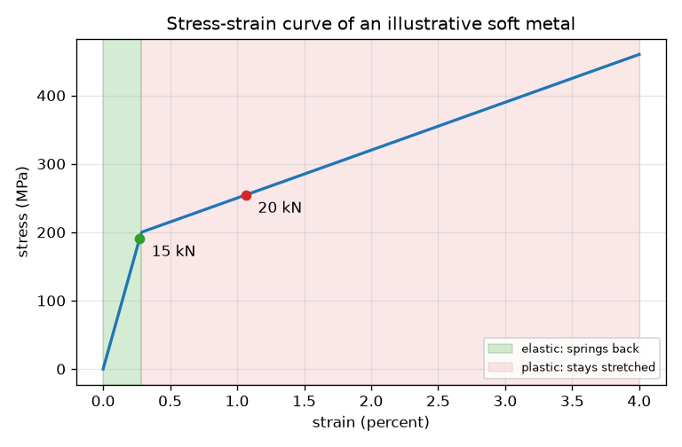
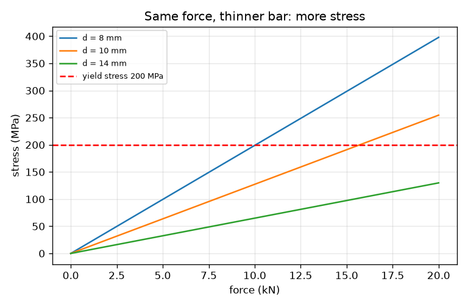

# அமர்வு 1: ஒரு கம்பியை இழுத்தல்: தகைவு, திரிபு, வளைவு

[Session 1 — हिन्दी](README.hi.md) · [Session 1 — മലയാളം](README.ml.md) · [Session 1 — தமிழ்](README.ta.md)

*நிலை 1 (கருத்தியல் ஊடாடும் மாதிரி) · சுமார் 60 நிமிடங்கள் · openstressstrain*

> இது எளிமைப்படுத்தப்பட்ட ஒரு கல்வி மாதிரி. இது சரிபார்க்கப்பட்ட (validated) வடிவமைப்புக் கருவி அல்ல; உண்மையான கட்டமைப்புகள், மின் அமைப்புகள், வாகனங்கள், தொழில்துறை செயல்முறைகள் அல்லது மருத்துவ முடிவுகளுக்கு இதைப் பயன்படுத்த வேண்டாம்.

**முன்தேவைகள் (Prerequisites)**

- வட்டத்தின் பரப்பளவு, விசையின் அலகுகள் (நியூட்டன், கிலோநியூட்டன்).
- நீங்கள் PRIMER.md-ஐப் படித்து `python start.py 1` ஐ ஒருமுறை இயக்கியுள்ளீர்கள்.

**கற்றல் நோக்கங்கள் (Learning objectives).** இந்த அமர்வுக்குப் பிறகு உங்களால் முடியும்:

- இழுக்கப்படும் கம்பிக்கு தகைவு (stress, விசை வகுத்தல் பரப்பளவு) மற்றும் திரிபு (strain, நீட்சி வகுத்தல் நீளம்) கணக்கிட.
- பொறியாளர்கள் விசைக்கும் நீட்சிக்கும் பதிலாக தகைவையும் திரிபையும் ஏன் பயன்படுத்துகிறார்கள் என்று விளக்க.
- தகைவு-திரிபு வளைவை வாசித்து மீள்தன்மை (elastic) பகுதியையும் நெகிழ்வுப் (plastic) பகுதியையும் குறிக்க.
- ஒவ்வொரு பகுதியிலும் சுமையை நீக்கும்போது கம்பிக்கு என்ன நடக்கிறது என்று கூற.

## A. நிஜ உலகப் பிரச்சினை
ஒரு லிஃப்ட் கேபிள், ஒரு சைக்கிள் ஸ்போக், ஒரு காகிதக் கிளிப் ஆகிய அனைத்தும் இழுக்கப்படுகின்றன அல்லது வளைக்கப்படுகின்றன. ஒரு காகிதக் கிளிப்பைச் சிறிது இழுத்தால் அது திரும்ப வருகிறது; கடுமையாக இழுத்தால் அது வளைந்தே இருக்கிறது. பாகத்தின் தடிமனையோ நீளத்தையோ சார்ந்திராத எண்களால் இதை எப்படி விவரிப்பது? இந்தக் கருத்தைக் கற்பிக்க இந்த அமர்வு வட்டமான, கற்பனை எண்கள் கொண்ட ஒரு எடுத்துக்காட்டு மென்மையான உலோகத்தைப் பயன்படுத்துகிறது. இது ஒரு கற்பித்தல் மாதிரி, வடிவமைப்புக் கருவி அல்ல, எந்த உண்மையான உலோகக் கலவையின் தரவும் அல்ல.

## B. கருத்தும் கோட்பாடும்
ஒரு கம்பியை விசை F கொண்டு இழுங்கள். உலோகம் தகைவை உணர்கிறது: குறுக்குவெட்டுப் பரப்பளவு A முழுவதும் பரவிய விசை. கம்பி நீட்சி dL அளவு நீளமாகிறது; அதை அசல் நீளம் L0 ஆல் வகுத்தால் திரிபு கிடைக்கிறது, அதற்கு அலகு இல்லை. தகைவை திரிபுக்கு எதிராக வரைந்த வரைபடமே தகைவு-திரிபு வளைவு, அது மாதிரியை அல்ல, உலோகத்தை விவரிக்கிறது. சிறிய தகைவில் கம்பி மீள்தன்மை கொண்டது: விடும்போது அது அசல் நீளத்துக்குத் திரும்புகிறது, திரிபு தகைவுக்கு விகிதசமமாக உள்ளது. மகசூல் தகைவுக்கு (yield stress) அப்பால் அது நெகிழ்வானது: அது எளிதாக நீள்கிறது, சுமையை நீக்கும்போது நீட்சியின் ஒரு பகுதி நிலைத்துவிடுகிறது (நிரந்தர அமைவு, permanent set).

| குறியீடு | பொருள் | அலகு |
|---|---|---|
| F | இழுக்கும் விசை | kN |
| A | குறுக்குவெட்டுப் பரப்பளவு, வட்டக் கம்பிக்கு pi d^2 / 4 | mm^2 |
| d | கம்பியின் விட்டம் | mm |
| sigma | தகைவு = F / A (1 N/mm^2 = 1 MPa) | MPa |
| dL | நீட்சி | mm |
| L0 | அசல் நீளம் (இங்கே 500 mm) | mm |
| eps | திரிபு = dL / L0 | அலகு இல்லை (0.01 என்றால் 1 சதவீதம்) |
| E | எடுத்துக்காட்டு உலோகத்தின் விறைப்பு (70 000) | MPa |
| sigma_y | எடுத்துக்காட்டு உலோகத்தின் மகசூல் தகைவு (200) | MPa |

**அனுமானங்கள் (Assumptions)**

- இழுப்பு கம்பியின் நீளத்தோடு நேராக உள்ளது, பரப்பளவு முழுவதும் சீராகப் பரவியுள்ளது.
- தகைவும் திரிபும் 'பொறியியல்' மதிப்புகள்: பரப்பளவும் நீளமும் அசலானவை.
- உலோகம் E = 70 GPa, மகசூல் 200 MPa, மகசூலுக்குப் பிறகு மென்மையான சரிவு கொண்ட கற்பனை மென்மையான உலோகம்; இது எந்த உண்மையான உலோகக் கலவையின் தரவும் அல்ல.
- கழுத்துச் சுருக்கம் (necking) இல்லை, வெப்பநிலை அல்லது வேக விளைவுகள் இல்லை. இது வடிவமைப்புக் கருவி அல்ல.

$$ \sigma=\frac{F}{A},\qquad A=\frac{\pi d^2}{4} $$

$$ \varepsilon=\frac{\Delta L}{L_0} $$

$$ \sigma=E\,\varepsilon\quad(\sigma\le\sigma_y),\qquad \varepsilon_{\text{permanent}}=\varepsilon-\frac{\sigma}{E} $$

## C. காட்சி விளக்கம்
முதல் படம் எடுத்துக்காட்டு உலோகத்தின் தகைவு-திரிபு வளைவு. பச்சைப் பட்டை மீள்தன்மைப் பகுதி, 200 MPa மகசூல் தகைவில் (திரிபு 0.29 சதவீதம்) முடியும் நேரான செங்குத்துக் கோடு. இளஞ்சிவப்புப் பட்டை நெகிழ்வுப் பகுதி, அங்கே வளைவு மிகவும் தட்டையாக உள்ளது. இரு புள்ளிகள் 10 mm கம்பியில் 15 kN (மீள்தன்மைப் பட்டைக்குள்) மற்றும் 20 kN (நெகிழ்வுப் பட்டையில்) இழுப்புகளைக் குறிக்கின்றன. இரண்டாவது படம் அதே விசைக்கு மெல்லிய கம்பிக்கு அதிகத் தகைவு என்பதைக் காட்டுகிறது, சிவப்புக் கோடிட்ட கோடு மெல்லிய கம்பிகள் முதலில் கடக்கும் மகசூல் தகைவு.

*மீள்தன்மை, நெகிழ்வுப் பகுதிகள் குறிக்கப்பட்ட எடுத்துக்காட்டு உலோகத்தின் தகைவு-திரிபு வளைவு.*

*மூன்று விட்டங்களுக்கு விசைக்கு எதிரான தகைவு; மெல்லிய கம்பிகள் மகசூல் தகைவை விரைவாக எட்டுகின்றன.*

## D. ஊடாடும் உருவகப்படுத்துதல்
பாடத்தை இயக்கவும் (`python start.py 1`), பிறகு நேரலை செயலியைத் திறக்கவும்: [அமர்வு 1: ஒரு கம்பியை இழுங்கள்](https://krunalpanchal1995.github.io/pan-iit-oss/openstressstrain/session-01/) (அல்லது இந்தக் கோப்புறையில் உள்ள `app.html`). விசை, விட்ட ஸ்லைடர்களை நகர்த்தி கம்பி நீள்வதையும், புள்ளி வளைவில் நகர்வதையும், கோடிட்ட இறக்கற் கோடு எவ்வளவு நீட்சி நிலைக்கும் என்று காட்டுவதையும் கவனியுங்கள்.

**சவால்.** அதிகபட்சம் 15 kN விசையைப் பயன்படுத்தி கம்பியை நெகிழ்வு நிலைக்குக் கொண்டு வாருங்கள் (தகைவு 205 MPa-க்கு மேல்).

## E. எடுத்துக்காட்டுக் கணக்கும் சோதனையும்
**கணக்கு.** விட்டம் 10 mm, நீளம் 500 mm கொண்ட ஒரு வட்டக் கம்பி 15 kN கொண்டு இழுக்கப்படுகிறது. தகைவு, திரிபு, நீட்சி ஆகியவற்றைக் கண்டு அது மீள்தன்மை கொண்டதா என்று கூறுக. மகசூல் தகைவு 200 MPa, E 70 000 MPa.

1. பரப்பளவு A = pi * 10^2 / 4 = 78.54 mm^2.
2. தகைவு = 15 * 1000 N / 78.54 mm^2 = 191.0 MPa.
3. 191.0 MPa மகசூலான 200 MPa-க்குக் கீழே உள்ளது, எனவே கம்பி மீள்தன்மை கொண்டது, திரிபு = தகைவு / E = 191.0 / 70 000 = 0.002728.
4. நீட்சி = திரிபு * L0 = 0.002728 * 500 = 1.364 mm.
5. நியாயச் சோதனை (sanity check): 500 mm-இல் 1.4 mm ஒரு சிறிய பகுதி (0.27 சதவீதம்), விறைப்பான உலோகத்துக்கு எதிர்பார்ப்பது போலவே.

**விடை.** தகைவு 191.0 MPa, திரிபு 0.00273, நீட்சி 1.36 mm, மீள்தன்மை. 20 kN-இல் தகைவு 254.6 MPa, கம்பி நெகிழ்வானது, திரிபு 0.01066 (5.33 mm), இறக்கிய பின் 0.00703 (3.51 mm) நீட்சி நிலைக்கிறது.

**சோதனை.** ஒரு மெல்லிய எஃகுக் கம்பியை அல்லது நீண்ட ரப்பர் துண்டை ஒரு கொக்கியில் தொங்கவிட்டு, தெரிந்த எடைகளைச் சேர்த்து, அளவுகோலால் நீட்சியை அளவிடுங்கள். எடையை நீட்சிக்கு எதிராக வரையுங்கள்: நேர்க்கோடு என்றால் மீள்தன்மை. ஒரு காகிதக் கிளிப்பில், சிறிய கோணத்தில் வளையுங்கள் (அது திரும்பும்), பிறகு பெரிய கோணத்தில் (அது வளைந்தே இருக்கும்) மீள்தன்மை, நெகிழ்வுப் பகுதிகளை உணர. உண்மையான உலோகங்கள் மகசூலுக்குள் மென்மையாக வளைவதாலும், இடுக்கி, கம்பி முடிச்சுகள், அளவுகோல் வாசிப்பு ஆகியவை ஒரு மில்லிமீட்டர் அல்லது அதற்கு மேற்பட்ட பிழைகளைச் சேர்ப்பதாலும் மாதிரி நிஜத்திலிருந்து வேறுபடுகிறது.

## F. மதிப்பீடும் வடிவமைப்புச் சவாலும்
**கேள்வி வகை A: கருத்தியல்.** பொறியாளர்கள் விசையை நீட்சிக்கு எதிராக வரைவதற்குப் பதிலாக தகைவை திரிபுக்கு எதிராக ஏன் வரைகிறார்கள்?

குறிப்பு

ஒரே உலோகத்தின் தடிமனான கம்பியையும் மெல்லிய கம்பியையும் நினைத்துப் பாருங்கள். உடைய அவற்றுக்கு ஒரே விசை தேவையா?

படிப்படியான தீர்வு

அதே சேதத்தை எட்ட தடிமனான கம்பிக்கு மெல்லிய கம்பியை விட பெரிய விசை தேவை, நீண்ட கம்பி குறுகியதை விட அதிகம் நீள்கிறது. விசையைப் பரப்பளவால் வகுத்தும் நீட்சியை நீளத்தால் வகுத்தும் மாதிரியின் அளவு நீக்கப்படுகிறது, எனவே ஒரு வளைவு உலோகத்தை விவரிக்கிறது, எந்த அளவுக்கும் பயன்படுத்தலாம்.

**கேள்வி வகை B: எண்ணியல்.** விட்டம் 8 mm, நீளம் 500 mm கொண்ட ஒரு கம்பி 10 kN கொண்டு இழுக்கப்படுகிறது (மகசூல் 200 MPa, E = 70 000 MPa). தகைவு, திரிபு, நீட்சி காண்க. அது மீள்தன்மை கொண்டதா?

குறிப்பு

முதலில் A = pi d^2 / 4, பிறகு தகைவு = F / A.

படிப்படியான தீர்வு

A = pi * 8^2 / 4 = 50.27 mm^2. தகைவு = 10 000 / 50.27 = 198.9 MPa. இது 200 MPa மகசூலுக்குச் சற்றே கீழே உள்ளது, எனவே கம்பி மீள்தன்மை கொண்டது. திரிபு = 198.9 / 70 000 = 0.002842, நீட்சி = 0.002842 * 500 = 1.42 mm. அலகுகள்: MPa, அலகு இல்லை, mm. நியாயச் சோதனை: தகைவு மகசூலுக்கு அருகில் உள்ளது, எனவே கம்பி கிட்டத்தட்ட அதன் எல்லையில் உள்ளது.

**கேள்வி வகை C: வரைபடம், உருவகப்படுத்துதல் விளக்கம்.** தகைவு-திரிபு வளைவில், எந்தத் திரிபில் வளைவு வளைகிறது, அங்கே சரிவு எப்படி மாறுகிறது?

குறிப்பு

மகசூலில் திரிபு = மகசூல் தகைவு / E. மகசூலுக்குப் பிறகு சரிவு 7 000 MPa.

படிப்படியான தீர்வு

வளைவு திரிபு 200 / 70 000 = 0.00286 (0.29 சதவீதம்) இல் உள்ளது. அதற்கு முன் சரிவு E = 70 000 MPa; அதற்குப் பிறகு சரிவு 7 000 MPa, பத்து மடங்கு தட்டை. தட்டையான வளைவு என்றால் மேலும் நீள உலோகத்துக்கு மிகக் குறைந்த கூடுதல் தகைவே தேவை, அந்த நீட்சி இனி மீளாது.

**கேள்வி வகை D: வடிவமைப்பு, உகப்பாக்கச் சவால்.** வடிவமைப்பு: 18 kN இழுப்பில் தகைவு மகசூல் தகைவின் 90 சதவீதத்தில் அல்லது அதற்குக் கீழே இருக்கும்படி மிகச் சிறிய முழு மில்லிமீட்டர் விட்டத்தைத் தேர்ந்தெடுங்கள். உங்கள் தேர்வின் தகைவையும் நீட்சியையும் கூறுங்கள்.

குறிப்பு

அனுமதிக்கப்பட்ட தகைவு 0.9 * 200 = 180 MPa, எனவே A குறைந்தது F வகுத்தல் அதுவாக இருக்க வேண்டும்.

படிப்படியான தீர்வு

A >= 18 000 / 180 = 100 mm^2, எனவே d >= sqrt(4 * 100 / pi) = 11.28 mm; மிகச் சிறிய முழு மில்லிமீட்டர் 12 mm. சோதனை: A = 113.1 mm^2, தகைவு = 159.2 MPa (மகசூலின் சுமார் 80 சதவீதம்), திரிபு = 0.002274, நீட்சி = 1.14 mm. d = 11 mm எனில் 189.4 MPa கிடைக்கும், மகசூலுக்கு மிக அருகில். சமரசம் (trade-off): தடிமனான கம்பி பாதுகாப்பானது, ஆனால் கனமானது, விலை அதிகம்.

[RUBRIC.md](../../RUBRIC.md) கொண்டு சுய மதிப்பெண் இடுங்கள். காகிதத்தில் செய்ய [செயல்பாட்டுத் தாளை](activity_sheet.md) அச்சிடுங்கள்.

## பொதுவான தவறான புரிதல்கள்
| பொதுவான தவறான புரிதல் | உண்மையில் சரியானது |
|---|---|
| வலிமையான கம்பி எப்போதும் குறைவாகவே நீளும். | சுமையின் கீழ் நீட்சி விறைப்பை (E) சார்ந்தது, உலோகம் எவ்வளவு வலிமையானது என்பதை அல்ல; வலிமை அது எப்போது மகசூல் அடையும் என்று சொல்கிறது. |
| தகைவு விசைக்குச் சமம். | தகைவு என்பது ஓரலகுப் பரப்பளவுக்கான விசை; அதே விசை மெல்லிய கம்பியில் அதிகத் தகைவையும் தடிமனான கம்பியில் குறைந்த தகைவையும் உண்டாக்குகிறது. |
| மகசூலுக்குப் பிறகு கம்பி உடைந்துவிட்டது. | மகசூல் என்றால் நிரந்தர நீட்சி தொடங்குகிறது என்று மட்டுமே பொருள்; தோல்வியடையும் முன் கம்பி இன்னும் அதிகச் சுமையைத் தாங்கும். |

## சொற்களஞ்சியம் (Glossary)
- **தகைவு (stress)**: விசையைக் குறுக்குவெட்டுப் பரப்பளவால் வகுத்தது; அலகு MPa
- **திரிபு (strain)**: நீட்சியை அசல் நீளத்தால் வகுத்தது; அலகு இல்லை
- **மீள்தன்மை (elastic)**: சுமையை நீக்கும்போது அசல் வடிவத்துக்குத் திரும்புகிறது
- **நெகிழ்வு (plastic)**: சுமையை நீக்கிய பின்னும் உருமாற்றத்தின் ஒரு பகுதியைத் தக்கவைக்கிறது
- **மகசூல் தகைவு (yield stress)**: நிரந்தர நீட்சி தொடங்கும் தகைவு
- **நிரந்தர அமைவு (permanent set)**: இறக்கிய பின் எஞ்சியிருக்கும் திரிபு

## முடித்தல்
1. [exercises.md](exercises.md)-இல் உள்ள மூன்று நிரலாக்கப் பணிகளைச் செய்யுங்கள்.
2. உங்கள் மாற்றங்களுக்குப் பிறகு `python start.py 1` ஐ மீண்டும் இயக்குங்கள். அது சோதனைச் சாவடியுடன் முடிகிறது; அது `PASS` அச்சிடும்போது நீங்கள் முடித்துவிட்டீர்கள். (சோதனைச் சாவடி மட்டும்: `python start.py check 1`.)

அடுத்தது: [அமர்வு 2](../session-02/README.md)
