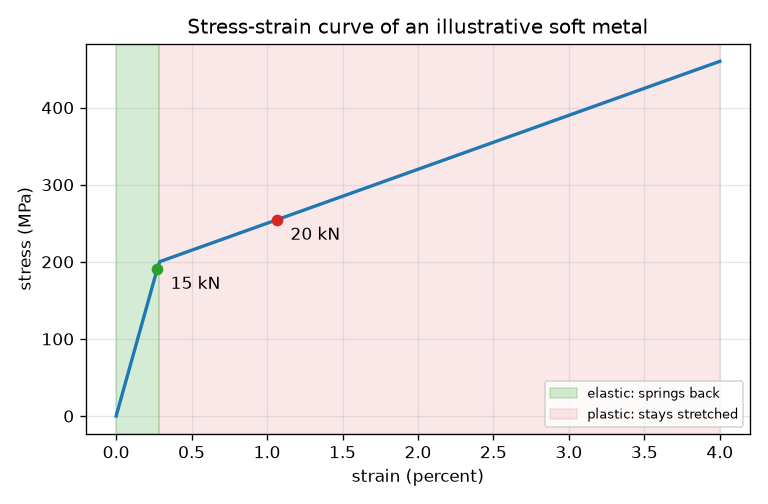
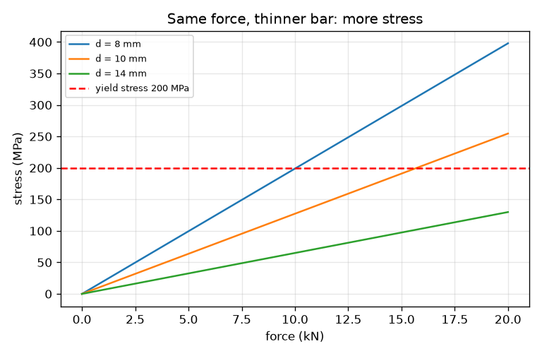

# సెషన్ 1: కడ్డీని లాగడం: ఒత్తిడి, వికృతి, వక్రం

[Session 1 — हिन्दी](README.hi.md) · [Session 1 — മലയാളം](README.ml.md) · [Session 1 — தமிழ்](README.ta.md) · [Session 1 — తెలుగు](README.te.md)

*స్థాయి 1 (భావనాత్మక ఇంటరాక్టివ్ మోడల్) · సుమారు 60 నిమిషాలు · openstressstrain*

> ఇది సరళీకృత విద్యా నమూనా. ఇది ధృవీకరించబడిన (validated) డిజైన్ సాధనం కాదు; నిజమైన నిర్మాణాలు, విద్యుత్ వ్యవస్థలు, వాహనాలు, పారిశ్రామిక ప్రక్రియలు లేదా వైద్య నిర్ణయాల కోసం దీన్ని ఉపయోగించవద్దు.

**ముందస్తు అవసరాలు (Prerequisites)**

- వృత్తం వైశాల్యం, బలం యొక్క యూనిట్లు (న్యూటన్, కిలోన్యూటన్).
- మీరు PRIMER.md చదివి `python start.py 1` ను ఒకసారి నడిపారు.

**అభ్యాస లక్ష్యాలు (Learning objectives).** ఈ సెషన్ తర్వాత మీరు వీటిని చేయగలరు:

- లాగబడిన కడ్డీకి ఒత్తిడి (stress, బలం భాగించు వైశాల్యం) మరియు వికృతి (strain, సాగుదల భాగించు పొడవు) లెక్కించడం.
- ఇంజనీర్లు బలం, సాగుదలకు బదులు ఒత్తిడి, వికృతిని ఎందుకు వాడతారో వివరించడం.
- ఒత్తిడి-వికృతి వక్రాన్ని చదివి స్థితిస్థాపక (elastic) ప్రాంతాన్ని, ప్లాస్టిక్ ప్రాంతాన్ని గుర్తించడం.
- ప్రతి ప్రాంతంలో భారాన్ని తొలగించినప్పుడు కడ్డీకి ఏమవుతుందో చెప్పడం.

## A. నిజ ప్రపంచ సమస్య
లిఫ్ట్ కేబుల్, సైకిల్ స్పోక్, పేపర్ క్లిప్ అన్నీ లాగబడతాయి లేదా వంచబడతాయి. పేపర్ క్లిప్‌ను కొంచెం లాగితే అది తిరిగి వస్తుంది; గట్టిగా లాగితే అది వంగిపోయే ఉంటుంది. భాగం ఎంత మందమో, ఎంత పొడవో అనే దానిపై ఆధారపడని సంఖ్యలతో దీన్ని ఎలా వివరించవచ్చు? ఈ భావనను బోధించడానికి ఈ సెషన్ గుండ్రని, కల్పిత సంఖ్యలు గల ఒక ఉదాహరణ మెత్తని లోహాన్ని ఉపయోగిస్తుంది. ఇది బోధనా నమూనా, డిజైన్ సాధనం కాదు, ఏ నిజమైన మిశ్రమ లోహ డేటా కూడా కాదు.

## B. భావన మరియు సిద్ధాంతం
ఒక కడ్డీని బలం F తో లాగండి. లోహం ఒత్తిడిని అనుభవిస్తుంది: అడ్డుకోత వైశాల్యం A పై పంపిణీ అయిన బలం. కడ్డీ సాగుదల dL మేర పొడవు పెరుగుతుంది; అసలు పొడవు L0 తో భాగిస్తే వికృతి వస్తుంది, దానికి యూనిట్ లేదు. ఒత్తిడిని వికృతికి వ్యతిరేకంగా గీసిన గ్రాఫే ఒత్తిడి-వికృతి వక్రం, అది నమూనాను కాదు, లోహాన్ని వర్ణిస్తుంది. చిన్న ఒత్తిడి వద్ద కడ్డీ స్థితిస్థాపకం: వదిలినప్పుడు అది అసలు పొడవుకు తిరిగి వస్తుంది, వికృతి ఒత్తిడికి అనులోమానుపాతంలో ఉంటుంది. దిగుబడి ఒత్తిడి (yield stress) దాటాక అది ప్లాస్టిక్: అది ఎక్కువ సులభంగా సాగుతుంది, భారాన్ని తొలగించినప్పుడు సాగుదలలో కొంత భాగం మిగిలిపోతుంది (శాశ్వత అమరిక, permanent set).

| గుర్తు | అర్థం | యూనిట్ |
|---|---|---|
| F | లాగే బలం | kN |
| A | అడ్డుకోత వైశాల్యం, గుండ్రని కడ్డీకి pi d^2 / 4 | mm^2 |
| d | కడ్డీ వ్యాసం | mm |
| sigma | ఒత్తిడి = F / A (1 N/mm^2 = 1 MPa) | MPa |
| dL | సాగుదల | mm |
| L0 | అసలు పొడవు (ఇక్కడ 500 mm) | mm |
| eps | వికృతి = dL / L0 | యూనిట్ లేదు (0.01 అంటే 1 శాతం) |
| E | ఉదాహరణ లోహపు దృఢత్వం (70 000) | MPa |
| sigma_y | ఉదాహరణ లోహపు దిగుబడి ఒత్తిడి (200) | MPa |

**ఊహలు (Assumptions)**

- లాగడం కడ్డీ పొడవునా నేరుగా ఉంది, వైశాల్యంపై సమానంగా పంపిణీ అయింది.
- ఒత్తిడి, వికృతి 'ఇంజనీరింగ్' విలువలు: వైశాల్యం, పొడవు అసలువి.
- లోహం E = 70 GPa, దిగుబడి 200 MPa, దిగుబడి తర్వాత మృదువైన వాలు గల కల్పిత మెత్తని లోహం; ఇది ఏ నిజమైన మిశ్రమ లోహ డేటా కాదు.
- నెక్కింగ్ లేదు, ఉష్ణోగ్రత లేదా వేగ ప్రభావాలు లేవు. ఇది డిజైన్ సాధనం కాదు.

$$ \sigma=\frac{F}{A},\qquad A=\frac{\pi d^2}{4} $$

$$ \varepsilon=\frac{\Delta L}{L_0} $$

$$ \sigma=E\,\varepsilon\quad(\sigma\le\sigma_y),\qquad \varepsilon_{\text{permanent}}=\varepsilon-\frac{\sigma}{E} $$

## C. దృశ్య వివరణ
మొదటి చిత్రం ఉదాహరణ లోహం యొక్క ఒత్తిడి-వికృతి వక్రం. ఆకుపచ్చ బ్యాండ్ స్థితిస్థాపక ప్రాంతం, 200 MPa దిగుబడి ఒత్తిడి (వికృతి 0.29 శాతం) వద్ద ముగిసే నేరుగా నిటారు రేఖ. గులాబీ బ్యాండ్ ప్లాస్టిక్ ప్రాంతం, అక్కడ వక్రం చాలా చదునుగా ఉంటుంది. రెండు చుక్కలు 10 mm కడ్డీపై 15 kN (స్థితిస్థాపక బ్యాండ్ లోపల) మరియు 20 kN (ప్లాస్టిక్ బ్యాండ్‌లో) లాగుడులను సూచిస్తాయి. రెండవ చిత్రం అదే బలానికి సన్నని కడ్డీకి ఎక్కువ ఒత్తిడి ఉంటుందని చూపిస్తుంది, ఎరుపు చుక్కల రేఖ సన్నని కడ్డీలు ముందుగా దాటే దిగుబడి ఒత్తిడి.

*స్థితిస్థాపక, ప్లాస్టిక్ ప్రాంతాలు గుర్తించిన ఉదాహరణ లోహపు ఒత్తిడి-వికృతి వక్రం.*

*మూడు వ్యాసాలకు బలానికి వ్యతిరేకంగా ఒత్తిడి; సన్నని కడ్డీలు దిగుబడి ఒత్తిడిని త్వరగా చేరతాయి.*

## D. ఇంటరాక్టివ్ అనుకరణ
పాఠాన్ని నడపండి (`python start.py 1`), తర్వాత లైవ్ యాప్‌ను తెరవండి: [సెషన్ 1: కడ్డీని లాగండి](https://krunalpanchal1995.github.io/pan-iit-oss/openstressstrain/session-01/) (లేదా ఈ ఫోల్డర్‌లోని `app.html`). బలం, వ్యాసం స్లైడర్లను కదిపి కడ్డీ సాగడం, చుక్క వక్రం వెంట కదలడం, చుక్కల అన్‌లోడింగ్ రేఖ ఎంత సాగుదల మిగులుతుందో చూపడం గమనించండి.

**సవాలు.** గరిష్ఠంగా 15 kN బలం వాడి కడ్డీని ప్లాస్టిక్ స్థితికి తీసుకురండి (ఒత్తిడి 205 MPa పైన).

## E. ఉదాహరణ సమస్య మరియు ప్రయోగం
**సమస్య.** వ్యాసం 10 mm, పొడవు 500 mm గల గుండ్రని కడ్డీని 15 kN తో లాగుతారు. ఒత్తిడి, వికృతి, సాగుదల కనుగొని అది స్థితిస్థాపకమో చెప్పండి. దిగుబడి ఒత్తిడి 200 MPa, E 70 000 MPa.

1. వైశాల్యం A = pi * 10^2 / 4 = 78.54 mm^2.
2. ఒత్తిడి = 15 * 1000 N / 78.54 mm^2 = 191.0 MPa.
3. 191.0 MPa దిగుబడి అయిన 200 MPa కంటే తక్కువ, కాబట్టి కడ్డీ స్థితిస్థాపకం, వికృతి = ఒత్తిడి / E = 191.0 / 70 000 = 0.002728.
4. సాగుదల = వికృతి * L0 = 0.002728 * 500 = 1.364 mm.
5. సహేతుకత తనిఖీ (sanity check): 500 mm లో 1.4 mm చిన్న భాగం (0.27 శాతం), దృఢమైన లోహానికి ఆశించినట్లే.

**జవాబు.** ఒత్తిడి 191.0 MPa, వికృతి 0.00273, సాగుదల 1.36 mm, స్థితిస్థాపకం. 20 kN వద్ద ఒత్తిడి 254.6 MPa, కడ్డీ ప్లాస్టిక్, వికృతి 0.01066 (5.33 mm), అన్‌లోడ్ చేశాక 0.00703 (3.51 mm) సాగుదల మిగులుతుంది.

**ప్రయోగం.** సన్నని ఉక్కు తీగను లేదా పొడవైన రబ్బరు పట్టీని ఒక కొక్కేనికి వేలాడదీసి, తెలిసిన బరువులు చేర్చి, స్కేలుతో సాగుదలను కొలవండి. బరువును సాగుదలకు వ్యతిరేకంగా గీయండి: నేరుగా ఉన్న రేఖ అంటే స్థితిస్థాపకం. పేపర్ క్లిప్‌తో, చిన్న కోణంలో వంచండి (అది తిరిగి వస్తుంది), తర్వాత పెద్ద కోణంలో (అది వంగిపోయే ఉంటుంది) స్థితిస్థాపక, ప్లాస్టిక్ ప్రాంతాలను అనుభూతి చెందడానికి. నిజమైన లోహాలు దిగుబడిలోకి మృదువుగా వంగడం వల్ల, మరియు బిగింపు, తీగ ముడతలు, స్కేలు రీడింగ్ ఒక మిల్లీమీటరు లేదా ఎక్కువ లోపాలను చేర్చడం వల్ల నమూనా వాస్తవం నుండి భిన్నంగా ఉంటుంది.

## F. మూల్యాంకనం మరియు డిజైన్ సవాలు
**ప్రశ్న రకం A: భావనాత్మక.** ఇంజనీర్లు బలాన్ని సాగుదలకు వ్యతిరేకంగా గీయడానికి బదులు ఒత్తిడిని వికృతికి వ్యతిరేకంగా ఎందుకు గీస్తారు?

సూచన

ఒకే లోహం యొక్క మందపాటి కడ్డీ, సన్నని కడ్డీ గురించి ఆలోచించండి. విరగడానికి వాటికి ఒకే బలం కావాలా?

దశలవారీ పరిష్కారం

అదే నష్టాన్ని చేరడానికి మందపాటి కడ్డీకి సన్నని కడ్డీ కంటే పెద్ద బలం కావాలి, పొడవైన కడ్డీ పొట్టిదాని కంటే ఎక్కువ సాగుతుంది. బలాన్ని వైశాల్యంతో, సాగుదలను పొడవుతో భాగించడం నమూనా పరిమాణాన్ని తొలగిస్తుంది, కాబట్టి ఒక వక్రం లోహాన్ని వర్ణిస్తుంది, ఏ పరిమాణానికైనా వాడవచ్చు.

**ప్రశ్న రకం B: సంఖ్యాత్మక.** వ్యాసం 8 mm, పొడవు 500 mm గల కడ్డీని 10 kN తో లాగుతారు (దిగుబడి 200 MPa, E = 70 000 MPa). ఒత్తిడి, వికృతి, సాగుదల కనుగొనండి. అది స్థితిస్థాపకమా?

సూచన

ముందు A = pi d^2 / 4, తర్వాత ఒత్తిడి = F / A.

దశలవారీ పరిష్కారం

A = pi * 8^2 / 4 = 50.27 mm^2. ఒత్తిడి = 10 000 / 50.27 = 198.9 MPa. ఇది 200 MPa దిగుబడికి కొంచెం కింద ఉంది, కాబట్టి కడ్డీ స్థితిస్థాపకం. వికృతి = 198.9 / 70 000 = 0.002842, సాగుదల = 0.002842 * 500 = 1.42 mm. యూనిట్లు: MPa, యూనిట్ లేదు, mm. సహేతుకత తనిఖీ: ఒత్తిడి దిగుబడికి దగ్గరగా ఉంది, కాబట్టి కడ్డీ దాదాపు దాని పరిమితిలో ఉంది.

**ప్రశ్న రకం C: గ్రాఫ్, అనుకరణ వివరణ.** ఒత్తిడి-వికృతి వక్రంలో, ఏ వికృతి వద్ద వక్రం వంగుతుంది, అక్కడ వాలు ఎలా మారుతుంది?

సూచన

దిగుబడి వద్ద వికృతి = దిగుబడి ఒత్తిడి / E. దిగుబడి తర్వాత వాలు 7 000 MPa.

దశలవారీ పరిష్కారం

వంపు వికృతి 200 / 70 000 = 0.00286 (0.29 శాతం) వద్ద ఉంది. దానికి ముందు వాలు E = 70 000 MPa; తర్వాత వాలు 7 000 MPa, పది రెట్లు చదునుగా. చదునైన వక్రం అంటే మరింత సాగడానికి లోహానికి చాలా తక్కువ అదనపు ఒత్తిడి చాలు, ఆ సాగుదల ఇక తిరిగి రాదు.

**ప్రశ్న రకం D: డిజైన్, ఆప్టిమైజేషన్ సవాలు.** డిజైన్: 18 kN లాగుడులో ఒత్తిడి దిగుబడి ఒత్తిడిలో 90 శాతం లేదా అంతకంటే తక్కువగా ఉండేలా అతి చిన్న పూర్ణ మిల్లీమీటర్ వ్యాసాన్ని ఎంచుకోండి. మీ ఎంపిక యొక్క ఒత్తిడి, సాగుదల చెప్పండి.

సూచన

అనుమతించిన ఒత్తిడి 0.9 * 200 = 180 MPa, కాబట్టి A కనీసం F భాగించు అది ఉండాలి.

దశలవారీ పరిష్కారం

A >= 18 000 / 180 = 100 mm^2, కాబట్టి d >= sqrt(4 * 100 / pi) = 11.28 mm; అతి చిన్న పూర్ణ మిల్లీమీటర్ 12 mm. తనిఖీ: A = 113.1 mm^2, ఒత్తిడి = 159.2 MPa (దిగుబడిలో సుమారు 80 శాతం), వికృతి = 0.002274, సాగుదల = 1.14 mm. d = 11 mm అయితే 189.4 MPa వస్తుంది, దిగుబడికి చాలా దగ్గరగా. రాజీ (trade-off): మందమైన కడ్డీ సురక్షితం, కానీ బరువు, ఖర్చు ఎక్కువ.

[RUBRIC.md](../../RUBRIC.md) తో స్వయంగా స్కోర్ చేసుకోండి. కాగితంపై చేయడానికి [కార్యాచరణ షీట్](activity_sheet.md) ప్రింట్ చేయండి.

## సాధారణ అపోహలు
| సాధారణ అపోహ | వాస్తవంగా సరైనది |
|---|---|
| బలమైన కడ్డీ ఎల్లప్పుడూ తక్కువగా సాగుతుంది. | భారం కింద సాగుదల దృఢత్వం (E) పై ఆధారపడుతుంది, లోహం ఎంత బలమైనదో దానిపై కాదు; బలం అది ఎప్పుడు దిగుబడి అవుతుందో చెబుతుంది. |
| ఒత్తిడి బలంతో సమానం. | ఒత్తిడి అంటే ప్రతి వైశాల్యానికి బలం; అదే బలం సన్నని కడ్డీలో ఎక్కువ ఒత్తిడిని, మందమైన కడ్డీలో తక్కువ ఒత్తిడిని కలిగిస్తుంది. |
| దిగుబడి తర్వాత కడ్డీ విరిగిపోయింది. | దిగుబడి అంటే శాశ్వత సాగుదల మొదలవుతుందని మాత్రమే; విఫలమయ్యే ముందు కడ్డీ ఇంకా ఎక్కువ భారాన్ని మోయగలదు. |

## పదకోశం (Glossary)
- **ఒత్తిడి (stress)**: బలాన్ని అడ్డుకోత వైశాల్యంతో భాగించింది; యూనిట్ MPa
- **వికృతి (strain)**: సాగుదలను అసలు పొడవుతో భాగించింది; యూనిట్ లేదు
- **స్థితిస్థాపకం (elastic)**: భారం తొలగించినప్పుడు అసలు ఆకృతికి తిరిగి వస్తుంది
- **ప్లాస్టిక్ (plastic)**: భారం తొలగించాక కూడా వికృతిలో కొంత భాగాన్ని నిలుపుకుంటుంది
- **దిగుబడి ఒత్తిడి (yield stress)**: శాశ్వత సాగుదల మొదలయ్యే ఒత్తిడి
- **శాశ్వత అమరిక (permanent set)**: అన్‌లోడ్ చేశాక మిగిలే వికృతి

## ముగించండి
1. [exercises.md](exercises.md) లోని మూడు కోడింగ్ పనులు చేయండి.
2. మీ మార్పుల తర్వాత `python start.py 1` ను మళ్ళీ నడపండి. అది చెక్‌పాయింట్‌తో ముగుస్తుంది; అది `PASS` ముద్రించినప్పుడు మీరు పూర్తి చేశారు. (చెక్‌పాయింట్ మాత్రమే: `python start.py check 1`.)

తదుపరి: [సెషన్ 2](../session-02/README.md)
