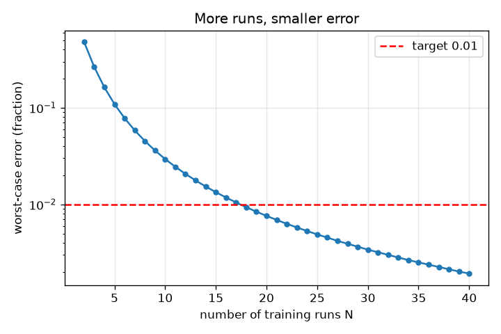
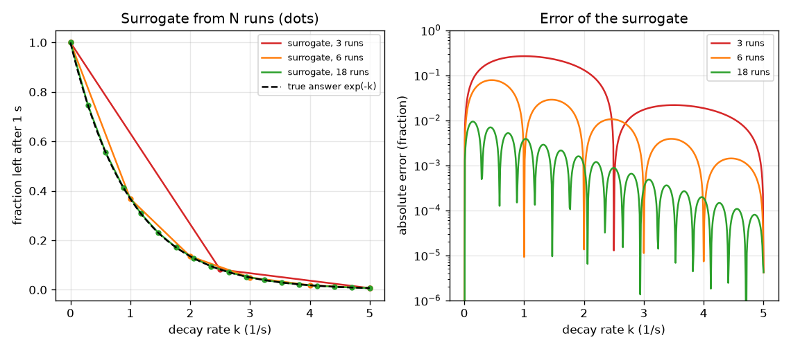

# सत्र 1: एक धीमे सिमुलेशन का तेज़ विकल्प

*स्तर 1 (वैचारिक इंटरैक्टिव मॉडल) · लगभग 60 मिनट · opensurrogate*

> यह एक सरलीकृत शैक्षिक मॉडल है। यह कोई प्रमाणित डिज़ाइन उपकरण नहीं है और इसका उपयोग वास्तविक संरचनाओं, बिजली की स्थापनाओं, वाहनों, औद्योगिक प्रक्रियाओं या चिकित्सा निर्णयों के लिए नहीं किया जाना चाहिए।

**पूर्वापेक्षाएँ (Prerequisites)**

- स्कूल का बीजगणित: ग्राफ़ और फलन f(k) पढ़ना।
- आपने PRIMER.md पढ़ लिया है और `python start.py 1` एक बार चला लिया है।

**सीखने के उद्देश्य।** इस सत्र के बाद आप:

- समझा सकेंगे कि सरोगेट (surrogate) क्या है: इनपुट अंदर, उत्तर बाहर, एक धीमे सिमुलेशन के रनों से सीखा हुआ।
- N प्रशिक्षण रनों (training runs) से एक लुकअप-तालिका (lookup table) सरोगेट बना सकेंगे और नए इनपुटों पर उसकी त्रुटि माप सकेंगे।
- रनों की संख्या के सापेक्ष त्रुटि पढ़ सकेंगे और तय कर सकेंगे कि कितने रन पर्याप्त हैं।
- बता सकेंगे कि जिन इनपुटों से सरोगेट बना है उनके बाहर उस पर भरोसा क्यों नहीं किया जा सकता।

## A. वास्तविक दुनिया की समस्या
एक दहन (combustion) इंजीनियर हज़ारों अलग-अलग परिस्थितियों के लिए एक रासायनिक सिमुलेशन का परिणाम चाहता है, पर हर रन में कई मिनट लगते हैं। सब चलाना बहुत धीमा है। विचार: धीमे सिमुलेशन को कुछ सोच-समझकर चुनी गई परिस्थितियों के लिए चलाइए, 'परिस्थितियाँ अंदर, उत्तर बाहर' का पैटर्न सीखिए, और उस सीखे पैटर्न को बाक़ी सभी परिस्थितियों का उत्तर तुरंत देने दीजिए। उस सीखे पैटर्न को सरोगेट कहते हैं। कितने धीमे रन पर्याप्त हैं, और हमें कैसे पता चले कि विकल्प अच्छा है?

## B. अवधारणा और सिद्धांत
हमारा धीमा सिमुलेशन एक ऐसे पदार्थ का अनुसरण करता है जो दर k (इकाई 1/s) से क्षय होता है: dy/dt = -k y, y = 1 से शुरू करके, 20000 बहुत छोटे ऑयलर चरणों के साथ 1 सेकंड तक चलाया गया। इसका इनपुट k (0 और 5 के बीच) है और इसका उत्तर 1 सेकंड के बाद बचा अंश है, जो सटीक गणित में exp(-k) है। सरोगेट k के समान दूरी वाले मानों पर n प्रशिक्षण रनों से बनाया जाता है: किसी नए k के लिए वह दो निकटतम प्रशिक्षण रनों के बीच एक सीधी रेखा खींचता है (रैखिक अंतर्वेशन, linear interpolation)। इसकी त्रुटि वास्तविक उत्तर से अंतर है। सबसे बुरी स्थिति की त्रुटि (worst-case error) सीमा के सभी k पर सबसे बड़ी त्रुटि है। केवल प्रशिक्षण रनों का उपयोग करना और कुछ नहीं, यही मुख्य सीमा है: 0 से 5 की सीमा के बाहर सरोगेट के पास कोई जानकारी नहीं है।

| प्रतीक | अर्थ | इकाई |
|---|---|---|
| k | क्षय दर, इनपुट | 1/s |
| y | 1 s के बाद बचे पदार्थ का अंश, उत्तर | कोई इकाई नहीं (0 और 1 के बीच) |
| n | प्रशिक्षण रनों की संख्या | कोई इकाई नहीं |
| h | पड़ोसी प्रशिक्षण इनपुटों के बीच की दूरी, 5 / (n - 1) | 1/s |
| error | सरोगेट और वास्तविक उत्तर के बीच निरपेक्ष अंतर | कोई इकाई नहीं |

**मान्यताएँ (Assumptions)**

- सिमुलेशन नियतात्मक (deterministic) है: एक ही k हमेशा एक ही उत्तर देता है।
- केवल एक इनपुट (k) बदलता है; अन्य इनपुट स्थिर हैं।
- प्रशिक्षण इनपुट 0 से 5 1/s की सीमा पर समान दूरी पर हैं।
- धीमा सिमुलेशन इतना सटीक है कि उसे सत्य माना जा सके (exp(-k) से जाँचा गया)।

$$ \frac{dy}{dt}=-k\,y,\qquad y(0)=1\;\Rightarrow\;y(1\,\mathrm{s})=e^{-k} $$

$$ \hat y(k)=y_i+\frac{k-k_i}{k_{i+1}-k_i}\,(y_{i+1}-y_i),\qquad k_i\le k\le k_{i+1} $$

$$ \text{worst-case error}=\max_{0\le k\le 5}\left|\hat y(k)-e^{-k}\right| $$

## C. दृश्य व्याख्या
बायाँ चित्र 3, 6 और 18 प्रशिक्षण रनों (बिंदु) से बना सरोगेट वास्तविक वक्र के सापेक्ष दिखाता है। 3 रनों के साथ यह कुछ सीधे टुकड़े हैं जो मोड़ को चूक जाते हैं; 18 रनों के साथ दोनों वक्रों में अंतर करना कठिन है। दायाँ चित्र रनों की संख्या के सापेक्ष त्रुटि दिखाता है: यह पहले तेज़ी से और फिर धीरे गिरती है, और 18 रनों पर 0.01 की लाल लक्ष्य रेखा को पार करती है।

*प्रशिक्षण रनों की संख्या के सापेक्ष सबसे बुरी स्थिति की त्रुटि; 18 रन 0.01 लक्ष्य पार करने वाले सबसे कम हैं।*

*वास्तविक वक्र के सापेक्ष 3, 6 और 18 रनों (बिंदु) से बने सरोगेट, और उनकी त्रुटियाँ।*

## D. इंटरैक्टिव सिमुलेशन
पाठ चलाइए (`python start.py 1`), फिर लाइव ऐप खोलिए: [सत्र 1: N रनों से एक सरोगेट](https://krunalpanchal1995.github.io/pan-iit-oss/opensurrogate/session-01/) (या इसी फ़ोल्डर में `app.html`)। रन स्लाइडर खिसकाइए और नीले सरोगेट को धूसर वास्तविक वक्र की ओर मुड़ते देखिए; फिर त्रुटि ग्राफ़ खोलिए और देखिए कि त्रुटि कहाँ सबसे बड़ी है (k = 0 के पास, जहाँ वक्र सबसे अधिक मुड़ता है)। एक इनपुट पर त्रुटि पढ़ने के लिए परीक्षण k स्लाइडर खिसकाइए।

**चुनौती।** जितने कम रनों से संभव हो, सबसे बुरी स्थिति की त्रुटि 0.01 से नीचे लाइए।

## E. हल किया गया उदाहरण और प्रयोग
**समस्या।** 6 रनों (k = 0, 1, 2, 3, 4, 5) से सरोगेट बनाइए। यह k = 2.5 पर क्या उत्तर देता है, वास्तविक उत्तर क्या है, और त्रुटि क्या है?

1. निकटतम प्रशिक्षण रन k = 2 और k = 3 हैं: exp(-2) = 0.1353 और exp(-3) = 0.0498।
2. k = 2.5 ठीक बीच में है, इसलिए सरोगेट का उत्तर औसत है: (0.1353 + 0.0498) / 2 = 0.0926।
3. वास्तविक उत्तर exp(-2.5) = 0.0821 है।
4. त्रुटि = 0.0926 - 0.0821 = 0.0105 (0.01 से थोड़ा ऊपर, इसलिए हर k पर 0.01 लक्ष्य के लिए 6 रन पर्याप्त नहीं हैं)।

**उत्तर।** सरोगेट 0.0926 कहता है, सत्य 0.0821 है, त्रुटि 0.0105 है (उत्तर का लगभग 13 प्रतिशत)।

**प्रयोग।** एक स्प्रेडशीट में या Python की कुछ पंक्तियों में एक वास्तविक धीमा सिमुलेशन चलाइए: छोटे समय-चरण लीजिए और k = 2 और k = 3 के लिए 1 s के बाद का मान छापिए, फिर k = 2.5 के लिए, और औसत से तुलना कीजिए। उपकरण कोई भी हो, वही अंतर दिखता है। मॉडल बनाम वास्तविकता: एक वास्तविक सिमुलेशन में संख्यात्मक त्रुटि भी होगी (यहाँ 1e-4 से कम, checkpoint.py में जाँची गई) और एक से कहीं अधिक इनपुट होंगे।

## F. मूल्यांकन और डिज़ाइन चुनौती
**प्रश्न प्रकार A: वैचारिक।** k = 0 से 5 के रनों से बने सरोगेट पर k = 6 पर भरोसा क्यों नहीं किया जा सकता? वह वहाँ वास्तव में क्या उत्तर देता है?

संकेत

सोचिए कि प्रशिक्षण रनों में कौन-सी जानकारी है, और तालिका के बाहर np.interp क्या करता है।

चरण-दर-चरण हल

प्रशिक्षण रन 5 से ऊपर के k के बारे में कुछ नहीं कहते। एक लुकअप तालिका जानकारी गढ़ नहीं सकती: np.interp बस अंतिम मान दोहराता है, इसलिए k = 6 पर वह 0.0067 (k = 5 का मान) उत्तर देता है जबकि सत्य 0.0025 है, दोगुने से अधिक छोटा। सरोगेट में कुछ भी चेतावनी नहीं देता कि वह अपनी सीमा से बाहर चला गया है।

**प्रश्न प्रकार B: संख्यात्मक।** एक सरोगेट 3 रनों (k = 0, 2.5, 5) से बना है। k = 1.25 पर उसका उत्तर और उसकी त्रुटि ज्ञात कीजिए।

संकेत

k = 1.25 पहले दो रनों के ठीक बीच में है; वहाँ उत्तर 1 और exp(-2.5) = 0.0821 हैं।

चरण-दर-चरण हल

सरोगेट = (1 + 0.0821) / 2 = 0.541। वास्तविक exp(-1.25) = 0.2865। त्रुटि = 0.541 - 0.2865 = 0.255, वास्तविक उत्तर का लगभग 90 प्रतिशत: जहाँ वक्र मुड़ता है वहाँ तीन रन बहुत कम हैं।

**प्रश्न प्रकार C: ग्राफ़ और सिमुलेशन की व्याख्या।** त्रुटि ग्राफ़ में त्रुटि कहाँ सबसे बड़ी है, और क्यों? रन जोड़ने पर उस शिखर का क्या होता है?

संकेत

k = 0 के पास और k = 5 के पास exp(-k) के मोड़ की तुलना कीजिए।

चरण-दर-चरण हल

त्रुटि k = 0 के पास शिखर पर है जहाँ exp(-k) सबसे अधिक मुड़ता है (वहाँ उसका द्वितीय अवकलज सबसे बड़ा है); दो रनों के बीच की सीधी रेखा मोड़ का अनुसरण नहीं कर सकती। रन जोड़ने से सीधे टुकड़े छोटे होते हैं, इसलिए शिखर सिकुड़ता है; 18 रनों के साथ यह 0.0094 है, 0.01 रेखा से नीचे।

**प्रश्न प्रकार D: डिज़ाइन और अनुकूलन (optimisation) चुनौती।** हर धीमा रन 2 मिनट लेता है। डिज़ाइन: सबसे बुरी स्थिति की त्रुटि 0.01 से नीचे, और 0.001 से नीचे के लिए आपको कितने रन चाहिए? कठोर लक्ष्य समय में कितना महँगा है? यदि समान दूरी वाले ग्रिड पर दो इनपुट हों तो क्या बदलता है?

संकेत

पाठ में runs_needed का उपयोग कीजिए, फिर प्रति रन लागत से गुणा कीजिए। दो इनपुटों के लिए ग्रिड को n गुणा n रन चाहिए।

चरण-दर-चरण हल

runs_needed 0.01 के लिए 18 रन (36 मिनट) और 0.001 के लिए 56 रन (112 मिनट) देता है: दस गुना कम त्रुटि के लिए लगभग तीन गुना अधिक रन लगते हैं। हर एक के 18 मानों वाले ग्रिड पर दो इनपुटों के साथ आपको 18 x 18 = 324 रन (648 मिनट) चाहिए और तीन इनपुटों के साथ 5832। समझौता (trade-off): कई इनपुट होने पर बिंदु-जोड़ो तरीक़ा रन बर्बाद करता है, इसीलिए सत्र 2 और 3 फ़िट किए गए सूत्रों और नेटवर्कों का उपयोग करते हैं।

[RUBRIC.md](../../RUBRIC.md) से स्वयं को अंक दीजिए। काग़ज़ पर काम करने के लिए [गतिविधि पत्रक](activity_sheet.md) प्रिंट कीजिए।

## सामान्य भ्रांतियाँ
| सामान्य भ्रांति | वास्तव में क्या सच है |
|---|---|
| सरोगेट सिमुलेशन जैसा ही है, बस तेज़। | सरोगेट कुछ रनों से सीखा गया एक सन्निकटन है; उसमें त्रुटि होती है और वह केवल उन्हीं इनपुटों को जानता है जिनसे वह बना है। |
| अधिक रन हमेशा उतनी ही मदद करते हैं। | त्रुटि पहले तेज़ी से और फिर धीरे गिरती है (यहाँ दस गुना कम त्रुटि के लिए लगभग तीन गुना अधिक रन चाहिए थे)। |
| यदि सरोगेट प्रशिक्षण रनों पर सही है, तो वह हर जगह सही है। | बनावट से ही वह प्रशिक्षण रनों को ठीक-ठीक दोहराता है; त्रुटि उनके बीच सबसे बड़ी है, और उनके बाहर वह अर्थहीन है। |
| यदि आलेख पर त्रुटि छोटी दिखती है तो वह पर्याप्त छोटी है। | एक लक्ष्य बताइए (यहाँ 0.01) और कई परीक्षण इनपुटों पर सबसे बुरी स्थिति मापिए, एक पर नहीं। |

## शब्दावली
- **सरोगेट (surrogate)**: एक धीमे सिमुलेशन का सस्ता, सीखा हुआ विकल्प
- **प्रशिक्षण रन (training run)**: सरोगेट बनाने के लिए उपयोग किया गया धीमे सिमुलेशन का एक रन
- **अंतर्वेशन (interpolation)**: ज्ञात मानों के बीच किसी मान का अनुमान, यहाँ सीधी रेखाओं से
- **सबसे बुरी स्थिति की त्रुटि (worst-case error)**: सभी परीक्षण इनपुटों पर सबसे बड़ी त्रुटि
- **बहिर्वेशन (extrapolation)**: प्रशिक्षण रनों की सीमा के बाहर के इनपुटों के लिए उत्तर देना

## समापन
1. [exercises.md](exercises.md) में दिए तीन कोडिंग कार्य कीजिए।
2. अपने बदलावों के बाद `python start.py 1` फिर से चलाइए। यह चेकपॉइंट (checkpoint) पर समाप्त होता है; जब यह `PASS` छापे, तो आपका काम पूरा है। (केवल चेकपॉइंट: `python start.py check 1`।)

अगला: [सत्र 2](../session-02/README.md)
