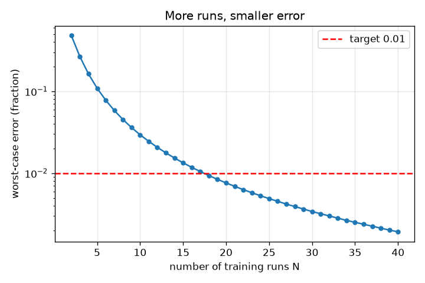
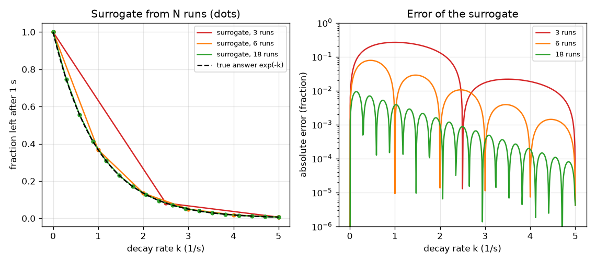

# സെഷൻ 1: സാവധാനത്തിലുള്ള ഒരു സിമുലേഷന് പകരം വേഗത്തിലുള്ള ഒരു പകരക്കാരൻ

[Session 1 — हिन्दी](README.hi.md)

*ലെവൽ 1 (ആശയപരമായ ഇന്ററാക്ടീവ് മോഡൽ) · ഏകദേശം 60 മിനിറ്റ് · opensurrogate*

> ഇത് ലളിതമാക്കിയ ഒരു വിദ്യാഭ്യാസ മോഡൽ ആണ്. ഇത് സാധൂകരിച്ച (validated) ഡിസൈൻ ഉപകരണമല്ല; യഥാർത്ഥ നിർമിതികൾ, വൈദ്യുത ഇൻസ്റ്റലേഷനുകൾ, വാഹനങ്ങൾ, വ്യാവസായിക പ്രക്രിയകൾ അല്ലെങ്കിൽ വൈദ്യശാസ്ത്ര തീരുമാനങ്ങൾ എന്നിവയ്ക്ക് ഇത് ഉപയോഗിക്കരുത്.

**മുൻകൂട്ടി അറിയേണ്ടവ (Prerequisites)**

- സ്കൂൾ ബീജഗണിതം: ഒരു ഗ്രാഫും ഒരു ഫംഗ്ഷൻ f(k)-യും വായിക്കൽ.
- നിങ്ങൾ PRIMER.md വായിച്ചിട്ടുണ്ട്, `python start.py 1` ഒരിക്കൽ റൺ ചെയ്തിട്ടുണ്ട്.

**പഠന ലക്ഷ്യങ്ങൾ (Learning objectives).** ഈ സെഷനു ശേഷം നിങ്ങൾക്ക്:

- ഒരു സറോഗേറ്റ് (surrogate) എന്താണെന്ന് വിശദീകരിക്കാം: ഇൻപുട്ടുകൾ അകത്ത്, ഉത്തരം പുറത്ത്, ഒരു സാവധാന സിമുലേഷന്റെ റണ്ണുകളിൽ നിന്ന് പഠിച്ചത്.
- N പരിശീലന റണ്ണുകളിൽ നിന്ന് ഒരു ലുക്ക്-അപ്പ് ടേബിൾ സറോഗേറ്റ് നിർമ്മിച്ച് പുതിയ ഇൻപുട്ടുകളിൽ അതിന്റെ പിശക് അളക്കാം.
- റണ്ണുകളുടെ എണ്ണത്തിനെതിരെ പിശക് വായിച്ച് എത്ര റണ്ണുകൾ മതി എന്ന് തീരുമാനിക്കാം.
- ഒരു സറോഗേറ്റ് നിർമ്മിച്ച ഇൻപുട്ടുകൾക്ക് പുറത്ത് എന്തുകൊണ്ട് വിശ്വസിക്കാനാവില്ല എന്ന് പറയാം.

## A. യഥാർത്ഥ ലോക പ്രശ്നം
ഒരു ജ്വലന എഞ്ചിനീയർക്ക് ആയിരക്കണക്കിന് വ്യത്യസ്ത സാഹചര്യങ്ങൾക്ക് ഒരു രാസ സിമുലേഷന്റെ ഫലം വേണം, പക്ഷേ ഓരോ റണ്ണിനും മിനിറ്റുകൾ എടുക്കും. എല്ലാം റൺ ചെയ്യുന്നത് വളരെ മന്ദമാണ്. ആശയം: നന്നായി തിരഞ്ഞെടുത്ത ഒരു മിതമായ എണ്ണം സാഹചര്യങ്ങൾക്ക് സാവധാന സിമുലേഷൻ റൺ ചെയ്യുക, 'സാഹചര്യങ്ങൾ അകത്ത്, ഉത്തരം പുറത്ത്' എന്ന മാതൃക പഠിക്കുക, പഠിച്ച മാതൃക മറ്റെല്ലാ സാഹചര്യങ്ങൾക്കും തൽക്ഷണം ഉത്തരം നൽകട്ടെ. പഠിച്ച ആ മാതൃകയെ സറോഗേറ്റ് എന്ന് വിളിക്കുന്നു. എത്ര സാവധാന റണ്ണുകൾ മതി, പകരക്കാരൻ നല്ലതാണെന്ന് നാം എങ്ങനെ അറിയും?

## B. ആശയവും സിദ്ധാന്തവും
നമ്മുടെ സാവധാന സിമുലേഷൻ k നിരക്കിൽ (യൂണിറ്റ് 1/s) ക്ഷയിക്കുന്ന ഒരു പദാർത്ഥത്തെ പിന്തുടരുന്നു: dy/dt = -k y, y = 1-ൽ തുടങ്ങി, 20000 ചെറിയ യൂളർ (Euler) ഘട്ടങ്ങളോടെ 1 സെക്കൻഡ് റൺ ചെയ്യുന്നു. അതിന്റെ ഇൻപുട്ട് k (0 നും 5 നും ഇടയിൽ), ഉത്തരം 1 സെക്കൻഡിന് ശേഷം ബാക്കിയുള്ള അംശം, കൃത്യമായ ഗണിതത്തിൽ അത് exp(-k) ആണ്. സറോഗേറ്റ് k-യുടെ തുല്യ അകലത്തിലുള്ള മൂല്യങ്ങളിലെ n പരിശീലന റണ്ണുകളിൽ നിന്ന് നിർമ്മിക്കുന്നു: പുതിയ k-യ്ക്ക് ഏറ്റവും അടുത്ത രണ്ട് പരിശീലന റണ്ണുകൾക്കിടയിൽ അത് ഒരു നേർരേഖ വരയ്ക്കുന്നു (രേഖീയ ഇന്റർപോളേഷൻ, linear interpolation). അതിന്റെ പിശക് യഥാർത്ഥ ഉത്തരത്തിൽ നിന്നുള്ള വ്യത്യാസമാണ്. ഏറ്റവും മോശം പിശക് (worst-case error) പരിധിയിലെ എല്ലാ k-യിലും ഉള്ള ഏറ്റവും വലിയ പിശകാണ്. പരിശീലന റണ്ണുകൾ മാത്രം ഉപയോഗിക്കുന്നു, മറ്റൊന്നുമില്ല എന്നതാണ് പ്രധാന പരിമിതി: 0 മുതൽ 5 വരെയുള്ള പരിധിക്ക് പുറത്ത് സറോഗേറ്റിന് ഒരു വിവരവുമില്ല.

| ചിഹ്നം | അർത്ഥം | യൂണിറ്റ് |
|---|---|---|
| k | ക്ഷയ നിരക്ക്, ഇൻപുട്ട് | 1/s |
| y | 1 s ന് ശേഷം ബാക്കിയുള്ള പദാർത്ഥത്തിന്റെ അംശം, ഉത്തരം | യൂണിറ്റില്ല (0 നും 1 നും ഇടയിൽ) |
| n | പരിശീലന റണ്ണുകളുടെ എണ്ണം | യൂണിറ്റില്ല |
| h | അടുത്തടുത്ത പരിശീലന ഇൻപുട്ടുകൾ തമ്മിലുള്ള അകലം, 5 / (n - 1) | 1/s |
| error | സറോഗേറ്റും യഥാർത്ഥ ഉത്തരവും തമ്മിലുള്ള കേവല വ്യത്യാസം | യൂണിറ്റില്ല |

**അനുമാനങ്ങൾ (Assumptions)**

- സിമുലേഷൻ നിർണ്ണായകമാണ് (deterministic): ഒരേ k എപ്പോഴും ഒരേ ഉത്തരം തരുന്നു.
- ഒരു ഇൻപുട്ട് (k) മാത്രം മാറുന്നു; മറ്റ് ഇൻപുട്ടുകൾ സ്ഥിരമാണ്.
- പരിശീലന ഇൻപുട്ടുകൾ 0 മുതൽ 5 1/s വരെയുള്ള പരിധിയിൽ തുല്യ അകലത്തിലാണ്.
- സാവധാന സിമുലേഷൻ സത്യമായി കണക്കാക്കാൻ മതിയായ കൃത്യതയുള്ളതാണ് (exp(-k) ഉപയോഗിച്ച് പരിശോധിച്ചത്).

$$ \frac{dy}{dt}=-k\,y,\qquad y(0)=1\;\Rightarrow\;y(1\,\mathrm{s})=e^{-k} $$

$$ \hat y(k)=y_i+\frac{k-k_i}{k_{i+1}-k_i}\,(y_{i+1}-y_i),\qquad k_i\le k\le k_{i+1} $$

$$ \text{worst-case error}=\max_{0\le k\le 5}\left|\hat y(k)-e^{-k}\right| $$

## C. ദൃശ്യ വിശദീകരണം
ഇടത് ചിത്രം 3, 6, 18 പരിശീലന റണ്ണുകളിൽ (കുത്തുകൾ) നിന്ന് നിർമ്മിച്ച സറോഗേറ്റിനെ യഥാർത്ഥ വക്രത്തിനെതിരെ വരയ്ക്കുന്നു. 3 റണ്ണുകളിൽ അത് വളവ് നഷ്ടപ്പെടുത്തുന്ന കുറച്ച് നേർ കഷണങ്ങളാണ്; 18 റണ്ണുകളിൽ രണ്ട് വക്രങ്ങളെ വേർതിരിച്ചറിയാൻ പ്രയാസമാണ്. വലത് ചിത്രം റണ്ണുകളുടെ എണ്ണത്തിനെതിരെ പിശക് വരയ്ക്കുന്നു: ആദ്യം കുത്തനെ താഴുന്നു, പിന്നെ സാവധാനം, 18 റണ്ണുകളിൽ ചുവന്ന ലക്ഷ്യ രേഖയായ 0.01 കടക്കുന്നു.

*പരിശീലന റണ്ണുകളുടെ എണ്ണത്തിനെതിരെ ഏറ്റവും മോശം പിശക്; 0.01 ലക്ഷ്യം കടക്കുന്ന ഏറ്റവും കുറഞ്ഞ എണ്ണം 18 റണ്ണുകളാണ്.*

*3, 6, 18 റണ്ണുകളിൽ (കുത്തുകൾ) നിന്നുള്ള സറോഗേറ്റുകൾ യഥാർത്ഥ വക്രത്തിനെതിരെ, അവയുടെ പിശകുകളും.*

## D. ഇന്ററാക്ടീവ് സിമുലേഷൻ
പാഠം റൺ ചെയ്യുക (`python start.py 1`), തുടർന്ന് ലൈവ് ആപ്പ് തുറക്കുക: [സെഷൻ 1: N റണ്ണുകളിൽ നിന്ന് ഒരു സറോഗേറ്റ്](https://krunalpanchal1995.github.io/pan-iit-oss/opensurrogate/session-01/) (അല്ലെങ്കിൽ ഈ ഫോൾഡറിലെ `app.html`). റൺസ് സ്ലൈഡർ നീക്കി നീല സറോഗേറ്റ് ചാര യഥാർത്ഥ വക്രത്തിലേക്ക് വളയുന്നത് നിരീക്ഷിക്കുക; തുടർന്ന് പിശക് ഗ്രാഫ് തുറന്ന് പിശക് ഏറ്റവും വലുത് എവിടെയാണെന്ന് കാണുക (k = 0-ന് അടുത്ത്, വക്രം ഏറ്റവും കൂടുതൽ വളയുന്നിടത്ത്). ഒരു ഇൻപുട്ടിലെ പിശക് വായിക്കാൻ ടെസ്റ്റ് k സ്ലൈഡർ നീക്കുക.

**വെല്ലുവിളി.** കഴിയുന്നത്ര കുറച്ച് റണ്ണുകൾ കൊണ്ട് 0.01-ന് താഴെ ഏറ്റവും മോശം പിശക് നേടുക.

## E. ഉദാഹരണവും പരീക്ഷണവും
**പ്രശ്നം.** 6 റണ്ണുകളിൽ നിന്ന് (k = 0, 1, 2, 3, 4, 5) സറോഗേറ്റ് നിർമ്മിക്കുക. k = 2.5-ൽ അത് എന്ത് ഉത്തരം നൽകുന്നു, യഥാർത്ഥ ഉത്തരം എന്താണ്, പിശക് എത്രയാണ്?

1. ഏറ്റവും അടുത്ത പരിശീലന റണ്ണുകൾ k = 2, k = 3 ആണ്: exp(-2) = 0.1353, exp(-3) = 0.0498.
2. k = 2.5 കൃത്യം നടുവിലാണ്, അതിനാൽ സറോഗേറ്റ് ഉത്തരം ശരാശരിയാണ്: (0.1353 + 0.0498) / 2 = 0.0926.
3. യഥാർത്ഥ ഉത്തരം exp(-2.5) = 0.0821.
4. പിശക് = 0.0926 - 0.0821 = 0.0105 (0.01-ൽ അല്പം കൂടുതൽ, അതിനാൽ എല്ലാ k-യിലും 0.01 ലക്ഷ്യത്തിന് 6 റണ്ണുകൾ മതിയാകില്ല).

**ഉത്തരം.** സറോഗേറ്റ് 0.0926 പറയുന്നു, സത്യം 0.0821, പിശക് 0.0105 (ഉത്തരത്തിന്റെ ഏകദേശം 13 ശതമാനം).

**പരീക്ഷണം.** ഒരു സ്പ്രെഡ്ഷീറ്റിലോ കുറച്ച് വരി Python-ലോ ഒരു യഥാർത്ഥ സാവധാന സിമുലേഷൻ റൺ ചെയ്യുക: ചെറിയ സമയ ഘട്ടങ്ങൾ എടുത്ത് k = 2, k = 3 എന്നിവയ്ക്ക് 1 s ന് ശേഷമുള്ള മൂല്യം പ്രിന്റ് ചെയ്യുക, പിന്നെ k = 2.5-ന്, ശരാശരിയുമായി താരതമ്യം ചെയ്യുക. ഏത് ഉപകരണം ഉപയോഗിച്ചാലും ഇതേ വ്യത്യാസം കാണും. മോഡലും യാഥാർത്ഥ്യവും: ഒരു യഥാർത്ഥ സിമുലേഷന് സംഖ്യാ പിശകും (ഇവിടെ 1e-4-ന് താഴെ, checkpoint.py-ൽ പരിശോധിച്ചത്) ഒന്നിലധികം ഇൻപുട്ടുകളും ഉണ്ടാകും.

## F. വിലയിരുത്തലും ഡിസൈൻ വെല്ലുവിളിയും
**ചോദ്യ തരം A: ആശയപരം.** k = 0 മുതൽ 5 വരെയുള്ള റണ്ണുകളിൽ നിന്ന് നിർമ്മിച്ച ഒരു സറോഗേറ്റ് k = 6-ൽ വിശ്വസിക്കാനാവാത്തത് എന്തുകൊണ്ട്? അവിടെ അത് യഥാർത്ഥത്തിൽ എന്ത് ഉത്തരം നൽകുന്നു?

സൂചന

പരിശീലന റണ്ണുകളിൽ ഏത് വിവരമുണ്ട് എന്നും ടേബിളിന് പുറത്ത് np.interp എന്താണ് ചെയ്യുന്നത് എന്നും ചിന്തിക്കുക.

ഘട്ടം ഘട്ടമായുള്ള പരിഹാരം

5-ന് മുകളിലുള്ള k-യെക്കുറിച്ച് പരിശീലന റണ്ണുകൾ ഒന്നും പറയുന്നില്ല. ഒരു ലുക്ക്-അപ്പ് ടേബിളിന് വിവരം കണ്ടുപിടിക്കാനാവില്ല: np.interp അവസാന മൂല്യം ആവർത്തിക്കുക മാത്രം ചെയ്യുന്നു, അതിനാൽ k = 6-ൽ അത് 0.0067 (k = 5-ലെ മൂല്യം) ഉത്തരം നൽകുന്നു, സത്യം 0.0025 ആണ്, രണ്ടിരട്ടിയിലധികം ചെറുത്. സറോഗേറ്റ് അതിന്റെ പരിധി വിട്ടു എന്ന് അതിൽ ഒന്നും മുന്നറിയിപ്പ് നൽകുന്നില്ല.

**ചോദ്യ തരം B: സംഖ്യാപരം.** 3 റണ്ണുകളിൽ (k = 0, 2.5, 5) നിന്ന് ഒരു സറോഗേറ്റ് നിർമ്മിച്ചിരിക്കുന്നു. k = 1.25-ൽ അതിന്റെ ഉത്തരവും പിശകും കണ്ടെത്തുക.

സൂചന

k = 1.25 ആദ്യ രണ്ട് റണ്ണുകളുടെ കൃത്യം നടുവിലാണ്; അവിടത്തെ ഉത്തരങ്ങൾ 1, exp(-2.5) = 0.0821 എന്നിവയാണ്.

ഘട്ടം ഘട്ടമായുള്ള പരിഹാരം

സറോഗേറ്റ് = (1 + 0.0821) / 2 = 0.541. യഥാർത്ഥ exp(-1.25) = 0.2865. പിശക് = 0.541 - 0.2865 = 0.255, യഥാർത്ഥ ഉത്തരത്തിന്റെ ഏതാണ്ട് 90 ശതമാനം: വക്രം വളയുന്നിടത്ത് മൂന്ന് റണ്ണുകൾ വളരെ കുറവാണ്.

**ചോദ്യ തരം C: ഗ്രാഫും സിമുലേഷനും വ്യാഖ്യാനിക്കൽ.** പിശക് ഗ്രാഫിൽ, പിശക് ഏറ്റവും വലുത് എവിടെയാണ്, എന്തുകൊണ്ട്? റണ്ണുകൾ കൂട്ടുമ്പോൾ ആ ഉച്ചത്തിന് എന്ത് സംഭവിക്കുന്നു?

സൂചന

k = 0-ന് അടുത്തും k = 5-ന് അടുത്തും exp(-k)-യുടെ വളവ് താരതമ്യം ചെയ്യുക.

ഘട്ടം ഘട്ടമായുള്ള പരിഹാരം

exp(-k) ഏറ്റവും കൂടുതൽ വളയുന്ന k = 0-ന് അടുത്താണ് പിശക് ഉച്ചത്തിലെത്തുന്നത് (അവിടെ അതിന്റെ രണ്ടാം അവകലജം ഏറ്റവും വലുതാണ്); രണ്ട് റണ്ണുകൾക്കിടയിലെ ഒരു നേർരേഖയ്ക്ക് വളവ് പിന്തുടരാൻ കഴിയില്ല. റണ്ണുകൾ കൂട്ടുന്നത് നേർ കഷണങ്ങളെ ചെറുതാക്കുന്നു, അതിനാൽ ഉച്ചം ചുരുങ്ങുന്നു; 18 റണ്ണുകളിൽ അത് 0.0094 ആണ്, 0.01 രേഖയ്ക്ക് താഴെ.

**ചോദ്യ തരം D: ഡിസൈനും ഒപ്റ്റിമൈസേഷനും വെല്ലുവിളി.** ഓരോ സാവധാന റണ്ണിനും 2 മിനിറ്റ് എടുക്കും. ഡിസൈൻ: 0.01-ന് താഴെയും 0.001-ന് താഴെയും ഏറ്റവും മോശം പിശകിന് എത്ര റണ്ണുകൾ വേണം? കൂടുതൽ കർശനമായ ലക്ഷ്യത്തിന് സമയത്തിൽ എന്ത് വില? അതേ അകലത്തിൽ ഒരു ഗ്രിഡിൽ രണ്ട് ഇൻപുട്ടുകൾ ഉണ്ടെങ്കിൽ എന്ത് മാറും?

സൂചന

പാഠത്തിലെ runs_needed ഉപയോഗിക്കുക, തുടർന്ന് ഒരു റണ്ണിന്റെ ചെലവ് കൊണ്ട് ഗുണിക്കുക. രണ്ട് ഇൻപുട്ടുകൾക്ക് ഒരു ഗ്രിഡിന് n ഗുണം n റണ്ണുകൾ വേണം.

ഘട്ടം ഘട്ടമായുള്ള പരിഹാരം

runs_needed 0.01-ന് 18 റണ്ണുകൾ (36 മിനിറ്റ്), 0.001-ന് 56 റണ്ണുകൾ (112 മിനിറ്റ്) എന്ന് നൽകുന്നു: പത്തിലൊന്ന് പിശകിന് ഏകദേശം മൂന്നിരട്ടി റണ്ണുകൾ ചെലവാകുന്നു. ഓരോന്നിലും 18 മൂല്യങ്ങളുള്ള ഒരു ഗ്രിഡിൽ രണ്ട് ഇൻപുട്ടുകളുണ്ടെങ്കിൽ 18 x 18 = 324 റണ്ണുകൾ (648 മിനിറ്റ്) വേണം, മൂന്ന് ഇൻപുട്ടുകൾക്ക് 5832. വിട്ടുവീഴ്ച (trade-off): ഒന്നിലധികം ഇൻപുട്ടുകൾ ഉള്ളപ്പോൾ കുത്തുകൾ യോജിപ്പിക്കൽ റണ്ണുകൾ പാഴാക്കുന്നു, അതുകൊണ്ടാണ് സെഷൻ 2, 3 ഫിറ്റ് ചെയ്ത ഫോർമുലകളും നെറ്റ്‌വർക്കുകളും ഉപയോഗിക്കുന്നത്.

[RUBRIC.md](../../RUBRIC.md) ഉപയോഗിച്ച് സ്വയം സ്കോർ ചെയ്യുക. പേപ്പറിൽ ചെയ്യാൻ [ആക്ടിവിറ്റി ഷീറ്റ്](activity_sheet.md) പ്രിന്റ് ചെയ്യുക.

## സാധാരണ തെറ്റിദ്ധാരണകൾ
| സാധാരണ തെറ്റിദ്ധാരണ | യഥാർത്ഥത്തിൽ ശരിയായത് |
|---|---|
| ഒരു സറോഗേറ്റ് സിമുലേഷൻ തന്നെയാണ്, കൂടുതൽ വേഗത്തിൽ എന്ന് മാത്രം. | സറോഗേറ്റ് ചില റണ്ണുകളിൽ നിന്ന് പഠിച്ച ഒരു ഏകദേശമാണ്; അതിന് പിശകുണ്ട്, അത് നിർമ്മിച്ച ഇൻപുട്ടുകൾ മാത്രമേ അതിന് അറിയൂ. |
| കൂടുതൽ റണ്ണുകൾ എപ്പോഴും ഒരേ അളവിൽ സഹായിക്കുന്നു. | പിശക് ആദ്യം വേഗത്തിലും പിന്നെ സാവധാനത്തിലും കുറയുന്നു (ഇവിടെ പത്തിലൊന്ന് പിശകിന് ഏകദേശം മൂന്നിരട്ടി റണ്ണുകൾ വേണ്ടി വന്നു). |
| പരിശീലന റണ്ണുകളിൽ സറോഗേറ്റ് ശരിയാണെങ്കിൽ അത് എല്ലായിടത്തും ശരിയാണ്. | നിർമ്മിതി പ്രകാരം അത് പരിശീലന റണ്ണുകളെ കൃത്യമായി പുനഃസൃഷ്ടിക്കുന്നു; പിശക് അവയ്ക്കിടയിലാണ് ഏറ്റവും വലുത്, അവയ്ക്ക് പുറത്ത് അത് അർത്ഥശൂന്യമാണ്. |
| പ്ലോട്ടിൽ പിശക് ചെറുതായി തോന്നുന്നെങ്കിൽ അത് മതിയാവുന്നത്ര ചെറുതാണ്. | ഒരു ലക്ഷ്യം പറയുക (ഇവിടെ 0.01), ഒന്നല്ല, നിരവധി ടെസ്റ്റ് ഇൻപുട്ടുകളിൽ ഏറ്റവും മോശം അവസ്ഥ അളക്കുക. |

## പദാവലി (Glossary)
- **സറോഗേറ്റ് (surrogate)**: സാവധാനത്തിലുള്ള ഒരു സിമുലേഷന് പകരം പഠിച്ചെടുത്ത വിലകുറഞ്ഞ ഒരു പകരക്കാരൻ
- **പരിശീലന റൺ (training run)**: സറോഗേറ്റ് നിർമ്മിക്കാൻ ഉപയോഗിക്കുന്ന സാവധാന സിമുലേഷന്റെ ഒരു റൺ
- **ഇന്റർപോളേഷൻ (interpolation)**: അറിയാവുന്ന മൂല്യങ്ങൾക്കിടയിലെ ഒരു മൂല്യം കണക്കാക്കൽ, ഇവിടെ നേർരേഖകൾ കൊണ്ട്
- **ഏറ്റവും മോശം പിശക് (worst-case error)**: എല്ലാ ടെസ്റ്റ് ഇൻപുട്ടുകളിലും ഏറ്റവും വലിയ പിശക്
- **എക്സ്ട്രാപോളേഷൻ (extrapolation)**: പരിശീലന റണ്ണുകളുടെ പരിധിക്ക് പുറത്തുള്ള ഇൻപുട്ടുകൾക്ക് ഉത്തരം നൽകൽ

## പൂർത്തിയാക്കുക
1. [exercises.md](exercises.md)-ലെ മൂന്ന് കോഡിംഗ് ടാസ്കുകൾ ചെയ്യുക.
2. നിങ്ങളുടെ മാറ്റങ്ങൾക്ക് ശേഷം `python start.py 1` വീണ്ടും റൺ ചെയ്യുക. അത് ചെക്ക്‌പോയിന്റോടെ അവസാനിക്കുന്നു; അത് `PASS` പ്രിന്റ് ചെയ്യുമ്പോൾ നിങ്ങൾ പൂർത്തിയാക്കി. (ചെക്ക്‌പോയിന്റ് മാത്രം: `python start.py check 1`.)

അടുത്തത്: [സെഷൻ 2](../session-02/README.md)
