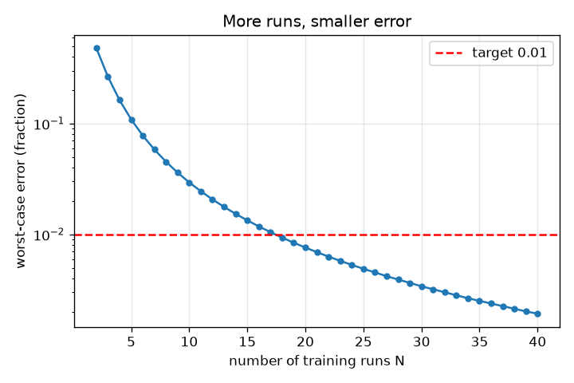
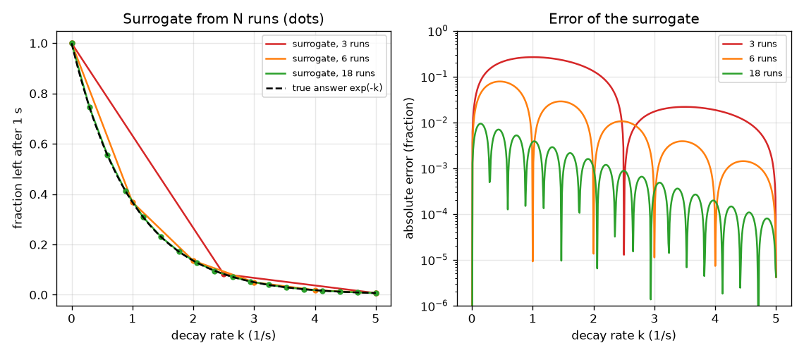

# அமர்வு 1: மெதுவான உருவகப்படுத்தலுக்குப் பதிலாக ஒரு வேகமான மாற்று

[Session 1 — हिन्दी](README.hi.md)

*நிலை 1 (கருத்தியல் ஊடாடும் மாதிரி) · சுமார் 60 நிமிடங்கள் · opensurrogate*

> இது எளிமைப்படுத்தப்பட்ட ஒரு கல்வி மாதிரி. இது சரிபார்க்கப்பட்ட (validated) வடிவமைப்புக் கருவி அல்ல; உண்மையான கட்டமைப்புகள், மின் நிறுவல்கள், வாகனங்கள், தொழிற்சாலை செயல்முறைகள் அல்லது மருத்துவ முடிவுகளுக்கு இதைப் பயன்படுத்தக் கூடாது.

**முன்தேவைகள் (Prerequisites)**

- பள்ளி இயற்கணிதம்: ஒரு வரைபடத்தையும் ஒரு சார்பு f(k) ஐயும் படித்தல்.
- நீங்கள் PRIMER.md படித்து, `python start.py 1` ஒருமுறை இயக்கியுள்ளீர்கள்.

**கற்றல் நோக்கங்கள் (Learning objectives).** இந்த அமர்வுக்குப் பிறகு நீங்கள்:

- ஒரு மாற்றுமாதிரி (surrogate) என்றால் என்ன என்று விளக்கலாம்: உள்ளீடுகள் உள்ளே, விடை வெளியே, ஒரு மெதுவான உருவகப்படுத்தலின் ஓட்டங்களிலிருந்து கற்றது.
- N பயிற்சி ஓட்டங்களிலிருந்து ஒரு தேடல்-அட்டவணை மாற்றுமாதிரியை உருவாக்கி, புதிய உள்ளீடுகளில் அதன் பிழையை அளக்கலாம்.
- ஓட்டங்களின் எண்ணிக்கைக்கு எதிரான பிழையைப் படித்து எத்தனை ஓட்டங்கள் போதும் என்று முடிவு செய்யலாம்.
- ஒரு மாற்றுமாதிரி உருவாக்கப்பட்ட உள்ளீடுகளுக்கு வெளியே ஏன் நம்பத்தகாதது என்று கூறலாம்.

## A. நிஜ உலகப் பிரச்சினை
ஓர் எரிப்புப் பொறியாளருக்கு ஆயிரக்கணக்கான வெவ்வேறு நிலைமைகளுக்கு ஒரு வேதியியல் உருவகப்படுத்தலின் முடிவு வேண்டும், ஆனால் ஒவ்வொரு ஓட்டத்துக்கும் நிமிடங்கள் ஆகின்றன. அனைத்தையும் ஓட்டுவது மிகவும் மெதுவு. யோசனை: நன்கு தேர்ந்தெடுத்த மிதமான எண்ணிக்கையிலான நிலைமைகளுக்கு மெதுவான உருவகப்படுத்தலை ஓட்டி, 'நிலைமைகள் உள்ளே, விடை வெளியே' என்ற வடிவத்தைக் கற்று, கற்ற வடிவம் மற்ற எல்லா நிலைமைகளுக்கும் உடனே விடை சொல்லட்டும். கற்ற அந்த வடிவம் மாற்றுமாதிரி (surrogate) எனப்படுகிறது. எத்தனை மெதுவான ஓட்டங்கள் போதும், மாற்று நல்லது என்று நாம் எப்படி அறிவது?

## B. கருத்தும் கோட்பாடும்
நமது மெதுவான உருவகப்படுத்தல் k விகிதத்தில் (அலகு 1/s) சிதையும் ஒரு பொருளைப் பின்தொடர்கிறது: dy/dt = -k y, y = 1 இலிருந்து தொடங்கி, 20000 சிறிய யூலர் (Euler) அடிகளுடன் 1 வினாடி ஓடுகிறது. அதன் உள்ளீடு k (0 முதல் 5 வரை), விடை 1 வினாடிக்குப் பிறகு மீதமுள்ள பங்கு, துல்லியக் கணிதத்தில் அது exp(-k). மாற்றுமாதிரி k இன் சம இடைவெளி மதிப்புகளில் n பயிற்சி ஓட்டங்களிலிருந்து கட்டப்படுகிறது: புதிய k க்கு அருகிலுள்ள இரண்டு பயிற்சி ஓட்டங்களுக்கு இடையே அது ஒரு நேர்கோடு வரைகிறது (நேரியல் இடைச்செருகல், linear interpolation). அதன் பிழை உண்மை விடையிலிருந்து உள்ள வேறுபாடு. மிக மோசமான பிழை (worst-case error) வரம்பிலுள்ள எல்லா k மீதும் உள்ள மிகப் பெரிய பிழை. பயிற்சி ஓட்டங்களை மட்டுமே பயன்படுத்துவது, வேறெதுவும் இல்லை என்பதே முக்கிய வரம்பு: 0 முதல் 5 வரையிலான வரம்புக்கு வெளியே மாற்றுமாதிரிக்குத் தகவல் இல்லை.

| குறியீடு | பொருள் | அலகு |
|---|---|---|
| k | சிதைவு வீதம், உள்ளீடு | 1/s |
| y | 1 s க்குப் பிறகு மீதமுள்ள பொருளின் பங்கு, விடை | அலகு இல்லை (0 முதல் 1 வரை) |
| n | பயிற்சி ஓட்டங்களின் எண்ணிக்கை | அலகு இல்லை |
| h | அடுத்தடுத்த பயிற்சி உள்ளீடுகளுக்கு இடையிலான இடைவெளி, 5 / (n - 1) | 1/s |
| error | மாற்றுமாதிரிக்கும் உண்மை விடைக்கும் இடையிலான தனி வேறுபாடு | அலகு இல்லை |

**அனுமானங்கள் (Assumptions)**

- உருவகப்படுத்தல் தீர்மானமானது (deterministic): ஒரே k எப்போதும் ஒரே விடையைத் தருகிறது.
- ஒரு உள்ளீடு (k) மட்டுமே மாறுகிறது; மற்ற உள்ளீடுகள் நிலையானவை.
- பயிற்சி உள்ளீடுகள் 0 முதல் 5 1/s வரம்பில் சம இடைவெளியில் உள்ளன.
- மெதுவான உருவகப்படுத்தல் உண்மையாகக் கருதும் அளவுக்குத் துல்லியமானது (exp(-k) உடன் சரிபார்க்கப்பட்டது).

$$ \frac{dy}{dt}=-k\,y,\qquad y(0)=1\;\Rightarrow\;y(1\,\mathrm{s})=e^{-k} $$

$$ \hat y(k)=y_i+\frac{k-k_i}{k_{i+1}-k_i}\,(y_{i+1}-y_i),\qquad k_i\le k\le k_{i+1} $$

$$ \text{worst-case error}=\max_{0\le k\le 5}\left|\hat y(k)-e^{-k}\right| $$

## C. காட்சி விளக்கம்
இடப்பக்கப் படம் 3, 6, 18 பயிற்சி ஓட்டங்களிலிருந்து (புள்ளிகள்) கட்டிய மாற்றுமாதிரியை உண்மை வளைவுக்கு எதிராக வரைகிறது. 3 ஓட்டங்களில் அது வளைவைத் தவறவிடும் சில நேர்த் துண்டுகள்; 18 ஓட்டங்களில் இரு வளைவுகளையும் பிரித்தறிவது கடினம். வலப்பக்கப் படம் ஓட்டங்களின் எண்ணிக்கைக்கு எதிராகப் பிழையை வரைகிறது: முதலில் செங்குத்தாக விழுந்து பின் மெதுவாக, 18 ஓட்டங்களில் சிவப்பு இலக்குக் கோடு 0.01 ஐக் கடக்கிறது.

*பயிற்சி ஓட்டங்களின் எண்ணிக்கைக்கு எதிரான மிக மோசமான பிழை; 0.01 இலக்கைக் கடக்கும் குறைந்தபட்ச எண்ணிக்கை 18 ஓட்டங்கள்.*

*3, 6, 18 ஓட்டங்களிலிருந்து (புள்ளிகள்) மாற்றுமாதிரிகள் உண்மை வளைவுக்கு எதிராக, அவற்றின் பிழைகளும்.*

## D. ஊடாடும் உருவகப்படுத்தல் (Interactive simulation)
பாடத்தை இயக்கவும் (`python start.py 1`), பின்னர் நேரடிச் செயலியைத் திறக்கவும்: [அமர்வு 1: N ஓட்டங்களிலிருந்து ஒரு மாற்றுமாதிரி](https://krunalpanchal1995.github.io/pan-iit-oss/opensurrogate/session-01/) (அல்லது இந்தக் கோப்புறையிலுள்ள `app.html`). ஓட்ட நழுவியை நகர்த்தி நீல மாற்றுமாதிரி சாம்பல் உண்மை வளைவை நோக்கி வளைவதைப் பாருங்கள்; பின்னர் பிழை வரைபடத்தைத் திறந்து பிழை எங்கே மிகப் பெரியது என்று பாருங்கள் (k = 0 க்கு அருகில், வளைவு மிக அதிகம் வளையும் இடத்தில்). ஒரு உள்ளீட்டில் பிழையைப் படிக்க சோதனை k நழுவியை நகர்த்துங்கள்.

**சவால்.** முடிந்தவரை குறைவான ஓட்டங்களுடன் 0.01 க்குக் கீழே மிக மோசமான பிழையை அடையுங்கள்.

## E. தீர்க்கப்பட்ட எடுத்துக்காட்டும் சோதனையும்
**பிரச்சினை.** 6 ஓட்டங்களிலிருந்து (k = 0, 1, 2, 3, 4, 5) மாற்றுமாதிரியை உருவாக்குங்கள். k = 2.5 இல் அது என்ன விடை தருகிறது, உண்மை விடை என்ன, பிழை என்ன?

1. அருகிலுள்ள பயிற்சி ஓட்டங்கள் k = 2 மற்றும் k = 3: exp(-2) = 0.1353 மற்றும் exp(-3) = 0.0498.
2. k = 2.5 சரியாக நடுவில் உள்ளது, எனவே மாற்றுமாதிரி விடை சராசரி: (0.1353 + 0.0498) / 2 = 0.0926.
3. உண்மை விடை exp(-2.5) = 0.0821.
4. பிழை = 0.0926 - 0.0821 = 0.0105 (0.01 ஐ விடச் சற்று அதிகம், எனவே ஒவ்வொரு k இலும் 0.01 இலக்குக்கு 6 ஓட்டங்கள் போதாது).

**விடை.** மாற்றுமாதிரி 0.0926 என்கிறது, உண்மை 0.0821, பிழை 0.0105 (விடையில் சுமார் 13 சதவீதம்).

**சோதனை.** ஒரு விரிதாளிலோ சில வரி Python இலோ உண்மையான மெதுவான உருவகப்படுத்தலை ஓட்டுங்கள்: சிறிய நேர அடிகள் எடுத்து k = 2 மற்றும் k = 3 க்கு 1 s க்குப் பிறகான மதிப்பை அச்சிடுங்கள், பின்னர் k = 2.5 க்கு, சராசரியுடன் ஒப்பிடுங்கள். எந்தக் கருவியிலும் அதே வேறுபாடு தோன்றும். மாதிரியும் நிஜமும்: உண்மையான உருவகப்படுத்தலுக்கு எண்ணியல் பிழையும் (இங்கே 1e-4 க்குக் கீழே, checkpoint.py இல் சரிபார்க்கப்பட்டது) ஒன்றுக்கு மேற்பட்ட உள்ளீடுகளும் இருக்கும்.

## F. மதிப்பீடும் வடிவமைப்புச் சவாலும்
**கேள்வி வகை A: கருத்தியல்.** k = 0 முதல் 5 வரையிலான ஓட்டங்களிலிருந்து கட்டிய மாற்றுமாதிரியை k = 6 இல் ஏன் நம்ப முடியாது? அங்கே அது உண்மையில் என்ன விடை தருகிறது?

குறிப்பு

பயிற்சி ஓட்டங்களில் என்ன தகவல் உள்ளது என்றும், அட்டவணைக்கு வெளியே np.interp என்ன செய்கிறது என்றும் யோசியுங்கள்.

படிப்படியான தீர்வு

5 க்கு மேலான k பற்றி பயிற்சி ஓட்டங்கள் எதுவும் சொல்வதில்லை. ஒரு தேடல் அட்டவணையால் தகவலைக் கண்டுபிடிக்க முடியாது: np.interp கடைசி மதிப்பையே திரும்பச் சொல்கிறது, எனவே k = 6 இல் அது 0.0067 (k = 5 இல் உள்ள மதிப்பு) என்று விடை தருகிறது, உண்மை 0.0025, இரு மடங்குக்கு மேல் சிறியது. மாற்றுமாதிரி தன் வரம்பை விட்டு வெளியேறிவிட்டது என்று அதில் எதுவும் எச்சரிக்கை தருவதில்லை.

**கேள்வி வகை B: எண்ணியல்.** 3 ஓட்டங்களிலிருந்து (k = 0, 2.5, 5) ஒரு மாற்றுமாதிரி கட்டப்பட்டுள்ளது. k = 1.25 இல் அதன் விடையையும் பிழையையும் காண்க.

குறிப்பு

k = 1.25 முதல் இரண்டு ஓட்டங்களுக்கு நடுவில் உள்ளது; அங்குள்ள விடைகள் 1 மற்றும் exp(-2.5) = 0.0821.

படிப்படியான தீர்வு

மாற்றுமாதிரி = (1 + 0.0821) / 2 = 0.541. உண்மை exp(-1.25) = 0.2865. பிழை = 0.541 - 0.2865 = 0.255, உண்மை விடையில் கிட்டத்தட்ட 90 சதவீதம்: வளைவு வளையும் இடத்தில் மூன்று ஓட்டங்கள் மிகவும் குறைவு.

**கேள்வி வகை C: வரைபடம் மற்றும் உருவகப்படுத்தல் விளக்கம்.** பிழை வரைபடத்தில், பிழை எங்கே மிகப் பெரியது, ஏன்? ஓட்டங்களைச் சேர்க்கும்போது அந்த உச்சத்துக்கு என்ன நடக்கிறது?

குறிப்பு

k = 0 க்கு அருகிலும் k = 5 க்கு அருகிலும் exp(-k) இன் வளைவை ஒப்பிடுங்கள்.

படிப்படியான தீர்வு

exp(-k) மிக அதிகம் வளையும் k = 0 க்கு அருகில் பிழை உச்சம் அடைகிறது (அங்கு அதன் இரண்டாம் வகைக்கெழு மிகப் பெரியது); இரண்டு ஓட்டங்களுக்கு இடையிலான நேர்கோட்டால் வளைவைப் பின்தொடர முடியாது. ஓட்டங்களைச் சேர்ப்பது நேர்த் துண்டுகளைச் சிறியதாக்குகிறது, எனவே உச்சம் சுருங்குகிறது; 18 ஓட்டங்களில் அது 0.0094, 0.01 கோட்டுக்குக் கீழே.

**கேள்வி வகை D: வடிவமைப்பு மற்றும் உகப்பாக்கச் (optimisation) சவால்.** ஒவ்வொரு மெதுவான ஓட்டத்துக்கும் 2 நிமிடங்கள் ஆகும். வடிவமைப்பு: மிக மோசமான பிழை 0.01 க்குக் கீழும் 0.001 க்குக் கீழும் இருக்க எத்தனை ஓட்டங்கள் தேவை? கடுமையான இலக்குக்கு நேரத்தில் என்ன விலை? அதே இடைவெளியுடன் ஒரு கட்டத்தில் இரண்டு உள்ளீடுகள் இருந்தால் என்ன மாறும்?

குறிப்பு

பாடத்திலுள்ள runs_needed ஐப் பயன்படுத்தி, ஒரு ஓட்டத்தின் செலவால் பெருக்குங்கள். இரண்டு உள்ளீடுகளுக்கு ஒரு கட்டத்துக்கு n பெருக்கல் n ஓட்டங்கள் தேவை.

படிப்படியான தீர்வு

runs_needed 0.01 க்கு 18 ஓட்டங்கள் (36 நிமிடங்கள்), 0.001 க்கு 56 ஓட்டங்கள் (112 நிமிடங்கள்) எனத் தருகிறது: பத்தில் ஒரு பங்கு பிழைக்கு ஏறத்தாழ மூன்று மடங்கு ஓட்டங்கள் செலவாகின்றன. ஒவ்வொன்றிலும் 18 மதிப்புகள் கொண்ட கட்டத்தில் இரண்டு உள்ளீடுகள் இருந்தால் 18 x 18 = 324 ஓட்டங்கள் (648 நிமிடங்கள்) தேவை, மூன்று உள்ளீடுகளுக்கு 5832. சமரசம் (trade-off): பல உள்ளீடுகள் இருக்கும்போது புள்ளிகளை இணைப்பது ஓட்டங்களை வீணாக்குகிறது, அதனால்தான் அமர்வு 2, 3 பொருத்திய சூத்திரங்களையும் வலையமைப்புகளையும் பயன்படுத்துகின்றன.

[RUBRIC.md](../../RUBRIC.md) மூலம் உங்களை நீங்களே மதிப்பிடுங்கள். தாளில் செய்ய [செயல்பாட்டுத் தாளை](activity_sheet.md) அச்சிடவும்.

## பொதுவான தவறான கருத்துகள்
| பொதுவான தவறான கருத்து | உண்மையில் சரியானது |
|---|---|
| மாற்றுமாதிரி என்பது உருவகப்படுத்தலே, வேகமாக மட்டும். | மாற்றுமாதிரி சில ஓட்டங்களிலிருந்து கற்ற தோராயம்; அதற்குப் பிழை உண்டு, அது கட்டப்பட்ட உள்ளீடுகளை மட்டுமே அது அறியும். |
| அதிக ஓட்டங்கள் எப்போதும் ஒரே அளவு உதவும். | பிழை முதலில் வேகமாகவும் பின் மெதுவாகவும் குறைகிறது (இங்கே பத்தில் ஒரு பங்கு பிழைக்கு ஏறத்தாழ மூன்று மடங்கு ஓட்டங்கள் தேவைப்பட்டன). |
| பயிற்சி ஓட்டங்களில் மாற்றுமாதிரி சரியாக இருந்தால், அது எங்கும் சரியாக இருக்கும். | கட்டமைப்பின்படி அது பயிற்சி ஓட்டங்களை சரியாக மீளுருவாக்குகிறது; பிழை அவற்றுக்கு இடையே மிகப் பெரியது, அவற்றுக்கு வெளியே அது பொருளற்றது. |
| வரைபடத்தில் பிழை சிறியதாகத் தெரிந்தால் அது போதுமான அளவு சிறியது. | ஓர் இலக்கைக் குறிப்பிடுங்கள் (இங்கே 0.01), ஒன்றல்ல, பல சோதனை உள்ளீடுகளில் மிக மோசமான நிலையை அளவிடுங்கள். |

## சொற்களஞ்சியம் (Glossary)
- **மாற்றுமாதிரி (surrogate)**: மெதுவான உருவகப்படுத்தலுக்குப் பதிலாகக் கற்றுக்கொண்ட மலிவான மாற்று
- **பயிற்சி ஓட்டம் (training run)**: மாற்றுமாதிரியை உருவாக்கப் பயன்படுத்தும் மெதுவான உருவகப்படுத்தலின் ஒரு ஓட்டம்
- **இடைச்செருகல் (interpolation)**: அறிந்த மதிப்புகளுக்கு இடையே ஒரு மதிப்பை மதிப்பிடுதல், இங்கே நேர்கோடுகளால்
- **மிக மோசமான பிழை (worst-case error)**: எல்லா சோதனை உள்ளீடுகளிலும் மிகப் பெரிய பிழை
- **வெளிச்செருகல் (extrapolation)**: பயிற்சி ஓட்டங்களின் வரம்புக்கு வெளியே உள்ள உள்ளீடுகளுக்கு விடை சொல்லுதல்

## நிறைவு
1. [exercises.md](exercises.md)-இல் உள்ள மூன்று நிரலாக்கப் பணிகளைச் செய்யவும்.
2. உங்கள் மாற்றங்களுக்குப் பிறகு `python start.py 1` மீண்டும் இயக்கவும். அது சோதனைச் சாவடியுடன் (checkpoint) முடிகிறது; அது `PASS` அச்சிடும்போது நீங்கள் முடித்துவிட்டீர்கள். (சோதனைச் சாவடி மட்டும்: `python start.py check 1`.)

அடுத்து: [அமர்வு 2](../session-02/README.md)
