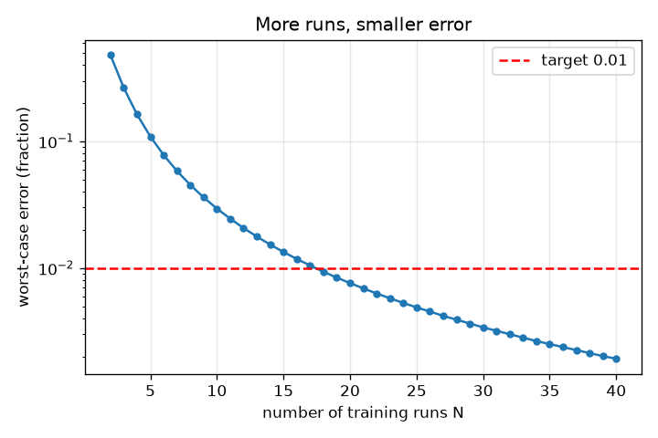
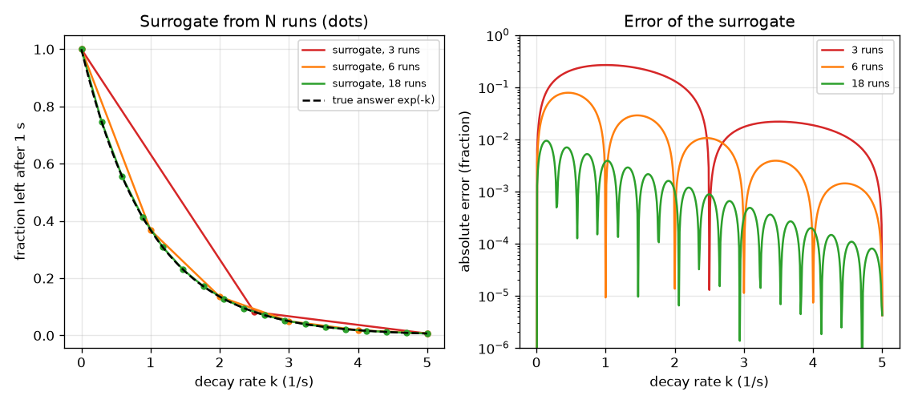

# సెషన్ 1: నెమ్మదైన సిమ్యులేషన్‌కు బదులుగా వేగవంతమైన ప్రత్యామ్నాయం

[Session 1 — हिन्दी](README.hi.md)

*స్థాయి 1 (భావనాత్మక ఇంటరాక్టివ్ నమూనా) · సుమారు 60 నిమిషాలు · opensurrogate*

> ఇది సరళీకరించిన విద్యా నమూనా. ఇది ధృవీకరించబడిన (validated) డిజైన్ సాధనం కాదు; నిజమైన నిర్మాణాలు, విద్యుత్ ఇన్‌స్టలేషన్లు, వాహనాలు, పారిశ్రామిక ప్రక్రియలు లేదా వైద్య నిర్ణయాల కోసం దీనిని ఉపయోగించకూడదు.

**ముందస్తు అవసరాలు (Prerequisites)**

- పాఠశాల బీజగణితం: గ్రాఫ్‌ను మరియు ప్రమేయం f(k) ను చదవడం.
- మీరు PRIMER.md చదివి, `python start.py 1` ఒకసారి రన్ చేశారు.

**అభ్యసన లక్ష్యాలు (Learning objectives).** ఈ సెషన్ తర్వాత మీరు:

- ప్రత్యామ్నాయ నమూనా (surrogate) అంటే ఏమిటో వివరించగలరు: ఇన్‌పుట్లు లోపలికి, సమాధానం బయటికి, నెమ్మదైన సిమ్యులేషన్ రన్‌ల నుండి నేర్చుకున్నది.
- N శిక్షణ రన్‌ల నుండి లుక్-అప్ టేబుల్ సర్రోగేట్‌ను నిర్మించి కొత్త ఇన్‌పుట్లపై దాని దోషాన్ని కొలవగలరు.
- రన్‌ల సంఖ్యకు వ్యతిరేకంగా దోషాన్ని చదివి ఎన్ని రన్‌లు సరిపోతాయో నిర్ణయించగలరు.
- సర్రోగేట్‌ను నిర్మించిన ఇన్‌పుట్ల వెలుపల ఎందుకు నమ్మకూడదో చెప్పగలరు.

## A. వాస్తవ ప్రపంచ సమస్య
ఒక దహన ఇంజనీర్‌కు వేలాది విభిన్న పరిస్థితులకు రసాయన సిమ్యులేషన్ ఫలితం కావాలి, కానీ ప్రతి రన్‌కు నిమిషాలు పడుతుంది. అన్నీ రన్ చేయడం చాలా నెమ్మది. ఆలోచన: బాగా ఎంచుకున్న మితమైన సంఖ్యలో పరిస్థితులకు నెమ్మదైన సిమ్యులేషన్‌ను రన్ చేసి, 'పరిస్థితులు లోపలికి, సమాధానం బయటికి' అనే నమూనాను నేర్చుకుని, నేర్చుకున్న ఆ నమూనా మిగిలిన అన్ని పరిస్థితులకూ తక్షణమే సమాధానమివ్వనివ్వండి. నేర్చుకున్న ఆ నమూనాను సర్రోగేట్ (surrogate) అంటారు. ఎన్ని నెమ్మది రన్‌లు సరిపోతాయి, ప్రత్యామ్నాయం మంచిదని మనం ఎలా తెలుసుకుంటాం?

## B. భావన మరియు సిద్ధాంతం
మన నెమ్మదైన సిమ్యులేషన్ k రేటుతో (ప్రమాణం 1/s) క్షీణించే పదార్థాన్ని అనుసరిస్తుంది: dy/dt = -k y, y = 1 నుండి మొదలై, 20000 చిన్న యూలర్ (Euler) అడుగులతో 1 సెకను రన్ అవుతుంది. దాని ఇన్‌పుట్ k (0 నుండి 5 మధ్య), సమాధానం 1 సెకను తర్వాత మిగిలిన భాగం, ఖచ్చితమైన గణితంలో అది exp(-k). సర్రోగేట్ k యొక్క సమాన అంతరం విలువల వద్ద n శిక్షణ రన్‌ల నుండి నిర్మించబడుతుంది: కొత్త k కోసం అది దగ్గరి రెండు శిక్షణ రన్‌ల మధ్య సరళరేఖ గీస్తుంది (రేఖీయ అంతర్వేశనం, linear interpolation). దాని దోషం నిజమైన సమాధానం నుండి తేడా. చెత్త-సందర్భ దోషం (worst-case error) పరిధిలోని అన్ని k లపై అతిపెద్ద దోషం. శిక్షణ రన్‌లను మాత్రమే ఉపయోగించడం, ఇంకేమీ లేకపోవడం ముఖ్య పరిమితి: 0 నుండి 5 పరిధి వెలుపల సర్రోగేట్‌కు సమాచారం లేదు.

| గుర్తు | అర్థం | ప్రమాణం |
|---|---|---|
| k | క్షయ రేటు, ఇన్‌పుట్ | 1/s |
| y | 1 s తర్వాత మిగిలిన పదార్థం భాగం, సమాధానం | ప్రమాణం లేదు (0 మరియు 1 మధ్య) |
| n | శిక్షణ రన్‌ల సంఖ్య | ప్రమాణం లేదు |
| h | పక్కపక్కన ఉన్న శిక్షణ ఇన్‌పుట్ల మధ్య అంతరం, 5 / (n - 1) | 1/s |
| error | సర్రోగేట్ మరియు నిజమైన సమాధానం మధ్య పరమ తేడా | ప్రమాణం లేదు |

**ఊహలు (Assumptions)**

- సిమ్యులేషన్ నిర్ధారితమైనది (deterministic): ఒకే k ఎల్లప్పుడూ ఒకే సమాధానం ఇస్తుంది.
- ఒక ఇన్‌పుట్ (k) మాత్రమే మారుతుంది; మిగిలిన ఇన్‌పుట్లు స్థిరం.
- శిక్షణ ఇన్‌పుట్లు 0 నుండి 5 1/s పరిధిలో సమాన అంతరంలో ఉన్నాయి.
- నెమ్మదైన సిమ్యులేషన్ నిజంగా పరిగణించేంత ఖచ్చితమైనది (exp(-k) తో తనిఖీ చేయబడింది).

$$ \frac{dy}{dt}=-k\,y,\qquad y(0)=1\;\Rightarrow\;y(1\,\mathrm{s})=e^{-k} $$

$$ \hat y(k)=y_i+\frac{k-k_i}{k_{i+1}-k_i}\,(y_{i+1}-y_i),\qquad k_i\le k\le k_{i+1} $$

$$ \text{worst-case error}=\max_{0\le k\le 5}\left|\hat y(k)-e^{-k}\right| $$

## C. దృశ్య వివరణ
ఎడమ చిత్రం 3, 6, 18 శిక్షణ రన్‌ల (చుక్కలు) నుండి నిర్మించిన సర్రోగేట్‌ను నిజమైన వక్రానికి వ్యతిరేకంగా గీస్తుంది. 3 రన్‌లతో అది వంపును తప్పించే కొన్ని సరళ ముక్కలు; 18 రన్‌లతో రెండు వక్రాలను వేరు చేయడం కష్టం. కుడి చిత్రం రన్‌ల సంఖ్యకు వ్యతిరేకంగా దోషాన్ని గీస్తుంది: మొదట నిటారుగా పడి తర్వాత నెమ్మదిగా, 18 రన్‌ల వద్ద ఎరుపు లక్ష్య రేఖ 0.01 ను దాటుతుంది.

*శిక్షణ రన్‌ల సంఖ్యకు వ్యతిరేకంగా చెత్త-సందర్భ దోషం; 0.01 లక్ష్యాన్ని దాటే కనీస సంఖ్య 18 రన్‌లు.*

*3, 6, 18 రన్‌ల (చుక్కలు) నుండి సర్రోగేట్లు నిజమైన వక్రానికి వ్యతిరేకంగా, వాటి దోషాలు కూడా.*

## D. ఇంటరాక్టివ్ సిమ్యులేషన్
పాఠాన్ని రన్ చేయండి (`python start.py 1`), తర్వాత లైవ్ యాప్‌ను తెరవండి: [సెషన్ 1: N రన్‌ల నుండి ఒక సర్రోగేట్](https://krunalpanchal1995.github.io/pan-iit-oss/opensurrogate/session-01/) (లేదా ఈ ఫోల్డర్‌లోని `app.html`). రన్‌ల స్లైడర్‌ను కదిలించి నీలం సర్రోగేట్ బూడిద నిజమైన వక్రం వైపు వంగడం గమనించండి; తర్వాత దోష గ్రాఫ్‌ను తెరిచి దోషం ఎక్కడ అతిపెద్దదో చూడండి (k = 0 దగ్గర, వక్రం ఎక్కువగా వంగే చోట). ఒక ఇన్‌పుట్ వద్ద దోషాన్ని చదవడానికి పరీక్ష k స్లైడర్‌ను కదిలించండి.

**సవాలు.** వీలైనంత తక్కువ రన్‌లతో 0.01 కంటే తక్కువ చెత్త-సందర్భ దోషాన్ని సాధించండి.

## E. సాధించిన ఉదాహరణ మరియు ప్రయోగం
**సమస్య.** 6 రన్‌ల (k = 0, 1, 2, 3, 4, 5) నుండి సర్రోగేట్‌ను నిర్మించండి. k = 2.5 వద్ద అది ఏ సమాధానం ఇస్తుంది, నిజమైన సమాధానం ఏమిటి, దోషం ఎంత?

1. దగ్గరి శిక్షణ రన్‌లు k = 2 మరియు k = 3: exp(-2) = 0.1353 మరియు exp(-3) = 0.0498.
2. k = 2.5 సరిగ్గా మధ్యలో ఉంది, కాబట్టి సర్రోగేట్ సమాధానం సగటు: (0.1353 + 0.0498) / 2 = 0.0926.
3. నిజమైన సమాధానం exp(-2.5) = 0.0821.
4. దోషం = 0.0926 - 0.0821 = 0.0105 (0.01 కంటే కొంచెం ఎక్కువ, కాబట్టి ప్రతి k వద్ద 0.01 లక్ష్యానికి 6 రన్‌లు సరిపోవు).

**సమాధానం.** సర్రోగేట్ 0.0926 అంటుంది, నిజం 0.0821, దోషం 0.0105 (సమాధానంలో సుమారు 13 శాతం).

**ప్రయోగం.** స్ప్రెడ్‌షీట్‌లో లేదా కొన్ని పంక్తుల Python లో నిజమైన నెమ్మది సిమ్యులేషన్‌ను రన్ చేయండి: చిన్న కాల అడుగులు తీసుకుని k = 2 మరియు k = 3 కు 1 s తర్వాత విలువను ప్రింట్ చేయండి, తర్వాత k = 2.5 కు, సగటుతో పోల్చండి. ఏ సాధనంలోనైనా అదే తేడా కనిపిస్తుంది. నమూనా మరియు వాస్తవం: నిజమైన సిమ్యులేషన్‌కు సంఖ్యా దోషం (ఇక్కడ 1e-4 కంటే తక్కువ, checkpoint.py లో తనిఖీ చేయబడింది) మరియు ఒకటి కంటే ఎక్కువ ఇన్‌పుట్లు కూడా ఉంటాయి.

## F. మూల్యాంకనం మరియు డిజైన్ సవాలు
**ప్రశ్న రకం A: భావనాత్మక.** k = 0 నుండి 5 వరకు రన్‌ల నుండి నిర్మించిన సర్రోగేట్‌ను k = 6 వద్ద ఎందుకు నమ్మలేము? అక్కడ అది వాస్తవంగా ఏ సమాధానం ఇస్తుంది?

సూచన

శిక్షణ రన్‌లలో ఏ సమాచారం ఉందో, టేబుల్ వెలుపల np.interp ఏమి చేస్తుందో ఆలోచించండి.

దశలవారీ పరిష్కారం

5 కంటే ఎక్కువ k గురించి శిక్షణ రన్‌లు ఏమీ చెప్పవు. లుక్-అప్ టేబుల్ సమాచారాన్ని కనిపెట్టలేదు: np.interp కేవలం చివరి విలువను పునరావృతం చేస్తుంది, కాబట్టి k = 6 వద్ద అది 0.0067 (k = 5 వద్ద విలువ) సమాధానం ఇస్తుంది, నిజం 0.0025, రెండు రెట్లకు పైగా చిన్నది. సర్రోగేట్ తన పరిధిని దాటిందని దానిలో ఏదీ హెచ్చరించదు.

**ప్రశ్న రకం B: సంఖ్యాత్మక.** 3 రన్‌ల (k = 0, 2.5, 5) నుండి సర్రోగేట్ నిర్మించబడింది. k = 1.25 వద్ద దాని సమాధానం మరియు దోషాన్ని కనుగొనండి.

సూచన

k = 1.25 మొదటి రెండు రన్‌ల మధ్య సరిగ్గా మధ్యలో ఉంది; అక్కడి సమాధానాలు 1 మరియు exp(-2.5) = 0.0821.

దశలవారీ పరిష్కారం

సర్రోగేట్ = (1 + 0.0821) / 2 = 0.541. నిజమైన exp(-1.25) = 0.2865. దోషం = 0.541 - 0.2865 = 0.255, నిజమైన సమాధానంలో దాదాపు 90 శాతం: వక్రం వంగే చోట మూడు రన్‌లు చాలా తక్కువ.

**ప్రశ్న రకం C: గ్రాఫ్ మరియు సిమ్యులేషన్ వ్యాఖ్యానం.** దోష గ్రాఫ్‌లో, దోషం ఎక్కడ అతిపెద్దది, ఎందుకు? రన్‌లను జోడించినప్పుడు ఆ శిఖరానికి ఏమవుతుంది?

సూచన

k = 0 దగ్గర మరియు k = 5 దగ్గర exp(-k) యొక్క వంపును పోల్చండి.

దశలవారీ పరిష్కారం

exp(-k) ఎక్కువగా వంగే k = 0 దగ్గర దోషం శిఖరానికి చేరుతుంది (అక్కడ దాని రెండవ అవకలజం అతిపెద్దది); రెండు రన్‌ల మధ్య సరళరేఖ వంపును అనుసరించలేదు. రన్‌లను జోడించడం సరళ ముక్కలను చిన్నవిగా చేస్తుంది, కాబట్టి శిఖరం తగ్గుతుంది; 18 రన్‌లతో అది 0.0094, 0.01 రేఖ కంటే తక్కువ.

**ప్రశ్న రకం D: డిజైన్ మరియు ఆప్టిమైజేషన్ (optimisation) సవాలు.** ప్రతి నెమ్మది రన్‌కు 2 నిమిషాలు పడుతుంది. డిజైన్: చెత్త-సందర్భ దోషం 0.01 కంటే తక్కువ మరియు 0.001 కంటే తక్కువ ఉండటానికి ఎన్ని రన్‌లు కావాలి? కఠినమైన లక్ష్యానికి సమయంలో ఏ ఖర్చు? అదే అంతరంతో గ్రిడ్‌పై రెండు ఇన్‌పుట్లు ఉంటే ఏమి మారుతుంది?

సూచన

పాఠంలోని runs_needed ఉపయోగించి, రన్‌కు ఖర్చుతో గుణించండి. రెండు ఇన్‌పుట్లకు గ్రిడ్‌కు n గుణించు n రన్‌లు కావాలి.

దశలవారీ పరిష్కారం

runs_needed 0.01 కు 18 రన్‌లు (36 నిమిషాలు), 0.001 కు 56 రన్‌లు (112 నిమిషాలు) ఇస్తుంది: పదో వంతు దోషానికి సుమారు మూడు రెట్లు రన్‌లు ఖర్చవుతాయి. ప్రతిదానిలో 18 విలువలున్న గ్రిడ్‌పై రెండు ఇన్‌పుట్లు ఉంటే 18 x 18 = 324 రన్‌లు (648 నిమిషాలు) కావాలి, మూడు ఇన్‌పుట్లకు 5832. రాజీ (trade-off): అనేక ఇన్‌పుట్లు ఉన్నప్పుడు చుక్కలను కలపడం రన్‌లను వృథా చేస్తుంది, అందుకే సెషన్ 2, 3 సరిపోల్చిన సూత్రాలను మరియు నెట్‌వర్క్‌లను ఉపయోగిస్తాయి.

[RUBRIC.md](../../RUBRIC.md) తో మిమ్మల్ని మీరు స్కోర్ చేసుకోండి. కాగితంపై చేయడానికి [కార్యాచరణ పత్రాన్ని](activity_sheet.md) ప్రింట్ చేయండి.

## సాధారణ అపోహలు
| సాధారణ అపోహ | వాస్తవంగా నిజమైనది |
|---|---|
| సర్రోగేట్ అంటే సిమ్యులేషనే, కేవలం వేగంగా. | సర్రోగేట్ కొన్ని రన్‌ల నుండి నేర్చుకున్న ఉజ్జాయింపు; దానికి దోషం ఉంది, అది నిర్మించిన ఇన్‌పుట్లు మాత్రమే దానికి తెలుసు. |
| ఎక్కువ రన్‌లు ఎల్లప్పుడూ అదే మొత్తంలో సహాయపడతాయి. | దోషం మొదట వేగంగా, తర్వాత నెమ్మదిగా తగ్గుతుంది (ఇక్కడ పదో వంతు దోషానికి సుమారు మూడు రెట్లు రన్‌లు అవసరమయ్యాయి). |
| శిక్షణ రన్‌ల వద్ద సర్రోగేట్ సరైనదైతే, అది ప్రతిచోటా సరైనది. | నిర్మాణం ప్రకారం అది శిక్షణ రన్‌లను ఖచ్చితంగా పునరుత్పత్తి చేస్తుంది; దోషం వాటి మధ్య అతిపెద్దది, వాటి వెలుపల అది అర్థరహితం. |
| ప్లాట్‌లో దోషం చిన్నగా కనిపిస్తే అది సరిపోయేంత చిన్నది. | ఒక లక్ష్యాన్ని చెప్పండి (ఇక్కడ 0.01), ఒకటి కాక, అనేక పరీక్ష ఇన్‌పుట్లపై చెత్త సందర్భాన్ని కొలవండి. |

## పదకోశం (Glossary)
- **సర్రోగేట్ (surrogate)**: నెమ్మదైన సిమ్యులేషన్‌కు బదులుగా నేర్చుకున్న చవకైన ప్రత్యామ్నాయం
- **శిక్షణ రన్ (training run)**: సర్రోగేట్‌ను నిర్మించడానికి ఉపయోగించే నెమ్మదైన సిమ్యులేషన్ యొక్క ఒక రన్
- **అంతర్వేశనం (interpolation)**: తెలిసిన విలువల మధ్య ఒక విలువను అంచనా వేయడం, ఇక్కడ సరళరేఖలతో
- **చెత్త-సందర్భ దోషం (worst-case error)**: అన్ని పరీక్ష ఇన్‌పుట్లపై అతిపెద్ద దోషం
- **బహిర్వేశనం (extrapolation)**: శిక్షణ రన్‌ల పరిధి వెలుపల ఉన్న ఇన్‌పుట్లకు సమాధానమివ్వడం

## ముగింపు
1. [exercises.md](exercises.md) లోని మూడు కోడింగ్ పనులను చేయండి.
2. మీ మార్పుల తర్వాత `python start.py 1` మళ్ళీ రన్ చేయండి. అది చెక్‌పాయింట్‌తో ముగుస్తుంది; అది `PASS` ప్రింట్ చేసినప్పుడు మీరు పూర్తి చేశారు. (చెక్‌పాయింట్ మాత్రమే: `python start.py check 1`.)

తర్వాత: [సెషన్ 2](../session-02/README.md)
