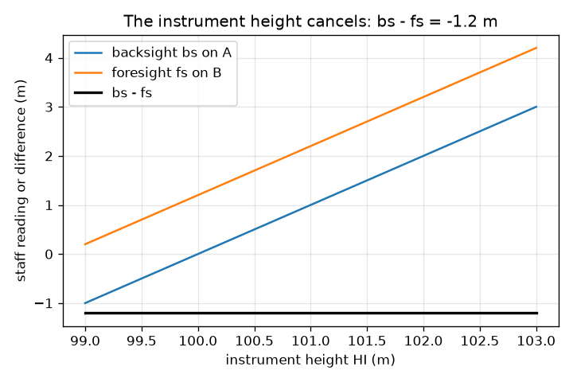
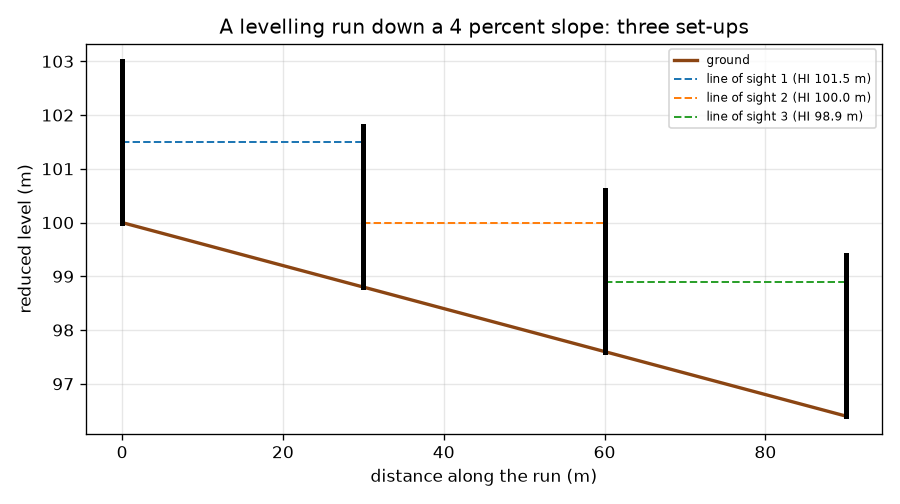

# सत्र 1: लेवल और स्टाफ़ से ऊँचाई का अंतर

*स्तर 1 (अवधारणात्मक इंटरैक्टिव मॉडल) · लगभग 60 मिनट · opensurvey*

> यह एक सरलीकृत शैक्षिक मॉडल है। यह कोई प्रमाणित डिज़ाइन उपकरण नहीं है और इसका उपयोग वास्तविक संरचनाओं, विद्युत संस्थापनों, वाहनों, औद्योगिक प्रक्रियाओं या चिकित्सा निर्णयों के लिए नहीं किया जाना चाहिए।

**पूर्वापेक्षाएँ (Prerequisites)**

- दशमलव संख्याओं को घटाना।
- आपने PRIMER.md पढ़ लिया है और `python start.py 1` एक बार चला लिया है।

**सीखने के उद्देश्य (Learning objectives)।** इस सत्र के बाद आप:

- समझा सकेंगे कि लेवल (level) और स्टाफ़ (staff) क्या मापते हैं।
- दो बिंदुओं के बीच चढ़ाव या उतार की गणना पश्चदृष्टि (backsight) घटा अग्रदृष्टि (foresight) के रूप में कर सकेंगे, और नए बिंदु का समानीत तल (reduced level) ज्ञात कर सकेंगे।
- ढलान पर नीचे जाते हुए कई स्थापनाओं (set-ups) को जोड़कर एक तलेक्षण क्रम (levelling run) बना सकेंगे।
- दिखा सकेंगे कि उपकरण की ऊँचाई मायने नहीं रखती, और कदम गिनकर दूरी माप सकेंगे।

## A. वास्तविक दुनिया की समस्या
सड़क, नाली या भवन का चबूतरा बनाने से पहले, किसी को पता होना चाहिए कि एक बिंदु दूसरे से कितना ऊँचा या नीचा है। पानी केवल ढलान पर नीचे बहता है, इसलिए ग़लत दिशा में ढलान वाली नाली काम नहीं करती। आप आँख से नहीं बता सकते। एक सर्वेक्षक एक लेवल (एक दूरबीन जो बिल्कुल क्षैतिज रहती है) और एक स्टाफ़ (सीधा पकड़ा गया एक लंबा पैमाना) का उपयोग करता है और दो पाठ्यांक घटाता है। ऐसी जगह से लिए गए दो पाठ्यांक, जो दोनों में से कोई बिंदु नहीं है, उनके बीच ऊँचाई का अंतर कैसे दे सकते हैं?

## B. अवधारणा और सिद्धांत
लेवल दो बिंदुओं A और B के बीच स्थापित किया जाता है। उसकी दृष्टि रेखा (line of sight) आधार तल (datum) (संदर्भ ऊँचाई, जैसे समुद्र तल) से किसी ऊँचाई पर बिल्कुल क्षैतिज होती है। स्टाफ़ को A पर सीधा पकड़ा जाता है और दूरबीन से पढ़ा जाता है: यह पश्चदृष्टि, bs है। फिर स्टाफ़ को B पर ले जाया जाता है: यह अग्रदृष्टि, fs है। बड़े पाठ्यांक का अर्थ है ज़मीन नीची है, क्योंकि तब स्टाफ़ का अधिकांश भाग दृष्टि रेखा से नीचे होता है। इसलिए A से B तक चढ़ाव bs - fs है (ऋणात्मक उत्तर उतार है), और B का समानीत तल (RL, आधार तल से ऊँचाई) A का RL जमा वह चढ़ाव है। यदि B एक स्थापना के लिए बहुत दूर है, तो सर्वेक्षक स्टाफ़ को एक परिवर्तन बिंदु (turning point) पर छोड़ता है और लेवल को आगे ले जाता है। दूरी मोटे तौर पर कदम गिनकर ज्ञात की जा सकती है: एक ज्ञात दूरी चलें, कदम गिनें, और दूरी = कदम x कदम लंबाई का उपयोग करें।

| प्रतीक | अर्थ | इकाई |
|---|---|---|
| bs | पश्चदृष्टि: पीछे के बिंदु (ज्ञात बिंदु) पर स्टाफ़ पाठ्यांक | m |
| fs | अग्रदृष्टि: आगे के बिंदु पर स्टाफ़ पाठ्यांक | m |
| RL | समानीत तल: चुने गए आधार तल से ऊँचाई | m |
| HI | दृष्टि रेखा की ऊँचाई (संधान ऊँचाई (collimation height)) | m |
| pace length | एक कदम की औसत लंबाई, अंशांकन चाल से | m |

**मान्यताएँ (Assumptions)**

- दृष्टि रेखा बिल्कुल क्षैतिज है।
- स्टाफ़ सीधा पकड़ा जाता है और ठीक-ठीक पढ़ा जाता है।
- दृष्टियाँ छोटी हैं, इसलिए पृथ्वी की वक्रता को नगण्य माना जा सकता है (सत्र 3 दिखाता है कि कब नहीं)।
- कदम गिनना एक मोटा तरीक़ा है; फ़ीता या टोटल स्टेशन बेहतर है।

$$ \text{rise from A to B}=bs-fs,\qquad RL_B=RL_A+(bs-fs) $$

$$ bs=HI-RL_A,\quad fs=HI-RL_B\ \Rightarrow\ bs-fs=RL_B-RL_A\ \text{(HI cancels)} $$

$$ \text{distance}=\text{paces}\times\text{pace length} $$

## C. दृश्य व्याख्या
पहला चित्र 4 प्रतिशत ढलान पर नीचे जाता एक तलेक्षण क्रम दिखाता है: ज़मीन, तीन डैश दृष्टि रेखाएँ (हर स्थापना के लिए एक) और स्टाफ़। हर स्थापना एक पश्चदृष्टि और एक अग्रदृष्टि पढ़ती है और 1.2 m का उतार पाती है, इसलिए 90 m में ज़मीन 3.6 m उतरती है और B 96.4 m पर समाप्त होता है। दूसरा चित्र उपकरण की ऊँचाई के सापेक्ष दोनों पाठ्यांक और उनका अंतर दिखाता है: पाठ्यांक उसके साथ बदलते हैं, अंतर -1.2 m पर रहता है। यही सपाट रेखा कारण है कि लेवल स्टाफ़ों के बीच कहीं भी खड़ा हो सकता है।

*पश्चदृष्टि और अग्रदृष्टि उपकरण की ऊँचाई के साथ बदलती हैं; उनका अंतर नहीं बदलता।*

*4 प्रतिशत ढलान पर नीचे जाता एक तलेक्षण क्रम: तीन स्थापनाएँ, तीन दृष्टि रेखाएँ।*

## D. इंटरैक्टिव सिमुलेशन
पाठ चलाएँ (`python start.py 1`), फिर लाइव ऐप खोलें: [सत्र 1: एक लेवल और दो स्टाफ़](https://krunalpanchal1995.github.io/pan-iit-oss/opensurvey/session-01/) (या इस फ़ोल्डर में `app.html`)। ढलान और दूरी स्लाइडर खिसकाएँ और अग्रदृष्टि को बढ़ते देखें, फिर लेवल दृश्य पर जाएँ और ज़मीन को उतरते देखें। पश्चदृष्टि बदलें और देखें कि उतार नहीं बदलता।

**चुनौती।** बिंदु B को 98.4 m के समानीत तल पर समाप्त कराएँ (A 100.0 m है)।

## E. हल किया गया उदाहरण और प्रयोग
**समस्या।** एक बेंचमार्क A का RL 100.000 m है। A पर पश्चदृष्टि 1.525 m है और B पर अग्रदृष्टि 2.310 m है। चढ़ाव या उतार और B का RL ज्ञात कीजिए।

1. चढ़ाव = bs - fs = 1.525 - 2.310 = -0.785 m।
2. ऋणात्मक चिह्न का अर्थ है उतार: B, A से 0.785 m नीचा है।
3. B का RL = 100.000 + (-0.785) = 99.215 m।
4. तर्कसंगतता जाँच: अग्रदृष्टि पश्चदृष्टि से बड़ी है, इसलिए B पर स्टाफ़ दृष्टि रेखा में नीचा है, इसलिए B नीचा बिंदु है। उत्तर सुसंगत है।

**उत्तर।** B, A से 0.785 m नीचा है, RL 99.215 m पर।

**प्रयोग।** एक बिल्डर के लेवल (या पानी से भरी एक पारदर्शी नली) और एक मीटर पैमाने से, स्कूल के गलियारे या बग़ीचे में 10 m दूर दो बिंदुओं के बीच bs और fs लें, और अंतर की गणना करें। फिर लेवल को किसी दूसरी जगह ले जाएँ और दोहराएँ: आपको कुछ मिलीमीटर तक वही अंतर मिलना चाहिए। अंतर पैमाना पढ़ने से, लेवल के बिल्कुल क्षैतिज न होने से और स्टाफ़ के झुकने से आते हैं; मॉडल आदर्श पाठ्यांक मानता है।

## F. मूल्यांकन और डिज़ाइन चुनौती
**प्रश्न प्रकार A: अवधारणात्मक।** उत्तर bs - fs इस पर निर्भर क्यों नहीं करता कि लेवल ज़मीन से कितना ऊँचा है?

संकेत

हर पाठ्यांक को दृष्टि रेखा की ऊँचाई घटा ज़मीन की ऊँचाई के रूप में लिखें।

चरण-दर-चरण हल

bs = HI - RL_A और fs = HI - RL_B, इसलिए bs - fs = RL_B - RL_A: HI कट जाता है। यदि उपकरण 0.40 m ऊपर उठाया जाए, तो दोनों पाठ्यांक 0.40 m घट जाते हैं और अंतर नहीं बदलता (पाठ के क्रम में -1.2 m)। इसीलिए लेवल दोनों स्टाफ़ों के बीच कहीं भी खड़ा हो सकता है।

**प्रश्न प्रकार B: संख्यात्मक।** RL 54.320 m वाले बिंदु पर पश्चदृष्टि 0.872 m है और अगले बिंदु पर अग्रदृष्टि 2.134 m है। अगले बिंदु का RL ज्ञात कीजिए और बताइए कि ज़मीन चढ़ती है या उतरती है।

संकेत

चढ़ाव = bs - fs, फिर RL में जोड़ें।

चरण-दर-चरण हल

चढ़ाव = 0.872 - 2.134 = -1.262 m, एक उतार। RL = 54.320 - 1.262 = 53.058 m। तर्कसंगतता जाँच: अग्रदृष्टि बड़ी है, इसलिए नया बिंदु नीचा है। इकाई: मीटर।

**प्रश्न प्रकार C: ग्राफ़ और सिमुलेशन की व्याख्या।** तलेक्षण-क्रम चित्र से, ज़मीन की प्रवणता (प्रतिशत में ढलान) क्या है, और प्रति स्थापना यह कितनी उतरती है?

संकेत

प्रवणता = उतार भाग क्षैतिज दूरी, गुणा 100।

चरण-दर-चरण हल

ज़मीन 90 m में 3.6 m उतरती है, इसलिए प्रवणता 3.6 / 90 x 100 = 4 प्रतिशत है। तीनों स्थापनाओं में से हर एक 30 m तय करती है और 1.2 m उतरती है, हर बार एक जैसा क्योंकि ढलान एकसमान है।

**प्रश्न प्रकार D: डिज़ाइन और इष्टतमीकरण (optimisation) चुनौती।** डिज़ाइन: स्टाफ़ 4.0 m लंबा है, ज़मीन पश्चदृष्टि स्टाफ़ से 5 प्रतिशत उतरती है, और पश्चदृष्टि 1.0 m पढ़ती है। अग्रदृष्टि स्टाफ़ कितनी दूर खड़ा हो सकता है ताकि पाठ्यांक अब भी स्टाफ़ पर रहे? सीधे बहुत छोटी दृष्टियाँ क्यों न उपयोग करें?

संकेत

अग्रदृष्टि, पश्चदृष्टि जमा दूरी पर उतार है।

चरण-दर-चरण हल

fs = 1.0 + 0.05 x d को 4.0 m या उससे कम रहना चाहिए, इसलिए d अधिकतम 60 m है। बहुत छोटी दृष्टियों के लिए उसी रेखा के लिए अधिक स्थापनाएँ चाहिए, इसलिए अधिक पाठ्यांक, अधिक समय और छोटी त्रुटियों के जुड़ने के अधिक अवसर (सत्र 2 दिखाता है कि कितनी तेज़ी से)। एक अच्छी योजना सबसे लंबी ऐसी दृष्टियाँ उपयोग करती है जो स्टाफ़ पर और दूरबीन की विश्वसनीय सीमा में रहें, और पश्चदृष्टि और अग्रदृष्टि की लंबाइयाँ लगभग बराबर रखती है।

[RUBRIC.md](../../RUBRIC.md) से स्वयं को अंक दें। काग़ज़ पर काम करने के लिए [गतिविधि पत्रक](activity_sheet.md) प्रिंट करें।

## आम भ्रांतियाँ (Common misconceptions)
| आम भ्रांति | वास्तव में क्या सही है |
|---|---|
| बड़े स्टाफ़ पाठ्यांक का अर्थ है ऊँचा बिंदु। | बड़े पाठ्यांक का अर्थ है नीचा बिंदु: स्टाफ़ का अधिक भाग दृष्टि रेखा से नीचे है। |
| लेवल को A और B के बीच की रेखा पर बिंदुओं जितनी ही ऊँचाई पर खड़ा होना चाहिए। | यह दोनों स्टाफ़ दिखने वाली किसी भी जगह, किसी भी ऊँचाई पर खड़ा हो सकता है, क्योंकि bs - fs में उपकरण की ऊँचाई कट जाती है। |
| चढ़ाव, अग्रदृष्टि घटा पश्चदृष्टि है। | चढ़ाव, पश्चदृष्टि घटा अग्रदृष्टि है। चिह्न से जाँचें: बड़ी अग्रदृष्टि को ऋणात्मक चढ़ाव (उतार) देना चाहिए। |
| कदम गिनना फ़ीते जितना सटीक है। | कदम गिनना आपके कदम, ज़मीन और आपकी थकान पर निर्भर करता है। यह एक त्वरित जाँच है, भवन की रूपरेखा बनाने का माप नहीं। |

## शब्दावली (Glossary)
- **लेवल (level)**: ऐसे लगाई गई दूरबीन कि उसकी दृष्टि रेखा क्षैतिज रहे
- **स्टाफ़ (staff)**: लेवल से पढ़ा जाने वाला एक लंबा सीधा पैमाना
- **पश्चदृष्टि (backsight) (bs)**: पीछे के ज्ञात बिंदु पर स्टाफ़ पाठ्यांक
- **अग्रदृष्टि (foresight) (fs)**: आगे के नए बिंदु पर स्टाफ़ पाठ्यांक
- **समानीत तल (reduced level) (RL)**: चुने गए आधार तल से किसी बिंदु की ऊँचाई
- **आधार तल (datum)**: वह संदर्भ ऊँचाई जिससे तल मापे जाते हैं
- **परिवर्तन बिंदु (turning point)**: वह बिंदु जहाँ स्टाफ़ रहता है जबकि लेवल आगे ले जाया जाता है

## समापन
1. [exercises.md](exercises.md) में दिए तीन कोडिंग कार्य करें।
2. अपने बदलावों के बाद `python start.py 1` फिर से चलाएँ। यह चेकपॉइंट के साथ समाप्त होता है; जब यह `PASS` छापे, तो आपका काम पूरा है। (केवल चेकपॉइंट: `python start.py check 1`।)

आगे: [सत्र 2](../session-02/README.md)
