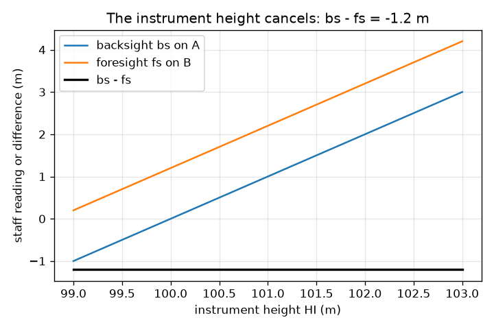
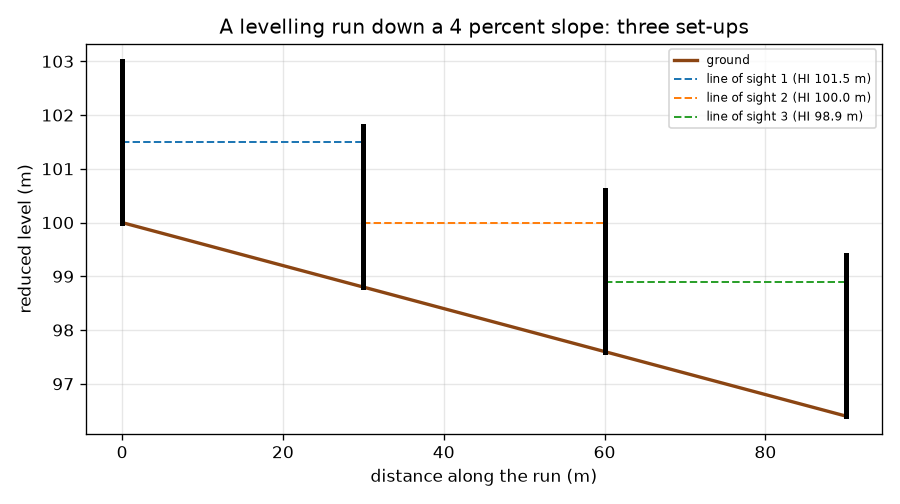

# സെഷൻ 1: ഒരു ലെവലും സ്റ്റാഫും ഉപയോഗിച്ച് ഉയര വ്യത്യാസം

[Session 1 — हिन्दी](README.hi.md)

*ലെവൽ 1 (ആശയപരമായ ഇന്ററാക്ടീവ് മോഡൽ) · ഏകദേശം 60 മിനിറ്റ് · opensurvey*

> ഇത് ഒരു ലളിതമാക്കിയ വിദ്യാഭ്യാസ മോഡൽ ആണ്. ഇത് സാധൂകരിക്കപ്പെട്ട ഒരു ഡിസൈൻ ഉപകരണമല്ല; യഥാർത്ഥ നിർമ്മിതികൾ, വൈദ്യുത ഇൻസ്റ്റലേഷനുകൾ, വാഹനങ്ങൾ, വ്യാവസായിക പ്രക്രിയകൾ അല്ലെങ്കിൽ വൈദ്യപരമായ തീരുമാനങ്ങൾ എന്നിവയ്ക്ക് ഇത് ഉപയോഗിക്കരുത്.

**മുൻ അറിവ് (Prerequisites)**

- ദശാംശ സംഖ്യകൾ കുറയ്ക്കൽ.
- നിങ്ങൾ PRIMER.md വായിക്കുകയും `python start.py 1` ഒരു തവണ റൺ ചെയ്യുകയും ചെയ്തിട്ടുണ്ട്.

**പഠന ലക്ഷ്യങ്ങൾ (Learning objectives).** ഈ സെഷനു ശേഷം നിങ്ങൾക്ക് കഴിയും:

- ഒരു ലെവലും (level) സ്റ്റാഫും (staff) എന്താണ് അളക്കുന്നതെന്ന് വിശദീകരിക്കാൻ.
- രണ്ട് ബിന്ദുക്കൾ തമ്മിലുള്ള ഉയർച്ച അല്ലെങ്കിൽ താഴ്ച ബാക്ക്സൈറ്റ് (backsight) മൈനസ് ഫോർസൈറ്റ് (foresight) ആയും, പുതിയ ബിന്ദുവിന്റെ റിഡ്യൂസ്ഡ് ലെവലും കണക്കാക്കാൻ.
- ഒരു ചരിവിലൂടെ താഴേക്കുള്ള ലെവലിംഗ് റണ്ണിൽ പല സെറ്റ്-അപ്പുകൾ ചേർക്കാൻ.
- ഉപകരണത്തിന്റെ ഉയരം പ്രശ്നമല്ലെന്ന് കാണിക്കാനും, ചുവടുകൾ എണ്ണി ദൂരം അളക്കാനും.

## A. യഥാർത്ഥ ലോക പ്രശ്നം
ഒരു റോഡോ ഓടയോ കെട്ടിട പ്ലാറ്റ്ഫോമോ നിർമ്മിക്കുന്നതിന് മുമ്പ്, ഒരു ബിന്ദു മറ്റൊന്നിനേക്കാൾ എത്ര ഉയരത്തിലോ താഴ്ചയിലോ ആണെന്ന് ആരെങ്കിലും അറിയണം. വെള്ളം താഴേക്ക് മാത്രമേ ഒഴുകൂ, അതിനാൽ തെറ്റായ ദിശയിൽ ചരിഞ്ഞ ഓട പ്രവർത്തിക്കില്ല. കണ്ണുകൊണ്ട് പറയാൻ കഴിയില്ല. സർവേയർ ഒരു ലെവലും (കൃത്യമായി തിരശ്ചീനമായി നിൽക്കുന്ന ദൂരദർശിനി) ഒരു സ്റ്റാഫും (നേരെ പിടിക്കുന്ന ഉയരമുള്ള സ്കെയിൽ) ഉപയോഗിച്ച് രണ്ട് റീഡിംഗുകൾ കുറയ്ക്കുന്നു. രണ്ട് ബിന്ദുക്കളിൽ ഒന്നുമല്ലാത്ത ഒരിടത്ത് നിന്നെടുത്ത രണ്ട് റീഡിംഗുകൾക്ക് അവ തമ്മിലുള്ള ഉയര വ്യത്യാസം എങ്ങനെ നൽകാൻ കഴിയും?

## B. ആശയവും സിദ്ധാന്തവും
ലെവൽ രണ്ട് ബിന്ദുക്കൾ A, B എന്നിവയ്ക്കിടയിൽ സ്ഥാപിക്കുന്നു. അതിന്റെ കാഴ്ച രേഖ ഡാറ്റത്തിന് (datum, സമുദ്രനിരപ്പ് പോലുള്ള റഫറൻസ് ഉയരം) മുകളിൽ ഒരു ഉയരത്തിൽ തികച്ചും തിരശ്ചീനമാണ്. സ്റ്റാഫ് A യിൽ നേരെ പിടിച്ച് ദൂരദർശിനിയിലൂടെ വായിക്കുന്നു: അതാണ് ബാക്ക്സൈറ്റ്, bs. തുടർന്ന് സ്റ്റാഫ് B യിലേക്ക് മാറ്റുന്നു: അതാണ് ഫോർസൈറ്റ്, fs. വലിയ റീഡിംഗ് എന്നാൽ നിലം താഴ്ന്നതാണ്, കാരണം അപ്പോൾ സ്റ്റാഫിന്റെ കൂടുതൽ ഭാഗവും കാഴ്ച രേഖയ്ക്ക് താഴെയാണ്. അതിനാൽ A യിൽ നിന്ന് B യിലേക്കുള്ള ഉയർച്ച bs - fs ആണ് (നെഗറ്റീവ് ഉത്തരം താഴ്ചയാണ്), B യുടെ റിഡ്യൂസ്ഡ് ലെവൽ (RL, ഡാറ്റത്തിന് മുകളിലുള്ള ഉയരം) A യുടെ RL ഉം ആ ഉയർച്ചയും ചേർന്നതാണ്. ഒരു സെറ്റ്-അപ്പിന് B വളരെ ദൂരെയാണെങ്കിൽ, സർവേയർ സ്റ്റാഫിനെ ഒരു ടേണിംഗ് പോയിന്റിൽ (turning point) നിർത്തി ലെവൽ മുന്നോട്ട് മാറ്റുന്നു. ചുവടുകൾ എണ്ണി ദൂരം ഏകദേശം കണ്ടെത്താം: അറിയാവുന്ന ഒരു ദൂരം നടക്കുക, ചുവടുകൾ എണ്ണുക, distance = paces x pace length ഉപയോഗിക്കുക.

| ചിഹ്നം | അർത്ഥം | യൂണിറ്റ് |
|---|---|---|
| bs | ബാക്ക്സൈറ്റ്: പിന്നിലെ ബിന്ദുവിലെ (അറിയാവുന്ന ബിന്ദു) സ്റ്റാഫ് റീഡിംഗ് | m |
| fs | ഫോർസൈറ്റ്: മുന്നിലെ ബിന്ദുവിലെ സ്റ്റാഫ് റീഡിംഗ് | m |
| RL | റിഡ്യൂസ്ഡ് ലെവൽ: തിരഞ്ഞെടുത്ത ഡാറ്റത്തിന് മുകളിലുള്ള ഉയരം | m |
| HI | കാഴ്ച രേഖയുടെ ഉയരം (കൊളിമേഷൻ ഉയരം) | m |
| pace length | ഒരു ചുവടിന്റെ ശരാശരി നീളം, ഒരു കാലിബ്രേഷൻ നടത്തത്തിൽ നിന്ന് | m |

**അനുമാനങ്ങൾ (Assumptions)**

- കാഴ്ച രേഖ തികച്ചും തിരശ്ചീനമാണ്.
- സ്റ്റാഫ് നേരെ പിടിക്കുകയും കൃത്യമായി വായിക്കുകയും ചെയ്യുന്നു.
- കാഴ്ചകൾ ചെറുതാണ്, അതിനാൽ ഭൂമിയുടെ വക്രത അവഗണിക്കാം (ഇത് അവഗണിക്കാൻ കഴിയാത്തത് എപ്പോഴെന്ന് സെഷൻ 3 കാണിക്കുന്നു).
- ചുവട് എണ്ണൽ ഏകദേശ രീതിയാണ്; ടേപ്പോ ടോട്ടൽ സ്റ്റേഷനോ മികച്ചതാണ്.

$$ \text{rise from A to B}=bs-fs,\qquad RL_B=RL_A+(bs-fs) $$

$$ bs=HI-RL_A,\quad fs=HI-RL_B\ \Rightarrow\ bs-fs=RL_B-RL_A\ \text{(HI cancels)} $$

$$ \text{distance}=\text{paces}\times\text{pace length} $$

## C. ദൃശ്യ വിശദീകരണം
ആദ്യ ചിത്രം 4 ശതമാനം ചരിവിലൂടെ താഴേക്കുള്ള ഒരു ലെവലിംഗ് റൺ കാണിക്കുന്നു: നിലം, മൂന്ന് മുറിഞ്ഞ കാഴ്ച രേഖകൾ (ഓരോ സെറ്റ്-അപ്പിനും ഒന്ന്), സ്റ്റാഫുകൾ. ഓരോ സെറ്റ്-അപ്പും ഒരു ബാക്ക്സൈറ്റും ഫോർസൈറ്റും വായിച്ച് 1.2 m താഴ്ച കണ്ടെത്തുന്നു, അതിനാൽ 90 m ൽ നിലം 3.6 m താഴുന്നു, B 96.4 m ൽ അവസാനിക്കുന്നു. രണ്ടാമത്തെ ചിത്രം രണ്ട് റീഡിംഗുകളും അവയുടെ വ്യത്യാസവും ഉപകരണത്തിന്റെ ഉയരത്തിനെതിരെ വരയ്ക്കുന്നു: റീഡിംഗുകൾ അതിനനുസരിച്ച് മാറുന്നു, വ്യത്യാസം -1.2 m ൽ തന്നെ നിൽക്കുന്നു. ആ പരന്ന രേഖയാണ് സ്റ്റാഫുകൾക്കിടയിൽ എവിടെയും ലെവൽ വയ്ക്കാമെന്നതിന്റെ കാരണം.

*ബാക്ക്സൈറ്റും ഫോർസൈറ്റും ഉപകരണത്തിന്റെ ഉയരത്തിനനുസരിച്ച് മാറുന്നു; അവയുടെ വ്യത്യാസം മാറുന്നില്ല.*

*4 ശതമാനം ചരിവിലൂടെ താഴേക്കുള്ള ലെവലിംഗ് റൺ: മൂന്ന് സെറ്റ്-അപ്പുകൾ, മൂന്ന് കാഴ്ച രേഖകൾ.*

## D. ഇന്ററാക്ടീവ് സിമുലേഷൻ
പാഠം റൺ ചെയ്യുക (`python start.py 1`), തുടർന്ന് ലൈവ് ആപ്പ് തുറക്കുക: [സെഷൻ 1: ഒരു ലെവലും രണ്ട് സ്റ്റാഫുകളും](https://krunalpanchal1995.github.io/pan-iit-oss/opensurvey/session-01/) (അല്ലെങ്കിൽ ഈ ഫോൾഡറിലെ `app.html`). ചരിവ്, ദൂരം സ്ലൈഡറുകൾ നീക്കി ഫോർസൈറ്റ് വളരുന്നത് നോക്കുക, തുടർന്ന് ലെവൽ കാഴ്ചയിലേക്ക് മാറി നിലം താഴുന്നത് കാണുക. ബാക്ക്സൈറ്റ് മാറ്റി താഴ്ച മാറുന്നില്ലെന്ന് കാണുക.

**വെല്ലുവിളി (Challenge).** ബിന്ദു B യുടെ റിഡ്യൂസ്ഡ് ലെവൽ 98.4 m ൽ അവസാനിപ്പിക്കുക (A 100.0 m ആണ്).

## E. ഉദാഹരണ പ്രശ്നവും പരീക്ഷണവും
**പ്രശ്നം.** ഒരു ബെഞ്ച്മാർക്ക് A യുടെ RL 100.000 m ആണ്. A യിലെ ബാക്ക്സൈറ്റ് 1.525 m ഉം B യിലെ ഫോർസൈറ്റ് 2.310 m ഉം ആണ്. ഉയർച്ച അല്ലെങ്കിൽ താഴ്ചയും B യുടെ RL ഉം കണ്ടെത്തുക.

1. ഉയർച്ച = bs - fs = 1.525 - 2.310 = -0.785 m.
2. നെഗറ്റീവ് ചിഹ്നം താഴ്ചയെ സൂചിപ്പിക്കുന്നു: B, A യേക്കാൾ 0.785 m താഴെയാണ്.
3. B യുടെ RL = 100.000 + (-0.785) = 99.215 m.
4. യുക്തി പരിശോധന: ഫോർസൈറ്റ് ബാക്ക്സൈറ്റിനേക്കാൾ വലുതാണ്, അതിനാൽ B യിലെ സ്റ്റാഫ് കാഴ്ച രേഖയിൽ താഴെയാണ്, അതിനാൽ B താഴ്ന്ന ബിന്ദുവാണ്. ഉത്തരം സ്ഥിരതയുള്ളതാണ്.

**ഉത്തരം.** B, A യേക്കാൾ 0.785 m താഴെയാണ്, RL 99.215 m.

**പരീക്ഷണം.** ഒരു ബിൽഡറുടെ ലെവൽ (അല്ലെങ്കിൽ വെള്ളം നിറച്ച സുതാര്യമായ ഹോസ്) ഉം ഒരു മീറ്റർ സ്കെയിലും ഉപയോഗിച്ച്, സ്കൂൾ ഇടനാഴിയിലോ പൂന്തോട്ടത്തിലോ 10 m അകലത്തിലുള്ള രണ്ട് ബിന്ദുക്കൾക്കിടയിൽ bs, fs എടുത്ത് വ്യത്യാസം കണക്കാക്കുക. തുടർന്ന് ലെവൽ മറ്റൊരിടത്തേക്ക് മാറ്റി ആവർത്തിക്കുക: ഏതാനും മില്ലിമീറ്ററിനുള്ളിൽ അതേ വ്യത്യാസം ലഭിക്കണം. സ്കെയിൽ വായിക്കുന്നതിൽ നിന്നും, ലെവൽ തികച്ചും തിരശ്ചീനമല്ലാത്തതിൽ നിന്നും, സ്റ്റാഫ് ചരിയുന്നതിൽ നിന്നുമാണ് വ്യത്യാസങ്ങൾ വരുന്നത്; മോഡൽ തികഞ്ഞ റീഡിംഗുകൾ അനുമാനിക്കുന്നു.

## F. വിലയിരുത്തലും ഡിസൈൻ വെല്ലുവിളിയും
**ചോദ്യ തരം A: ആശയപരം.** bs - fs എന്ന ഉത്തരം ലെവൽ നിലത്തിന് മുകളിൽ എത്ര ഉയരത്തിലാണെന്നതിനെ ആശ്രയിക്കാത്തത് എന്തുകൊണ്ട്?

സൂചന

ഓരോ റീഡിംഗും കാഴ്ച രേഖയുടെ ഉയരത്തിൽ നിന്ന് നിലത്തിന്റെ ഉയരം കുറച്ചതായി എഴുതുക.

ഘട്ടം ഘട്ടമായുള്ള പരിഹാരം

bs = HI - RL_A, fs = HI - RL_B, അതിനാൽ bs - fs = RL_B - RL_A: HI ഇല്ലാതാകുന്നു. ഉപകരണം 0.40 m ഉയർത്തിയാൽ രണ്ട് റീഡിംഗുകളും 0.40 m കുറയുന്നു, വ്യത്യാസം മാറുന്നില്ല (പാഠത്തിലെ റണ്ണിൽ -1.2 m). അതുകൊണ്ടാണ് രണ്ട് സ്റ്റാഫുകൾക്കിടയിൽ എവിടെയും ലെവൽ വയ്ക്കാൻ കഴിയുന്നത്.

**ചോദ്യ തരം B: സംഖ്യാപരം.** RL 54.320 m ഉള്ള ഒരു ബിന്ദുവിലെ ബാക്ക്സൈറ്റ് 0.872 m ഉം അടുത്ത ബിന്ദുവിലെ ഫോർസൈറ്റ് 2.134 m ഉം ആണ്. അടുത്ത ബിന്ദുവിന്റെ RL കണ്ടെത്തുക, നിലം ഉയരുന്നുണ്ടോ താഴുന്നുണ്ടോ എന്ന് പറയുക.

സൂചന

ഉയർച്ച = bs - fs, തുടർന്ന് RL ലേക്ക് കൂട്ടുക.

ഘട്ടം ഘട്ടമായുള്ള പരിഹാരം

ഉയർച്ച = 0.872 - 2.134 = -1.262 m, ഒരു താഴ്ച. RL = 54.320 - 1.262 = 53.058 m. യുക്തി പരിശോധന: ഫോർസൈറ്റ് വലുതാണ്, അതിനാൽ പുതിയ ബിന്ദു താഴെയാണ്. യൂണിറ്റുകൾ: മീറ്റർ.

**ചോദ്യ തരം C: ഗ്രാഫ്, സിമുലേഷൻ വ്യാഖ്യാനം.** ലെവലിംഗ്-റൺ ചിത്രത്തിൽ നിന്ന്, നിലത്തിന്റെ ഗ്രേഡ് (ശതമാനത്തിലെ ചരിവ്) എത്രയാണ്, ഓരോ സെറ്റ്-അപ്പിലും എത്ര താഴുന്നു?

സൂചന

ഗ്രേഡ് = താഴ്ചയെ തിരശ്ചീന ദൂരം കൊണ്ട് ഹരിച്ച് 100 കൊണ്ട് ഗുണിച്ചത്.

ഘട്ടം ഘട്ടമായുള്ള പരിഹാരം

നിലം 90 m ൽ 3.6 m താഴുന്നു, അതിനാൽ ഗ്രേഡ് 3.6 / 90 x 100 = 4 ശതമാനം. മൂന്ന് സെറ്റ്-അപ്പുകളും ഓരോന്നും 30 m ഉൾക്കൊള്ളുകയും 1.2 m താഴുകയും ചെയ്യുന്നു, ചരിവ് ഏകരൂപമായതിനാൽ ഓരോ തവണയും ഒന്നുതന്നെ.

**ചോദ്യ തരം D: ഡിസൈൻ, ഒപ്റ്റിമൈസേഷൻ വെല്ലുവിളി.** ഡിസൈൻ: സ്റ്റാഫിന് 4.0 m നീളമുണ്ട്, ബാക്ക്സൈറ്റ് സ്റ്റാഫിൽ നിന്ന് നിലം 5 ശതമാനം താഴുന്നു, ബാക്ക്സൈറ്റ് 1.0 m വായിക്കുന്നു. റീഡിംഗ് ഇപ്പോഴും സ്റ്റാഫിൽ തന്നെ വരണമെങ്കിൽ ഫോർസൈറ്റ് സ്റ്റാഫ് എത്ര ദൂരെ നിൽക്കാം? വളരെ ചെറിയ കാഴ്ചകൾ മാത്രം ഉപയോഗിച്ചുകൂടാത്തത് എന്തുകൊണ്ട്?

സൂചന

ഫോർസൈറ്റ് എന്നത് ബാക്ക്സൈറ്റും ആ ദൂരത്തിലെ താഴ്ചയും ചേർന്നതാണ്.

ഘട്ടം ഘട്ടമായുള്ള പരിഹാരം

fs = 1.0 + 0.05 x d എന്നത് 4.0 m ന് താഴെയോ തുല്യമോ ആയിരിക്കണം, അതിനാൽ d പരമാവധി 60 m. വളരെ ചെറിയ കാഴ്ചകൾക്ക് അതേ രേഖയ്ക്ക് കൂടുതൽ സെറ്റ്-അപ്പുകൾ വേണം, അതിനാൽ കൂടുതൽ റീഡിംഗുകളും കൂടുതൽ സമയവും ചെറിയ പിശകുകൾ കൂടിച്ചേരാനുള്ള കൂടുതൽ സാധ്യതകളും (അത് എത്ര വേഗത്തിൽ എന്ന് സെഷൻ 2 കാണിക്കുന്നു). ഒരു നല്ല പ്ലാൻ സ്റ്റാഫിൽ തന്നെ നിൽക്കുന്നതും ദൂരദർശിനിയുടെ വിശ്വസനീയ പരിധിക്കുള്ളിലുള്ളതുമായ ഏറ്റവും നീളമുള്ള കാഴ്ചകൾ ഉപയോഗിക്കുകയും ബാക്ക്സൈറ്റ്, ഫോർസൈറ്റ് നീളങ്ങൾ ഏകദേശം തുല്യമായി നിലനിർത്തുകയും ചെയ്യുന്നു.

[RUBRIC.md](../../RUBRIC.md) ഉപയോഗിച്ച് സ്വയം സ്കോർ ചെയ്യുക. പേപ്പറിൽ ചെയ്യാൻ [ആക്ടിവിറ്റി ഷീറ്റ്](activity_sheet.md) പ്രിന്റ് ചെയ്യുക.

## സാധാരണ തെറ്റിദ്ധാരണകൾ
| സാധാരണ തെറ്റിദ്ധാരണ | യഥാർത്ഥത്തിൽ ശരിയായത് |
|---|---|
| വലിയ സ്റ്റാഫ് റീഡിംഗ് എന്നാൽ ഉയർന്ന ബിന്ദു. | വലിയ റീഡിംഗ് എന്നാൽ താഴ്ന്ന ബിന്ദു: സ്റ്റാഫിന്റെ കൂടുതൽ ഭാഗം കാഴ്ച രേഖയ്ക്ക് താഴെയാണ്. |
| ലെവൽ A, B എന്നിവയ്ക്കിടയിലെ രേഖയിൽ ബിന്ദുക്കളുടെ അതേ ഉയരത്തിൽ നിൽക്കണം. | bs - fs ൽ ഉപകരണത്തിന്റെ ഉയരം ഇല്ലാതാകുന്നതിനാൽ, രണ്ട് സ്റ്റാഫുകളും കാണാവുന്ന ഏത് സ്ഥലത്തും ഏത് ഉയരത്തിലും അതിന് നിൽക്കാം. |
| ഉയർച്ച എന്നത് ഫോർസൈറ്റ് മൈനസ് ബാക്ക്സൈറ്റ് ആണ്. | ഉയർച്ച എന്നത് ബാക്ക്സൈറ്റ് മൈനസ് ഫോർസൈറ്റ് ആണ്. ചിഹ്നം കൊണ്ട് പരിശോധിക്കുക: വലിയ ഫോർസൈറ്റ് നെഗറ്റീവ് ഉയർച്ച (താഴ്ച) നൽകണം. |
| ചുവട് എണ്ണൽ ടേപ്പിന്റെ അത്രയും കൃത്യമാണ്. | ചുവട് എണ്ണൽ നിങ്ങളുടെ ചുവട്, നിലം, ക്ഷീണം എന്നിവയെ ആശ്രയിക്കുന്നു. ഇത് ഒരു വേഗത്തിലുള്ള പരിശോധനയാണ്, ഒരു കെട്ടിടം അടയാളപ്പെടുത്താനുള്ള അളവല്ല. |

## പദാവലി (Glossary)
- **ലെവൽ (level)**: കാഴ്ച രേഖ തിരശ്ചീനമായി നിൽക്കുന്ന രീതിയിൽ ഘടിപ്പിച്ച ദൂരദർശിനി
- **സ്റ്റാഫ് (staff)**: ലെവലിലൂടെ വായിക്കുന്ന, നേരെ പിടിക്കുന്ന ഉയരമുള്ള സ്കെയിൽ
- **ബാക്ക്സൈറ്റ് (backsight, bs)**: പിന്നിലെ അറിയാവുന്ന ബിന്ദുവിലെ സ്റ്റാഫ് റീഡിംഗ്
- **ഫോർസൈറ്റ് (foresight, fs)**: മുന്നിലെ പുതിയ ബിന്ദുവിലെ സ്റ്റാഫ് റീഡിംഗ്
- **റിഡ്യൂസ്ഡ് ലെവൽ (reduced level, RL)**: തിരഞ്ഞെടുത്ത ഡാറ്റത്തിന് മുകളിലുള്ള ഒരു ബിന്ദുവിന്റെ ഉയരം
- **ഡാറ്റം (datum)**: ലെവലുകൾ അളക്കുന്ന റഫറൻസ് ഉയരം
- **ടേണിംഗ് പോയിന്റ് (turning point)**: ലെവൽ മുന്നോട്ട് മാറ്റുമ്പോൾ സ്റ്റാഫ് നിൽക്കുന്ന ബിന്ദു

## പൂർത്തിയാക്കുക
1. [exercises.md](exercises.md) ലെ മൂന്ന് കോഡിംഗ് ടാസ്കുകൾ ചെയ്യുക.
2. നിങ്ങളുടെ മാറ്റങ്ങൾക്കു ശേഷം `python start.py 1` വീണ്ടും റൺ ചെയ്യുക. ഇത് ചെക്ക്‌പോയിന്റോടെ അവസാനിക്കുന്നു; അത് `PASS` എന്ന് പ്രിന്റ് ചെയ്യുമ്പോൾ നിങ്ങൾ പൂർത്തിയാക്കി. (ചെക്ക്‌പോയിന്റ് മാത്രം: `python start.py check 1`.)

അടുത്തത്: [സെഷൻ 2](../session-02/README.md)
