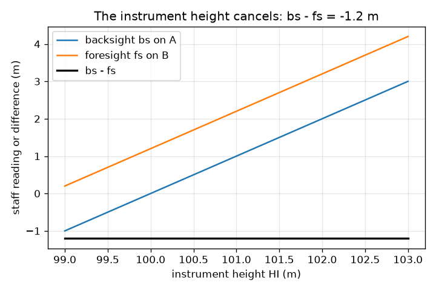
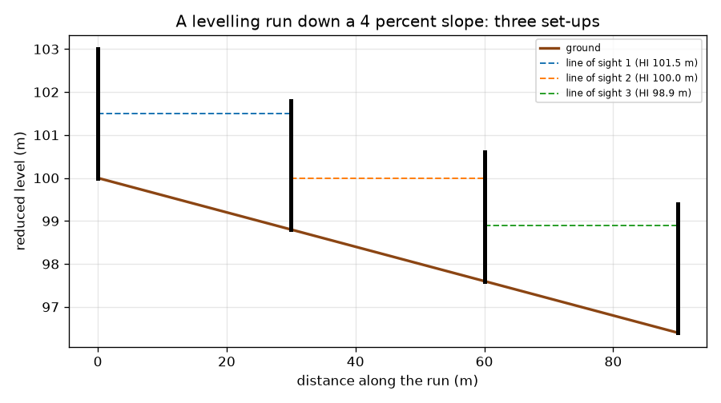

# அமர்வு 1: மட்டக்கருவியும் அளவுகோலும் கொண்டு உயர வேறுபாடு

[Session 1 — हिन्दी](README.hi.md) · [Session 1 — മലയാളം](README.ml.md)

*நிலை 1 (கருத்தியல் ஊடாடும் மாதிரி) · சுமார் 60 நிமிடங்கள் · opensurvey*

> இது ஒரு எளிமைப்படுத்தப்பட்ட கல்வி மாதிரி. இது சரிபார்க்கப்பட்ட வடிவமைப்புக் கருவி அல்ல; உண்மையான கட்டமைப்புகள், மின் நிறுவல்கள், வாகனங்கள், தொழில்துறை செயல்முறைகள் அல்லது மருத்துவ முடிவுகளுக்கு இதைப் பயன்படுத்தக் கூடாது.

**முன்தேவைகள் (Prerequisites)**

- தசம எண்களைக் கழித்தல்.
- நீங்கள் PRIMER.md ஐப் படித்து, `python start.py 1` ஐ ஒரு முறை இயக்கியிருக்கிறீர்கள்.

**கற்றல் நோக்கங்கள் (Learning objectives).** இந்த அமர்வுக்குப் பிறகு உங்களால் முடியும்:

- மட்டக்கருவியும் (level) அளவுகோலும் (staff) எதை அளக்கின்றன என்று விளக்க.
- இரண்டு புள்ளிகளுக்கு இடையிலான ஏற்றம் அல்லது இறக்கத்தைப் பின்பார்வை (backsight) கழித்தல் முன்பார்வை (foresight) என்று கணக்கிட்டு, புதிய புள்ளியின் குறைக்கப்பட்ட மட்டத்தைக் (reduced level) கணக்கிட.
- சரிவில் இறங்கும் மட்டம் காணும் ஓட்டத்தில் பல அமைப்புகளைத் தொடர்ந்து இணைக்க.
- கருவியின் உயரம் முக்கியமில்லை என்று காட்டவும், அடிகளை எண்ணி தூரம் அளக்கவும்.

## A. நிஜ உலகப் பிரச்சினை
சாலை, வடிகால் அல்லது கட்டிட மேடை கட்டுவதற்கு முன், ஒரு புள்ளி மற்றொன்றை விட எவ்வளவு உயரம் அல்லது தாழ்வு என்று யாராவது அறிய வேண்டும். நீர் கீழ்நோக்கி மட்டுமே ஓடும், எனவே தவறான திசையில் சரியும் வடிகால் வேலை செய்யாது. கண்ணால் சொல்ல முடியாது. நில அளவையாளர் ஒரு மட்டக்கருவியையும் (சரியாகக் கிடையாக நிற்கும் தொலைநோக்கி) ஒரு அளவுகோலையும் (நேராகப் பிடிக்கும் உயரமான அளவுகோல்) பயன்படுத்தி இரண்டு அளவீடுகளைக் கழிக்கிறார். இரண்டு புள்ளிகளில் எதுவுமல்லாத இடத்திலிருந்து எடுக்கப்பட்ட இரண்டு அளவீடுகள் அவற்றுக்கு இடையிலான உயர வேறுபாட்டை எவ்வாறு தர முடியும்?

## B. கருத்தும் கோட்பாடும்
மட்டக்கருவி இரண்டு புள்ளிகள் A மற்றும் B க்கு இடையில் அமைக்கப்படுகிறது. அதன் பார்வைக் கோடு தரவுத்தளத்துக்கு (datum, கடல் மட்டம் போன்ற குறிப்பு உயரம்) மேலே ஒரு உயரத்தில் முற்றிலும் கிடையாக உள்ளது. அளவுகோல் A இல் நேராகப் பிடிக்கப்பட்டுத் தொலைநோக்கி வழியே படிக்கப்படுகிறது: அது பின்பார்வை, bs. பிறகு அளவுகோல் B க்கு நகர்த்தப்படுகிறது: அது முன்பார்வை, fs. பெரிய அளவீடு என்றால் தரை தாழ்வு, ஏனெனில் அப்போது அளவுகோலின் பெரும்பகுதி பார்வைக் கோட்டுக்குக் கீழே உள்ளது. எனவே A இலிருந்து B க்கு ஏற்றம் bs - fs (எதிர்மறை விடை இறக்கம்), B இன் குறைக்கப்பட்ட மட்டம் (RL, தரவுத்தளத்துக்கு மேலான உயரம்) A இன் RL உடன் அந்த ஏற்றத்தைக் கூட்டியது. ஒரே அமைப்புக்கு B மிகத் தொலைவில் இருந்தால், நில அளவையாளர் அளவுகோலை ஒரு திருப்பப் புள்ளியில் (turning point) விட்டுவிட்டு மட்டக்கருவியை முன்னே நகர்த்துகிறார். அடிகளை எண்ணித் தூரத்தைத் தோராயமாகக் காணலாம்: அறியப்பட்ட தூரத்தை நடந்து, அடிகளை எண்ணி, distance = paces x pace length ஐப் பயன்படுத்துங்கள்.

| குறியீடு | பொருள் | அலகு |
|---|---|---|
| bs | பின்பார்வை: பின்னால் உள்ள (அறியப்பட்ட) புள்ளியில் அளவுகோல் அளவீடு | m |
| fs | முன்பார்வை: முன்னால் உள்ள புள்ளியில் அளவுகோல் அளவீடு | m |
| RL | குறைக்கப்பட்ட மட்டம்: தேர்ந்தெடுத்த தரவுத்தளத்துக்கு மேலான உயரம் | m |
| HI | பார்வைக் கோட்டின் உயரம் (கோலிமேஷன் உயரம்) | m |
| pace length | ஒரு அடியின் சராசரி நீளம், அளவுத்திருத்த நடையிலிருந்து | m |

**அனுமானங்கள் (Assumptions)**

- பார்வைக் கோடு முற்றிலும் கிடையாக உள்ளது.
- அளவுகோல் நேராகப் பிடிக்கப்பட்டுச் சரியாகப் படிக்கப்படுகிறது.
- பார்வைகள் குறுகியவை, எனவே பூமியின் வளைவை புறக்கணிக்கலாம் (எப்போது புறக்கணிக்க முடியாது என்பதை அமர்வு 3 காட்டுகிறது).
- அடி எண்ணுதல் தோராயமான முறை; நாடாவோ மொத்த நிலையமோ (total station) சிறந்தது.

$$ \text{rise from A to B}=bs-fs,\qquad RL_B=RL_A+(bs-fs) $$

$$ bs=HI-RL_A,\quad fs=HI-RL_B\ \Rightarrow\ bs-fs=RL_B-RL_A\ \text{(HI cancels)} $$

$$ \text{distance}=\text{paces}\times\text{pace length} $$

## C. காட்சி விளக்கம்
முதல் படம் 4 சதவீத சரிவில் இறங்கும் மட்டம் காணும் ஓட்டத்தைக் காட்டுகிறது: தரை, மூன்று புள்ளிக் கோடுகளான பார்வைக் கோடுகள் (ஒவ்வொரு அமைப்புக்கும் ஒன்று) மற்றும் அளவுகோல்கள். ஒவ்வொரு அமைப்பும் ஒரு பின்பார்வையையும் முன்பார்வையையும் படித்து 1.2 m இறக்கத்தைக் காண்கிறது, எனவே 90 m இல் தரை 3.6 m இறங்குகிறது, B 96.4 m இல் முடிகிறது. இரண்டாவது படம் இரண்டு அளவீடுகளையும் அவற்றின் வேறுபாட்டையும் கருவியின் உயரத்துக்கு எதிராக வரைகிறது: அளவீடுகள் அதனுடன் மாறுகின்றன, வேறுபாடு -1.2 m இல் நிலையாக நிற்கிறது. அந்தத் தட்டையான கோடுதான் அளவுகோல்களுக்கு இடையில் எங்கும் மட்டக்கருவியை வைக்கலாம் என்பதற்கான காரணம்.

*பின்பார்வையும் முன்பார்வையும் கருவியின் உயரத்துடன் மாறுகின்றன; அவற்றின் வேறுபாடு மாறுவதில்லை.*

*4 சதவீத சரிவில் இறங்கும் மட்டம் காணும் ஓட்டம்: மூன்று அமைப்புகள், மூன்று பார்வைக் கோடுகள்.*

## D. ஊடாடும் உருவகப்படுத்துதல்
பாடத்தை இயக்கவும் (`python start.py 1`), பின்னர் நேரடிச் செயலியைத் திறக்கவும்: [அமர்வு 1: ஒரு மட்டக்கருவியும் இரண்டு அளவுகோல்களும்](https://krunalpanchal1995.github.io/pan-iit-oss/opensurvey/session-01/) (அல்லது இந்தக் கோப்புறையில் உள்ள `app.html`). சரிவு மற்றும் தூர ஸ்லைடர்களை நகர்த்தி முன்பார்வை வளர்வதைப் பாருங்கள், பின்னர் மட்டக் காட்சிக்கு மாறித் தரை இறங்குவதைப் பாருங்கள். பின்பார்வையை மாற்றி இறக்கம் மாறவில்லை என்று பாருங்கள்.

**சவால் (Challenge).** புள்ளி B இன் குறைக்கப்பட்ட மட்டம் 98.4 m இல் முடியச் செய்யுங்கள் (A 100.0 m).

## E. தீர்க்கப்பட்ட எடுத்துக்காட்டும் சோதனையும்
**பிரச்சினை.** ஒரு அளவுக்குறி A இன் RL 100.000 m. A இல் பின்பார்வை 1.525 m மற்றும் B இல் முன்பார்வை 2.310 m. ஏற்றம் அல்லது இறக்கத்தையும் B இன் RL ஐயும் கண்டறியுங்கள்.

1. ஏற்றம் = bs - fs = 1.525 - 2.310 = -0.785 m.
2. எதிர்மறை குறி இறக்கத்தைக் குறிக்கிறது: B, A ஐ விட 0.785 m தாழ்வானது.
3. B இன் RL = 100.000 + (-0.785) = 99.215 m.
4. பொருத்தச் சோதனை: முன்பார்வை பின்பார்வையை விடப் பெரியது, எனவே B இல் உள்ள அளவுகோல் பார்வைக் கோட்டில் தாழ்வாக உள்ளது, எனவே B தாழ்ந்த புள்ளி. விடை ஒத்துப்போகிறது.

**விடை.** B, A ஐ விட 0.785 m தாழ்வானது, RL 99.215 m.

**சோதனை.** ஒரு கட்டுநரின் மட்டக்கருவி (அல்லது நீர் நிரப்பிய தெளிவான குழாய்) மற்றும் ஒரு மீட்டர் அளவுகோலுடன், பள்ளி நடைபாதை அல்லது தோட்டத்தில் 10 m இடைவெளியில் உள்ள இரண்டு புள்ளிகளுக்கு இடையே bs மற்றும் fs எடுத்து வேறுபாட்டைக் கணக்கிடுங்கள். பிறகு மட்டக்கருவியை வேறு இடத்துக்கு நகர்த்தி மீண்டும் செய்யுங்கள்: சில மில்லிமீட்டருக்குள் அதே வேறுபாடு கிடைக்க வேண்டும். வேறுபாடுகள் அளவுகோலைப் படிப்பதிலிருந்தும், மட்டக்கருவி சரியாகக் கிடையாக இல்லாததிலிருந்தும், அளவுகோல் சாய்வதிலிருந்தும் வருகின்றன; மாதிரி சரியான அளவீடுகளை அனுமானிக்கிறது.

## F. மதிப்பீடும் வடிவமைப்புச் சவாலும்
**கேள்வி வகை A: கருத்தியல்.** bs - fs என்ற விடை மட்டக்கருவி தரைக்கு மேல் எவ்வளவு உயரத்தில் உள்ளது என்பதைச் சார்ந்திருக்காதது ஏன்?

குறிப்பு

ஒவ்வொரு அளவீட்டையும் பார்வைக் கோட்டின் உயரம் கழித்தல் தரையின் உயரம் என்று எழுதுங்கள்.

படிப்படியான தீர்வு

bs = HI - RL_A மற்றும் fs = HI - RL_B, எனவே bs - fs = RL_B - RL_A: HI நீங்கிவிடுகிறது. கருவி 0.40 m உயர்த்தப்பட்டால் இரண்டு அளவீடுகளும் 0.40 m குறைகின்றன, வேறுபாடு மாறுவதில்லை (பாடத்தின் ஓட்டத்தில் -1.2 m). அதனால்தான் இரண்டு அளவுகோல்களுக்கு இடையில் எங்கும் மட்டக்கருவியை வைக்கலாம்.

**கேள்வி வகை B: எண்ணியல்.** RL 54.320 m கொண்ட புள்ளியில் பின்பார்வை 0.872 m மற்றும் அடுத்த புள்ளியில் முன்பார்வை 2.134 m. அடுத்த புள்ளியின் RL ஐக் கண்டறிந்து, தரை ஏறுகிறதா இறங்குகிறதா என்று சொல்லுங்கள்.

குறிப்பு

ஏற்றம் = bs - fs, பின்னர் RL உடன் கூட்டுங்கள்.

படிப்படியான தீர்வு

ஏற்றம் = 0.872 - 2.134 = -1.262 m, ஒரு இறக்கம். RL = 54.320 - 1.262 = 53.058 m. பொருத்தச் சோதனை: முன்பார்வை பெரியது, எனவே புதிய புள்ளி தாழ்வானது. அலகுகள்: மீட்டர்.

**கேள்வி வகை C: வரைபடம் மற்றும் உருவகப்படுத்துதல் விளக்கம்.** மட்டம் காணும் ஓட்டப் படத்திலிருந்து, தரையின் தரம் (சதவீதத்தில் சரிவு) என்ன, ஒவ்வொரு அமைப்பிலும் எவ்வளவு இறங்குகிறது?

குறிப்பு

தரம் = இறக்கத்தைக் கிடைத் தூரத்தால் வகுத்து 100 ஆல் பெருக்கியது.

படிப்படியான தீர்வு

தரை 90 m இல் 3.6 m இறங்குகிறது, எனவே தரம் 3.6 / 90 x 100 = 4 சதவீதம். மூன்று அமைப்புகளும் ஒவ்வொன்றும் 30 m ஐ உள்ளடக்கி 1.2 m இறங்குகின்றன, சரிவு சீரானதால் ஒவ்வொரு முறையும் ஒன்றே.

**கேள்வி வகை D: வடிவமைப்பு மற்றும் உகப்பாக்கச் சவால்.** வடிவமைப்பு: அளவுகோல் 4.0 m நீளம், பின்பார்வை அளவுகோலிலிருந்து தரை 5 சதவீதம் இறங்குகிறது, பின்பார்வை 1.0 m படிக்கிறது. அளவீடு இன்னும் அளவுகோலிலேயே விழ வேண்டுமெனில் முன்பார்வை அளவுகோல் எவ்வளவு தூரத்தில் நிற்கலாம்? மிகக் குறுகிய பார்வைகளை மட்டும் ஏன் பயன்படுத்தக் கூடாது?

குறிப்பு

முன்பார்வை என்பது பின்பார்வையுடன் அந்தத் தூரத்தில் ஏற்படும் இறக்கத்தைக் கூட்டியது.

படிப்படியான தீர்வு

fs = 1.0 + 0.05 x d என்பது 4.0 m க்குக் கீழே அல்லது சமமாக இருக்க வேண்டும், எனவே d அதிகபட்சம் 60 m. மிகக் குறுகிய பார்வைகளுக்கு அதே கோட்டுக்கு அதிக அமைப்புகள் தேவை, எனவே அதிக அளவீடுகள், அதிக நேரம், சிறிய பிழைகள் சேரும் வாய்ப்பு அதிகம் (அது எவ்வளவு வேகமாக என்பதை அமர்வு 2 காட்டுகிறது). நல்ல திட்டம் அளவுகோலிலேயே இருக்கும், தொலைநோக்கியின் நம்பகமான வரம்புக்குள் இருக்கும் மிக நீண்ட பார்வைகளைப் பயன்படுத்தி, பின்பார்வை மற்றும் முன்பார்வை நீளங்களை ஏறக்குறைய சமமாக வைத்திருக்கும்.

[RUBRIC.md](../../RUBRIC.md) மூலம் உங்களை நீங்களே மதிப்பிடுங்கள். காகிதத்தில் செய்ய [செயல்பாட்டுத் தாளை](activity_sheet.md) அச்சிடுங்கள்.

## பொதுவான தவறான கருத்துகள்
| பொதுவான தவறான கருத்து | உண்மையில் சரியானது |
|---|---|
| பெரிய அளவுகோல் அளவீடு என்றால் உயரமான புள்ளி. | பெரிய அளவீடு என்றால் தாழ்ந்த புள்ளி: அளவுகோலின் அதிகப் பகுதி பார்வைக் கோட்டுக்குக் கீழே உள்ளது. |
| மட்டக்கருவி A மற்றும் B க்கு இடையிலான கோட்டில் புள்ளிகளின் அதே உயரத்தில் நிற்க வேண்டும். | bs - fs இல் கருவியின் உயரம் நீங்கிவிடுவதால், இரண்டு அளவுகோல்களும் தெரியும் எந்த இடத்திலும் எந்த உயரத்திலும் அது நிற்கலாம். |
| ஏற்றம் என்பது முன்பார்வை கழித்தல் பின்பார்வை. | ஏற்றம் என்பது பின்பார்வை கழித்தல் முன்பார்வை. குறியால் சரிபாருங்கள்: பெரிய முன்பார்வை எதிர்மறை ஏற்றத்தை (இறக்கத்தை) தர வேண்டும். |
| அடி எண்ணுதல் நாடாவைப் போலவே துல்லியமானது. | அடி எண்ணுதல் உங்கள் அடி, தரை மற்றும் சோர்வைச் சார்ந்தது. இது விரைவான சரிபார்ப்பு, கட்டிடத்தை அடையாளமிடுவதற்கான அளவீடு அல்ல. |

## சொற்களஞ்சியம் (Glossary)
- **மட்டக்கருவி (level)**: பார்வைக் கோடு கிடையாக இருக்கும்படி பொருத்தப்பட்ட தொலைநோக்கி
- **அளவுகோல் (staff)**: மட்டக்கருவி வழியே படிக்கும் நேராகப் பிடிக்கும் உயரமான அளவுகோல்
- **பின்பார்வை (backsight, bs)**: பின்னால் உள்ள அறியப்பட்ட புள்ளியில் அளவுகோல் அளவீடு
- **முன்பார்வை (foresight, fs)**: முன்னால் உள்ள புதிய புள்ளியில் அளவுகோல் அளவீடு
- **குறைக்கப்பட்ட மட்டம் (reduced level, RL)**: தேர்ந்தெடுத்த தரவுத்தளத்துக்கு மேலான ஒரு புள்ளியின் உயரம்
- **தரவுத்தளம் (datum)**: மட்டங்கள் அளக்கப்படும் குறிப்பு உயரம்
- **திருப்பப் புள்ளி (turning point)**: மட்டக்கருவி நகர்த்தப்படும்போது அளவுகோல் நிற்கும் புள்ளி

## முடிக்கவும்
1. [exercises.md](exercises.md) இல் உள்ள மூன்று நிரலாக்கப் பணிகளைச் செய்யுங்கள்.
2. உங்கள் மாற்றங்களுக்குப் பிறகு `python start.py 1` ஐ மீண்டும் இயக்குங்கள். இது சோதனைச்சாவடியுடன் (checkpoint) முடிகிறது; அது `PASS` என்று அச்சிடும்போது நீங்கள் முடித்துவிட்டீர்கள். (சோதனைச்சாவடி மட்டும்: `python start.py check 1`.)

அடுத்து: [அமர்வு 2](../session-02/README.md)
