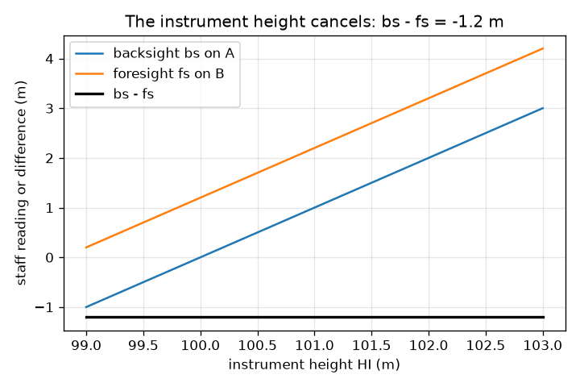
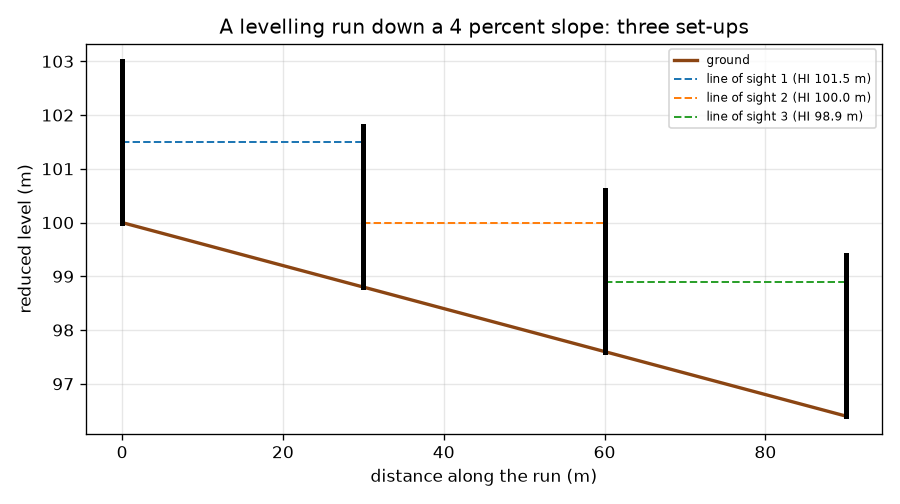

# సెషన్ 1: లెవల్ మరియు స్టాఫ్‌తో ఎత్తు వ్యత్యాసం

[Session 1 — हिन्दी](README.hi.md) · [Session 1 — മലയാളം](README.ml.md) · [Session 1 — தமிழ்](README.ta.md)

*స్థాయి 1 (భావనాత్మక ఇంటరాక్టివ్ నమూనా) · సుమారు 60 నిమిషాలు · opensurvey*

> ఇది ఒక సరళీకృత విద్యా నమూనా. ఇది ధృవీకరించబడిన డిజైన్ సాధనం కాదు; నిజమైన నిర్మాణాలు, విద్యుత్ ఇన్‌స్టలేషన్లు, వాహనాలు, పారిశ్రామిక ప్రక్రియలు లేదా వైద్య నిర్ణయాల కోసం దీనిని ఉపయోగించకూడదు.

**ముందస్తు అవసరాలు (Prerequisites)**

- దశాంశ సంఖ్యలను తీసివేయడం.
- మీరు PRIMER.md చదివి, `python start.py 1` ను ఒకసారి రన్ చేశారు.

**అభ్యసన లక్ష్యాలు (Learning objectives).** ఈ సెషన్ తర్వాత మీరు చేయగలరు:

- లెవల్ (level) మరియు స్టాఫ్ (staff) దేనిని కొలుస్తాయో వివరించడం.
- రెండు బిందువుల మధ్య ఎత్తు పెరుగుదల లేదా తగ్గుదలను బ్యాక్‌సైట్ (backsight) మైనస్ ఫోర్‌సైట్ (foresight) గా, కొత్త బిందువు యొక్క రిడ్యూస్డ్ లెవల్‌ను లెక్కించడం.
- వాలు వెంట కిందికి సాగే లెవలింగ్ రన్‌లో అనేక సెటప్‌లను కలపడం.
- పరికరం ఎత్తు పట్టింపు లేదని చూపడం, అడుగులు లెక్కించి దూరం కొలవడం.

## A. వాస్తవ ప్రపంచ సమస్య
రోడ్డు, కాలువ లేదా భవన వేదిక నిర్మించే ముందు, ఒక బిందువు మరొకదాని కంటే ఎంత ఎత్తు లేదా పల్లంలో ఉందో ఎవరైనా తెలుసుకోవాలి. నీరు కిందికి మాత్రమే ప్రవహిస్తుంది, కాబట్టి తప్పు దిశలో వాలిన కాలువ పనిచేయదు. కంటితో చెప్పలేము. సర్వేయర్ లెవల్ (ఖచ్చితంగా సమాంతరంగా ఉండే టెలిస్కోప్) మరియు స్టాఫ్ (నిటారుగా పట్టుకునే ఎత్తైన స్కేల్) ఉపయోగించి రెండు రీడింగ్‌లను తీసివేస్తాడు. రెండు బిందువుల్లో ఏదీ కాని చోటు నుండి తీసిన రెండు రీడింగ్‌లు వాటి మధ్య ఎత్తు వ్యత్యాసాన్ని ఎలా ఇవ్వగలవు?

## B. భావన మరియు సిద్ధాంతం
లెవల్‌ను రెండు బిందువులు A మరియు B మధ్య అమర్చుతారు. దాని దృష్టి రేఖ డేటమ్‌కు (datum, సముద్ర మట్టం వంటి సూచన ఎత్తు) పైన ఒక ఎత్తులో పూర్తిగా సమాంతరంగా ఉంటుంది. స్టాఫ్‌ను A పై నిటారుగా పట్టుకుని టెలిస్కోప్ ద్వారా చదువుతారు: అది బ్యాక్‌సైట్, bs. తర్వాత స్టాఫ్‌ను B కి మారుస్తారు: అది ఫోర్‌సైట్, fs. పెద్ద రీడింగ్ అంటే నేల పల్లం, ఎందుకంటే అప్పుడు స్టాఫ్‌లో ఎక్కువ భాగం దృష్టి రేఖ కంటే కింద ఉంటుంది. కాబట్టి A నుండి B కి పెరుగుదల bs - fs (ప్రతికూల సమాధానం తగ్గుదల), B యొక్క రిడ్యూస్డ్ లెవల్ (RL, డేటమ్ పైన ఎత్తు) A యొక్క RL కు ఆ పెరుగుదలను కలిపినది. ఒక సెటప్‌కు B చాలా దూరంలో ఉంటే, సర్వేయర్ స్టాఫ్‌ను టర్నింగ్ పాయింట్ (turning point) వద్ద ఉంచి లెవల్‌ను ముందుకు జరుపుతాడు. అడుగులు లెక్కించి దూరాన్ని సుమారుగా కనుగొనవచ్చు: తెలిసిన దూరం నడిచి, అడుగులు లెక్కించి, distance = paces x pace length ఉపయోగించండి.

| గుర్తు | అర్థం | యూనిట్ |
|---|---|---|
| bs | బ్యాక్‌సైట్: వెనుక ఉన్న (తెలిసిన) బిందువు వద్ద స్టాఫ్ రీడింగ్ | m |
| fs | ఫోర్‌సైట్: ముందు ఉన్న బిందువు వద్ద స్టాఫ్ రీడింగ్ | m |
| RL | రిడ్యూస్డ్ లెవల్: ఎంచుకున్న డేటమ్ పైన ఎత్తు | m |
| HI | దృష్టి రేఖ ఎత్తు (కొలిమేషన్ ఎత్తు) | m |
| pace length | ఒక అడుగు సగటు పొడవు, క్రమాంకన నడక నుండి | m |

**ఊహలు (Assumptions)**

- దృష్టి రేఖ ఖచ్చితంగా సమాంతరం.
- స్టాఫ్‌ను నిటారుగా పట్టుకుని ఖచ్చితంగా చదువుతారు.
- చూపులు చిన్నవి, కాబట్టి భూమి వక్రతను విస్మరించవచ్చు (ఎప్పుడు విస్మరించలేమో సెషన్ 3 చూపిస్తుంది).
- అడుగులు లెక్కించడం సుమారు పద్ధతి; టేపు లేదా టోటల్ స్టేషన్ మెరుగైనవి.

$$ \text{rise from A to B}=bs-fs,\qquad RL_B=RL_A+(bs-fs) $$

$$ bs=HI-RL_A,\quad fs=HI-RL_B\ \Rightarrow\ bs-fs=RL_B-RL_A\ \text{(HI cancels)} $$

$$ \text{distance}=\text{paces}\times\text{pace length} $$

## C. దృశ్య వివరణ
మొదటి చిత్రం 4 శాతం వాలులో కిందికి సాగే లెవలింగ్ రన్‌ను చూపిస్తుంది: నేల, మూడు చుక్కల రేఖలైన దృష్టి రేఖలు (ప్రతి సెటప్‌కు ఒకటి) మరియు స్టాఫ్‌లు. ప్రతి సెటప్ ఒక బ్యాక్‌సైట్ మరియు ఫోర్‌సైట్ చదివి 1.2 m తగ్గుదల కనుగొంటుంది, కాబట్టి 90 m లో నేల 3.6 m దిగుతుంది, B 96.4 m వద్ద ముగుస్తుంది. రెండవ చిత్రం రెండు రీడింగ్‌లను మరియు వాటి వ్యత్యాసాన్ని పరికరం ఎత్తుకు వ్యతిరేకంగా గీస్తుంది: రీడింగ్‌లు దానితో మారతాయి, వ్యత్యాసం -1.2 m వద్ద స్థిరంగా ఉంటుంది. ఆ చదునైన రేఖే స్టాఫ్‌ల మధ్య ఎక్కడైనా లెవల్‌ను ఉంచవచ్చు అనడానికి కారణం.

*బ్యాక్‌సైట్ మరియు ఫోర్‌సైట్ పరికరం ఎత్తుతో మారతాయి; వాటి వ్యత్యాసం మారదు.*

*4 శాతం వాలులో కిందికి సాగే లెవలింగ్ రన్: మూడు సెటప్‌లు, మూడు దృష్టి రేఖలు.*

## D. ఇంటరాక్టివ్ సిమ్యులేషన్
పాఠాన్ని రన్ చేయండి (`python start.py 1`), తర్వాత లైవ్ యాప్‌ను తెరవండి: [సెషన్ 1: ఒక లెవల్ మరియు రెండు స్టాఫ్‌లు](https://krunalpanchal1995.github.io/pan-iit-oss/opensurvey/session-01/) (లేదా ఈ ఫోల్డర్‌లోని `app.html`). వాలు మరియు దూరం స్లైడర్‌లను కదిపి ఫోర్‌సైట్ పెరగడం చూడండి, తర్వాత లెవల్ వీక్షణకు మారి నేల దిగడం చూడండి. బ్యాక్‌సైట్‌ను మార్చి తగ్గుదల మారదని చూడండి.

**సవాలు (Challenge).** బిందువు B యొక్క రిడ్యూస్డ్ లెవల్ 98.4 m వద్ద ముగిసేలా చేయండి (A 100.0 m).

## E. సాధించిన ఉదాహరణ మరియు ప్రయోగం
**సమస్య.** ఒక బెంచ్‌మార్క్ A యొక్క RL 100.000 m. A వద్ద బ్యాక్‌సైట్ 1.525 m మరియు B వద్ద ఫోర్‌సైట్ 2.310 m. పెరుగుదల లేదా తగ్గుదలను మరియు B యొక్క RL ను కనుగొనండి.

1. పెరుగుదల = bs - fs = 1.525 - 2.310 = -0.785 m.
2. ప్రతికూల గుర్తు తగ్గుదలను సూచిస్తుంది: B, A కంటే 0.785 m కింద ఉంది.
3. B యొక్క RL = 100.000 + (-0.785) = 99.215 m.
4. సహేతుకత పరీక్ష: ఫోర్‌సైట్ బ్యాక్‌సైట్ కంటే పెద్దది, కాబట్టి B వద్ద స్టాఫ్ దృష్టి రేఖలో కిందికి ఉంది, కాబట్టి B తక్కువ ఎత్తు బిందువు. సమాధానం సరిపోతుంది.

**సమాధానం.** B, A కంటే 0.785 m కింద ఉంది, RL 99.215 m.

**ప్రయోగం.** బిల్డర్ లెవల్ (లేదా నీటితో నింపిన స్పష్టమైన గొట్టం) మరియు మీటర్ స్కేల్‌తో, పాఠశాల కారిడార్ లేదా తోటలో 10 m దూరంలోని రెండు బిందువుల మధ్య bs మరియు fs తీసుకుని వ్యత్యాసాన్ని లెక్కించండి. తర్వాత లెవల్‌ను మరో చోటుకు జరిపి మళ్ళీ చేయండి: కొన్ని మిల్లీమీటర్లలోపు అదే వ్యత్యాసం రావాలి. తేడాలు స్కేల్ చదవడం నుండి, లెవల్ ఖచ్చితంగా సమాంతరంగా లేకపోవడం నుండి, స్టాఫ్ వాలడం నుండి వస్తాయి; నమూనా ఖచ్చితమైన రీడింగ్‌లను ఊహిస్తుంది.

## F. మూల్యాంకనం మరియు డిజైన్ సవాలు
**ప్రశ్న రకం A: భావనాత్మక.** bs - fs సమాధానం లెవల్ నేల పైన ఎంత ఎత్తులో ఉందనే దానిపై ఆధారపడకపోవడానికి కారణం ఏమిటి?

సూచన

ప్రతి రీడింగ్‌ను దృష్టి రేఖ ఎత్తు మైనస్ నేల ఎత్తుగా రాయండి.

దశలవారీ పరిష్కారం

bs = HI - RL_A మరియు fs = HI - RL_B, కాబట్టి bs - fs = RL_B - RL_A: HI రద్దవుతుంది. పరికరాన్ని 0.40 m పైకి ఎత్తితే రెండు రీడింగ్‌లు 0.40 m తగ్గుతాయి, వ్యత్యాసం మారదు (పాఠంలోని రన్‌లో -1.2 m). అందుకే రెండు స్టాఫ్‌ల మధ్య ఎక్కడైనా లెవల్‌ను ఉంచవచ్చు.

**ప్రశ్న రకం B: సంఖ్యాత్మక.** RL 54.320 m ఉన్న బిందువు వద్ద బ్యాక్‌సైట్ 0.872 m మరియు తర్వాతి బిందువు వద్ద ఫోర్‌సైట్ 2.134 m. తర్వాతి బిందువు RL కనుగొని, నేల పెరుగుతుందా తగ్గుతుందా చెప్పండి.

సూచన

పెరుగుదల = bs - fs, తర్వాత RL కు కలపండి.

దశలవారీ పరిష్కారం

పెరుగుదల = 0.872 - 2.134 = -1.262 m, ఒక తగ్గుదల. RL = 54.320 - 1.262 = 53.058 m. సహేతుకత పరీక్ష: ఫోర్‌సైట్ పెద్దది, కాబట్టి కొత్త బిందువు కింద ఉంది. యూనిట్లు: మీటర్లు.

**ప్రశ్న రకం C: గ్రాఫ్ మరియు సిమ్యులేషన్ వ్యాఖ్యానం.** లెవలింగ్-రన్ చిత్రం నుండి, నేల గ్రేడ్ (శాతంలో వాలు) ఎంత, ప్రతి సెటప్‌లో ఎంత దిగుతుంది?

సూచన

గ్రేడ్ = తగ్గుదలను సమాంతర దూరంతో భాగించి 100 తో గుణించినది.

దశలవారీ పరిష్కారం

నేల 90 m లో 3.6 m దిగుతుంది, కాబట్టి గ్రేడ్ 3.6 / 90 x 100 = 4 శాతం. మూడు సెటప్‌లలో ప్రతిదీ 30 m కవర్ చేసి 1.2 m దిగుతుంది, వాలు ఏకరీతి కాబట్టి ప్రతిసారీ అదే.

**ప్రశ్న రకం D: డిజైన్ మరియు ఆప్టిమైజేషన్ సవాలు.** డిజైన్: స్టాఫ్ 4.0 m పొడవు, బ్యాక్‌సైట్ స్టాఫ్ నుండి నేల 5 శాతం దిగుతుంది, బ్యాక్‌సైట్ 1.0 m చదువుతుంది. రీడింగ్ ఇంకా స్టాఫ్‌పైనే పడాలంటే ఫోర్‌సైట్ స్టాఫ్ ఎంత దూరంలో నిలబడవచ్చు? చాలా చిన్న చూపులనే ఎందుకు వాడకూడదు?

సూచన

ఫోర్‌సైట్ అంటే బ్యాక్‌సైట్ ప్లస్ ఆ దూరంలో తగ్గుదల.

దశలవారీ పరిష్కారం

fs = 1.0 + 0.05 x d అనేది 4.0 m కంటే తక్కువ లేదా సమానంగా ఉండాలి, కాబట్టి d గరిష్ఠంగా 60 m. చాలా చిన్న చూపులకు అదే రేఖకు ఎక్కువ సెటప్‌లు కావాలి, కాబట్టి ఎక్కువ రీడింగ్‌లు, ఎక్కువ సమయం, చిన్న లోపాలు కలిసే ఎక్కువ అవకాశాలు (అవి ఎంత వేగంగా అనేది సెషన్ 2 చూపిస్తుంది). మంచి ప్రణాళిక స్టాఫ్‌పైనే ఉండే, టెలిస్కోప్ నమ్మదగిన పరిధిలోని అత్యంత పొడవైన చూపులను ఉపయోగించి, బ్యాక్‌సైట్ మరియు ఫోర్‌సైట్ పొడవులను దాదాపు సమానంగా ఉంచుతుంది.

[RUBRIC.md](../../RUBRIC.md) తో మిమ్మల్ని మీరు స్కోర్ చేసుకోండి. కాగితంపై పని చేయడానికి [కార్యాచరణ పత్రాన్ని](activity_sheet.md) ప్రింట్ చేయండి.

## సాధారణ అపోహలు
| సాధారణ అపోహ | నిజానికి సరైనది |
|---|---|
| పెద్ద స్టాఫ్ రీడింగ్ అంటే ఎత్తైన బిందువు. | పెద్ద రీడింగ్ అంటే తక్కువ ఎత్తు బిందువు: స్టాఫ్‌లో ఎక్కువ భాగం దృష్టి రేఖ కింద ఉంది. |
| లెవల్ A మరియు B మధ్య రేఖపై బిందువుల అదే ఎత్తులో నిలబడాలి. | bs - fs లో పరికరం ఎత్తు రద్దవుతుంది కాబట్టి, రెండు స్టాఫ్‌లూ కనిపించే ఏ చోటైనా, ఏ ఎత్తులోనైనా అది నిలబడవచ్చు. |
| పెరుగుదల అంటే ఫోర్‌సైట్ మైనస్ బ్యాక్‌సైట్. | పెరుగుదల అంటే బ్యాక్‌సైట్ మైనస్ ఫోర్‌సైట్. గుర్తుతో పరీక్షించండి: పెద్ద ఫోర్‌సైట్ ప్రతికూల పెరుగుదల (తగ్గుదల) ఇవ్వాలి. |
| అడుగులు లెక్కించడం టేపు అంత ఖచ్చితమైనది. | అడుగులు లెక్కించడం మీ అడుగు, నేల మరియు అలసటపై ఆధారపడుతుంది. ఇది త్వరిత పరీక్ష, భవనాన్ని గుర్తించే కొలత కాదు. |

## పదకోశం (Glossary)
- **లెవల్ (level)**: దృష్టి రేఖ సమాంతరంగా ఉండేలా అమర్చిన టెలిస్కోప్
- **స్టాఫ్ (staff)**: లెవల్ ద్వారా చదివే నిటారుగా పట్టుకునే ఎత్తైన స్కేల్
- **బ్యాక్‌సైట్ (backsight, bs)**: వెనుక ఉన్న తెలిసిన బిందువు వద్ద స్టాఫ్ రీడింగ్
- **ఫోర్‌సైట్ (foresight, fs)**: ముందు ఉన్న కొత్త బిందువు వద్ద స్టాఫ్ రీడింగ్
- **రిడ్యూస్డ్ లెవల్ (reduced level, RL)**: ఎంచుకున్న డేటమ్ పైన ఒక బిందువు ఎత్తు
- **డేటమ్ (datum)**: లెవళ్లను కొలిచే సూచన ఎత్తు
- **టర్నింగ్ పాయింట్ (turning point)**: లెవల్‌ను ముందుకు జరిపేటప్పుడు స్టాఫ్ ఉండే బిందువు

## ముగించండి
1. [exercises.md](exercises.md) లోని మూడు కోడింగ్ పనులను చేయండి.
2. మీ మార్పుల తర్వాత `python start.py 1` ను మళ్ళీ రన్ చేయండి. ఇది చెక్‌పాయింట్‌తో ముగుస్తుంది; అది `PASS` అని ప్రింట్ చేసినప్పుడు మీరు పూర్తి చేశారు. (చెక్‌పాయింట్ మాత్రమే: `python start.py check 1`.)

తదుపరి: [సెషన్ 2](../session-02/README.md)
