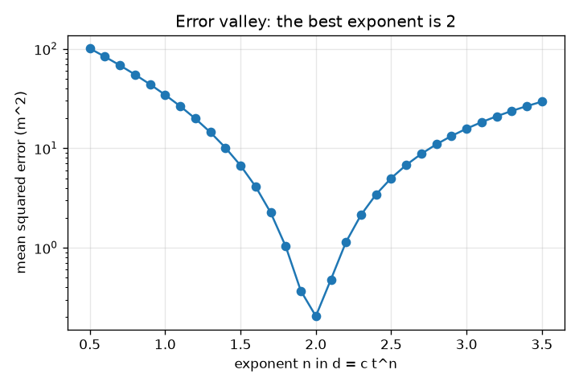
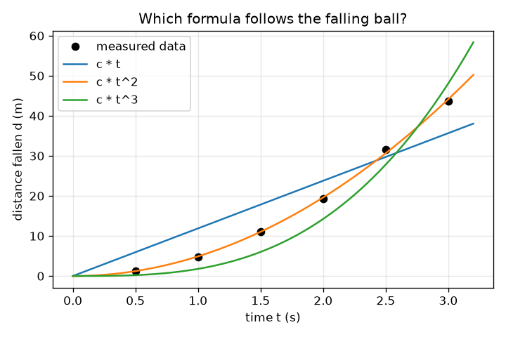

# सत्र 1: नियम का पालन करने वाला डेटा: क्या कंप्यूटर सूत्र का अनुमान लगा सकता है?

*स्तर 1 (वैचारिक इंटरैक्टिव मॉडल) · लगभग 60 मिनट · opensymbolic*

> यह एक सरलीकृत शैक्षिक मॉडल है। यह कोई प्रमाणित डिज़ाइन टूल नहीं है और इसका उपयोग वास्तविक संरचनाओं, बिजली की वायरिंग (electrical installations), वाहनों, औद्योगिक प्रक्रियाओं या चिकित्सा निर्णयों के लिए नहीं किया जाना चाहिए।

**पूर्व-आवश्यकताएँ (Prerequisites)**

- स्कूल का बीजगणित: t^2 जैसी घातें और सूत्र का विचार।
- आपने PRIMER.md पढ़ लिया है और एक बार `python start.py 1` चलाया है।

**सीखने के उद्देश्य (Learning objectives).** इस सत्र के बाद आप:

- समझा सकेंगे कि मापे गए डेटा के किसी नियम का पालन करने का क्या अर्थ है, और माप कभी उससे ठीक-ठीक मेल क्यों नहीं खाते।
- न्यूनतम वर्ग विधि (least squares) से d = c t^n में एक अज्ञात स्थिरांक c को फ़िट कर सकेंगे।
- किसी उम्मीदवार सूत्र (candidate formula) को उसकी माध्य वर्ग त्रुटि (mean squared error) से अंक दे सकेंगे और उम्मीदवारों को क्रम में रख सकेंगे।
- त्रुटि-बनाम-घातांक वक्र पढ़ सकेंगे और समझा सकेंगे कि उसका निम्नतम बिंदु नियम के लिए एक अच्छा अनुमान क्यों है।

## A. वास्तविक दुनिया की समस्या
एक मीनार से एक गेंद गिराइए और हर आधे सेकंड के बाद समय नापिए कि वह कितनी दूर गिरी है। संख्याएँ तेज़ी से और तेज़ी से बढ़ती हैं, पर क्या दूरी समय के समानुपाती है, उसके वर्ग के, उसके घन के? गैलीलियो को एक सूत्र का अनुमान लगाकर उसका परीक्षण करना पड़ा। एक कंप्यूटर अनुमान लगाने का काम कर सकता है: कई उम्मीदवार सूत्र लिखिए, हर एक को फ़िट कीजिए, और उसे रखिए जो डेटा से सबसे अच्छा मेल खाता है। यही प्रतीकात्मक प्रतिगमन (symbolic regression) का बीज है, एक ऐसी विधि जो केवल एक वक्र नहीं बल्कि एक समीकरण ढूँढती है, और जिसका उपयोग वैज्ञानिक आज रसायन विज्ञान में व्याख्या योग्य नियम खोजने के लिए करते हैं, उदाहरण के लिए अभिक्रिया दरों (reaction rates) के लिए।

## B. अवधारणा और सिद्धांत
विरामावस्था से मुक्त पतन (free fall) d = (1/2) g t^2 का पालन करता है, जहाँ d मीटर में गिरी हुई दूरी है, t सेकंड में समय और g गुरुत्वीय त्वरण (acceleration due to gravity), पृथ्वी पर 9.81 m/s^2। वास्तविक मापों में त्रुटियाँ होती हैं, इसलिए हम उन्हें हर दूरी को एक छोटी भिन्नात्मक त्रुटि e के साथ (1 + e) से गुणा करके मॉडल करते हैं। एक उम्मीदवार सूत्र का रूप d = c t^n है: घातांक (exponent) n खोज द्वारा चुना जाता है और स्थिरांक c न्यूनतम वर्ग विधि से ज्ञात किया जाता है। डेटा और सूत्र के बीच वर्ग अंतरों के योग को न्यूनतम करने से c = sum(f d) / sum(f f) मिलता है, जहाँ f = t^n। अंक माध्य वर्ग त्रुटि (MSE) है: वर्ग अंतरों का औसत, वर्ग मीटर में। यदि जीतने वाला घातांक 2 है, तो c = g / 2 और इसलिए g = 2c।

| प्रतीक | अर्थ | इकाई |
|---|---|---|
| d | विरामावस्था से गिरी हुई दूरी | m |
| t | छोड़ने के बाद का समय | s |
| g | गुरुत्वीय त्वरण | m/s^2 |
| c | किसी उम्मीदवार सूत्र के लिए फ़िट किया गया स्थिरांक | m/s^n |
| n | उम्मीदवार में t का घातांक | कोई इकाई नहीं |
| MSE | किसी उम्मीदवार की माध्य वर्ग त्रुटि | m^2 |
| e | एक बिंदु की भिन्नात्मक माप त्रुटि | कोई इकाई नहीं |

**मान्यताएँ (Assumptions)**

- गेंद विरामावस्था से शुरू होती है और वायु प्रतिरोध (air resistance) अनदेखा किया गया है।
- त्रुटियाँ छोटी हैं, यहाँ -3 और 3 प्रतिशत के बीच, और हम छह निश्चित मानों का उपयोग करते हैं ताकि सबको एक ही डेटा मिले।
- हर उम्मीदवार का रूप c गुणा एक आकार है; हम अभी सूत्र के अंदर स्थिरांकों की अनुमति नहीं देते।

$$ d=\tfrac12\,g\,t^2 $$

$$ c=\frac{\sum_i f_i\,d_i}{\sum_i f_i^2},\qquad f_i=t_i^{\,n} $$

$$ \mathrm{MSE}=\frac1N\sum_{i=1}^{N}\big(d_i-c\,t_i^{\,n}\big)^2 $$

$$ d=c\,t^2\ \Rightarrow\ g=2c $$

## C. दृश्य व्याख्या
बायाँ चित्र छह मापे गए बिंदु और तीन उम्मीदवार वक्र दिखाता है: t के समानुपाती दूरी (अंत में बहुत सपाट), t घन के समानुपाती (बहुत तीव्र) और t वर्ग के समानुपाती, जो बिंदुओं के समूह से होकर गुज़रता है। दायाँ चित्र log अक्ष पर घातांक n के सापेक्ष त्रुटि दर्शाता है: एक गहरी घाटी जिसका निम्नतम बिंदु n = 2.0 पर है, जहाँ त्रुटि 0.20 m^2 है, जबकि n = 1 पर 34.39 m^2 और n = 3 पर 15.73 m^2। एक अच्छी सूत्र खोज ऐसी घाटी में उतरना है।

*घातांक n के सापेक्ष त्रुटि: घाटी n = 2 पर है।*

*छह मापे गए बिंदु और तीन उम्मीदवार सूत्र: केवल t वर्ग डेटा का पालन करता है।*

## D. इंटरैक्टिव सिमुलेशन
पाठ चलाइए (`python start.py 1`), फिर लाइव ऐप खोलिए: [सत्र 1: गिरती गेंद के सूत्र का अनुमान लगाइए](https://krunalpanchal1995.github.io/pan-iit-oss/opensymbolic/session-01/) (या इसी फ़ोल्डर में `app.html`)। एक गुरुत्व और एक घातांक चुनिए। भरी हुई गेंदें (मापी गई) और छल्ले (सूत्र) देखिए, फिर ग्राफ़ व्यू पर जाइए और देखिए कि घातांक खिसकने पर त्रुटि कैसे बदलती है।

**चुनौती।** गुरुत्व को मंगल (3.71 m/s^2) पर सेट कीजिए और वह घातांक चुनिए जो सबसे अच्छा फ़िट हो।

## E. हल किया गया उदाहरण और प्रयोग
**समस्या।** गिरती गेंद की छह मापी गई दूरियों (समय 0.5, 1, 1.5, 2, 2.5, 3 s) पर d = c t^2 फ़िट कीजिए और g का अनुमान लगाइए।

1. मापी गई दूरियाँ 1.251, 4.758, 11.147, 19.228, 31.576 और 43.704 m हैं (सही मान गुणा (1 + e))।
2. आकार f = t^2 हैं 0.25, 1, 2.25, 4, 6.25 और 9। उनके वर्गों का योग sum(f f) = 142.1875 है।
3. हर आकार को उसकी दूरी से गुणा करके जोड़िए: sum(f d) = 697.742।
4. c = 697.742 / 142.1875 = 4.907 m/s^2।
5. माध्य वर्ग त्रुटि 0.205 m^2 है, और g = 2c = 9.81 m/s^2, ज्ञात मान।

**उत्तर।** c = 4.907, MSE = 0.205 m^2 और g = 9.81 m/s^2।

**प्रयोग।** 3 m ऊँची बालकनी से एक गेंद (या एक सिक्का) गिराइए और फ़ोन से 60 फ़्रेम प्रति सेकंड पर उसका वीडियो बनाइए; चित्र में रखे पैमाने से फ़्रेम-दर-फ़्रेम ऊँचाई पढ़िए। ऊपर की तरह d = c t^2 फ़िट कीजिए। आपको g कुछ प्रतिशत के भीतर मिलेगा, पर ठीक 9.81 नहीं: पहले फ़्रेम की टाइमिंग अनिश्चित है, वायु कर्षण छोटा है पर शून्य नहीं, और पैमाना आँख से पढ़ा जाता है। यहाँ का मॉडल सटीक है, प्रयोग नहीं।

## F. मूल्यांकन और डिज़ाइन चुनौती
**प्रश्न प्रकार A: वैचारिक।** दो घातांक, n = 1.9 और n = 2.1, 0.37 और 0.48 m^2 की त्रुटियाँ देते हैं, जो n = 2 के 0.20 m^2 के क़रीब हैं। क्या डेटा सिद्ध कर सकता है कि n ठीक 2 है?

संकेत

3 प्रतिशत तक की माप त्रुटियों के बारे में सोचिए।

चरण-दर-चरण हल

नहीं। डेटा दिखाता है कि n, 2 के क़रीब है और n = 1 या n = 3 कहीं बदतर हैं, पर कुछ प्रतिशत की त्रुटियों के साथ पड़ोसी घातांक 1.9 और 2.1 केवल लगभग दोगुने बुरे हैं। कोई नियम इसलिए चुना जाता है क्योंकि वह सबसे सरल सूत्र है जो शोर (noise) के भीतर फ़िट होता है और जिसका एक भौतिक कारण भी है (यहाँ स्थिर त्वरण से d = (1/2) g t^2), इसलिए नहीं कि त्रुटि ठीक शून्य है।

**प्रश्न प्रकार B: संख्यात्मक।** एक आकार f = (1, 2) को d = c f के साथ डेटा d = (3, 5) पर फ़िट किया गया है। हाथ से c और MSE ज्ञात कीजिए।

संकेत

c = sum(f d) / sum(f f) का उपयोग कीजिए, फिर वर्ग अंतरों का औसत निकालिए।

चरण-दर-चरण हल

sum(f d) = 1*3 + 2*5 = 13 और sum(f f) = 1 + 4 = 5, इसलिए c = 13/5 = 2.6। सूत्र (2.6, 5.2) देता है, इसलिए अंतर 0.4 और -0.2 हैं और MSE = (0.16 + 0.04) / 2 = 0.1। इकाइयाँ: d की इकाइयों का वर्ग।

**प्रश्न प्रकार C: ग्राफ़ और सिमुलेशन की व्याख्या।** त्रुटि-बनाम-घातांक वक्र पर, n = 1 पर त्रुटि 34.39 m^2 है और n = 3 पर 15.73 m^2। कौन-सा ग़लत अनुमान बदतर है, और न्यूनतम कहाँ है?

संकेत

n = 1 और n = 3 पर वक्र की ऊँचाइयों की तुलना कीजिए और निम्नतम बिंदु ढूँढिए।

चरण-दर-चरण हल

न्यूनतम n = 2.0 पर है, त्रुटि 0.20 m^2 के साथ। यहाँ घातांक 1, घातांक 3 से बदतर है (34.39 बनाम 15.73 m^2)। घाटी सममित नहीं है क्योंकि समय 0.5 और 3 s के बीच हैं, और उस सीमा में t^3 वक्र एक सीधी रेखा की तुलना में t^2 के अधिक निकट है।

**प्रश्न प्रकार D: डिज़ाइन और अनुकूलन (optimisation) चुनौती।** डिज़ाइन: आप लगभग 0.1 s तक सटीक स्टॉपवॉच से केवल चार गिरावटों का समय नाप सकते हैं। गिरने के समय (या ऊँचाइयाँ) चुनिए और बताइए कि आप n = 1.5, 2 और 3 के बीच कैसे निर्णय करेंगे, और आपके निर्णय को अधिक विश्वसनीय क्या बनाएगा।

संकेत

समयों को व्यापक रूप से फैलाइए और मापों को दोहराइए; याद रखिए कि दूरी की त्रुटि टाइमिंग की त्रुटि पर निर्भर करती है।

चरण-दर-चरण हल

पूरी सीमा में फैले समयों का उपयोग कीजिए, उदाहरण के लिए 0.5 से 3 s, क्योंकि उम्मीदवार केवल बड़े t पर ही स्पष्ट रूप से भिन्न होते हैं। टाइमिंग की त्रुटि घटाने के लिए हर गिरावट कई बार दोहराइए और औसत निकालिए। हर उम्मीदवार को फ़िट कीजिए और MSE की तुलना कीजिए; शोर के भीतर सबसे सरल उम्मीदवार को प्राथमिकता दीजिए। एक और बाधा यह है कि लंबी गिरावटों के लिए ऊँची मीनार चाहिए और वायु कर्षण चाल के साथ बढ़ता है। समझौता (trade-off) सीमा (अधिक भेद करने की क्षमता) बनाम व्यावहारिकता और कर्षण के बीच है।

[RUBRIC.md](../../RUBRIC.md) से स्वयं को अंक दीजिए। काग़ज़ पर काम करने के लिए [गतिविधि पत्रक (activity sheet)](activity_sheet.md) प्रिंट कीजिए।

## आम भ्रांतियाँ (Common misconceptions)
| आम भ्रांति | वास्तव में क्या सही है |
|---|---|
| जो सूत्र डेटा से फ़िट होता है वही सही नियम होना चाहिए। | कई सूत्र शोरयुक्त डेटा पर लगभग समान रूप से फ़िट होते हैं; हम उनमें से त्रुटि के साथ-साथ सरलता और भौतिक कारणों के आधार पर चुनते हैं। |
| शून्य त्रुटि का अर्थ है कि सूत्र पूर्ण है। | वास्तविक डेटा में शोर होता है, इसलिए प्रशिक्षण डेटा (training data) पर ठीक शून्य त्रुटि वाला सूत्र आमतौर पर शोर को भी फ़िट कर लेता है। |
| स्थिरांक c बस अनुमान लगाने की एक संख्या है। | d = c f(t) के लिए सबसे अच्छे c का एक सटीक सूत्र है, इसलिए किसी अनुमान की ज़रूरत नहीं है। |
| भारी गेंदें तेज़ी से गिरती हैं, इसलिए नियम में द्रव्यमान होना चाहिए। | इस मॉडल में दूरी द्रव्यमान पर निर्भर नहीं करती, क्योंकि गुरुत्व का खिंचाव और गेंद का जड़त्व (inertia) एक-दूसरे को निरस्त कर देते हैं। वायु कर्षण, जिसे हम अनदेखा करते हैं, ही कारण है कि पंख धीमा गिरता है। |

## शब्दावली (Glossary)
- **प्रतीकात्मक प्रतिगमन (symbolic regression)**: ऐसा सूत्र (एक समीकरण) खोजना जो डेटा को समझाए, केवल एक वक्र नहीं
- **उम्मीदवार सूत्र (candidate formula)**: एक संभावित सूत्र जिसका अंक हम गणना करते हैं
- **न्यूनतम वर्ग (least squares)**: स्थिरांकों को ऐसे चुनना कि वर्ग अंतरों का योग यथासंभव छोटा हो
- **माध्य वर्ग त्रुटि (mean squared error, MSE)**: डेटा और सूत्र के बीच वर्ग अंतरों का औसत
- **घातांक (exponent)**: t^n में ऊपर उठी छोटी संख्या n

## समापन
1. [exercises.md](exercises.md) में दिए गए तीन कोडिंग कार्य कीजिए।
2. अपने बदलावों के बाद `python start.py 1` फिर से चलाइए। यह चेकपॉइंट (checkpoint) के साथ समाप्त होता है; जब यह `PASS` प्रिंट करे, तो आपका काम पूरा हुआ। (केवल चेकपॉइंट: `python start.py check 1`।)

आगे: [सत्र 2](../session-02/README.md)
