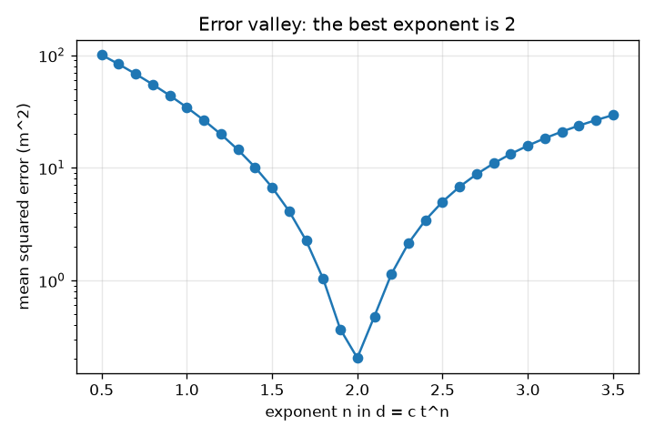
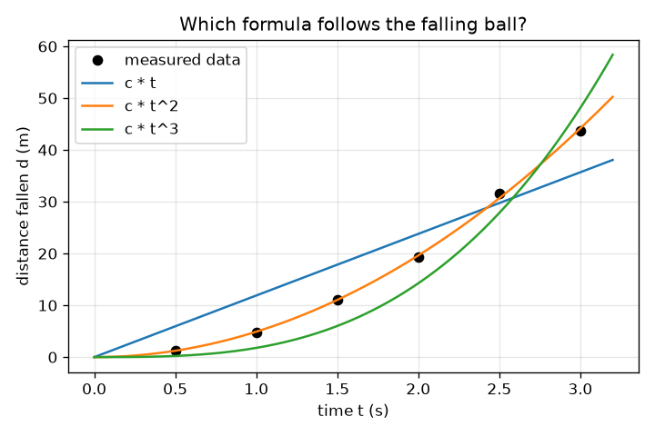

# സെഷൻ 1: ഒരു നിയമം പിന്തുടരുന്ന ഡാറ്റ: ഒരു കമ്പ്യൂട്ടറിന് സൂത്രവാക്യം ഊഹിക്കാനാകുമോ?

[Session 1 — हिन्दी](README.hi.md)

*ലെവൽ 1 (ആശയപരമായ ഇന്ററാക്ടീവ് മോഡൽ) · ഏകദേശം 60 മിനിറ്റ് · opensymbolic*

> ഇത് ലളിതമാക്കിയ ഒരു വിദ്യാഭ്യാസ മോഡൽ (educational model) ആണ്. ഇത് സാധൂകരിക്കപ്പെട്ട ഒരു ഡിസൈൻ ഉപകരണമല്ല; യഥാർത്ഥ നിർമ്മിതികൾ, വൈദ്യുത ഇൻസ്റ്റലേഷനുകൾ, വാഹനങ്ങൾ, വ്യാവസായിക പ്രക്രിയകൾ അല്ലെങ്കിൽ വൈദ്യശാസ്ത്ര തീരുമാനങ്ങൾ എന്നിവയ്ക്ക് ഇത് ഉപയോഗിക്കരുത്.

**മുൻ‌അറിവ് (Prerequisites)**

- സ്കൂൾ ബീജഗണിതം: t^2 പോലുള്ള കൃതികളും സൂത്രവാക്യം എന്ന ആശയവും.
- നിങ്ങൾ PRIMER.md വായിക്കുകയും `python start.py 1` ഒരിക്കൽ റൺ ചെയ്യുകയും ചെയ്തിട്ടുണ്ട്.

**പഠന ലക്ഷ്യങ്ങൾ (Learning objectives).** ഈ സെഷനു ശേഷം നിങ്ങൾക്ക് കഴിയും:

- അളന്ന ഡാറ്റ ഒരു നിയമം പിന്തുടരുന്നു എന്നതിന്റെ അർത്ഥവും അളവുകൾ ഒരിക്കലും അതിനോട് കൃത്യമായി ഒത്തുപോകാത്തതിന്റെ കാരണവും വിശദീകരിക്കാൻ.
- d = c t^n-ലെ അജ്ഞാത സ്ഥിരാങ്കം c-യെ ലീസ്റ്റ് സ്ക്വയേഴ്സ് (least squares) ഉപയോഗിച്ച് ഫിറ്റ് ചെയ്യാൻ.
- ഒരു സ്ഥാനാർത്ഥി സൂത്രവാക്യത്തെ അതിന്റെ ശരാശരി വർഗ്ഗപ്പിശക് (mean squared error) കൊണ്ട് സ്കോർ ചെയ്യാനും സ്ഥാനാർത്ഥികളെ റാങ്ക് ചെയ്യാനും.
- പിശക്-എതിർ-കൃത ഘാതാങ്ക (error-versus-exponent) വക്രം വായിക്കാനും അതിന്റെ ഏറ്റവും താഴ്ന്ന ബിന്ദു നിയമത്തിനുള്ള നല്ല ഊഹമാകുന്നത് എന്തുകൊണ്ടെന്ന് വിശദീകരിക്കാനും.

## A. യഥാർത്ഥ ജീവിതത്തിലെ പ്രശ്നം
ഒരു ഗോപുരത്തിൽ നിന്ന് ഒരു പന്ത് താഴേക്കിടുക, ഓരോ അര സെക്കൻഡിനു ശേഷവും അത് എത്ര ദൂരം വീണു എന്ന് സമയം കണക്കാക്കുക. സംഖ്യകൾ കൂടുതൽ കൂടുതൽ വേഗത്തിൽ ഉയരുന്നു, പക്ഷേ ദൂരം സമയത്തിന് ആനുപാതികമാണോ, അതിന്റെ വർഗ്ഗത്തിനോ, ഘനത്തിനോ? ഗലീലിയോയ്ക്ക് ഒരു സൂത്രവാക്യം ഊഹിച്ച് പരീക്ഷിക്കേണ്ടിവന്നു. ഒരു കമ്പ്യൂട്ടറിന് ഊഹിക്കൽ ചെയ്യാനാകും: പല സ്ഥാനാർത്ഥി സൂത്രവാക്യങ്ങൾ എഴുതുക, ഓരോന്നും ഫിറ്റ് ചെയ്യുക, ഡാറ്റയുമായി ഏറ്റവും നന്നായി ഒത്തുപോകുന്നത് നിലനിർത്തുക. അതാണ് സിംബോളിക് റിഗ്രഷന്റെ (symbolic regression) വിത്ത്, ഒരു വക്രം മാത്രമല്ല ഒരു സമവാക്യം കണ്ടെത്തുന്ന രീതി, രസതന്ത്രത്തിൽ, ഉദാഹരണത്തിന് രാസപ്രവർത്തന നിരക്കുകൾക്ക്, വ്യാഖ്യാനിക്കാവുന്ന നിയമങ്ങൾ തേടാൻ ശാസ്ത്രജ്ഞർ ഇന്ന് ഇത് ഉപയോഗിക്കുന്നു.

## B. ആശയവും സിദ്ധാന്തവും
നിശ്ചലാവസ്ഥയിൽ നിന്നുള്ള സ്വതന്ത്ര പതനം d = (1/2) g t^2 പിന്തുടരുന്നു, ഇവിടെ d വീണ ദൂരം മീറ്ററിലും t സെക്കൻഡിൽ സമയവും g ഗുരുത്വാകർഷണ ത്വരണവും ആണ്, ഭൂമിയിൽ 9.81 m/s^2. യഥാർത്ഥ അളവുകൾക്ക് പിശകുകൾ ഉണ്ട്, അതിനാൽ ഓരോ ദൂരത്തെയും ചെറിയ ഭിന്നക പിശക് e ഉപയോഗിച്ച് (1 + e) കൊണ്ട് ഗുണിച്ച് നമ്മൾ അവയെ മാതൃകയാക്കുന്നു. ഒരു സ്ഥാനാർത്ഥി സൂത്രവാക്യത്തിന്റെ രൂപം d = c t^n ആണ്: ഘാതാങ്കം n തിരച്ചിൽ തിരഞ്ഞെടുക്കുന്നു, സ്ഥിരാങ്കം c ലീസ്റ്റ് സ്ക്വയേഴ്സ് വഴി കണ്ടെത്തുന്നു. ഡാറ്റയും സൂത്രവാക്യവും തമ്മിലുള്ള വ്യത്യാസങ്ങളുടെ വർഗ്ഗങ്ങളുടെ തുക ഏറ്റവും ചെറുതാക്കുമ്പോൾ c = sum(f d) / sum(f f) ലഭിക്കുന്നു, ഇവിടെ f = t^n. സ്കോർ ശരാശരി വർഗ്ഗപ്പിശക് (MSE) ആണ്: വ്യത്യാസങ്ങളുടെ വർഗ്ഗങ്ങളുടെ ശരാശരി, ചതുരശ്ര മീറ്ററിൽ. വിജയിക്കുന്ന ഘാതാങ്കം 2 ആണെങ്കിൽ c = g / 2, അതിനാൽ g = 2c.

| ചിഹ്നം | അർത്ഥം | യൂണിറ്റ് |
|---|---|---|
| d | നിശ്ചലാവസ്ഥയിൽ നിന്ന് വീണ ദൂരം | m |
| t | വിടുവിച്ചതിന് ശേഷമുള്ള സമയം | s |
| g | ഗുരുത്വാകർഷണ ത്വരണം | m/s^2 |
| c | ഒരു സ്ഥാനാർത്ഥി സൂത്രവാക്യത്തിനായി ഫിറ്റ് ചെയ്ത സ്ഥിരാങ്കം | m/s^n |
| n | സ്ഥാനാർത്ഥിയിൽ t-യുടെ ഘാതാങ്കം | യൂണിറ്റ് ഇല്ല |
| MSE | ഒരു സ്ഥാനാർത്ഥിയുടെ ശരാശരി വർഗ്ഗപ്പിശക് | m^2 |
| e | ഒരു ബിന്ദുവിന്റെ ഭിന്നക അളവ് പിശക് | യൂണിറ്റ് ഇല്ല |

**അനുമാനങ്ങൾ (Assumptions)**

- പന്ത് നിശ്ചലാവസ്ഥയിൽ നിന്ന് തുടങ്ങുന്നു, വായു പ്രതിരോധം അവഗണിക്കുന്നു.
- പിശകുകൾ ചെറുതാണ്, ഇവിടെ -3 മുതൽ 3 ശതമാനം വരെ, എല്ലാവർക്കും ഒരേ ഡാറ്റ ലഭിക്കാൻ നമ്മൾ ആറ് സ്ഥിര മൂല്യങ്ങൾ ഉപയോഗിക്കുന്നു.
- ഓരോ സ്ഥാനാർത്ഥിയും c ഗുണം ഒരു ആകൃതി എന്ന രൂപത്തിലാണ്; സൂത്രവാക്യത്തിനുള്ളിൽ സ്ഥിരാങ്കങ്ങൾ നമ്മൾ ഇതുവരെ അനുവദിക്കുന്നില്ല.

$$ d=\tfrac12\,g\,t^2 $$

$$ c=\frac{\sum_i f_i\,d_i}{\sum_i f_i^2},\qquad f_i=t_i^{\,n} $$

$$ \mathrm{MSE}=\frac1N\sum_{i=1}^{N}\big(d_i-c\,t_i^{\,n}\big)^2 $$

$$ d=c\,t^2\ \Rightarrow\ g=2c $$

## C. ദൃശ്യ വിശദീകരണം
ഇടത് ചിത്രം ആറ് അളന്ന ബിന്ദുക്കളും മൂന്ന് സ്ഥാനാർത്ഥി വക്രങ്ങളും കാണിക്കുന്നു: ദൂരം t-ക്ക് ആനുപാതികം (അവസാനം വളരെ പരന്നത്), t-യുടെ ഘനത്തിന് (വളരെ കുത്തനെ), t-യുടെ വർഗ്ഗത്തിന്, അത് ബിന്ദുക്കളുടെ കൂട്ടത്തിലൂടെ കടന്നുപോകുന്നു. വലത് ചിത്രം ഒരു ലോഗ് അക്ഷത്തിൽ ഘാതാങ്കം n-നെതിരെ പിശക് വരയ്ക്കുന്നു: n = 2.0-ൽ ഏറ്റവും താഴ്ന്ന ബിന്ദുവുള്ള ആഴമുള്ള ഒരു താഴ്വര, അവിടെ പിശക് 0.20 m^2 ആണ്, n = 1-ൽ 34.39 m^2, n = 3-ൽ 15.73 m^2. നല്ല സൂത്രവാക്യ തിരച്ചിൽ അത്തരമൊരു താഴ്വരയിലേക്കുള്ള ഇറക്കമാണ്.

*ഘാതാങ്കം n-നെതിരെ പിശക്: താഴ്വര n = 2-ൽ ആണ്.*

*ആറ് അളന്ന ബിന്ദുക്കളും മൂന്ന് സ്ഥാനാർത്ഥി സൂത്രവാക്യങ്ങളും: t-യുടെ വർഗ്ഗം മാത്രം ഡാറ്റയെ പിന്തുടരുന്നു.*

## D. ഇന്ററാക്ടീവ് സിമുലേഷൻ
പാഠം റൺ ചെയ്യുക (`python start.py 1`), എന്നിട്ട് ലൈവ് ആപ്പ് തുറക്കുക: [സെഷൻ 1: വീഴുന്ന പന്തിന്റെ സൂത്രവാക്യം ഊഹിക്കുക](https://krunalpanchal1995.github.io/pan-iit-oss/opensymbolic/session-01/) (അല്ലെങ്കിൽ ഈ ഫോൾഡറിലെ `app.html`). ഒരു ഗുരുത്വാകർഷണവും ഒരു ഘാതാങ്കവും തിരഞ്ഞെടുക്കുക. നിറച്ച പന്തുകളും (അളന്നത്) വളയങ്ങളും (സൂത്രവാക്യം) നിരീക്ഷിക്കുക, പിന്നെ ഗ്രാഫ് കാഴ്ചയിലേക്ക് മാറി ഘാതാങ്കം നീങ്ങുമ്പോൾ പിശക് എങ്ങനെ മാറുന്നു എന്ന് കാണുക.

**വെല്ലുവിളി.** ഗുരുത്വാകർഷണം ചൊവ്വയുടേതായി (3.71 m/s^2) സജ്ജമാക്കി ഏറ്റവും നന്നായി യോജിക്കുന്ന ഘാതാങ്കം തിരഞ്ഞെടുക്കുക.

## E. ഉദാഹരണവും പരീക്ഷണവും
**പ്രശ്നം.** വീഴുന്ന പന്തിന്റെ ആറ് അളന്ന ദൂരങ്ങളിലേക്ക് (സമയങ്ങൾ 0.5, 1, 1.5, 2, 2.5, 3 s) d = c t^2 ഫിറ്റ് ചെയ്ത് g കണക്കാക്കുക.

1. അളന്ന ദൂരങ്ങൾ 1.251, 4.758, 11.147, 19.228, 31.576, 43.704 m ആണ് (യഥാർത്ഥ മൂല്യങ്ങൾ ഗുണം (1 + e)).
2. ആകൃതികൾ f = t^2 എന്നത് 0.25, 1, 2.25, 4, 6.25, 9 ആണ്. അവയുടെ വർഗ്ഗങ്ങളുടെ തുക sum(f f) = 142.1875.
3. ഓരോ ആകൃതിയെയും അതിന്റെ ദൂരം കൊണ്ട് ഗുണിച്ച് കൂട്ടുക: sum(f d) = 697.742.
4. c = 697.742 / 142.1875 = 4.907 m/s^2.
5. ശരാശരി വർഗ്ഗപ്പിശക് 0.205 m^2 ആണ്, g = 2c = 9.81 m/s^2, അറിയപ്പെടുന്ന മൂല്യം.

**ഉത്തരം.** c = 4.907, MSE = 0.205 m^2, g = 9.81 m/s^2.

**പരീക്ഷണം.** 3 മീറ്റർ ഉയരമുള്ള ഒരു ബാൽക്കണിയിൽ നിന്ന് ഒരു പന്ത് (അല്ലെങ്കിൽ ഒരു നാണയം) താഴേക്കിട്ട് ഫോണിൽ സെക്കൻഡിൽ 60 ഫ്രെയിമിൽ ചിത്രീകരിക്കുക; ചിത്ര ഫ്രെയിമിലെ സ്കെയിലിൽ നിന്ന് ഫ്രെയിം ഫ്രെയിമായി ഉയരം വായിക്കുക. മുകളിൽ പറഞ്ഞതുപോലെ d = c t^2 ഫിറ്റ് ചെയ്യുക. g ഏതാനും ശതമാനത്തിനുള്ളിൽ ലഭിക്കും, പക്ഷേ കൃത്യമായി 9.81 അല്ല: ആദ്യ ഫ്രെയിമിന്റെ സമയം അനിശ്ചിതമാണ്, വായു പ്രതിരോധം ചെറുതാണെങ്കിലും പൂജ്യമല്ല, സ്കെയിൽ കണ്ണുകൊണ്ടാണ് വായിക്കുന്നത്. ഇവിടത്തെ മോഡൽ കൃത്യമാണ്, പരീക്ഷണം അങ്ങനെയല്ല.

## F. വിലയിരുത്തലും ഡിസൈൻ വെല്ലുവിളിയും
**ചോദ്യ തരം A: ആശയപരം.** n = 1.9, n = 2.1 എന്നീ രണ്ട് ഘാതാങ്കങ്ങൾ 0.37, 0.48 m^2 പിശകുകൾ നൽകുന്നു, n = 2-ന്റെ 0.20 m^2-ന് അടുത്ത്. n കൃത്യമായി 2 ആണെന്ന് ഡാറ്റയ്ക്ക് തെളിയിക്കാനാകുമോ?

സൂചന

3 ശതമാനം വരെയുള്ള അളവ് പിശകുകളെക്കുറിച്ച് ചിന്തിക്കുക.

ഘട്ടം ഘട്ടമായുള്ള പരിഹാരം

ഇല്ല. n 2-ന് അടുത്താണെന്നും n = 1 അല്ലെങ്കിൽ n = 3 വളരെ മോശമാണെന്നും ഡാറ്റ കാണിക്കുന്നു, പക്ഷേ ഏതാനും ശതമാനം പിശകുകൾ ഉള്ളപ്പോൾ അടുത്തുള്ള ഘാതാങ്കങ്ങളായ 1.9, 2.1 എന്നിവ ഏകദേശം ഇരട്ടി മോശം മാത്രമാണ്. ശബ്ദത്തിനുള്ളിൽ യോജിക്കുന്ന ഏറ്റവും ലളിതമായ സൂത്രവാക്യമായതിനാലും ഒരു ഭൗതിക കാരണം ഉള്ളതിനാലും (ഇവിടെ സ്ഥിര ത്വരണത്തിൽ നിന്ന് d = (1/2) g t^2) ആണ് ഒരു നിയമം തിരഞ്ഞെടുക്കുന്നത്, പിശക് കൃത്യമായി പൂജ്യമായതുകൊണ്ടല്ല.

**ചോദ്യ തരം B: സംഖ്യാപരം.** d = c f ഉപയോഗിച്ച് ആകൃതി f = (1, 2) ഡാറ്റ d = (3, 5)-ലേക്ക് ഫിറ്റ് ചെയ്തിരിക്കുന്നു. c-യും MSE-യും കൈകൊണ്ട് കണ്ടെത്തുക.

സൂചന

c = sum(f d) / sum(f f) ഉപയോഗിക്കുക, പിന്നെ വ്യത്യാസങ്ങളുടെ വർഗ്ഗങ്ങളുടെ ശരാശരി എടുക്കുക.

ഘട്ടം ഘട്ടമായുള്ള പരിഹാരം

sum(f d) = 1*3 + 2*5 = 13, sum(f f) = 1 + 4 = 5, അതിനാൽ c = 13/5 = 2.6. സൂത്രവാക്യം (2.6, 5.2) നൽകുന്നു, അതിനാൽ വ്യത്യാസങ്ങൾ 0.4, -0.2, MSE = (0.16 + 0.04) / 2 = 0.1. യൂണിറ്റുകൾ: d-യുടെ യൂണിറ്റിന്റെ വർഗ്ഗം.

**ചോദ്യ തരം C: ഗ്രാഫും സിമുലേഷനും വ്യാഖ്യാനിക്കൽ.** പിശക്-എതിർ-ഘാതാങ്ക വക്രത്തിൽ n = 1-ൽ പിശക് 34.39 m^2, n = 3-ൽ 15.73 m^2 ആണ്. ഏത് തെറ്റായ ഊഹമാണ് കൂടുതൽ മോശം, ഏറ്റവും കുറഞ്ഞത് എവിടെയാണ്?

സൂചന

n = 1, n = 3 എന്നിവയിലെ വക്രത്തിന്റെ ഉയരങ്ങൾ താരതമ്യം ചെയ്ത് ഏറ്റവും താഴ്ന്ന ബിന്ദു കണ്ടെത്തുക.

ഘട്ടം ഘട്ടമായുള്ള പരിഹാരം

ഏറ്റവും കുറഞ്ഞത് n = 2.0-ൽ, പിശക് 0.20 m^2. ഇവിടെ ഘാതാങ്കം 1, ഘാതാങ്കം 3-നേക്കാൾ മോശമാണ് (34.39, 15.73 m^2). സമയങ്ങൾ 0.5-നും 3 s-നും ഇടയിലായതിനാൽ താഴ്വര സമമിതമല്ല, ആ പരിധിയിൽ ഒരു നേർരേഖയേക്കാൾ t^3 വക്രം t^2-നോട് അടുത്താണ്.

**ചോദ്യ തരം D: ഡിസൈനും ഒപ്റ്റിമൈസേഷൻ (optimisation) വെല്ലുവിളിയും.** ഡിസൈൻ: ഏകദേശം 0.1 s കൃത്യതയുള്ള ഒരു സ്റ്റോപ്പ് വാച്ച് ഉപയോഗിച്ച് നാല് വീഴ്ചകൾ മാത്രമേ നിങ്ങൾക്ക് സമയം കണക്കാക്കാനാകൂ. വീഴ്ച സമയങ്ങൾ (അല്ലെങ്കിൽ ഉയരങ്ങൾ) തിരഞ്ഞെടുക്കുക, n = 1.5, 2, 3 എന്നിവയിൽ നിങ്ങൾ എങ്ങനെ തീരുമാനിക്കും എന്നും നിങ്ങളുടെ തീരുമാനം കൂടുതൽ വിശ്വസനീയമാക്കുന്നത് എന്തെന്നും പറയുക.

സൂചന

സമയങ്ങൾ വിശാലമായി വിതറുക, അളവുകൾ ആവർത്തിക്കുക; ദൂരത്തിന്റെ പിശക് സമയത്തിന്റെ പിശകിനെ ആശ്രയിക്കുന്നു എന്ന് ഓർക്കുക.

ഘട്ടം ഘട്ടമായുള്ള പരിഹാരം

മുഴുവൻ പരിധിയിലും വിതറിയ സമയങ്ങൾ ഉപയോഗിക്കുക, ഉദാഹരണത്തിന് 0.5 മുതൽ 3 s വരെ, കാരണം സ്ഥാനാർത്ഥികൾ വലിയ t-യിൽ മാത്രമേ വ്യക്തമായി വ്യത്യാസപ്പെടുന്നുള്ളൂ. സമയ പിശക് കുറയ്ക്കാൻ ഓരോ വീഴ്ചയും പലതവണ ആവർത്തിച്ച് ശരാശരി എടുക്കുക. എല്ലാ സ്ഥാനാർത്ഥികളെയും ഫിറ്റ് ചെയ്ത് MSE താരതമ്യം ചെയ്യുക; ശബ്ദത്തിനുള്ളിൽ ഏറ്റവും ലളിതമായ സ്ഥാനാർത്ഥിയെ തിരഞ്ഞെടുക്കുക. മറ്റൊരു പരിമിതി: നീണ്ട വീഴ്ചകൾക്ക് ഉയരമുള്ള ഗോപുരം വേണം, വേഗതയോടൊപ്പം വായു പ്രതിരോധം കൂടുന്നു. ട്രേഡ്-ഓഫ് (trade-off) എന്നത് പരിധി (കൂടുതൽ വേർതിരിക്കൽ ശേഷി) എതിരെ പ്രായോഗികതയും പ്രതിരോധവുമാണ്.

[RUBRIC.md](../../RUBRIC.md) ഉപയോഗിച്ച് സ്വയം സ്കോർ ചെയ്യുക. പേപ്പറിൽ ചെയ്യാൻ [ആക്ടിവിറ്റി ഷീറ്റ്](activity_sheet.md) പ്രിന്റ് ചെയ്യുക.

## സാധാരണ തെറ്റിദ്ധാരണകൾ
| സാധാരണ തെറ്റിദ്ധാരണ | യഥാർത്ഥത്തിൽ ശരിയായത് |
|---|---|
| ഡാറ്റയ്ക്ക് യോജിക്കുന്ന സൂത്രവാക്യം യഥാർത്ഥ നിയമമായിരിക്കണം. | ശബ്ദമുള്ള ഡാറ്റയ്ക്ക് പല സൂത്രവാക്യങ്ങളും ഏകദേശം ഒരുപോലെ യോജിക്കുന്നു; പിശകിനൊപ്പം ലാളിത്യവും ഭൗതിക കാരണങ്ങളും ഉപയോഗിച്ച് നമ്മൾ അവയിൽ നിന്ന് തിരഞ്ഞെടുക്കുന്നു. |
| പിശക് പൂജ്യമാണെങ്കിൽ സൂത്രവാക്യം പൂർണ്ണമാണ്. | യഥാർത്ഥ ഡാറ്റയിൽ ശബ്ദമുണ്ട്, അതിനാൽ പരിശീലന ഡാറ്റയിൽ കൃത്യമായി പൂജ്യം പിശകുള്ള സൂത്രവാക്യം സാധാരണയായി ശബ്ദത്തിനും യോജിക്കുന്നു. |
| സ്ഥിരാങ്കം c വെറുതെ ഊഹിക്കേണ്ട ഒരു സംഖ്യയാണ്. | d = c f(t)-യ്ക്ക് ഏറ്റവും നല്ല c-ക്ക് കൃത്യമായ സൂത്രവാക്യമുണ്ട്, അതിനാൽ ഊഹിക്കേണ്ടതില്ല. |
| ഭാരമുള്ള പന്തുകൾ വേഗത്തിൽ വീഴുന്നു, അതിനാൽ നിയമത്തിൽ പിണ്ഡം ഉണ്ടായിരിക്കണം. | ഈ മോഡലിൽ ദൂരം പിണ്ഡത്തെ ആശ്രയിക്കുന്നില്ല, കാരണം ഗുരുത്വാകർഷണ വലിവും പന്തിന്റെ ജഡത്വവും പരസ്പരം റദ്ദാക്കുന്നു. നമ്മൾ അവഗണിക്കുന്ന വായു പ്രതിരോധമാണ് തൂവൽ മന്ദഗതിയിലാകാൻ കാരണം. |

## പദാവലി (Glossary)
- **സിംബോളിക് റിഗ്രഷൻ (symbolic regression)**: ഒരു വക്രം മാത്രമല്ല, ഡാറ്റയെ വിശദീകരിക്കുന്ന ഒരു സൂത്രവാക്യം (സമവാക്യം) തിരയുന്നത്
- **സ്ഥാനാർത്ഥി സൂത്രവാക്യം (candidate formula)**: നമ്മൾ സ്കോർ കണക്കാക്കുന്ന ഒരു സാധ്യമായ സൂത്രവാക്യം
- **ലീസ്റ്റ് സ്ക്വയേഴ്സ് (least squares)**: വ്യത്യാസങ്ങളുടെ വർഗ്ഗങ്ങളുടെ തുക കഴിയുന്നത്ര ചെറുതാകുന്ന രീതിയിൽ സ്ഥിരാങ്കങ്ങൾ തിരഞ്ഞെടുക്കൽ
- **ശരാശരി വർഗ്ഗപ്പിശക് (mean squared error, MSE)**: ഡാറ്റയും സൂത്രവാക്യവും തമ്മിലുള്ള വ്യത്യാസങ്ങളുടെ വർഗ്ഗങ്ങളുടെ ശരാശരി
- **ഘാതാങ്കം (exponent)**: t^n-ലെ ഉയർത്തി എഴുതിയ ചെറിയ സംഖ്യ n

## പൂർത്തിയാക്കുക
1. [exercises.md](exercises.md)-ലെ മൂന്ന് കോഡിംഗ് ടാസ്കുകൾ ചെയ്യുക.
2. മാറ്റങ്ങൾക്കു ശേഷം `python start.py 1` വീണ്ടും റൺ ചെയ്യുക. അത് ചെക്ക്‌പോയിന്റോടെ (checkpoint) അവസാനിക്കുന്നു; അത് `PASS` എന്ന് പ്രിന്റ് ചെയ്യുമ്പോൾ നിങ്ങൾ പൂർത്തിയാക്കി. (ചെക്ക്‌പോയിന്റ് മാത്രം: `python start.py check 1`.)

അടുത്തത്: [സെഷൻ 2](../session-02/README.md)
