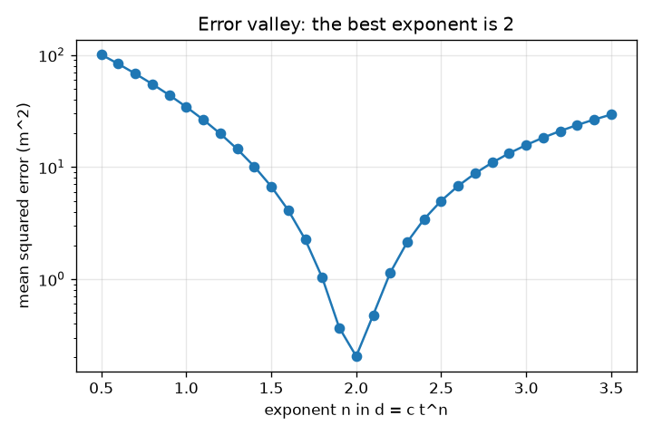
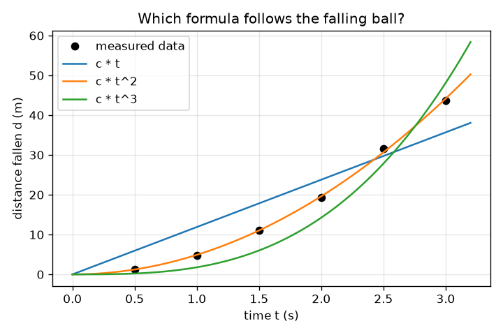

# அமர்வு 1: ஒரு விதியைப் பின்பற்றும் தரவு: கணினி சூத்திரத்தை ஊகிக்க முடியுமா?

[Session 1 — हिन्दी](README.hi.md)

*நிலை 1 (கருத்தியல் ஊடாடும் மாதிரி) · சுமார் 60 நிமிடங்கள் · opensymbolic*

> இது எளிமைப்படுத்தப்பட்ட ஒரு கல்வி மாதிரி (educational model). இது சரிபார்க்கப்பட்ட வடிவமைப்புக் கருவி அல்ல; உண்மையான கட்டமைப்புகள், மின் நிறுவல்கள், வாகனங்கள், தொழில்துறை செயல்முறைகள் அல்லது மருத்துவ முடிவுகளுக்கு இதைப் பயன்படுத்தக் கூடாது.

**முன்தேவைகள் (Prerequisites)**

- பள்ளி இயற்கணிதம்: t^2 போன்ற அடுக்குகளும் சூத்திரம் என்ற கருத்தும்.
- நீங்கள் PRIMER.md படித்து `python start.py 1` ஒருமுறை இயக்கியிருக்கிறீர்கள்.

**கற்றல் நோக்கங்கள் (Learning objectives).** இந்த அமர்வுக்குப் பிறகு உங்களால் முடியும்:

- அளக்கப்பட்ட தரவு ஒரு விதியைப் பின்பற்றுவது என்றால் என்ன, அளவீடுகள் அதனுடன் ஏன் ஒருபோதும் துல்லியமாகப் பொருந்துவதில்லை என்று விளக்க.
- d = c t^n இல் உள்ள ஒரே தெரியாத மாறிலி c-ஐ மீச்சிறு வர்க்கங்களால் (least squares) பொருத்த.
- ஒரு வேட்பாளர் சூத்திரத்தை அதன் சராசரி வர்க்கப் பிழையால் (mean squared error) மதிப்பிட்டு வேட்பாளர்களை வரிசைப்படுத்த.
- பிழை-எதிர்-அடுக்குக் (error-versus-exponent) வளைவைப் படித்து, அதன் மிகத் தாழ்ந்த புள்ளி விதிக்கு நல்ல ஊகமாக ஏன் உள்ளது என்று விளக்க.

## A. நிஜ உலகப் பிரச்சினை
ஒரு கோபுரத்திலிருந்து ஒரு பந்தை விடுங்கள், ஒவ்வொரு அரை வினாடிக்குப் பிறகும் அது எவ்வளவு தூரம் விழுந்தது என்று நேரம் அளவிடுங்கள். எண்கள் மேலும் மேலும் வேகமாக உயர்கின்றன, ஆனால் தூரம் நேரத்துக்கு விகிதசமமா, அதன் வர்க்கத்துக்கா, கனத்துக்கா? கலிலியோ ஒரு சூத்திரத்தை ஊகித்துச் சோதிக்க வேண்டியிருந்தது. ஊகிக்கும் வேலையைக் கணினி செய்யலாம்: பல வேட்பாளர் சூத்திரங்களை எழுதி, ஒவ்வொன்றையும் பொருத்தி, தரவுடன் சிறப்பாகப் பொருந்துவதை வைத்துக்கொள்ளலாம். அதுவே குறியீட்டுப் பின்னடைவின் (symbolic regression) விதை, வெறும் வளைவை அல்லாமல் ஒரு சமன்பாட்டைக் கண்டுபிடிக்கும் முறை, வேதியியலில், எடுத்துக்காட்டாக வினை வீதங்களுக்கு, விளக்கக்கூடிய விதிகளைத் தேட விஞ்ஞானிகள் இன்று இதைப் பயன்படுத்துகின்றனர்.

## B. கருத்தும் கோட்பாடும்
ஓய்விலிருந்து தடையற்ற வீழ்ச்சி d = (1/2) g t^2 ஐப் பின்பற்றுகிறது, இங்கு d மீட்டரில் விழுந்த தூரம், t வினாடியில் நேரம், g புவிஈர்ப்பு முடுக்கம், பூமியில் 9.81 m/s^2. உண்மையான அளவீடுகளில் பிழைகள் உண்டு, எனவே ஒவ்வொரு தூரத்தையும் சிறிய பின்னப் பிழை e கொண்டு (1 + e) ஆல் பெருக்கி அவற்றை மாதிரியாக்குகிறோம். ஒரு வேட்பாளர் சூத்திரத்தின் வடிவம் d = c t^n: அடுக்கு n தேடலால் தேர்ந்தெடுக்கப்படுகிறது, மாறிலி c மீச்சிறு வர்க்கங்களால் கண்டறியப்படுகிறது. தரவுக்கும் சூத்திரத்துக்கும் இடையிலான வேறுபாடுகளின் வர்க்கங்களின் கூட்டலைச் சிறிதாக்கும்போது c = sum(f d) / sum(f f) கிடைக்கிறது, இங்கு f = t^n. மதிப்பெண் சராசரி வர்க்கப் பிழை (MSE): வேறுபாடுகளின் வர்க்கங்களின் சராசரி, சதுர மீட்டரில். வெற்றி பெறும் அடுக்கு 2 எனில் c = g / 2, எனவே g = 2c.

| குறியீடு | பொருள் | அலகு |
|---|---|---|
| d | ஓய்விலிருந்து விழுந்த தூரம் | m |
| t | விடுவித்ததிலிருந்து நேரம் | s |
| g | புவிஈர்ப்பு முடுக்கம் | m/s^2 |
| c | ஒரு வேட்பாளர் சூத்திரத்துக்காகப் பொருத்தப்பட்ட மாறிலி | m/s^n |
| n | வேட்பாளரில் t-இன் அடுக்கு | அலகு இல்லை |
| MSE | ஒரு வேட்பாளரின் சராசரி வர்க்கப் பிழை | m^2 |
| e | ஒரு புள்ளியின் பின்ன அளவீட்டுப் பிழை | அலகு இல்லை |

**அனுமானங்கள் (Assumptions)**

- பந்து ஓய்விலிருந்து தொடங்குகிறது, காற்றுத் தடை புறக்கணிக்கப்படுகிறது.
- பிழைகள் சிறியவை, இங்கு -3 முதல் 3 சதவீதம் வரை, எல்லோருக்கும் ஒரே தரவு கிடைக்க ஆறு நிலையான மதிப்புகளைப் பயன்படுத்துகிறோம்.
- ஒவ்வொரு வேட்பாளரும் c பெருக்கல் ஒரு வடிவம் என்ற வடிவில் உள்ளது; சூத்திரத்துக்குள் மாறிலிகளை நாம் இன்னும் அனுமதிக்கவில்லை.

$$ d=\tfrac12\,g\,t^2 $$

$$ c=\frac{\sum_i f_i\,d_i}{\sum_i f_i^2},\qquad f_i=t_i^{\,n} $$

$$ \mathrm{MSE}=\frac1N\sum_{i=1}^{N}\big(d_i-c\,t_i^{\,n}\big)^2 $$

$$ d=c\,t^2\ \Rightarrow\ g=2c $$

## C. காட்சி விளக்கம்
இடப்பக்கப் படம் ஆறு அளக்கப்பட்ட புள்ளிகளையும் மூன்று வேட்பாளர் வளைவுகளையும் காட்டுகிறது: தூரம் t-க்கு விகிதசமம் (இறுதியில் மிகத் தட்டை), t-இன் கனத்துக்கு (மிகச் செங்குத்து), t-இன் வர்க்கத்துக்கு, அது புள்ளிக் கூட்டத்தின் வழியாகச் செல்கிறது. வலப்பக்கப் படம் ஒரு மடக்கை அச்சில் அடுக்கு n-க்கு எதிராகப் பிழையை வரைகிறது: n = 2.0 இல் மிகத் தாழ்ந்த புள்ளியுடன் ஆழமான பள்ளத்தாக்கு, அங்கு பிழை 0.20 m^2, n = 1 இல் 34.39 m^2, n = 3 இல் 15.73 m^2. நல்ல சூத்திரத் தேடல் அத்தகைய பள்ளத்தாக்கில் இறங்குவதாகும்.

*அடுக்கு n-க்கு எதிரான பிழை: பள்ளத்தாக்கு n = 2 இல் உள்ளது.*

*ஆறு அளக்கப்பட்ட புள்ளிகளும் மூன்று வேட்பாளர் சூத்திரங்களும்: t-இன் வர்க்கம் மட்டுமே தரவைப் பின்பற்றுகிறது.*

## D. ஊடாடும் உருவகப்படுத்தல் (Interactive simulation)
பாடத்தை இயக்குங்கள் (`python start.py 1`), பிறகு நேரடிச் செயலியைத் திறக்கவும்: [அமர்வு 1: விழும் பந்தின் சூத்திரத்தை ஊகியுங்கள்](https://krunalpanchal1995.github.io/pan-iit-oss/opensymbolic/session-01/) (அல்லது இந்தக் கோப்புறையில் உள்ள `app.html`). ஒரு ஈர்ப்பையும் ஒரு அடுக்கையும் தேர்ந்தெடுங்கள். நிரப்பப்பட்ட பந்துகளையும் (அளக்கப்பட்டது) வளையங்களையும் (சூத்திரம்) கவனியுங்கள், பிறகு வரைபடக் காட்சிக்கு மாறி அடுக்கு நகரும்போது பிழை எப்படி மாறுகிறது என்று பாருங்கள்.

**சவால்.** ஈர்ப்பைச் செவ்வாய்க்கு (3.71 m/s^2) அமைத்து, சிறப்பாகப் பொருந்தும் அடுக்கைத் தேர்ந்தெடுங்கள்.

## E. தீர்க்கப்பட்ட எடுத்துக்காட்டும் சோதனையும்
**கணக்கு.** விழும் பந்தின் ஆறு அளக்கப்பட்ட தூரங்களுக்கு (நேரங்கள் 0.5, 1, 1.5, 2, 2.5, 3 s) d = c t^2 ஐப் பொருத்தி g-ஐ மதிப்பிடுங்கள்.

1. அளக்கப்பட்ட தூரங்கள் 1.251, 4.758, 11.147, 19.228, 31.576, 43.704 m (உண்மை மதிப்புகள் பெருக்கல் (1 + e)).
2. வடிவங்கள் f = t^2 என்பவை 0.25, 1, 2.25, 4, 6.25, 9. அவற்றின் வர்க்கங்களின் கூட்டல் sum(f f) = 142.1875.
3. ஒவ்வொரு வடிவத்தையும் அதன் தூரத்தால் பெருக்கிக் கூட்டுங்கள்: sum(f d) = 697.742.
4. c = 697.742 / 142.1875 = 4.907 m/s^2.
5. சராசரி வர்க்கப் பிழை 0.205 m^2, மேலும் g = 2c = 9.81 m/s^2, அறியப்பட்ட மதிப்பு.

**விடை.** c = 4.907, MSE = 0.205 m^2, g = 9.81 m/s^2.

**சோதனை.** 3 மீ உயர மாடியிலிருந்து ஒரு பந்தை (அல்லது நாணயத்தை) விட்டு, போனில் வினாடிக்கு 60 சட்டங்களில் படம்பிடியுங்கள்; படச் சட்டத்தில் உள்ள அளவுகோலிலிருந்து சட்டம் சட்டமாக உயரத்தைப் படியுங்கள். மேலே கூறியபடி d = c t^2 ஐப் பொருத்துங்கள். g சில சதவீதத்துக்குள் கிடைக்கும், ஆனால் சரியாக 9.81 அல்ல: முதல் சட்டத்தின் நேரம் நிச்சயமற்றது, காற்றுத் தடை சிறியது ஆனால் பூஜ்ஜியம் அல்ல, அளவுகோல் கண்ணால் படிக்கப்படுகிறது. இங்குள்ள மாதிரி துல்லியமானது, சோதனை அப்படி அல்ல.

## F. மதிப்பீடும் வடிவமைப்புச் சவாலும்
**கேள்வி வகை A: கருத்தியல்.** n = 1.9, n = 2.1 ஆகிய இரண்டு அடுக்குகள் 0.37, 0.48 m^2 பிழைகளைத் தருகின்றன, n = 2-இன் 0.20 m^2-க்கு அருகில். n சரியாக 2 என்று தரவு நிரூபிக்க முடியுமா?

குறிப்பு

3 சதவீதம் வரையிலான அளவீட்டுப் பிழைகளைப் பற்றி யோசியுங்கள்.

படிப்படியான தீர்வு

இல்லை. n 2-க்கு அருகில் உள்ளது என்றும் n = 1 அல்லது n = 3 மிக மோசமானவை என்றும் தரவு காட்டுகிறது, ஆனால் சில சதவீதப் பிழைகள் இருக்கும்போது அருகிலுள்ள அடுக்குகள் 1.9, 2.1 இரண்டு மடங்கு மோசமானவை மட்டுமே. இரைச்சலுக்குள் பொருந்தும் எளிமையான சூத்திரம் என்பதாலும் இயற்பியல் காரணம் உள்ளதாலும் (இங்கு மாறா முடுக்கத்திலிருந்து d = (1/2) g t^2) ஒரு விதி தேர்ந்தெடுக்கப்படுகிறது, பிழை சரியாக பூஜ்ஜியம் என்பதால் அல்ல.

**கேள்வி வகை B: எண்ணியல்.** d = c f உடன் வடிவம் f = (1, 2) தரவு d = (3, 5)-க்குப் பொருத்தப்படுகிறது. c-ஐயும் MSE-ஐயும் கையால் கண்டறியுங்கள்.

குறிப்பு

c = sum(f d) / sum(f f) பயன்படுத்தி, பிறகு வேறுபாடுகளின் வர்க்கங்களின் சராசரியை எடுங்கள்.

படிப்படியான தீர்வு

sum(f d) = 1*3 + 2*5 = 13, sum(f f) = 1 + 4 = 5, எனவே c = 13/5 = 2.6. சூத்திரம் (2.6, 5.2) தருகிறது, எனவே வேறுபாடுகள் 0.4 மற்றும் -0.2, MSE = (0.16 + 0.04) / 2 = 0.1. அலகுகள்: d-இன் அலகின் வர்க்கம்.

**கேள்வி வகை C: வரைபடம் மற்றும் உருவகப்படுத்தல் விளக்கம்.** பிழை-எதிர்-அடுக்கு வளைவில், n = 1 இல் பிழை 34.39 m^2, n = 3 இல் 15.73 m^2. எந்தத் தவறான ஊகம் மோசமானது, குறைந்தபட்சம் எங்கே?

குறிப்பு

n = 1, n = 3 இல் வளைவின் உயரங்களை ஒப்பிட்டு மிகத் தாழ்ந்த புள்ளியைக் கண்டறியுங்கள்.

படிப்படியான தீர்வு

குறைந்தபட்சம் n = 2.0 இல், பிழை 0.20 m^2. இங்கு அடுக்கு 1, அடுக்கு 3-ஐவிட மோசமானது (34.39, 15.73 m^2). நேரங்கள் 0.5 முதல் 3 s வரை இருப்பதால் பள்ளத்தாக்கு சமச்சீர் அல்ல, அந்த வரம்பில் ஒரு நேர்கோட்டைவிட t^3 வளைவு t^2-க்கு நெருக்கமானது.

**கேள்வி வகை D: வடிவமைப்பு மற்றும் உகப்பாக்கம் (optimisation) சவால்.** வடிவமைப்பு: சுமார் 0.1 s துல்லியம் கொண்ட ஸ்டாப்வாட்ச் மூலம் நான்கு வீழ்ச்சிகளை மட்டுமே நீங்கள் நேரம் அளக்க முடியும். வீழ்ச்சி நேரங்களை (அல்லது உயரங்களை) தேர்ந்தெடுத்து, n = 1.5, 2, 3 ஆகியவற்றுக்கிடையே எப்படி முடிவு செய்வீர்கள், உங்கள் முடிவை மேலும் நம்பகமாக்குவது எது என்று கூறுங்கள்.

குறிப்பு

நேரங்களை அகலமாகப் பரப்புங்கள், அளவீடுகளைத் திரும்பச் செய்யுங்கள்; தூரப் பிழை நேரப் பிழையைச் சார்ந்தது என்பதை நினைவில் கொள்ளுங்கள்.

படிப்படியான தீர்வு

முழு வரம்பிலும் பரப்பிய நேரங்களைப் பயன்படுத்துங்கள், எடுத்துக்காட்டாக 0.5 முதல் 3 s வரை, ஏனெனில் வேட்பாளர்கள் பெரிய t-இல் மட்டுமே தெளிவாக வேறுபடுகின்றனர். நேரப் பிழையைக் குறைக்க ஒவ்வொரு வீழ்ச்சியையும் பலமுறை செய்து சராசரி எடுங்கள். எல்லா வேட்பாளர்களையும் பொருத்தி MSE-ஐ ஒப்பிடுங்கள்; இரைச்சலுக்குள் எளிமையான வேட்பாளரை விரும்புங்கள். மற்றொரு கட்டுப்பாடு: நீண்ட வீழ்ச்சிகளுக்கு உயரமான கோபுரம் வேண்டும், வேகத்துடன் காற்றுத் தடை கூடுகிறது. பரிமாற்றம் (trade-off) என்பது வரம்பு (அதிக வேறுபடுத்தும் திறன்) எதிர் நடைமுறைச் சாத்தியமும் தடையும்.

[RUBRIC.md](../../RUBRIC.md) கொண்டு உங்களை மதிப்பிடுங்கள். தாளில் செய்ய [செயல்பாட்டுத் தாள்](activity_sheet.md)-ஐ அச்சிடுங்கள்.

## பொதுவான தவறான கருத்துகள்
| பொதுவான தவறான கருத்து | உண்மையில் சரியானது |
|---|---|
| தரவுக்குப் பொருந்தும் சூத்திரம் உண்மையான விதியாகவே இருக்க வேண்டும். | இரைச்சலுள்ள தரவுக்குப் பல சூத்திரங்களும் கிட்டத்தட்ட சமமாகப் பொருந்துகின்றன; பிழையுடன் எளிமை, இயற்பியல் காரணங்களைக் கொண்டும் அவற்றிலிருந்து தேர்ந்தெடுக்கிறோம். |
| பூஜ்ஜியப் பிழை என்றால் சூத்திரம் சரியானது. | உண்மைத் தரவில் இரைச்சல் உண்டு, எனவே பயிற்சித் தரவில் சரியாக பூஜ்ஜியப் பிழை கொண்ட சூத்திரம் பொதுவாக இரைச்சலுக்கும் பொருந்தியிருக்கும். |
| மாறிலி c ஊகிக்க வேண்டிய ஒரு எண் மட்டுமே. | d = c f(t)-க்குச் சிறந்த c-க்குத் துல்லியமான சூத்திரம் உள்ளது, எனவே ஊகிக்க வேண்டியதில்லை. |
| கனமான பந்துகள் வேகமாக விழுகின்றன, எனவே விதியில் நிறை இருக்க வேண்டும். | இந்த மாதிரியில் தூரம் நிறையைச் சார்ந்ததல்ல, ஏனெனில் ஈர்ப்பின் இழுவையும் பந்தின் நிலைமமும் ஒன்றையொன்று ரத்து செய்கின்றன. நாம் புறக்கணிக்கும் காற்றுத் தடையே இறகு மெதுவாக விழக் காரணம். |

## சொற்களஞ்சியம் (Glossary)
- **குறியீட்டுப் பின்னடைவு (symbolic regression)**: வெறும் வளைவை அல்லாமல், தரவை விளக்கும் ஒரு சூத்திரத்தை (சமன்பாட்டை) தேடுதல்
- **வேட்பாளர் சூத்திரம் (candidate formula)**: நாம் மதிப்பெண் கணக்கிடும் ஒரு சாத்தியமான சூத்திரம்
- **மீச்சிறு வர்க்கங்கள் (least squares)**: வேறுபாடுகளின் வர்க்கங்களின் கூட்டல் முடிந்தவரை சிறிதாக இருக்கும்படி மாறிலிகளைத் தேர்ந்தெடுத்தல்
- **சராசரி வர்க்கப் பிழை (mean squared error, MSE)**: தரவுக்கும் சூத்திரத்துக்கும் இடையிலான வேறுபாடுகளின் வர்க்கங்களின் சராசரி
- **அடுக்கு (exponent)**: t^n இல் உயர்த்தி எழுதப்படும் சிறிய எண் n

## முடிவு
1. [exercises.md](exercises.md)-இல் உள்ள மூன்று நிரலாக்கப் பணிகளைச் செய்யுங்கள்.
2. உங்கள் மாற்றங்களுக்குப் பிறகு `python start.py 1` மீண்டும் இயக்குங்கள். அது சோதனைச் சாவடியுடன் (checkpoint) முடிகிறது; அது `PASS` என்று அச்சிடும்போது நீங்கள் முடித்துவிட்டீர்கள். (சோதனைச் சாவடி மட்டும்: `python start.py check 1`.)

அடுத்து: [அமர்வு 2](../session-02/README.md)
