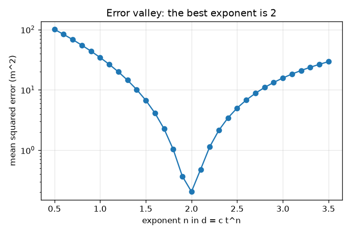
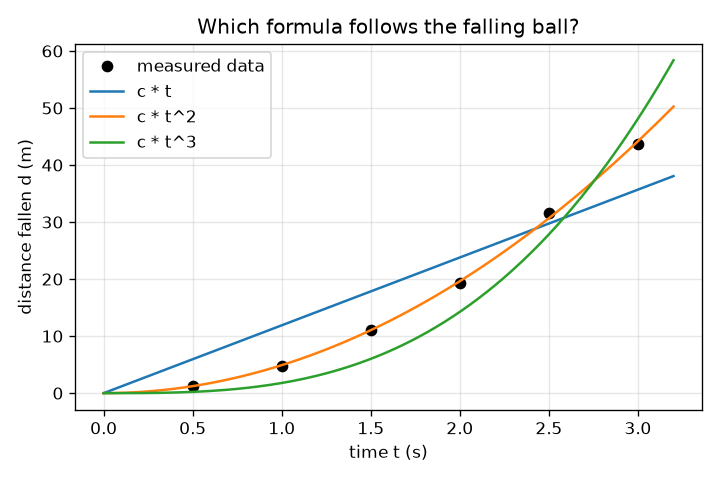

# సెషన్ 1: ఒక నియమాన్ని అనుసరించే డేటా: కంప్యూటర్ సూత్రాన్ని ఊహించగలదా?

[Session 1 — हिन्दी](README.hi.md)

*స్థాయి 1 (భావనాత్మక ఇంటరాక్టివ్ నమూనా) · సుమారు 60 నిమిషాలు · opensymbolic*

> ఇది సరళీకరించిన ఒక విద్యా నమూనా (educational model). ఇది ధృవీకరించబడిన డిజైన్ సాధనం కాదు; నిజమైన నిర్మాణాలు, విద్యుత్ ఇన్‌స్టాలేషన్‌లు, వాహనాలు, పారిశ్రామిక ప్రక్రియలు లేదా వైద్య నిర్ణయాల కోసం దీనిని ఉపయోగించకూడదు.

**ముందస్తు జ్ఞానం (Prerequisites)**

- పాఠశాల బీజగణితం: t^2 వంటి ఘాతాలు మరియు సూత్రం అనే భావన.
- మీరు PRIMER.md చదివి `python start.py 1` ఒకసారి రన్ చేశారు.

**అభ్యాస లక్ష్యాలు (Learning objectives).** ఈ సెషన్ తర్వాత మీరు చేయగలరు:

- కొలిచిన డేటా ఒక నియమాన్ని అనుసరించడం అంటే ఏమిటో, కొలతలు దానితో ఎప్పుడూ ఖచ్చితంగా ఎందుకు సరిపోవో వివరించడం.
- d = c t^n లోని ఒకే తెలియని స్థిరాంకం c ను కనిష్ఠ వర్గాల (least squares) ద్వారా ఫిట్ చేయడం.
- అభ్యర్థి సూత్రాన్ని దాని సగటు వర్గ దోషం (mean squared error) తో స్కోర్ చేసి అభ్యర్థులను ర్యాంక్ చేయడం.
- దోషం-వర్సెస్-ఘాతాంక (error-versus-exponent) వక్రాన్ని చదివి, దాని అత్యల్ప బిందువు నియమానికి మంచి ఊహ ఎందుకో వివరించడం.

## A. వాస్తవ ప్రపంచ సమస్య
ఒక టవర్ నుండి బంతిని వదిలి, ప్రతి అర సెకనుకు అది ఎంత దూరం పడిందో సమయం కొలవండి. సంఖ్యలు మరింత వేగంగా పెరుగుతాయి, కానీ దూరం సమయానికి అనులోమానుపాతమా, దాని వర్గానికా, ఘనానికా? గెలీలియో ఒక సూత్రాన్ని ఊహించి పరీక్షించాల్సి వచ్చింది. ఊహించే పనిని కంప్యూటర్ చేయగలదు: అనేక అభ్యర్థి సూత్రాలు రాసి, ప్రతిదాన్ని ఫిట్ చేసి, డేటాకు బాగా సరిపోయేదాన్ని ఉంచుకోవచ్చు. అదే సింబాలిక్ రిగ్రెషన్ (symbolic regression) బీజం, కేవలం వక్రాన్ని కాకుండా సమీకరణాన్ని కనుగొనే పద్ధతి, రసాయన శాస్త్రంలో, ఉదాహరణకు చర్య రేట్లకు, వివరించదగిన నియమాలను వెతకడానికి శాస్త్రవేత్తలు నేడు దీనిని ఉపయోగిస్తున్నారు.

## B. భావన మరియు సిద్ధాంతం
నిశ్చలస్థితి నుండి స్వేచ్ఛా పతనం d = (1/2) g t^2 ను అనుసరిస్తుంది, ఇక్కడ d మీటర్లలో పడిన దూరం, t సెకన్లలో సమయం, g గురుత్వ త్వరణం, భూమిపై 9.81 m/s^2. నిజమైన కొలతలకు దోషాలు ఉంటాయి, కాబట్టి ప్రతి దూరాన్ని చిన్న భిన్న దోషం e తో (1 + e) చేత గుణించి వాటిని నమూనా చేస్తాం. అభ్యర్థి సూత్రం రూపం d = c t^n: ఘాతాంకం n ను శోధన ఎంచుకుంటుంది, స్థిరాంకం c ను కనిష్ఠ వర్గాల ద్వారా కనుగొంటాం. డేటాకు, సూత్రానికి మధ్య భేదాల వర్గాల మొత్తాన్ని కనిష్ఠం చేస్తే c = sum(f d) / sum(f f) వస్తుంది, ఇక్కడ f = t^n. స్కోర్ సగటు వర్గ దోషం (MSE): భేదాల వర్గాల సగటు, చదరపు మీటర్లలో. గెలిచే ఘాతాంకం 2 అయితే c = g / 2, కాబట్టి g = 2c.

| చిహ్నం | అర్థం | యూనిట్ |
|---|---|---|
| d | నిశ్చలస్థితి నుండి పడిన దూరం | m |
| t | వదిలిన తర్వాత సమయం | s |
| g | గురుత్వ త్వరణం | m/s^2 |
| c | అభ్యర్థి సూత్రం కోసం ఫిట్ చేసిన స్థిరాంకం | m/s^n |
| n | అభ్యర్థిలో t యొక్క ఘాతాంకం | యూనిట్ లేదు |
| MSE | అభ్యర్థి సగటు వర్గ దోషం | m^2 |
| e | ఒక బిందువు భిన్న కొలత దోషం | యూనిట్ లేదు |

**ఊహలు (Assumptions)**

- బంతి నిశ్చలస్థితి నుండి మొదలవుతుంది, గాలి నిరోధం విస్మరించబడుతుంది.
- దోషాలు చిన్నవి, ఇక్కడ -3 నుండి 3 శాతం మధ్య, అందరికీ ఒకే డేటా రావడానికి ఆరు స్థిర విలువలు వాడతాం.
- ప్రతి అభ్యర్థి c గుణకారం ఒక ఆకారం అనే రూపంలో ఉంటుంది; సూత్రం లోపల స్థిరాంకాలను ఇంకా అనుమతించం.

$$ d=\tfrac12\,g\,t^2 $$

$$ c=\frac{\sum_i f_i\,d_i}{\sum_i f_i^2},\qquad f_i=t_i^{\,n} $$

$$ \mathrm{MSE}=\frac1N\sum_{i=1}^{N}\big(d_i-c\,t_i^{\,n}\big)^2 $$

$$ d=c\,t^2\ \Rightarrow\ g=2c $$

## C. దృశ్య వివరణ
ఎడమ చిత్రం ఆరు కొలిచిన బిందువులను, మూడు అభ్యర్థి వక్రాలను చూపిస్తుంది: దూరం t కు అనులోమానుపాతం (చివరలో మరీ చదునుగా), t ఘనానికి (మరీ నిటారుగా), t వర్గానికి, అది బిందువుల గుంపు గుండా వెళ్తుంది. కుడి చిత్రం లాగ్ అక్షంపై ఘాతాంకం n కు వ్యతిరేకంగా దోషాన్ని గీస్తుంది: n = 2.0 వద్ద అత్యల్ప బిందువుతో లోతైన లోయ, అక్కడ దోషం 0.20 m^2, n = 1 వద్ద 34.39 m^2, n = 3 వద్ద 15.73 m^2. మంచి సూత్ర శోధన అటువంటి లోయలోకి దిగడం.

*ఘాతాంకం n కు వ్యతిరేకంగా దోషం: లోయ n = 2 వద్ద ఉంది.*

*ఆరు కొలిచిన బిందువులు, మూడు అభ్యర్థి సూత్రాలు: t వర్గం మాత్రమే డేటాను అనుసరిస్తుంది.*

## D. ఇంటరాక్టివ్ సిమ్యులేషన్
పాఠాన్ని రన్ చేయండి (`python start.py 1`), తర్వాత లైవ్ యాప్‌ను తెరవండి: [సెషన్ 1: పడే బంతి సూత్రాన్ని ఊహించండి](https://krunalpanchal1995.github.io/pan-iit-oss/opensymbolic/session-01/) (లేదా ఈ ఫోల్డర్‌లోని `app.html`). ఒక గురుత్వాన్ని, ఒక ఘాతాంకాన్ని ఎంచుకోండి. నింపిన బంతులను (కొలిచినవి), వలయాలను (సూత్రం) గమనించండి, తర్వాత గ్రాఫ్ వీక్షణకు మారి ఘాతాంకం కదిలేకొద్దీ దోషం ఎలా మారుతుందో చూడండి.

**సవాలు.** గురుత్వాన్ని అంగారకుడికి (3.71 m/s^2) సెట్ చేసి, ఉత్తమంగా సరిపోయే ఘాతాంకాన్ని ఎంచుకోండి.

## E. సాధించిన ఉదాహరణ మరియు ప్రయోగం
**సమస్య.** పడే బంతి ఆరు కొలిచిన దూరాలకు (సమయాలు 0.5, 1, 1.5, 2, 2.5, 3 s) d = c t^2 ను ఫిట్ చేసి g ను అంచనా వేయండి.

1. కొలిచిన దూరాలు 1.251, 4.758, 11.147, 19.228, 31.576, 43.704 m (నిజ విలువలు గుణకారం (1 + e)).
2. ఆకారాలు f = t^2 అవి 0.25, 1, 2.25, 4, 6.25, 9. వాటి వర్గాల మొత్తం sum(f f) = 142.1875.
3. ప్రతి ఆకారాన్ని దాని దూరంతో గుణించి కూడండి: sum(f d) = 697.742.
4. c = 697.742 / 142.1875 = 4.907 m/s^2.
5. సగటు వర్గ దోషం 0.205 m^2, మరియు g = 2c = 9.81 m/s^2, తెలిసిన విలువ.

**సమాధానం.** c = 4.907, MSE = 0.205 m^2, g = 9.81 m/s^2.

**ప్రయోగం.** 3 మీ ఎత్తైన బాల్కనీ నుండి బంతిని (లేదా నాణాన్ని) వదిలి ఫోన్‌తో సెకనుకు 60 ఫ్రేమ్‌లలో చిత్రీకరించండి; చిత్ర ఫ్రేమ్‌లోని స్కేలు నుండి ఫ్రేమ్ ఫ్రేమ్‌గా ఎత్తును చదవండి. పైన చెప్పినట్లు d = c t^2 ను ఫిట్ చేయండి. g కొన్ని శాతాల లోపల వస్తుంది, కానీ ఖచ్చితంగా 9.81 కాదు: మొదటి ఫ్రేమ్ సమయం అనిశ్చితం, గాలి నిరోధం చిన్నదే కానీ సున్నా కాదు, స్కేలును కంటితో చదువుతారు. ఇక్కడి నమూనా ఖచ్చితమైనది, ప్రయోగం కాదు.

## F. మూల్యాంకనం మరియు డిజైన్ సవాలు
**ప్రశ్న రకం A: భావనాత్మక.** n = 1.9, n = 2.1 అనే రెండు ఘాతాంకాలు 0.37, 0.48 m^2 దోషాలను ఇస్తాయి, n = 2 యొక్క 0.20 m^2 కు దగ్గరగా. n సరిగ్గా 2 అని డేటా నిరూపించగలదా?

సూచన

3 శాతం వరకు ఉన్న కొలత దోషాల గురించి ఆలోచించండి.

దశలవారీ పరిష్కారం

లేదు. n 2 కు దగ్గరగా ఉందని, n = 1 లేదా n = 3 చాలా అధ్వానమని డేటా చూపుతుంది, కానీ కొన్ని శాతాల దోషాలతో పక్కనున్న ఘాతాంకాలు 1.9, 2.1 సుమారు రెండు రెట్లు మాత్రమే అధ్వానం. శబ్దం లోపల సరిపోయే సరళమైన సూత్రం కాబట్టి, భౌతిక కారణం ఉన్నందున (ఇక్కడ స్థిర త్వరణం నుండి d = (1/2) g t^2) ఒక నియమాన్ని ఎంచుకుంటాం, దోషం సరిగ్గా సున్నా కాబట్టి కాదు.

**ప్రశ్న రకం B: సంఖ్యాత్మక.** d = c f తో ఆకారం f = (1, 2) డేటా d = (3, 5) కు ఫిట్ చేయబడింది. c మరియు MSE ను చేతితో కనుగొనండి.

సూచన

c = sum(f d) / sum(f f) వాడండి, తర్వాత భేదాల వర్గాల సగటు తీసుకోండి.

దశలవారీ పరిష్కారం

sum(f d) = 1*3 + 2*5 = 13 మరియు sum(f f) = 1 + 4 = 5, కాబట్టి c = 13/5 = 2.6. సూత్రం (2.6, 5.2) ఇస్తుంది, కాబట్టి భేదాలు 0.4 మరియు -0.2, MSE = (0.16 + 0.04) / 2 = 0.1. యూనిట్లు: d యూనిట్ల వర్గం.

**ప్రశ్న రకం C: గ్రాఫ్ మరియు సిమ్యులేషన్ వ్యాఖ్యానం.** దోషం-వర్సెస్-ఘాతాంక వక్రంపై, n = 1 వద్ద దోషం 34.39 m^2, n = 3 వద్ద 15.73 m^2. ఏ తప్పు ఊహ అధ్వానం, కనిష్ఠం ఎక్కడ?

సూచన

n = 1, n = 3 వద్ద వక్రం ఎత్తులను పోల్చి అత్యల్ప బిందువును కనుగొనండి.

దశలవారీ పరిష్కారం

కనిష్ఠం n = 2.0 వద్ద, దోషం 0.20 m^2. ఇక్కడ ఘాతాంకం 1, ఘాతాంకం 3 కంటే అధ్వానం (34.39, 15.73 m^2). సమయాలు 0.5 నుండి 3 s మధ్య ఉన్నందున లోయ సౌష్ఠవంగా లేదు, ఆ పరిధిలో సరళరేఖ కంటే t^3 వక్రం t^2 కు దగ్గరగా ఉంటుంది.

**ప్రశ్న రకం D: డిజైన్ మరియు ఆప్టిమైజేషన్ (optimisation) సవాలు.** డిజైన్: సుమారు 0.1 s కచ్చితత్వం ఉన్న స్టాప్‌వాచ్‌తో మీరు నాలుగు పతనాలను మాత్రమే సమయం కొలవగలరు. పతన సమయాలను (లేదా ఎత్తులను) ఎంచుకుని, n = 1.5, 2, 3 మధ్య ఎలా నిర్ణయిస్తారో, మీ నిర్ణయాన్ని మరింత నమ్మదగినదిగా చేసేది ఏమిటో చెప్పండి.

సూచన

సమయాలను విస్తృతంగా వ్యాపింపజేయండి, కొలతలను పునరావృతం చేయండి; దూరం దోషం సమయ దోషంపై ఆధారపడుతుందని గుర్తుంచుకోండి.

దశలవారీ పరిష్కారం

మొత్తం పరిధిలో వ్యాపించిన సమయాలను వాడండి, ఉదాహరణకు 0.5 నుండి 3 s, ఎందుకంటే అభ్యర్థులు పెద్ద t వద్ద మాత్రమే స్పష్టంగా భిన్నంగా ఉంటారు. సమయ దోషం తగ్గించడానికి ప్రతి పతనాన్ని అనేకసార్లు పునరావృతం చేసి సగటు తీసుకోండి. అన్ని అభ్యర్థులను ఫిట్ చేసి MSE పోల్చండి; శబ్దం లోపల సరళమైన అభ్యర్థిని ఇష్టపడండి. మరో పరిమితి: పొడవైన పతనాలకు ఎత్తైన టవర్ కావాలి, వేగంతో గాలి నిరోధం పెరుగుతుంది. ట్రేడ్-ఆఫ్ (trade-off) అంటే పరిధి (ఎక్కువ వేరుచేసే సామర్థ్యం) వర్సెస్ ఆచరణాత్మకత, నిరోధం.

[RUBRIC.md](../../RUBRIC.md)తో మిమ్మల్ని మీరు స్కోర్ చేసుకోండి. కాగితంపై చేయడానికి [కార్యాచరణ పత్రం](activity_sheet.md) ప్రింట్ చేయండి.

## సాధారణ అపోహలు
| సాధారణ అపోహ | నిజానికి సరైనది |
|---|---|
| డేటాకు సరిపోయే సూత్రం నిజమైన నియమమే అయి ఉండాలి. | శబ్దంతో కూడిన డేటాకు చాలా సూత్రాలు దాదాపు సమానంగా సరిపోతాయి; దోషంతో పాటు సరళత, భౌతిక కారణాలను కూడా ఉపయోగించి వాటి నుండి ఎంచుకుంటాం. |
| సున్నా దోషం అంటే సూత్రం పరిపూర్ణం. | నిజ డేటాలో శబ్దం ఉంటుంది, కాబట్టి శిక్షణ డేటాపై సరిగ్గా సున్నా దోషం ఉన్న సూత్రం సాధారణంగా శబ్దానికి కూడా సరిపోయి ఉంటుంది. |
| స్థిరాంకం c కేవలం ఊహించాల్సిన సంఖ్య. | d = c f(t) కు ఉత్తమ c కి ఖచ్చితమైన సూత్రం ఉంది, కాబట్టి ఊహించాల్సిన అవసరం లేదు. |
| బరువైన బంతులు వేగంగా పడతాయి, కాబట్టి నియమంలో ద్రవ్యరాశి ఉండాలి. | ఈ నమూనాలో దూరం ద్రవ్యరాశిపై ఆధారపడదు, ఎందుకంటే గురుత్వ లాగుడు, బంతి జడత్వం ఒకదాన్నొకటి రద్దు చేస్తాయి. మనం విస్మరించే గాలి నిరోధమే ఈక నెమ్మదిగా పడటానికి కారణం. |

## పదకోశం (Glossary)
- **సింబాలిక్ రిగ్రెషన్ (symbolic regression)**: కేవలం వక్రాన్ని కాకుండా, డేటాను వివరించే సూత్రాన్ని (సమీకరణాన్ని) వెతకడం
- **అభ్యర్థి సూత్రం (candidate formula)**: మనం స్కోర్ లెక్కించే ఒక సాధ్యమైన సూత్రం
- **కనిష్ఠ వర్గాలు (least squares)**: భేదాల వర్గాల మొత్తం వీలైనంత చిన్నదిగా ఉండేలా స్థిరాంకాలను ఎంచుకోవడం
- **సగటు వర్గ దోషం (mean squared error, MSE)**: డేటాకు, సూత్రానికి మధ్య భేదాల వర్గాల సగటు
- **ఘాతాంకం (exponent)**: t^n లో పైకెత్తి రాసే చిన్న సంఖ్య n

## ముగింపు
1. [exercises.md](exercises.md)లోని మూడు కోడింగ్ పనులు చేయండి.
2. మీ మార్పుల తర్వాత `python start.py 1` మళ్ళీ రన్ చేయండి. అది చెక్‌పాయింట్‌తో (checkpoint) ముగుస్తుంది; అది `PASS` అని ప్రింట్ చేసినప్పుడు మీరు పూర్తి చేశారు. (చెక్‌పాయింట్ మాత్రమే: `python start.py check 1`.)

తర్వాత: [సెషన్ 2](../session-02/README.md)
