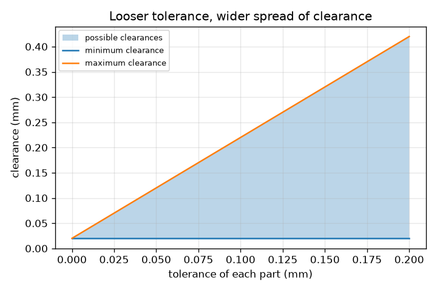
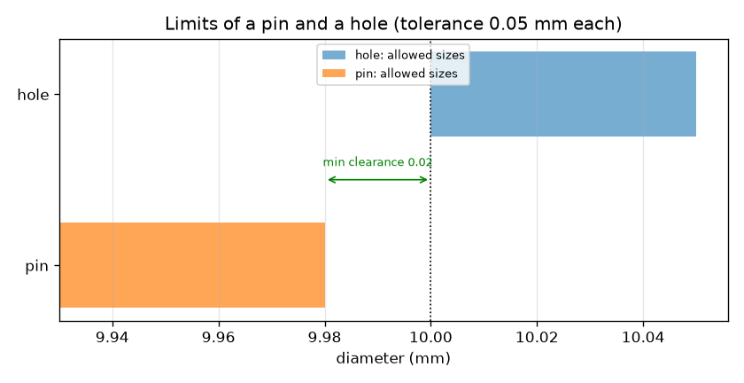

# सत्र 1: कोई भी पुर्ज़ा बिल्कुल सटीक नहीं बनता: सीमाएँ और सहनशीलता

*स्तर 1 (वैचारिक इंटरैक्टिव मॉडल) · लगभग 60 मिनट · opentolerance*

> यह एक सरलीकृत शैक्षिक मॉडल है। यह कोई प्रमाणित डिज़ाइन उपकरण नहीं है और इसका उपयोग वास्तविक संरचनाओं, विद्युत स्थापनाओं, वाहनों, औद्योगिक प्रक्रियाओं या चिकित्सा संबंधी निर्णयों के लिए नहीं किया जाना चाहिए।

**पूर्वापेक्षाएँ (Prerequisites)**

- दशमलव संख्याएँ घटाना (उदाहरण के लिए 10.05 - 9.98)।
- आपने PRIMER.md पढ़ लिया है और `python start.py 1` एक बार चला लिया है।

**सीखने के उद्देश्य (Learning objectives)।** इस सत्र के बाद आप:

- समझा सकेंगे कि ड्रॉइंग पर हर आयाम (dimension) को सहनशीलता (tolerance) की आवश्यकता क्यों होती है।
- किसी पुर्ज़े की ऊपरी और निचली सीमाएँ (limits) लिख सकेंगे और उसकी सहनशीलता की गणना कर सकेंगे।
- छेद और पिन के बीच निकासी (clearance) की गणना कर सकेंगे और निकासी को व्यतिकरण (interference) से अलग पहचान सकेंगे।
- अपनी सीमाओं के भीतर कहीं भी बने पुर्ज़ों के लिए सबसे छोटी और सबसे बड़ी निकासी ज्ञात कर सकेंगे।

## A. वास्तविक दुनिया की समस्या
थोड़ा बड़ा शाफ़्ट थोड़े छोटे छेद में नहीं जाएगा। कोई मशीन छेद को ठीक 10.000 mm पर नहीं काट सकती: औज़ार घिसते हैं, धातु गर्म होती है, मापन की अपनी त्रुटि होती है। इसलिए ड्रॉइंग यह नहीं कहती कि 'इसे 10 mm बनाओ'; वह कहती है 'इसे इन दो आकारों के बीच बनाओ'। वह परास कितनी चौड़ी हो सकती है ताकि हर पिन फिर भी हर छेद में जाए, और संकरी परास की लागत कितनी है? आज हम केवल पहला आधा प्रश्न पूछते हैं।

## B. अवधारणा और सिद्धांत
किसी पुर्ज़े की एक ऊपरी सीमा (अनुमत सबसे बड़ा आकार) और एक निचली सीमा (सबसे छोटा) होती है। सहनशीलता उनके बीच का अंतर है: कुल ढील जो हम स्वीकार करते हैं। एक मापा गया पुर्ज़ा सहनशीलता के भीतर है यदि उसका आकार सीमाओं के बीच है, और ठीक सीमा पर का आकार भी स्वीकार्य है। एक पिन छेद में जाती है यदि छेद पिन से बड़ा हो। निकासी छेद का आकार ऋण पिन का आकार है। यदि निकासी धनात्मक है तो वह निकासी है; यदि ऋणात्मक है तो उसे व्यतिकरण कहते हैं (पिन छेद से बड़ी है); शून्य रेखा-से-रेखा (line to line) है। जब दोनों पुर्ज़े अपनी सीमाओं के भीतर कहीं भी हो सकते हैं, तो सबसे छोटी निकासी सबसे छोटे छेद में सबसे बड़ी पिन के साथ होती है और सबसे बड़ी निकासी सबसे बड़े छेद में सबसे छोटी पिन के साथ। इस सत्र में पिन 9.98 - tol और 9.98 mm के बीच तथा छेद 10.00 और 10.00 + tol mm के बीच निर्दिष्ट है, जहाँ tol हर पुर्ज़े की सहनशीलता है।

| प्रतीक | अर्थ | इकाई |
|---|---|---|
| upper, lower | किसी पुर्ज़े की ऊपरी और निचली सीमाएँ | mm |
| tol | सहनशीलता = ऊपरी सीमा - निचली सीमा | mm |
| c | निकासी = छेद का आकार - पिन का आकार | mm |
| c_min, c_max | सभी अनुमत पुर्ज़ों पर सबसे छोटी और सबसे बड़ी निकासी | mm |

**मान्यताएँ (Assumptions)**

- आकार एक ही तापमान पर व्यास हैं, पूर्णतः गोल पुर्ज़ों के साथ और बिना सतही खुरदरापन।
- पिन और छेद अपनी सीमाओं के भीतर कहीं भी हो सकते हैं।
- केवल व्यासों पर विचार किया जाता है (कोई आकृति या स्थिति त्रुटि नहीं)।

$$ t = U - L $$

$$ c = d_{\mathrm{hole}} - d_{\mathrm{pin}} $$

$$ c_{\min} = L_{\mathrm{hole}} - U_{\mathrm{pin}},\qquad c_{\max} = U_{\mathrm{hole}} - L_{\mathrm{pin}} $$

## C. दृश्य व्याख्या
पहला चित्र हर पुर्ज़े के लिए 0.05 mm की सहनशीलता पर पिन (नारंगी) और छेद (नीला) के अनुमत आकारों को व्यास पैमाने पर दो दंडों के रूप में खींचता है। नारंगी दंड के दाएँ सिरे और नीले दंड के बाएँ सिरे के बीच का अंतर सबसे छोटी निकासी, 0.02 mm, है। दूसरा चित्र सहनशीलता के सापेक्ष संभावित निकासियों को आलेखित करता है: निचली रेखा 0.02 mm पर रहती है जबकि ऊपरी रेखा बढ़ती है, इसलिए सहनशीलता ढीली करने पर संभावित निकासियों का पट्टा चौड़ा होता जाता है।

*हर पुर्ज़े की सहनशीलता बढ़ने पर संभावित निकासियों का पट्टा चौड़ा होता जाता है।*

*हर एक के लिए 0.05 mm सहनशीलता पर पिन और छेद के अनुमत आकार; तीर सबसे छोटी निकासी को चिह्नित करता है।*

## D. इंटरैक्टिव सिमुलेशन
पाठ चलाइए (`python start.py 1`), फिर लाइव ऐप खोलिए: [सत्र 1: एक पिन और एक छेद](https://krunalpanchal1995.github.io/pan-iit-oss/opentolerance/session-01/) (या इसी फ़ोल्डर में `app.html`)। पिन और छेद के स्लाइडर खिसकाइए और निकासी तथा चित्र को देखिए (आकार के अंतर आवर्धित हैं), फिर सहनशीलता बदलिए और ग्राफ़ दृश्य में संभावित निकासियों का पट्टा देखिए।

**चुनौती।** एक पिन और एक छेद चुनिए, दोनों अपनी सीमाओं के भीतर, जिनकी निकासी 0.08 और 0.10 mm के बीच हो।

## E. हल किया गया उदाहरण और प्रयोग
**समस्या।** दोनों पुर्ज़ों पर 0.05 mm की सहनशीलता के साथ, पिन और छेद की सीमाएँ, सबसे छोटी और सबसे बड़ी निकासी ज्ञात कीजिए, और तय कीजिए कि 9.99 mm मापी गई पिन स्वीकार्य है या नहीं।

1. पिन की सीमाएँ: ऊपरी 9.98 mm, निचली 9.98 - 0.05 = 9.93 mm। छेद की सीमाएँ: निचली 10.00 mm, ऊपरी 10.00 + 0.05 = 10.05 mm।
2. पिन की सहनशीलता = 9.98 - 9.93 = 0.05 mm, छेद की = 10.05 - 10.00 = 0.05 mm।
3. सबसे छोटी निकासी = छेद की निचली सीमा - पिन की ऊपरी सीमा = 10.00 - 9.98 = 0.02 mm।
4. सबसे बड़ी निकासी = छेद की ऊपरी सीमा - पिन की निचली सीमा = 10.05 - 9.93 = 0.12 mm।
5. 9.99 mm की पिन ऊपरी सीमा 9.98 mm से ऊपर है, इसलिए वह सहनशीलता से बाहर है और अस्वीकृत की जाती है, यद्यपि वह फिर भी 10.00 mm के छेद में 0.01 mm की गुंजाइश के साथ फ़िट हो जाती। ड्रॉइंग तय करती है, अकेला फ़िट नहीं।

**उत्तर।** हर अनुमत पिन और छेद के लिए निकासी 0.02 से 0.12 mm; 9.99 mm की पिन अस्वीकृत।

**प्रयोग।** एक ही नाममात्र आकार के पाँच ड्रिल बिट (या बोल्ट) का व्यास 0.02 mm तक पढ़ने वाले वर्नियर कैलिपर से मापिए, और देखिए कि वे कितने अलग हैं; फिर हर एक को एक ही बिट से ड्रिल किए गए छेद में आज़माइए। आप जो फैलाव देखते हैं उसकी तुलना उस सहनशीलता से कीजिए जो आप ड्रॉइंग पर रखना चाहेंगे। मॉडल सटीक मापन और पूर्ण गोलाई मानता है; कैलिपर की अपनी कुछ सौवें मिलीमीटर की त्रुटि होती है, और वास्तविक पुर्ज़े थोड़े अंडाकार होते हैं, इसलिए वास्तविक फ़िट मॉडल से थोड़ा कसा होता है।

## F. मूल्यांकन और डिज़ाइन चुनौती
**प्रश्न प्रकार A: वैचारिक।** ड्रॉइंग एक सटीक आकार के बजाय सीमाएँ क्यों देती है? ठीक ऊपरी सीमा पर आकार वाले पुर्ज़े को क्या माना जाता है?

संकेत

सोचिए कि एक मशीन क्या बनाए रख सकती है और क्या नहीं, और 'सहनशीलता के भीतर' की परिभाषा पढ़िए।

चरण-दर-चरण हल

कोई भी प्रक्रिया हर बार सटीक आकार नहीं बनाती (औज़ार का घिसाव, तापमान, मापन त्रुटि), इसलिए ड्रॉइंग बताती है कि आकार आदर्श से कितना दूर हो सकता है। सीमाएँ सबसे बड़े और सबसे छोटे स्वीकार्य आकार हैं। ठीक सीमा पर का पुर्ज़ा भी सहनशीलता के भीतर है, क्योंकि सीमाएँ स्वयं अनुमत हैं।

**प्रश्न प्रकार B: संख्यात्मक।** एक पिन 9.93 और 9.98 mm के बीच और एक छेद 10.00 और 10.05 mm के बीच बनाया जाता है। 9.95 mm की पिन 10.04 mm के छेद से मिलती है। निकासी क्या है, और क्या दोनों पुर्ज़े सहनशीलता के भीतर हैं? निकासी परास 0.02 से 0.12 mm से इसकी जाँच कीजिए।

संकेत

निकासी = छेद - पिन; फिर हर आकार की तुलना उसकी सीमाओं से कीजिए।

चरण-दर-चरण हल

निकासी = 10.04 - 9.95 = 0.09 mm। पिन 9.93 और 9.98 के बीच है और छेद 10.00 और 10.05 के बीच, इसलिए दोनों सहनशीलता के भीतर हैं। मान 0.09 mm सबसे छोटी (0.02 mm) और सबसे बड़ी (0.12 mm) निकासी के बीच है, जैसा होना चाहिए।

**प्रश्न प्रकार C: ग्राफ़ और सिमुलेशन की व्याख्या।** सहनशीलता के सापेक्ष निकासी के ग्राफ़ में, निचली रेखा 0.02 mm पर क्यों रहती है जबकि ऊपरी रेखा बढ़ती है? 0.10 mm की सहनशीलता पर सबसे बड़ी निकासी क्या है?

संकेत

सबसे छोटी निकासी किन सीमाओं का उपयोग करती है, और क्या वे tol बदलने पर खिसकती हैं?

चरण-दर-चरण हल

सबसे छोटी निकासी छेद की निचली सीमा (10.00) और पिन की ऊपरी सीमा (9.98) का उपयोग करती है; इनमें से कोई भी tol पर निर्भर नहीं है, इसलिए यह 0.02 mm पर रहती है। सबसे बड़ी निकासी छेद की ऊपरी सीमा और पिन की निचली सीमा का उपयोग करती है, और दोनों tol से बाहर की ओर खिसकती हैं, इसलिए यह 0.02 + 2 tol के बराबर है। tol = 0.10 mm पर यह 0.02 + 0.20 = 0.22 mm है।

**प्रश्न प्रकार D: डिज़ाइन और अनुकूलन चुनौती।** डिज़ाइन: एक खिलौने में पिन इतनी ढीली होनी चाहिए कि वह हमेशा अंदर जाए पर 0.10 mm से अधिक न डगमगाए। हर पुर्ज़े की सहनशीलता के लिए मिलीमीटर का सबसे बड़ा पूर्ण सौवाँ भाग चुनिए और उसका औचित्य बताइए। छोटी सहनशीलता चुनने से आप क्या खोते हैं?

संकेत

सबसे बड़ी निकासी 0.02 + 2 tol को अधिकतम 0.10 mm रखिए।

चरण-दर-चरण हल

0.02 + 2 tol <= 0.10 से tol <= 0.04 mm मिलता है। tol = 0.04 पर निकासी परास 0.02 से 0.10 mm है: हमेशा जुड़ जाता है और कभी डगमगाहट सीमा पार नहीं करता। छोटी सहनशीलता (उदाहरण के लिए 0.02 mm, निकासी 0.02 से 0.06 mm) भी काम करती है पर पुर्ज़े अधिक सटीकता से बनाने पड़ते हैं, जिसकी लागत अधिक है; वह समझौता (trade-off) सत्र 3 में लौटता है।

[RUBRIC.md](../../RUBRIC.md) से स्वयं को अंक दीजिए। कागज़ पर काम करने के लिए [गतिविधि पत्रक](activity_sheet.md) प्रिंट कीजिए।

## आम भ्रांतियाँ
| आम भ्रांति | वास्तव में क्या सच है |
|---|---|
| पुर्ज़ा ठीक ड्रॉइंग पर लिखे आकार का होना चाहिए। | कोई भी पुर्ज़ा ऐसा नहीं होता; ड्रॉइंग सीमाएँ देती है और पुर्ज़ा उनके बीच कहीं भी हो तो अच्छा है। |
| बड़ी सहनशीलता का अर्थ है बेहतर पुर्ज़ा। | बड़ी सहनशीलता का अर्थ है ढीली आवश्यकता: बनाने में आसान और सस्ता, पर फ़िट का अधिक फैलाव। |
| यदि पुर्ज़ा फिर भी फ़िट हो जाए, तो वह स्वीकार्य है। | स्वीकृति ड्रॉइंग की सीमाओं से तय होती है; 9.99 mm की पिन फ़िट हो सकती है पर सहनशीलता से बाहर है। |
| व्यतिकरण का अर्थ है कि पुर्ज़े टूटे हुए हैं। | व्यतिकरण का अर्थ है कि पिन छेद से बड़ी है; प्रेस फ़िट (press fit) के लिए यह जानबूझकर किया जाता है। |

## शब्दावली
- **सहनशीलता (tolerance)**: किसी आकार का कुल अनुमत परिवर्तन: ऊपरी सीमा ऋण निचली सीमा
- **सीमा (limit)**: किसी पुर्ज़े का सबसे बड़ा (ऊपरी) या सबसे छोटा (निचला) अनुमत आकार
- **निकासी (clearance)**: धनात्मक होने पर छेद का आकार ऋण पिन का आकार: उनके बीच का स्थान
- **व्यतिकरण (interference)**: ऋणात्मक निकासी: पिन छेद से बड़ी है
- **नाममात्र आकार (nominal size)**: वह आदर्श आकार जिसका हम नाम लेते हैं, जैसे 10 mm, सीमाएँ लागू होने से पहले

## समापन
1. [exercises.md](exercises.md) में दिए तीन कोडिंग कार्य कीजिए।
2. अपने बदलावों के बाद `python start.py 1` फिर से चलाइए। यह चेकपॉइंट (checkpoint) पर समाप्त होता है; जब यह `PASS` छापे, तो आपका काम पूरा है। (केवल चेकपॉइंट: `python start.py check 1`।)

अगला: [सत्र 2](../session-02/README.md)
