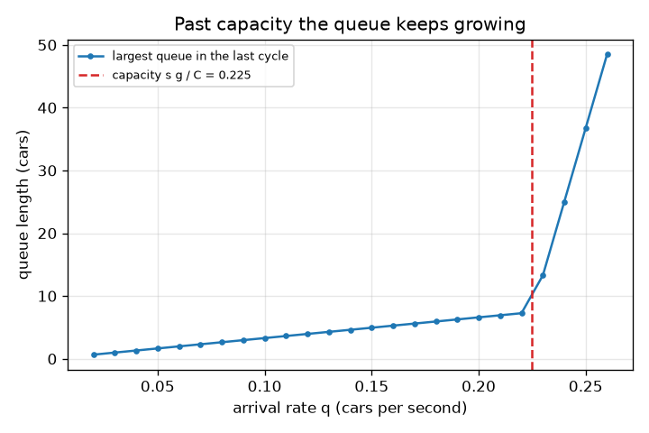
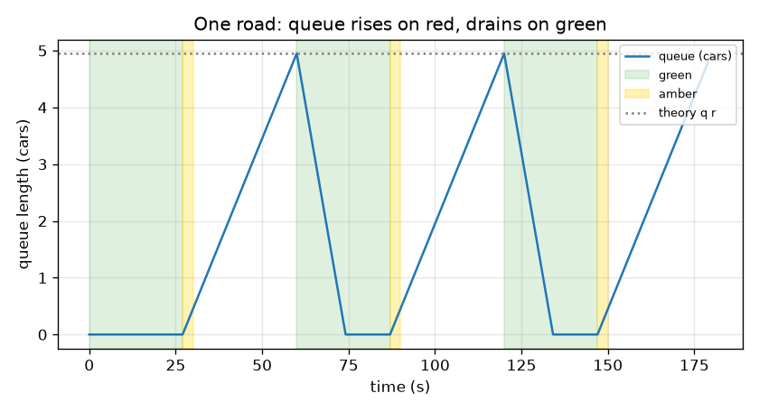

# सत्र 1: दो चरण (phases), एक कतार (queue)

*स्तर 1 (वैचारिक इंटरैक्टिव मॉडल) · लगभग 60 मिनट · opentrafficsignal*

> यह एक सरलीकृत शैक्षिक मॉडल है। यह कोई प्रमाणित डिज़ाइन उपकरण नहीं है और इसका उपयोग वास्तविक संरचनाओं, विद्युत संस्थापनों, वाहनों, औद्योगिक प्रक्रियाओं या चिकित्सा निर्णयों के लिए नहीं किया जाना चाहिए।

**पूर्वापेक्षाएँ (Prerequisites)**

- दशमलव के साथ अंकगणित और रेखा ग्राफ़ पढ़ना।
- आपने PRIMER.md पढ़ लिया है और एक बार `python start.py 1` चला लिया है।

**सीखने के उद्देश्य (Learning objectives)।** इस सत्र के बाद आप:

- दो-चरण सिग्नल योजना (हरा, पीला (amber), लाल) और उसके चक्र समय (cycle time) का वर्णन कर सकेंगे।
- समझा सकेंगे कि लाल पर कतार क्यों बढ़ती है और हरे पर क्यों घटती है।
- q x r से अधिकतम कतार और q r / (s - q) से उसे साफ़ होने का समय पहले से बता सकेंगे।
- समय के सापेक्ष कतार की लंबाई का ग्राफ़ पढ़ सकेंगे और बता सकेंगे कि कब एक चौराहा (junction) सँभाल नहीं पाता।

## A. वास्तविक दुनिया की समस्या
एक चौराहे पर दो सड़कें एक-दूसरे को काटती हैं, और एक समय में केवल एक ही सड़क पर गाड़ियाँ चल सकती हैं। सिग्नल बारी-बारी से बदलता है: सड़क A के लिए हरा जबकि सड़क B लाल पर प्रतीक्षा करती है, फिर पीला, फिर उलटा। प्रतीक्षा वाली सड़क पर गाड़ियाँ आती रहती हैं, इसलिए एक कतार बनती है; जब बत्ती हरी होती है तो कतार ख़ाली होती है। चालकों को यह प्रतीक्षा के रूप में महसूस होता है; एक शहर को यह उन कतारों के रूप में महसूस होता है जो पिछले चौराहे को भी रोक देती हैं। कतार कितनी लंबी होती है, और उसे ग़ायब होने में कितना समय लगता है? यह एक सरलीकृत शैक्षिक मॉडल है, कोई यातायात इंजीनियरिंग (traffic engineering) उपकरण नहीं।

## B. अवधारणा और सिद्धांत
हर सड़क को एक हरा समय g मिलता है, फिर एक पीला समय a (यहाँ 3 s; पीले पर गाड़ियाँ नहीं निकलतीं, इसलिए यह व्यर्थ समय (lost time) है), फिर जब दूसरी सड़क चलती है तो वह प्रतीक्षा करती है। दो बराबर चरणों के लिए चक्र समय C = 2 (g + a) है। गाड़ियाँ q गाड़ी प्रति सेकंड की स्थिर दर से आती हैं। हरे पर वे संतृप्ति प्रवाह (saturation flow) s पर निकलती हैं, यानी एक कतार से प्रति सेकंड निकल सकने वाली अधिकतम गाड़ियाँ; प्रति लेन लगभग 0.5 गाड़ी प्रति सेकंड एक सामान्य पाठ्यपुस्तक मान है (लगभग 1800 गाड़ी प्रति घंटा), और वास्तविक मान सड़क के साथ बदलते हैं। एक सड़क r = C - g सेकंड तक हरी नहीं होती। उस समय में q r गाड़ियाँ आती हैं और कोई नहीं निकलती, इसलिए कतार q r पर अधिकतम होती है। हरे पर कतार s - q की गति से घटती है, इसलिए उसे ग़ायब होने के लिए q r / (s - q) सेकंड चाहिए। यदि हरा समाप्त होने से पहले वह ग़ायब नहीं होती, तो बची हुई कतार हर चक्र में बढ़ती है। एक सड़क जिस सबसे बड़ी स्थिर आगमन दर को सँभाल सकती है वह उसकी क्षमता (capacity) s g / C है।

| प्रतीक | अर्थ | इकाई |
|---|---|---|
| g | एक सड़क का हरा समय | s |
| a | पीला समय (यहाँ 3 s) | s |
| C | चक्र समय, 2 (g + a) | s |
| r | वह समय जब सड़क हरी नहीं है, C - g | s |
| q | आगमन दर (arrival rate) | गाड़ी प्रति सेकंड |
| s | संतृप्ति प्रवाह (सामान्य मान प्रति लेन 0.5) | गाड़ी प्रति सेकंड |
| capacity | सबसे बड़ी स्थिर आगमन दर, s g / C | गाड़ी प्रति सेकंड |

**मान्यताएँ (Assumptions)**

- दो सड़कें, बराबर हरा, सममित (symmetric) योजना; सड़क B, सड़क A से आधा चक्र पीछे चलती है।
- आगमन पूरी तरह स्थिर हैं (अभी कोई यादृच्छिक झुंड (random bunches) नहीं) और गाड़ियों को एक चिकने तरल की तरह माना जाता है।
- जब तक कतार है और हरा चालू है, गाड़ियाँ ठीक s पर निकलती हैं; पीले या लाल पर कोई नहीं निकलता।
- प्रति सड़क एक लेन; कोई मुड़ने वाली गाड़ियाँ, पैदल यात्री या बसें नहीं।

$$ C = 2\,(g + a),\qquad r = C - g $$

$$ Q_{\max} = q\,r\quad\text{(cars waiting at the end of red)} $$

$$ t_{\text{clear}} = \frac{q\,r}{s - q}\quad\text{(seconds of green needed to empty the queue)} $$

$$ \text{capacity} = \frac{s\,g}{C},\qquad \text{the queue clears every cycle only if } q < \text{capacity} $$

## C. दृश्य व्याख्या
पहला चित्र तीन चक्रों के लिए एक सड़क पर कतार दिखाता है। यह लाल के दौरान एक सीधी रेखा में चढ़ती है, 4.95 गाड़ियों पर अधिकतम होती है, फिर हरे के दौरान तेज़ी से गिरती है क्योंकि गाड़ियाँ 0.5 गाड़ी प्रति सेकंड पर निकलती हैं जबकि 0.15 आती हैं; बिंदीदार रेखा हाथ से की गई गणना q r है। दूसरा चित्र उसी सिग्नल के साथ कई आगमन दरों के लिए प्रयोग दोहराता है और अंतिम चक्र में सबसे बड़ी कतार दिखाता है। यह तब तक स्थिर रूप से बढ़ती है जब तक आगमन दर क्षमता 0.225 गाड़ी प्रति सेकंड तक नहीं पहुँचती, फिर तेज़ी से उछलती है: कतार अब ख़ाली नहीं होती और चक्र-दर-चक्र बढ़ती है।

*आगमन दर के सापेक्ष सबसे बड़ी कतार: यह क्षमता 0.225 गाड़ी प्रति सेकंड पर उछलती है।*

*तीन चक्रों के लिए एक सड़क: लाल के अंत में कतार q r = 4.95 गाड़ियों पर अधिकतम होती है।*

## D. इंटरैक्टिव सिमुलेशन
पाठ चलाएँ (`python start.py 1`), फिर लाइव ऐप खोलें: [सत्र 1: एक चौराहा, दो चरण](https://krunalpanchal1995.github.io/pan-iit-oss/opentrafficsignal/session-01/) (या इस फ़ोल्डर में `app.html`)। चौराहा दृश्य खोलें और समय स्लाइडर को खींचें: बत्तियों को बदलते और प्रतीक्षा वाली सड़क पर डिब्बों (गाड़ियों) को जमा होते देखें। फिर ग्राफ़ पर जाएँ और हरा समय तथा आगमन दर बदलें।

**चुनौती।** पहले चक्र की अधिकतम कतार 4 गाड़ियों या उससे कम रखें, जबकि कतार फिर भी हर चक्र में साफ़ हो (आगमन क्षमता से नीचे)।

## E. हल किया गया उदाहरण और प्रयोग
**समस्या।** एक सड़क का हरा g = 27 s, पीला 3 s है और गाड़ियाँ q = 0.15 गाड़ी प्रति सेकंड पर आती हैं (s = 0.5)। चक्र समय, लाल समय, अधिकतम कतार, उसे साफ़ होने का समय और क्षमता ज्ञात करें। क्या कतार हर चक्र में साफ़ होती है?

1. C = 2 (27 + 3) = 60 s और r = C - g = 60 - 27 = 33 s।
2. अधिकतम कतार = q r = 0.15 x 33 = 4.95 गाड़ियाँ।
3. गाड़ियाँ 0.5 पर निकलती हैं और 0.15 पर आती हैं, इसलिए कतार 0.35 गाड़ी प्रति सेकंड से घटती है: t_clear = 4.95 / 0.35 = 14.14 s।
4. 14.14 s, 27 s के हरे से कम है, इसलिए कतार 12.9 s बचाकर साफ़ हो जाती है।
5. क्षमता = s g / C = 0.5 x 27 / 60 = 0.225 गाड़ी प्रति सेकंड, जो 0.15 से ऊपर है, जो मेल खाता है।

**उत्तर।** C = 60 s, r = 33 s, अधिकतम कतार 4.95 गाड़ियाँ, 14.14 s के हरे के बाद साफ़; क्षमता 0.225 गाड़ी प्रति सेकंड, इसलिए कतार हर चक्र में साफ़ होती है। lesson.py में सिमुलेशन 4.93 गाड़ियों का शिखर देता है।

**प्रयोग।** स्टॉपवॉच के साथ एक चौराहे पर खड़े हों, एक लाल के दौरान आने वाली गाड़ियाँ गिनें (पाँच चक्रों के लिए ऐसा करें) और नोट करें कि हरे के बाद कतार कब ग़ायब हुई। q के अपने अनुमान का उपयोग करके औसत गिनती की तुलना q x r से करें। अंतर मॉडल से आते हैं: वास्तविक गाड़ियाँ यादृच्छिक झुंडों में आती हैं, चालकों को चलना शुरू करने में समय लगता है, और कुछ पीला समय गाड़ियाँ उपयोग कर लेती हैं; मॉडल में इनमें से कुछ भी नहीं है।

## F. मूल्यांकन और डिज़ाइन चुनौती
**प्रश्न प्रकार A: वैचारिक।** हरे पर गाड़ियाँ 0.5 गाड़ी प्रति सेकंड पर निकलती हैं, फिर भी कतार उससे धीमी घटती है। क्यों? जैसे-जैसे आगमन दर 0.5 के क़रीब पहुँचती है, घटने की गति का क्या होता है?

संकेत

कतार ख़ाली होते समय भी गाड़ियाँ आती रहती हैं।

चरण-दर-चरण हल

नई गाड़ियाँ कतार के पीछे जुड़ती हैं जबकि पुरानी आगे से निकलती हैं, इसलिए कतार अंतर s - q से घटती है, s से नहीं। जैसे-जैसे q, s के क़रीब पहुँचता है, घटने की गति शून्य की ओर जाती है और साफ़ होने का समय q r / (s - q) बिना सीमा के बढ़ता है: एक सड़क जो लगभग हमेशा पूरे संतृप्ति प्रवाह की माँग करती है, अपनी कतार से कभी छुटकारा नहीं पा सकती।

**प्रश्न प्रकार B: संख्यात्मक।** सड़क A का हरा 20 s, पीला 3 s और q = 0.10 गाड़ी प्रति सेकंड है (s = 0.5)। C, r, अधिकतम कतार, उसे साफ़ होने का समय और क्षमता ज्ञात करें। सामान्य जाँच (sanity check): क्या उत्तर सही इकाइयों में है?

संकेत

C = 2 (g + a); शिखर = q r; साफ़ होने का समय = शिखर / (s - q); क्षमता = s g / C।

चरण-दर-चरण हल

C = 2 (20 + 3) = 46 s और r = 46 - 20 = 26 s। अधिकतम कतार = 0.10 x 26 = 2.6 गाड़ियाँ। साफ़ होने का समय = 2.6 / (0.5 - 0.1) = 6.5 s। क्षमता = 0.5 x 20 / 46 = 0.217 गाड़ी प्रति सेकंड। इकाइयाँ: गाड़ी प्रति सेकंड गुणा सेकंड से गाड़ियाँ मिलती हैं; गाड़ियाँ भाग गाड़ी प्रति सेकंड से सेकंड मिलते हैं। 6.5 s, 20 s के हरे से कम है और 0.10, 0.217 से नीचे है, इसलिए कतार हर चक्र में साफ़ होती है।

**प्रश्न प्रकार C: ग्राफ़ और सिमुलेशन की व्याख्या।** दूसरे चित्र में (g = 27 s के लिए आगमन दर के सापेक्ष सबसे बड़ी कतार), बिंदु एक सीधी रेखा में बढ़ते हैं और फिर उछलते हैं। यह किस आगमन दर पर होता है, और उसके बाद कतार के साथ क्या हो रहा है?

संकेत

लाल डैश वाली रेखा, s g / C, से तुलना करें।

चरण-दर-चरण हल

उछाल क्षमता s g / C = 0.225 गाड़ी प्रति सेकंड पर है। इसके नीचे सबसे बड़ी कतार q r = 33 q है, मूल बिंदु से गुज़रती 33 s ढलान वाली एक सीधी रेखा। इसके ऊपर प्रति चक्र आगमन उससे अधिक है जितना एक हरा सँभाल सकता है, इसलिए हर चक्र में कुछ गाड़ियाँ बची रह जाती हैं और कतार एक चक्र से अगले तक बिना सीमा के बढ़ती है।

**प्रश्न प्रकार D: डिज़ाइन और अनुकूलन (optimisation) चुनौती।** डिज़ाइन: दो बराबर सड़कों में से हर एक पर q = 0.18 गाड़ी प्रति सेकंड आती हैं। हरा समय g (सेकंडों की एक पूर्ण संख्या, पीला 3 s) ऐसे चुनें कि कतार हर चक्र में साफ़ हो और अधिकतम कतार अधिकतम 6 गाड़ियाँ हो। आप कौन-सा g चुनेंगे और क्यों?

संकेत

दो शर्तें: क्षमता s g / C, 0.18 से ऊपर, और q r अधिकतम 6 जहाँ r = g + 6।

चरण-दर-चरण हल

क्षमता की शर्त: 0.5 g / (2 g + 6) > 0.18 से g > 7.7 मिलता है, इसलिए g >= 8 (लेकिन g = 8 लगभग कोई अतिरिक्त गुंजाइश नहीं छोड़ता: क्षमता 0.182)। शिखर की शर्त: 0.18 (g + 6) <= 6 से g <= 27.3 मिलता है, इसलिए g <= 27। 8 से 27 तक कोई भी g दोनों शर्तें पूरी करता है; एक समझदार चुनाव 15 से 20 s है: g = 15 से शिखर 3.8 गाड़ियाँ और क्षमता 0.208 (16 प्रतिशत मार्जिन) मिलती है, g = 20 से शिखर 4.7 गाड़ियाँ और क्षमता 0.217। समझौता (trade-off): छोटे हरे का अर्थ है छोटी कतारें लेकिन चक्र का अधिक भाग पीले में व्यर्थ होता है; लंबे हरे क्षमता बढ़ाते हैं लेकिन प्रतीक्षा वाली सड़क को अधिक देर प्रतीक्षा कराते हैं।

[RUBRIC.md](../../RUBRIC.md) से स्वयं को अंक दें। काग़ज़ पर काम करने के लिए [गतिविधि पत्रक](activity_sheet.md) प्रिंट करें।

## सामान्य भ्रांतियाँ (Common misconceptions)
| सामान्य भ्रांति | वास्तव में क्या सही है |
|---|---|
| कतार उतनी ही तेज़ी से साफ़ होती है जितनी तेज़ी से गाड़ियाँ निकल सकती हैं, 0.5 गाड़ी प्रति सेकंड। | गाड़ियाँ आती रहती हैं, इसलिए कतार s - q से घटती है; q, s के जितना क़रीब हो, उतनी धीमी। |
| लंबा हरा हमेशा कतार का इलाज करता है। | एक सीमा के बाद लंबा हरा दूसरी सड़क के लाल और चक्र को लंबा कर देता है, इसलिए दूसरी कतार बढ़ती है; अधिकतम कतार q r है और r = C - g। |
| यदि औसत आगमन दर संतृप्ति प्रवाह से नीचे है, तो कतार हमेशा साफ़ होती है। | सड़क केवल कुछ समय हरी रहती है: आगमन दर क्षमता s g / C से नीचे होनी चाहिए, जो s से छोटी है। |
| हरे की शुरुआत में कतार सबसे लंबी होती है। | कतार लाल के अंत में सबसे लंबी होती है, ठीक उस क्षण जब बत्ती हरी होती है; वहाँ से वह घटती है। |

## शब्दावली (Glossary)
- **चरण (phase)**: सिग्नल चक्र का वह भाग जिसमें सड़कों के एक समूह को हरा मिलता है
- **चक्र समय (cycle time)**: पूरे हरा-पीला-लाल क्रम के दोहराने में लगने वाले सेकंड
- **संतृप्ति प्रवाह (saturation flow)**: हरे पर एक कतार से प्रति सेकंड निकल सकने वाली अधिकतम गाड़ियाँ; सामान्य मान प्रति लेन 0.5
- **कतार (queue)**: स्टॉप लाइन पर प्रतीक्षा करती गाड़ियाँ
- **क्षमता (capacity)**: सबसे बड़ी स्थिर आगमन दर जिसे एक सड़क सँभाल सकती है, s g / C
- **अतिसंतृप्त (oversaturated)**: क्षमता से ऊपर आगमन: कतार कभी साफ़ नहीं होती

## समापन
1. [exercises.md](exercises.md) में दिए तीन कोडिंग कार्य करें।
2. अपने बदलावों के बाद `python start.py 1` फिर से चलाएँ। यह चेकपॉइंट (checkpoint) के साथ समाप्त होता है; जब यह `PASS` प्रिंट करे, तो आपका काम पूरा है। (केवल चेकपॉइंट: `python start.py check 1`।)

आगे: [सत्र 2](../session-02/README.md)
