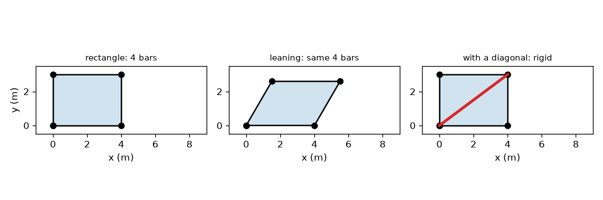
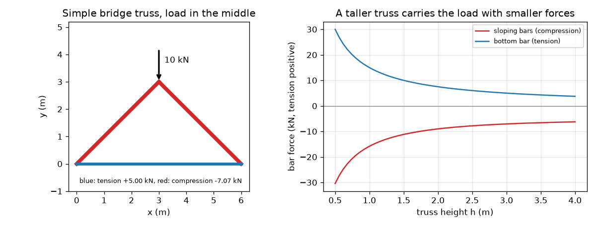

# सत्र 1: त्रिभुज दृढ़ होता है, और छड़ें केवल तनाव या संपीडन वहन करती हैं

*स्तर 1 (संकल्पनात्मक इंटरैक्टिव मॉडल) · लगभग 60 मिनट · opentruss*

> यह एक सरलीकृत शैक्षिक मॉडल है। यह कोई प्रमाणित डिज़ाइन टूल नहीं है और इसका उपयोग वास्तविक संरचनाओं, विद्युत स्थापनाओं, वाहनों, औद्योगिक प्रक्रियाओं या चिकित्सा निर्णयों के लिए नहीं किया जाना चाहिए।

**पूर्व-आवश्यकताएँ (Prerequisites)**

- स्कूल त्रिकोणमिति: ज्या (sine), कोज्या (cosine), स्पर्शज्या (tangent)।
- आपने PRIMER.md पढ़ लिया है और `python start.py 1` एक बार चला लिया है।

**सीखने के उद्देश्य (Learning objectives)।** इस सत्र के बाद आप:

- समझा सकेंगे कि पिन से जुड़ी छड़ों का त्रिभुज दृढ़ (rigid) क्यों होता है और आयत क्यों नहीं।
- गिन सकेंगे कि एक दृढ़ पिन-जोड़ वाले ढाँचे को j जोड़ों के लिए कितनी छड़ें चाहिए, 2 j - 3।
- एक पिन पर बलों के संतुलन से सबसे सरल पुल कैंची (bridge truss) में बल ज्ञात कर सकेंगे।
- कैंची की ऊँचाई के विरुद्ध छड़ बल का ग्राफ़ पढ़ सकेंगे और बता सकेंगे कि कौन-सी छड़ें तनाव (tension) में हैं और कौन-सी संपीडन (compression) में।

## A. वास्तविक दुनिया की समस्या
किसी रेलवे पुल के नीचे या किसी क्रेन की भुजा को देखिए: आपको त्रिभुजों में जुड़ी सीधी छड़ें दिखती हैं। त्रिभुज क्यों, आयत क्यों नहीं? और जब एक भारी लॉरी एक छोटे पुल के बीच में रुकती है, तो कौन-सी छड़ें खींची जा रही हैं और कौन-सी दबाई जा रही हैं? इंजीनियरों को यह जानना ज़रूरी है, क्योंकि खींची गई छड़ और दबाई गई छड़ अलग-अलग तरीकों से विफल होती हैं। यह सत्र सबसे सरल कैंची से चित्र बनाता है। यह एक शैक्षिक मॉडल है, डिज़ाइन विधि नहीं।

## B. संकल्पना और सिद्धांत
कैंची (truss) पिनों पर जुड़ी सीधी छड़ों का एक समूह है; भार केवल पिनों पर कार्य करते हैं। तब हर छड़ अपने ही अक्ष के साथ खींची या धकेली जाती है और कुछ नहीं। जो छड़ खींची जाती है वह तनाव में है (हम उसके बल को धनात्मक लिखते हैं, नीले रंग में खींचा गया)। जो छड़ धकेली जाती है वह संपीडन में है (ऋणात्मक, लाल रंग में खींचा गया)। आयत बनाने वाली चार पिन-जुड़ी छड़ें सभी छड़ लंबाइयों को अपरिवर्तित रखते हुए झुककर समांतर चतुर्भुज बन सकती हैं: आयत एक तंत्र (mechanism) है। त्रिभुज एक भुजा बदले बिना अपने कोण नहीं बदल सकता, इसलिए वह दृढ़ है; j जोड़ों वाले ढाँचे को कम से कम 2 j - 3 छड़ें चाहिए। सबसे सरल पुल कैंची के लिए (दो समान ढलवाँ छड़ें जो एक भारित शीर्ष पर मिलती हैं और एक निचली छड़ जो पैरों को जोड़ती है) हर आधार P/2 वहन करता है। शीर्ष पर ऊर्ध्वाधर बलों का संतुलन 2 F sin(theta) = P देता है, और एक पैर पर क्षैतिज बलों का संतुलन निचली छड़ का बल देता है।

| प्रतीक | अर्थ | इकाई |
|---|---|---|
| P | शीर्ष पर भार | kN |
| L | आधारों के बीच का विस्तार (span) (यहाँ 6 m) | m |
| h | आधारों से ऊपर शीर्ष की ऊँचाई | m |
| theta | ढलवाँ छड़ों का ढाल कोण | डिग्री |
| F_top | हर ढलवाँ छड़ में बल (ऋणात्मक = संपीडन) | kN |
| F_bot | निचली छड़ में बल (धनात्मक = तनाव) | kN |
| j | जोड़ों (पिनों) की संख्या | कोई इकाई नहीं |

**मान्यताएँ (Assumptions)**

- छड़ें सीधी और भारहीन हैं।
- जोड़ घर्षणरहित पिन हैं और भार केवल पिनों पर कार्य करते हैं।
- कैंची में विक्षेप (deflection) छोटा है: भार डालने पर उसका आकार नहीं बदलता।
- एक पिन आधार और एक रोलर आधार, इसलिए कोई क्षैतिज प्रतिक्रिया नहीं है।

$$ m_{\min}=2j-3\quad\text{(bars needed for a rigid frame of } j \text{ pins)} $$

$$ d^2=a^2+b^2-2ab\cos\varphi\quad\text{(diagonal of a pinned parallelogram)} $$

$$ \theta=\arctan\!\left(\frac{h}{L/2}\right) $$

$$ 2F_{\mathrm{top}}\sin\theta=-P\;\Rightarrow\;F_{\mathrm{top}}=-\frac{P}{2\sin\theta} $$

$$ F_{\mathrm{bot}}=\frac{P}{2\tan\theta} $$

## C. दृश्य व्याख्या
पहला चित्र चार छड़ों का 4 m गुणा 3 m का एक आयत, वही छड़ें 60 डिग्री के कोने तक झुकी हुई (इसका विकर्ण 5.0 m से 3.606 m तक सिकुड़ता है), और 5 m का विकर्ण जोड़ा गया आयत दिखाता है, जो केवल 90 डिग्री वाले आकार की अनुमति देता है। दूसरा चित्र शीर्ष पर 10 kN भार वाला सरल पुल खींचता है, जिसमें ढलवाँ छड़ें लाल और निचली छड़ नीली है, और दोनों बलों को ऊँचाई h के विरुद्ध आलेखित करता है: कैंची ऊँची होने पर दोनों गिरते हैं।

*एक आयत झुकता है (वही चार छड़ें); एक विकर्ण इसे दृढ़ बनाता है।*

*10 kN भार वाली एक सरल पुल कैंची, और ऊँचाई के विरुद्ध उसके छड़ बल।*

## D. इंटरैक्टिव सिमुलेशन
पाठ चलाइए (`python start.py 1`), फिर लाइव ऐप खोलिए: [सत्र 1: एक सरल पुल कैंची](https://krunalpanchal1995.github.io/pan-iit-oss/opentruss/session-01/) (या इसी फ़ोल्डर में `app.html`)। ऊँचाई स्लाइडर खिसकाइए और छड़ों की चौड़ाई बदलते देखिए: कैंची जितनी सपाट, हर छड़ उतना अधिक काम करती है। दोनों बल वक्र और उन पर अपना वर्तमान बिंदु देखने के लिए ग्राफ़ दृश्य पर जाइए।

**चुनौती।** निचली छड़ के तनाव को 5 kN से नीचे रखते हुए कम से कम 10 kN का भार वहन कीजिए।

## E. हल किया गया उदाहरण और प्रयोग
**समस्या।** एक छोटी पुल कैंची 6 m का विस्तार रखती है। शीर्ष 3 m ऊँचा है और 10 kN वहन करता है। हर छड़ में बल ज्ञात कीजिए और बताइए कि वह तनाव में है या संपीडन में।

1. आधार: सममिति से हर एक 10 / 2 = 5 kN ऊपर की ओर वहन करता है।
2. ढाल कोण: theta = arctan(3 / 3) = 45 डिग्री, इसलिए sin(theta) = 0.7071 और tan(theta) = 1।
3. शीर्ष पिन, ऊर्ध्वाधर बलों का योग = 0: 2 F sin(45) = 10, इसलिए हर ढलवाँ बल का परिमाण 10 / (2 * 0.7071) = 7.07 kN है। छड़ें शीर्ष पर धकेलती हैं, इसलिए वे संपीडन में हैं: F_top = -7.07 kN।
4. बायाँ पैर पिन, क्षैतिज बलों का योग = 0: ढलवाँ छड़ पैर को 7.07 * cos(45) = 5.00 kN से बाहर की ओर धकेलती है, इसलिए निचली छड़ को उसे 5.00 kN से वापस खींचना होगा: F_bot = +5.00 kN (तनाव)।
5. पैर पर ऊर्ध्वाधर संतुलन जाँचिए: 7.07 * sin(45) = 5.00 kN, 5 kN प्रतिक्रिया के बराबर।

**उत्तर।** दोनों ढलवाँ छड़ें -7.07 kN (संपीडन) वहन करती हैं और निचली छड़ +5.00 kN (तनाव) वहन करती है।

**प्रयोग।** पेपर फ़ास्टनरों से पिन किए गए तीन लकड़ी के स्केलों से कैंची बनाइए, इसे दो किताबों पर टिकाइए और शीर्ष से ज्ञात द्रव्यमान का एक थैला लटकाइए। निचले स्केल को एक स्प्रिंग तुला या रबर बैंड से बदलिए: यह खिंचता है, इसलिए यह तनाव में है। शीर्ष पर दबाइए और दोनों स्केल थोड़े छोटे हो जाते हैं, इसलिए वे संपीडन में हैं। मॉडल से अंतर: असली जोड़ों में घर्षण होता है और वे ठीक-ठीक पिन नहीं होते, स्केलों का भार होता है, और किताबें बाहर की ओर खिसक सकती हैं, इसलिए आप जो निचली छड़ का बल मापेंगे वह प्रति 10 kN पर 5.00 kN से कुछ कम या अधिक होगा।

## F. मूल्यांकन और डिज़ाइन चुनौती
**प्रश्न प्रकार A: संकल्पनात्मक।** एक विकर्ण जोड़ने से पिन-जुड़ी छड़ों का आयत दृढ़ क्यों हो जाता है, और उसके बिना आयत क्यों विफल होता है? 4 m गुणा 3 m आयत की संख्याओं का उपयोग कीजिए।

संकेत

90 डिग्री वाले कोने पर और झुके हुए 60 डिग्री वाले कोने पर विकर्ण की लंबाई की तुलना कीजिए।

चरण-दर-चरण हल

विकर्ण के बिना, ढाँचे के झुकने पर चारों छड़ लंबाइयाँ वही रहती हैं, इसलिए उसे कुछ नहीं रोकता: यह एक तंत्र है। जब यह 90 से 60 डिग्री तक झुकता है, तो सम्मुख कोनों के बीच की दूरी 5.0 m से 3.606 m तक बदल जाती है। एक निश्चित 5 m की छड़ उस दूरी को तय कर देती है, और कोज्या नियम से केवल 90 डिग्री वाला कोना ही 5 m देता है, इसलिए ढाँचा अब हिल नहीं सकता। 4 जोड़ों वाले ढाँचे को 2*4 - 3 = 5 छड़ें चाहिए, और आयत में केवल 4 हैं।

**प्रश्न प्रकार B: संख्यात्मक।** 6 m विस्तार और 1.5 m ऊँचाई वाली एक कैंची अपने शीर्ष पर 12 kN वहन करती है। ढलवाँ छड़ों और निचली छड़ में बल, चिह्नों सहित, ज्ञात कीजिए।

संकेत

tan(theta) = 1.5 / 3 = 0.5, इसलिए sin(theta) = 0.4472।

चरण-दर-चरण हल

F_top = -12 / (2 * 0.4472) = -13.42 kN (संपीडन)। F_bot = 12 / (2 * 0.5) = +12.00 kN (तनाव)। जाँच: ढलवाँ छड़ का ऊर्ध्वाधर भाग 13.42 * 0.4472 = 6.0 kN है, जो भार का आधा है। इकाइयाँ: kN।

**प्रश्न प्रकार C: ग्राफ़ और सिमुलेशन की व्याख्या।** बल बनाम ऊँचाई ग्राफ़ (10 kN भार) पर, कैंची को 0.5 m से 4 m तक ऊँचा बनाने पर बलों का क्या होता है? दोनों छोरों पर बल बताइए।

संकेत

h = 0.5 और h = 4 पर लाल और नीले वक्र पढ़िए।

चरण-दर-चरण हल

h बढ़ने पर दोनों वक्र गिरते हैं। h = 0.5 m पर छड़ें -30.41 kN और +30.00 kN वहन करती हैं, 10 kN भार का तीन गुना। h = 4 m पर वे -6.25 kN और +3.75 kN वहन करती हैं। एक सपाट कैंची लगभग एक सीधी केबल-और-टेक (strut) है जिसे एक उथले कोण पर भार का प्रतिरोध करना पड़ता है, इसलिए बल बहुत बड़े होते हैं।

**प्रश्न प्रकार D: डिज़ाइन और इष्टतमीकरण (optimisation) चुनौती।** डिज़ाइन: सबसे छोटी ऊँचाई (निकटतम 0.25 m तक) चुनिए ताकि 6 m विस्तार पर 10 kN भार के अंतर्गत निचली छड़ का तनाव अधिकतम 4 kN हो। तब हर ढलवाँ छड़ कितना संपीडन वहन करती है, और आप क्या छोड़ते हैं?

संकेत

F_bot = P / (2 tan theta) = P * 3 / (2 h)।

चरण-दर-चरण हल

F_bot = 10 * 3 / (2 h) = 15 / h <= 4 से h >= 3.75 m मिलता है। h = 3.75 m पर ढाल 51.3 डिग्री है, निचली छड़ में ठीक +4.00 kN और हर ढलवाँ छड़ में -6.40 kN है। समझौता (trade-off): ऊँची कैंची बल घटाती है पर उसे लंबी छड़ें, अधिक ऊँचाई की जगह और बगल की हवा के विरुद्ध अधिक बंधन (bracing) चाहिए, और लंबी संपीडन छड़ें आकुंचन (buckling) के प्रति अधिक संवेदनशील होती हैं।

[RUBRIC.md](../../RUBRIC.md) से स्वयं को अंक दीजिए। कागज़ पर काम करने के लिए [गतिविधि पत्रक](activity_sheet.md) प्रिंट कीजिए।

## सामान्य भ्रांतियाँ (Common misconceptions)
| सामान्य भ्रांति | वास्तव में क्या सच है |
|---|---|
| मज़बूत छड़ों से बना आयत दृढ़ होता है। | पिनों से जुड़ी चार छड़ें चाहे कितनी भी मज़बूत हों, झुक सकती हैं; केवल त्रिभुज (या त्रिभुजों में बँधा ढाँचा) अपना आकार बनाए रखता है। |
| पुल की हर छड़ खींची जाती है। | कैंची में कुछ छड़ें खींची जाती हैं (तनाव) और कुछ धकेली जाती हैं (संपीडन); बल का चिह्न बताता है कि कौन-सी। |
| ऊँची कैंची को हर छड़ में अधिक इस्पात चाहिए। | किसी दिए गए भार के लिए, ऊँची कैंचियों में छड़ बल छोटे होते हैं (हालाँकि छड़ें लंबी होती हैं, इसलिए कुल इस्पात एक समझौता है)। |
| कैंची की छड़ एक धरन (beam) की तरह मुड़ती है। | केवल पिनों पर भार होने पर, छड़ केवल अपने अक्ष के साथ बल वहन करती है; मुड़ना इस मॉडल के बाहर है। |

## शब्दावली (Glossary)
- **कैंची (truss)**: पिनों पर जुड़ी सीधी छड़ों का समूह, जिस पर भार केवल पिनों पर डाला जाता है
- **तनाव (tension)**: छड़ के साथ खींचने वाला बल; इस repo में धनात्मक, नीले रंग में खींचा गया
- **संपीडन (compression)**: छड़ के साथ धकेलने वाला बल; इस repo में ऋणात्मक, लाल रंग में खींचा गया
- **पिन (pin)**: एक घर्षणरहित जोड़ जो छड़ों को घूमने देता है पर बल आगे पहुँचाता है
- **तंत्र (mechanism)**: एक ढाँचा जो किसी भी छड़ की लंबाई बदले बिना हिल सकता है
- **प्रतिक्रिया (reaction)**: वह बल जिससे कोई आधार वापस धकेलता है

## समापन
1. [exercises.md](exercises.md) में दिए गए तीन कोडिंग कार्य कीजिए।
2. अपने बदलावों के बाद `python start.py 1` फिर से चलाइए। यह checkpoint के साथ समाप्त होता है; जब यह `PASS` छापे, तो आपका काम पूरा है। (केवल checkpoint: `python start.py check 1`।)

अगला: [सत्र 2](../session-02/README.md)
