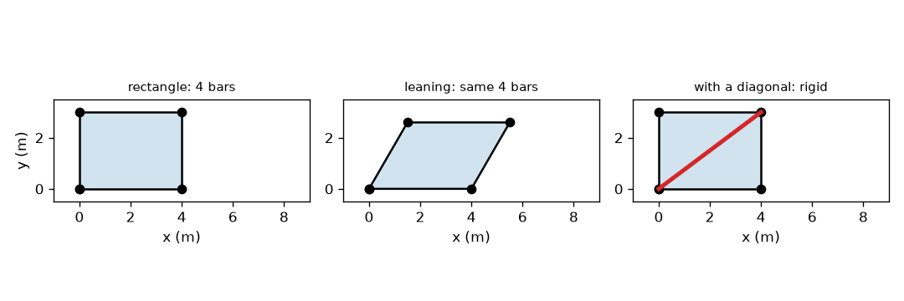
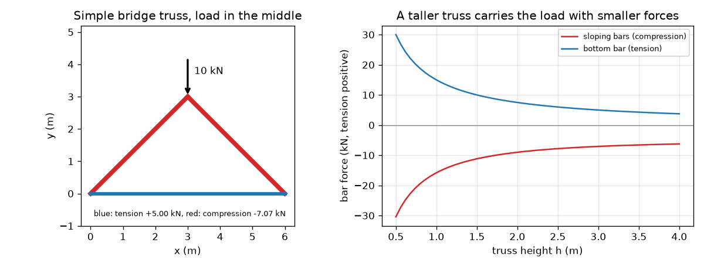

# സെഷൻ 1: ത്രികോണം ദൃഢമാണ്, ദണ്ഡുകൾ വലിവോ സമ്മർദമോ മാത്രം വഹിക്കുന്നു

[Session 1 — हिन्दी](README.hi.md)

*തലം 1 (ആശയപരമായ സംവേദനാത്മക മാതൃക) · ഏകദേശം 60 മിനിറ്റ് · opentruss*

> ഇതൊരു ലളിതവൽക്കരിച്ച വിദ്യാഭ്യാസ മാതൃകയാണ്. ഇത് സാധൂകരിച്ച ഡിസൈൻ ഉപകരണമല്ല; യഥാർഥ നിർമിതികൾ, വൈദ്യുത ഇൻസ്റ്റലേഷനുകൾ, വാഹനങ്ങൾ, വ്യാവസായിക പ്രക്രിയകൾ, വൈദ്യശാസ്ത്ര തീരുമാനങ്ങൾ എന്നിവയ്ക്ക് ഇത് ഉപയോഗിക്കരുത്.

**മുൻവിജ്ഞാനം (Prerequisites)**

- സ്കൂൾ ത്രികോണമിതി: സൈൻ, കൊസൈൻ, ടാൻജെന്റ്.
- നിങ്ങൾ PRIMER.md വായിക്കുകയും `python start.py 1` ഒരു തവണ റൺ ചെയ്യുകയും ചെയ്തിരിക്കണം.

**പഠനലക്ഷ്യങ്ങൾ (Learning objectives).** ഈ സെഷനു ശേഷം നിങ്ങൾക്ക്:

- പിൻ ഘടിപ്പിച്ച ദണ്ഡുകളുടെ ത്രികോണം ദൃഢവും ചതുരം അല്ലാത്തതും ആകുന്നത് എന്തുകൊണ്ടെന്ന് വിശദീകരിക്കാം.
- ദൃഢമായ പിൻ-സന്ധി ചട്ടക്കൂടിന് ആവശ്യമായ ദണ്ഡുകളുടെ എണ്ണം, j സന്ധികൾക്ക് 2 j - 3, കണക്കാക്കാം.
- ഒരു പിന്നിലെ ബലസന്തുലനത്തിൽ നിന്ന് ഏറ്റവും ലളിതമായ പാലം ട്രസ്സിലെ ബലങ്ങൾ കണ്ടെത്താം.
- ട്രസ്സിന്റെ ഉയരത്തിനെതിരെ ദണ്ഡിലെ ബലത്തിന്റെ ഗ്രാഫ് വായിച്ച് ഏതെല്ലാം ദണ്ഡുകൾ വലിവിലും ഏതെല്ലാം സമ്മർദത്തിലുമാണെന്ന് പറയാം.

## A. യഥാർഥ ജീവിത പ്രശ്നം
ഒരു റെയിൽവേ പാലത്തിന്റെ അടിയിലോ ഒരു ക്രെയിൻ ഭുജത്തിലോ നോക്കുക: ത്രികോണങ്ങളായി ചേർത്ത നേരായ ദണ്ഡുകൾ കാണാം. എന്തുകൊണ്ട് ചതുരങ്ങളല്ല, ത്രികോണങ്ങൾ? ഒരു ഭാരമുള്ള ലോറി ഒരു ചെറിയ പാലത്തിന്റെ നടുവിൽ നിൽക്കുമ്പോൾ ഏതെല്ലാം ദണ്ഡുകളാണ് വലിക്കപ്പെടുന്നത്, ഏതെല്ലാമാണ് ഞെരുക്കപ്പെടുന്നത്? എൻജിനീയർമാർ അറിയണം, കാരണം വലിക്കപ്പെടുന്ന ദണ്ഡും ഞെരുക്കപ്പെടുന്ന ദണ്ഡും വ്യത്യസ്ത രീതിയിൽ പരാജയപ്പെടുന്നു. ഈ സെഷൻ ഏറ്റവും ലളിതമായ ട്രസ്സിൽ നിന്ന് ചിത്രം പടുത്തുയർത്തുന്നു. ഇതൊരു വിദ്യാഭ്യാസ മാതൃകയാണ്, ഡിസൈൻ രീതിയല്ല.

## B. ആശയവും സിദ്ധാന്തവും
പിന്നുകളിൽ ചേർത്ത നേരായ ദണ്ഡുകളുടെ ഒരു കൂട്ടമാണ് ട്രസ്സ് (truss); ഭാരങ്ങൾ പിന്നുകളിൽ മാത്രം പ്രവർത്തിക്കുന്നു. അപ്പോൾ ഓരോ ദണ്ഡും അതിന്റെ സ്വന്തം അക്ഷത്തിൽ മാത്രം വലിക്കപ്പെടുകയോ തള്ളപ്പെടുകയോ ചെയ്യുന്നു, മറ്റൊന്നും ഇല്ല. വലിക്കപ്പെടുന്ന ദണ്ഡ് വലിവിലാണ് (tension) (അതിന്റെ ബലം നാം പോസിറ്റീവായി എഴുതുന്നു, നീലനിറത്തിൽ വരയ്ക്കുന്നു). തള്ളപ്പെടുന്ന ദണ്ഡ് സമ്മർദത്തിലാണ് (compression) (നെഗറ്റീവ്, ചുവപ്പ് നിറത്തിൽ വരയ്ക്കുന്നു). ചതുരമായി നിൽക്കുന്ന നാല് പിൻ-ദണ്ഡുകൾക്ക് എല്ലാ ദണ്ഡുകളുടെയും നീളം മാറാതെ ഒരു സമാന്തരചതുർഭുജമായി ചരിയാൻ കഴിയും: ചതുരം ഒരു യന്ത്രസംവിധാനമാണ് (mechanism). ത്രികോണത്തിന് ഒരു വശം മാറ്റാതെ കോണുകൾ മാറ്റാൻ കഴിയില്ല, അതിനാൽ അത് ദൃഢമാണ്; j സന്ധികളുള്ള ചട്ടക്കൂടിന് കുറഞ്ഞത് 2 j - 3 ദണ്ഡുകൾ വേണം. ഏറ്റവും ലളിതമായ പാലം ട്രസ്സിൽ (ഭാരമുള്ള ശിഖരത്തിൽ കൂടിച്ചേരുന്ന രണ്ടു തുല്യ ചരിഞ്ഞ ദണ്ഡുകളും പാദങ്ങളെ ബന്ധിപ്പിക്കുന്ന ഒരു അടിദണ്ഡും) താങ്ങുകൾ ഓരോന്നും P/2 വഹിക്കുന്നു. ശിഖരത്തിലെ ലംബബല സന്തുലനം 2 F sin(theta) = P നൽകുന്നു, ഒരു പാദത്തിലെ തിരശ്ചീന ബല സന്തുലനം അടിദണ്ഡിലെ ബലം നൽകുന്നു.

| ചിഹ്നം | അർഥം | യൂണിറ്റ് |
|---|---|---|
| P | ശിഖരത്തിലെ ഭാരം | kN |
| L | താങ്ങുകൾക്കിടയിലെ വിസ്താരം (ഇവിടെ 6 m) | m |
| h | താങ്ങുകൾക്കു മുകളിലെ ശിഖരത്തിന്റെ ഉയരം | m |
| theta | ചരിഞ്ഞ ദണ്ഡുകളുടെ ചരിവ് കോൺ | ഡിഗ്രി |
| F_top | ഓരോ ചരിഞ്ഞ ദണ്ഡിലെയും ബലം (നെഗറ്റീവ് = സമ്മർദം) | kN |
| F_bot | അടിദണ്ഡിലെ ബലം (പോസിറ്റീവ് = വലിവ്) | kN |
| j | സന്ധികളുടെ (പിന്നുകളുടെ) എണ്ണം | യൂണിറ്റില്ല |

**അനുമാനങ്ങൾ (Assumptions)**

- ദണ്ഡുകൾ നേരായതും ഭാരമില്ലാത്തതുമാണ്.
- സന്ധികൾ ഘർഷണമില്ലാത്ത പിന്നുകളാണ്, ഭാരങ്ങൾ പിന്നുകളിൽ മാത്രം പ്രവർത്തിക്കുന്നു.
- ട്രസ്സ് ചെറിയ വിക്ഷേപണമുള്ളതാണ്: ഭാരം വഹിക്കുമ്പോൾ അതിന്റെ ആകൃതി മാറുന്നില്ല.
- ഒരു പിൻ താങ്ങും ഒരു റോളർ താങ്ങുമുണ്ട്, അതിനാൽ തിരശ്ചീന പ്രതിബലമില്ല.

$$ m_{\min}=2j-3\quad\text{(bars needed for a rigid frame of } j \text{ pins)} $$

$$ d^2=a^2+b^2-2ab\cos\varphi\quad\text{(diagonal of a pinned parallelogram)} $$

$$ \theta=\arctan\!\left(\frac{h}{L/2}\right) $$

$$ 2F_{\mathrm{top}}\sin\theta=-P\;\Rightarrow\;F_{\mathrm{top}}=-\frac{P}{2\sin\theta} $$

$$ F_{\mathrm{bot}}=\frac{P}{2\tan\theta} $$

## C. ദൃശ്യ വിശദീകരണം
ആദ്യ ചിത്രം നാല് ദണ്ഡുകളുടെ 4 m x 3 m ചതുരം, അതേ ദണ്ഡുകൾ 60 ഡിഗ്രി കോണിലേക്കു ചരിഞ്ഞത് (അതിന്റെ വികർണം 5.0 m-ൽ നിന്ന് 3.606 m ആയി ചുരുങ്ങുന്നു), 5 m വികർണം ചേർത്ത ചതുരം (അത് 90 ഡിഗ്രി രൂപം മാത്രം അനുവദിക്കുന്നു) എന്നിവ കാണിക്കുന്നു. രണ്ടാമത്തെ ചിത്രം ശിഖരത്തിൽ 10 kN ഭാരമുള്ള ലളിതമായ പാലം വരയ്ക്കുന്നു, ചരിഞ്ഞ ദണ്ഡുകൾ ചുവപ്പും അടിദണ്ഡ് നീലയുമാണ്, കൂടാതെ ഉയരം h-നെതിരെ രണ്ട് ബലങ്ങളും വരയ്ക്കുന്നു: ട്രസ്സ് ഉയരം കൂടുമ്പോൾ രണ്ടും കുറയുന്നു.

*ഒരു ചതുരം ചരിയുന്നു (അതേ നാല് ദണ്ഡുകൾ); ഒരു വികർണം അതിനെ ദൃഢമാക്കുന്നു.*

*10 kN ഭാരമുള്ള ലളിതമായ പാലം ട്രസ്സ്, ഉയരത്തിനെതിരെ അതിന്റെ ദണ്ഡ് ബലങ്ങളും.*

## D. സംവേദനാത്മക സിമുലേഷൻ
പാഠം റൺ ചെയ്യുക (`python start.py 1`), എന്നിട്ട് ലൈവ് ആപ്പ് തുറക്കുക: [സെഷൻ 1: ഒരു ലളിതമായ പാലം ട്രസ്സ്](https://krunalpanchal1995.github.io/pan-iit-oss/opentruss/session-01/) (അല്ലെങ്കിൽ ഈ ഫോൾഡറിലെ `app.html`). ഉയരം സ്ലൈഡർ നീക്കി ദണ്ഡുകളുടെ വീതി മാറുന്നത് കാണുക: ട്രസ്സ് പരന്നതാകുന്തോറും ഓരോ ദണ്ഡും കൂടുതൽ അധ്വാനിക്കുന്നു. രണ്ടു ബല വക്രങ്ങളും അവയിൽ നിങ്ങളുടെ നിലവിലെ ബിന്ദുവും കാണാൻ ഗ്രാഫ് കാഴ്ചയിലേക്കു മാറുക.

**വെല്ലുവിളി.** അടിദണ്ഡിലെ വലിവ് 5 kN-ൽ താഴെ നിലനിർത്തിക്കൊണ്ട് കുറഞ്ഞത് 10 kN ഭാരം വഹിക്കുക.

## E. ഉദാഹരണവും പരീക്ഷണവും
**പ്രശ്നം.** ഒരു ചെറിയ പാലം ട്രസ്സ് 6 m വിസ്താരമുള്ളതാണ്. ശിഖരം 3 m ഉയരത്തിലാണ്, 10 kN വഹിക്കുന്നു. ഓരോ ദണ്ഡിലെയും ബലം കണ്ടെത്തി അത് വലിവിലാണോ സമ്മർദത്തിലാണോ എന്നു പറയുക.

1. താങ്ങുകൾ: സമമിതി പ്രകാരം ഓരോന്നും മുകളിലേക്ക് 10 / 2 = 5 kN വഹിക്കുന്നു.
2. ചരിവ് കോൺ: theta = arctan(3 / 3) = 45 ഡിഗ്രി, അതിനാൽ sin(theta) = 0.7071, tan(theta) = 1.
3. ശിഖര പിൻ, ലംബബലങ്ങളുടെ ആകെത്തുക = 0: 2 F sin(45) = 10, അതിനാൽ ഓരോ ചരിഞ്ഞ ബലത്തിന്റെയും വലുപ്പം 10 / (2 * 0.7071) = 7.07 kN. ദണ്ഡുകൾ ശിഖരത്തെ തള്ളുന്നു, അതിനാൽ അവ സമ്മർദത്തിലാണ്: F_top = -7.07 kN.
4. ഇടത് പാദ പിൻ, തിരശ്ചീനബലങ്ങളുടെ ആകെത്തുക = 0: ചരിഞ്ഞ ദണ്ഡ് പാദത്തെ 7.07 * cos(45) = 5.00 kN കൊണ്ട് പുറത്തേക്കു തള്ളുന്നു, അതിനാൽ അടിദണ്ഡ് അതിനെ 5.00 kN കൊണ്ട് തിരികെ വലിക്കണം: F_bot = +5.00 kN (വലിവ്).
5. പാദത്തിലെ ലംബ സന്തുലനം പരിശോധിക്കുക: 7.07 * sin(45) = 5.00 kN, 5 kN പ്രതിബലത്തിനു തുല്യം.

**ഉത്തരം.** രണ്ടു ചരിഞ്ഞ ദണ്ഡുകൾ -7.07 kN (സമ്മർദം) വഹിക്കുന്നു, അടിദണ്ഡ് +5.00 kN (വലിവ്) വഹിക്കുന്നു.

**പരീക്ഷണം.** പേപ്പർ ഫാസ്റ്റനറുകൾ കൊണ്ട് പിൻ ചെയ്ത മൂന്ന് മരസ്കെയിലുകൾ ഉപയോഗിച്ച് ട്രസ്സ് ഉണ്ടാക്കുക, രണ്ടു പുസ്തകങ്ങളിൽ വയ്ക്കുക, ശിഖരത്തിൽ അറിയാവുന്ന പിണ്ഡമുള്ള ഒരു സഞ്ചി തൂക്കുക. അടിയിലെ സ്കെയിലിനു പകരം ഒരു സ്പ്രിങ് ബാലൻസോ റബ്ബർ ബാൻഡോ വയ്ക്കുക: അത് നീളുന്നു, അതിനാൽ വലിവിലാണ്. ശിഖരത്തിൽ അമർത്തുക, രണ്ടു സ്കെയിലുകൾ അല്പം ചുരുങ്ങുന്നു, അതിനാൽ സമ്മർദത്തിലാണ്. മാതൃകയുമായുള്ള വ്യത്യാസങ്ങൾ: യഥാർഥ സന്ധികൾക്ക് ഘർഷണമുണ്ട്, അവ കൃത്യമായ പിന്നുകളല്ല, സ്കെയിലുകൾക്ക് ഭാരമുണ്ട്, പുസ്തകങ്ങൾ പുറത്തേക്കു നീങ്ങിയേക്കാം, അതിനാൽ നിങ്ങൾ അളക്കുന്ന അടിദണ്ഡ് ബലം 10 kN-ന് 5.00 kN-നെക്കാൾ അല്പം കുറവോ കൂടുതലോ ആയിരിക്കും.

## F. മൂല്യനിർണയവും ഡിസൈൻ വെല്ലുവിളിയും
**ചോദ്യ തരം A: ആശയപരം.** ഒരു വികർണം ചേർക്കുന്നത് പിൻ-ദണ്ഡുകളുടെ ചതുരത്തെ ദൃഢമാക്കുന്നത് എന്തുകൊണ്ട്, അതില്ലാത്ത ചതുരം പരാജയപ്പെടുന്നത് എന്തുകൊണ്ട്? 4 m x 3 m ചതുരത്തിന്റെ സംഖ്യകൾ ഉപയോഗിക്കുക.

സൂചന

90 ഡിഗ്രി കോണിലെയും ചരിഞ്ഞ 60 ഡിഗ്രി കോണിലെയും വികർണത്തിന്റെ നീളം താരതമ്യം ചെയ്യുക.

ഘട്ടം ഘട്ടമായ പരിഹാരം

വികർണമില്ലെങ്കിൽ, ചട്ടക്കൂട് ചരിയുമ്പോൾ നാല് ദണ്ഡുകളുടെയും നീളം മാറുന്നില്ല, അതിനാൽ ഒന്നും അതിനെ തടയുന്നില്ല: അത് ഒരു യന്ത്രസംവിധാനമാണ്. അത് 90 ഡിഗ്രിയിൽ നിന്ന് 60 ഡിഗ്രിയിലേക്കു ചരിയുമ്പോൾ എതിർ കോണുകൾ തമ്മിലുള്ള ദൂരം 5.0 m-ൽ നിന്ന് 3.606 m ആയി മാറുന്നു. ഉറപ്പിച്ച 5 m ദണ്ഡ് ആ ദൂരം ഉറപ്പിക്കുന്നു, കൊസൈൻ നിയമപ്രകാരം 90 ഡിഗ്രി കോൺ മാത്രമേ 5 m നൽകൂ, അതിനാൽ ചട്ടക്കൂടിന് ഇനി ചലിക്കാൻ കഴിയില്ല. 4 സന്ധികളുള്ള ചട്ടക്കൂടിന് 2*4 - 3 = 5 ദണ്ഡുകൾ വേണം, ചതുരത്തിന് 4 മാത്രമേയുള്ളൂ.

**ചോദ്യ തരം B: സംഖ്യാപരം.** 6 m വിസ്താരവും 1.5 m ഉയരവുമുള്ള ഒരു ട്രസ്സ് അതിന്റെ ശിഖരത്തിൽ 12 kN വഹിക്കുന്നു. ചരിഞ്ഞ ദണ്ഡുകളിലെയും അടിദണ്ഡിലെയും ബലം, ചിഹ്നങ്ങളോടെ, കണ്ടെത്തുക.

സൂചന

tan(theta) = 1.5 / 3 = 0.5, അതിനാൽ sin(theta) = 0.4472.

ഘട്ടം ഘട്ടമായ പരിഹാരം

F_top = -12 / (2 * 0.4472) = -13.42 kN (സമ്മർദം). F_bot = 12 / (2 * 0.5) = +12.00 kN (വലിവ്). പരിശോധന: ചരിഞ്ഞ ദണ്ഡിന്റെ ലംബ ഭാഗം 13.42 * 0.4472 = 6.0 kN, ഭാരത്തിന്റെ പകുതി. യൂണിറ്റുകൾ: kN.

**ചോദ്യ തരം C: ഗ്രാഫും സിമുലേഷനും വ്യാഖ്യാനിക്കൽ.** ഉയരത്തിനെതിരെ ബലത്തിന്റെ ഗ്രാഫിൽ (10 kN ഭാരം), ട്രസ്സ് 0.5 m മുതൽ 4 m വരെ ഉയരമുള്ളതാക്കുമ്പോൾ ബലങ്ങൾക്ക് എന്തു സംഭവിക്കുന്നു? രണ്ടറ്റത്തെയും ബലങ്ങൾ നൽകുക.

സൂചന

h = 0.5, h = 4 എന്നിവിടങ്ങളിൽ ചുവപ്പ്, നീല വക്രങ്ങൾ വായിക്കുക.

ഘട്ടം ഘട്ടമായ പരിഹാരം

h കൂടുമ്പോൾ രണ്ടു വക്രങ്ങളും താഴുന്നു. h = 0.5 m-ൽ ദണ്ഡുകൾ -30.41 kN, +30.00 kN വഹിക്കുന്നു, 10 kN ഭാരത്തിന്റെ മൂന്നിരട്ടി. h = 4 m-ൽ അവ -6.25 kN, +3.75 kN വഹിക്കുന്നു. പരന്ന ട്രസ്സ് ഏതാണ്ട് ഒരു നേരായ കേബിളും താങ്ങുദണ്ഡുമാണ്, അത് ആഴം കുറഞ്ഞ കോണിൽ ഭാരത്തെ പ്രതിരോധിക്കണം, അതിനാൽ ബലങ്ങൾ വളരെ വലുതാണ്.

**ചോദ്യ തരം D: ഡിസൈൻ, ഒപ്റ്റിമൈസേഷൻ വെല്ലുവിളി.** ഡിസൈൻ: 6 m വിസ്താരത്തിൽ 10 kN ഭാരത്തിൽ അടിദണ്ഡിന്റെ വലിവ് പരമാവധി 4 kN ആകുന്ന ഏറ്റവും ചെറിയ ഉയരം (അടുത്ത 0.25 m-ലേക്ക്) തിരഞ്ഞെടുക്കുക. അപ്പോൾ ഓരോ ചരിഞ്ഞ ദണ്ഡും എത്ര സമ്മർദം വഹിക്കുന്നു, നിങ്ങൾ എന്തു വിട്ടുകൊടുക്കുന്നു?

സൂചന

F_bot = P / (2 tan theta) = P * 3 / (2 h).

ഘട്ടം ഘട്ടമായ പരിഹാരം

F_bot = 10 * 3 / (2 h) = 15 / h <= 4 എന്നതിൽ നിന്ന് h >= 3.75 m. h = 3.75 m-ൽ ചരിവ് 51.3 ഡിഗ്രി, അടിദണ്ഡിന് കൃത്യം +4.00 kN, ഓരോ ചരിഞ്ഞ ദണ്ഡിനും -6.40 kN. വിട്ടുവീഴ്ച (trade-off): ഉയരം കൂടിയ ട്രസ്സ് ബലങ്ങൾ കുറയ്ക്കുന്നു, എന്നാൽ നീളമുള്ള ദണ്ഡുകൾ, കൂടുതൽ ഉയര വിടവ്, വശത്തെ കാറ്റിനെതിരെ കൂടുതൽ ബലപ്പെടുത്തൽ എന്നിവ വേണം, നീളമുള്ള സമ്മർദ ദണ്ഡുകൾ വളഞ്ഞുപോകാൻ (buckling) കൂടുതൽ സാധ്യതയുള്ളവയാണ്.

[RUBRIC.md](../../RUBRIC.md) ഉപയോഗിച്ച് സ്വയം മാർക്കിടുക. കടലാസിൽ ചെയ്യാൻ [പ്രവർത്തന ഷീറ്റ്](activity_sheet.md) പ്രിന്റ് ചെയ്യുക.

## സാധാരണ തെറ്റിദ്ധാരണകൾ
| സാധാരണ തെറ്റിദ്ധാരണ | യഥാർഥത്തിൽ ശരിയായത് |
|---|---|
| ബലമുള്ള ദണ്ഡുകൾ കൊണ്ടുണ്ടാക്കിയ ചതുരം ദൃഢമാണ്. | പിന്നുകളിൽ ചേർത്ത നാല് ദണ്ഡുകൾ എത്ര ബലമുള്ളവയായാലും ചരിയും; ത്രികോണത്തിനു (അല്ലെങ്കിൽ ത്രികോണങ്ങളായി ബലപ്പെടുത്തിയ ചട്ടക്കൂടിന്) മാത്രമേ ആകൃതി നിലനിർത്താനാകൂ. |
| പാലത്തിലെ എല്ലാ ദണ്ഡുകളും വലിക്കപ്പെടുന്നു. | ട്രസ്സിൽ ചില ദണ്ഡുകൾ വലിക്കപ്പെടുന്നു (വലിവ്), ചിലത് തള്ളപ്പെടുന്നു (സമ്മർദം); ബലത്തിന്റെ ചിഹ്നം ഏതെന്ന് പറയുന്നു. |
| ഉയരം കൂടിയ ട്രസ്സിന്റെ ഓരോ ദണ്ഡിനും കൂടുതൽ ഉരുക്ക് വേണം. | ഒരു നിശ്ചിത ഭാരത്തിന് ഉയരം കൂടിയ ട്രസ്സുകൾക്ക് ദണ്ഡ് ബലങ്ങൾ കുറവാണ് (എന്നാൽ ദണ്ഡുകൾക്ക് നീളം കൂടുതലാണ്, അതിനാൽ ആകെ ഉരുക്ക് ഒരു വിട്ടുവീഴ്ചയാണ്). |
| ട്രസ്സിലെ ദണ്ഡ് ഒരു ബീം പോലെ വളയുന്നു. | ഭാരങ്ങൾ പിന്നുകളിൽ മാത്രമാകുമ്പോൾ ദണ്ഡ് സ്വന്തം അക്ഷത്തിലെ ബലം മാത്രം വഹിക്കുന്നു; വളയൽ ഈ മാതൃകയ്ക്കു പുറത്താണ്. |

## പദാവലി (Glossary)
- **ട്രസ്സ് (truss)**: പിന്നുകളിൽ ചേർത്ത നേരായ ദണ്ഡുകളുടെ ഒരു കൂട്ടം, പിന്നുകളിൽ മാത്രം ഭാരം ഏൽക്കുന്നു
- **വലിവ് (tension)**: ദണ്ഡിലൂടെയുള്ള വലിക്കുന്ന ബലം; ഈ റെപ്പോയിൽ പോസിറ്റീവ്, നീലനിറത്തിൽ വരയ്ക്കുന്നു
- **സമ്മർദം (compression)**: ദണ്ഡിലൂടെയുള്ള തള്ളുന്ന ബലം; ഈ റെപ്പോയിൽ നെഗറ്റീവ്, ചുവപ്പ് നിറത്തിൽ വരയ്ക്കുന്നു
- **പിൻ (pin)**: ദണ്ഡുകളെ തിരിയാൻ അനുവദിക്കുകയും ബലം കൈമാറുകയും ചെയ്യുന്ന ഘർഷണമില്ലാത്ത സന്ധി
- **യന്ത്രസംവിധാനം (mechanism)**: ഒരു ദണ്ഡിന്റെയും നീളം മാറാതെ ചലിക്കാൻ കഴിയുന്ന ചട്ടക്കൂട്
- **പ്രതിബലം (reaction)**: താങ്ങ് തിരികെ തള്ളുന്ന ബലം

## പൂർത്തിയാക്കൽ
1. [exercises.md](exercises.md)-ലെ മൂന്ന് കോഡിങ് ജോലികൾ ചെയ്യുക.
2. മാറ്റങ്ങൾക്കു ശേഷം `python start.py 1` വീണ്ടും റൺ ചെയ്യുക. അത് ചെക്ക്പോയിന്റോടെ അവസാനിക്കുന്നു; `PASS` എന്ന് പ്രിന്റ് ചെയ്താൽ നിങ്ങൾ പൂർത്തിയാക്കി. (ചെക്ക്പോയിന്റ് മാത്രം: `python start.py check 1`.)

അടുത്തത്: [സെഷൻ 2](../session-02/README.md)
