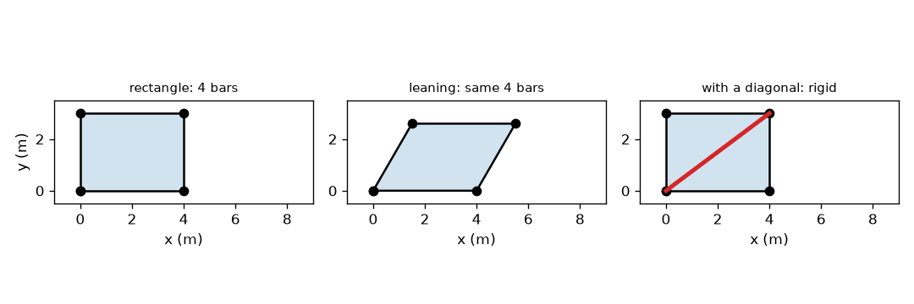
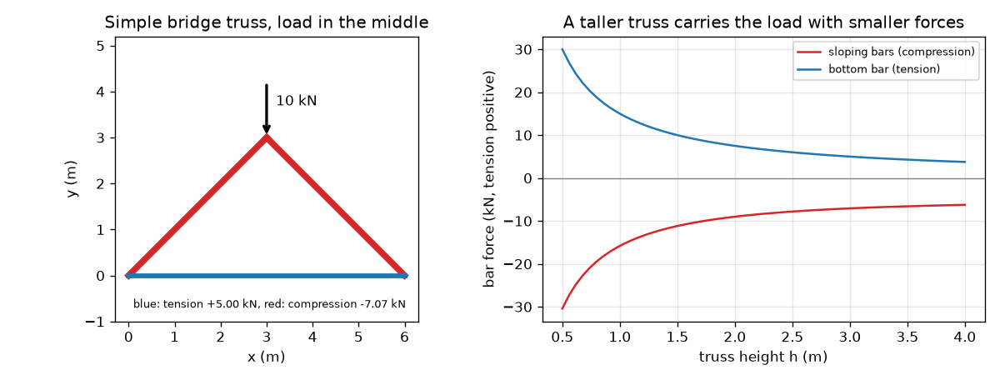

# அமர்வு 1: முக்கோணம் உறுதியானது, கம்பிகள் இழுவையோ அழுத்தமோ மட்டுமே தாங்குகின்றன

[Session 1 — हिन्दी](README.hi.md)

*நிலை 1 (கருத்தியல் ஊடாடும் மாதிரி) · சுமார் 60 நிமிடங்கள் · opentruss*

> இது எளிமைப்படுத்தப்பட்ட கல்வி மாதிரி. இது சரிபார்க்கப்பட்ட வடிவமைப்புக் கருவி அல்ல; உண்மையான கட்டமைப்புகள், மின் நிறுவல்கள், வாகனங்கள், தொழில்துறை செயல்முறைகள் அல்லது மருத்துவ முடிவுகளுக்கு இதைப் பயன்படுத்தக் கூடாது.

**முன்தேவைகள் (Prerequisites)**

- பள்ளி முக்கோணவியல்: சைன், கொசைன், டேன்ஜென்ட்.
- நீங்கள் PRIMER.md ஐப் படித்து, `python start.py 1` ஐ ஒருமுறை இயக்கியிருக்க வேண்டும்.

**கற்றல் நோக்கங்கள் (Learning objectives).** இந்த அமர்வுக்குப் பிறகு உங்களால்:

- ஆணிகளால் இணைக்கப்பட்ட கம்பிகளின் முக்கோணம் உறுதியானது, செவ்வகம் அல்ல என்பது ஏன் என்பதை விளக்க முடியும்.
- உறுதியான ஆணி-இணைப்புச் சட்டத்துக்குத் தேவையான கம்பிகளின் எண்ணிக்கையை, j இணைப்புகளுக்கு 2 j - 3, எண்ண முடியும்.
- ஓர் ஆணியில் விசைகளின் சமநிலையிலிருந்து எளிய பாலம் ட்ரஸ்ஸில் விசைகளைக் காண முடியும்.
- ட்ரஸ்ஸின் உயரத்துக்கு எதிரான கம்பி விசையின் வரைபடத்தைப் படித்து எந்தக் கம்பிகள் இழுவையிலும் எவை அழுத்தத்திலும் உள்ளன என்று சொல்ல முடியும்.

## A. நிஜ வாழ்க்கைப் பிரச்சினை
ஒரு ரயில் பாலத்தின் அடியிலோ கிரேன் கையிலோ பாருங்கள்: முக்கோணங்களாக இணைக்கப்பட்ட நேரான கம்பிகள் தெரியும். ஏன் செவ்வகங்கள் அல்ல, முக்கோணங்கள்? ஒரு கனமான லாரி சிறிய பாலத்தின் நடுவில் நிற்கும்போது எந்தக் கம்பிகள் இழுக்கப்படுகின்றன, எவை நசுக்கப்படுகின்றன? பொறியாளர்கள் அறிய வேண்டும், ஏனெனில் இழுக்கப்படும் கம்பியும் நசுக்கப்படும் கம்பியும் வெவ்வேறு விதமாகத் தோற்கின்றன. இந்த அமர்வு எளிமையான ட்ரஸ்ஸிலிருந்து படத்தைக் கட்டியெழுப்புகிறது. இது கல்வி மாதிரி, வடிவமைப்பு முறை அல்ல.

## B. கருத்தும் கோட்பாடும்
ட்ரஸ் (truss) என்பது ஆணிகளில் இணைக்கப்பட்ட நேரான கம்பிகளின் தொகுப்பு; சுமைகள் ஆணிகளில் மட்டுமே செயல்படுகின்றன. அப்போது ஒவ்வொரு கம்பியும் அதன் சொந்த அச்சில் மட்டுமே இழுக்கப்படுகிறது அல்லது தள்ளப்படுகிறது, வேறெதுவும் இல்லை. இழுக்கப்படும் கம்பி இழுவையில் (tension) உள்ளது (அதன் விசையை நேர்மறையாக எழுதுகிறோம், நீல நிறத்தில் வரைகிறோம்). தள்ளப்படும் கம்பி அழுத்தத்தில் (compression) உள்ளது (எதிர்மறை, சிவப்பு நிறத்தில் வரையப்படும்). செவ்வகமாக அமைந்த நான்கு ஆணிக் கம்பிகள் எல்லாக் கம்பி நீளங்களும் மாறாமல் இணைகரமாகச் சாயலாம்: செவ்வகம் ஓர் இயக்கமுறை அமைப்பு (mechanism). முக்கோணம் ஒரு பக்கத்தை மாற்றாமல் கோணங்களை மாற்ற முடியாது, எனவே அது உறுதியானது; j இணைப்புகள் கொண்ட சட்டத்துக்கு குறைந்தது 2 j - 3 கம்பிகள் தேவை. எளிமையான பாலம் ட்ரஸ்ஸில் (சுமையுள்ள உச்சியில் சந்திக்கும் இரு சம சாய்வுக் கம்பிகளும், அடிகளை இணைக்கும் அடிக்கம்பியும்) ஆதாரங்கள் ஒவ்வொன்றும் P/2 தாங்குகின்றன. உச்சியில் செங்குத்து விசைகளின் சமநிலை 2 F sin(theta) = P தருகிறது, ஓர் அடியில் கிடைமட்ட விசைகளின் சமநிலை அடிக்கம்பி விசையைத் தருகிறது.

| குறியீடு | பொருள் | அலகு |
|---|---|---|
| P | உச்சியில் உள்ள சுமை | kN |
| L | ஆதாரங்களுக்கு இடையிலான நீட்சி (இங்கு 6 m) | m |
| h | ஆதாரங்களுக்கு மேல் உச்சியின் உயரம் | m |
| theta | சாய்வுக் கம்பிகளின் சாய்வுக் கோணம் | டிகிரி |
| F_top | ஒவ்வொரு சாய்வுக் கம்பியிலும் விசை (எதிர்மறை = அழுத்தம்) | kN |
| F_bot | அடிக்கம்பியில் விசை (நேர்மறை = இழுவை) | kN |
| j | இணைப்புகளின் (ஆணிகளின்) எண்ணிக்கை | அலகு இல்லை |

**அனுமானங்கள் (Assumptions)**

- கம்பிகள் நேரானவை, எடையற்றவை.
- இணைப்புகள் உராய்வற்ற ஆணிகள், சுமைகள் ஆணிகளில் மட்டுமே செயல்படுகின்றன.
- ட்ரஸ் சிறு விலகலுடையது: சுமை ஏற்றும்போது அதன் வடிவம் மாறாது.
- ஒரு ஆணி ஆதாரமும் ஒரு உருளை ஆதாரமும் உள்ளன, எனவே கிடைமட்ட எதிர்வினை இல்லை.

$$ m_{\min}=2j-3\quad\text{(bars needed for a rigid frame of } j \text{ pins)} $$

$$ d^2=a^2+b^2-2ab\cos\varphi\quad\text{(diagonal of a pinned parallelogram)} $$

$$ \theta=\arctan\!\left(\frac{h}{L/2}\right) $$

$$ 2F_{\mathrm{top}}\sin\theta=-P\;\Rightarrow\;F_{\mathrm{top}}=-\frac{P}{2\sin\theta} $$

$$ F_{\mathrm{bot}}=\frac{P}{2\tan\theta} $$

## C. காட்சி விளக்கம்
முதல் படம் நான்கு கம்பிகளின் 4 m x 3 m செவ்வகம், அதே கம்பிகள் 60 டிகிரி மூலைக்குச் சாய்ந்தது (அதன் மூலைவிட்டம் 5.0 m இலிருந்து 3.606 m ஆகச் சுருங்குகிறது), 5 m மூலைவிட்டம் சேர்த்த செவ்வகம் (அது 90 டிகிரி வடிவத்தை மட்டுமே அனுமதிக்கிறது) ஆகியவற்றைக் காட்டுகிறது. இரண்டாவது படம் உச்சியில் 10 kN சுமையுடன் எளிய பாலத்தை வரைகிறது, சாய்வுக் கம்பிகள் சிவப்பு, அடிக்கம்பி நீலம், மேலும் உயரம் h க்கு எதிராக இரு விசைகளையும் வரைகிறது: ட்ரஸ் உயரமாகும்போது இரண்டும் குறைகின்றன.

*ஒரு செவ்வகம் சாய்கிறது (அதே நான்கு கம்பிகள்); ஒரு மூலைவிட்டம் அதை உறுதியாக்குகிறது.*

*10 kN சுமையுடன் எளிய பாலம் ட்ரஸ், உயரத்துக்கு எதிரான அதன் கம்பி விசைகளும்.*

## D. ஊடாடும் உருவகப்படுத்தல்
பாடத்தை இயக்குங்கள் (`python start.py 1`), பின் நேரடி பயன்பாட்டைத் திறக்கவும்: [அமர்வு 1: ஓர் எளிய பாலம் ட்ரஸ்](https://krunalpanchal1995.github.io/pan-iit-oss/opentruss/session-01/) (அல்லது இந்தக் கோப்புறையில் உள்ள `app.html`). உயர ஸ்லைடரை நகர்த்திக் கம்பிகளின் அகலம் மாறுவதைப் பாருங்கள்: ட்ரஸ் தட்டையாக இருக்கும்தோறும் ஒவ்வொரு கம்பியும் கடினமாக உழைக்கிறது. இரு விசை வளைவுகளையும் அவற்றில் உங்கள் தற்போதைய புள்ளியையும் காண வரைபடக் காட்சிக்கு மாறுங்கள்.

**சவால்.** அடிக்கம்பி இழுவையை 5 kN க்குக் கீழே வைத்துக்கொண்டு குறைந்தது 10 kN சுமையைத் தாங்குங்கள்.

## E. தீர்க்கப்பட்ட எடுத்துக்காட்டும் சோதனையும்
**சிக்கல்.** ஒரு சிறிய பாலம் ட்ரஸ் 6 m நீட்சி கொண்டது. உச்சி 3 m உயரத்தில் உள்ளது, 10 kN தாங்குகிறது. ஒவ்வொரு கம்பியிலும் விசையைக் கண்டு அது இழுவையிலா அழுத்தத்திலா என்று கூறுக.

1. ஆதாரங்கள்: சமச்சீரால் ஒவ்வொன்றும் மேல்நோக்கி 10 / 2 = 5 kN தாங்குகிறது.
2. சாய்வுக் கோணம்: theta = arctan(3 / 3) = 45 டிகிரி, எனவே sin(theta) = 0.7071, tan(theta) = 1.
3. உச்சி ஆணி, செங்குத்து விசைகளின் கூட்டுத்தொகை = 0: 2 F sin(45) = 10, எனவே ஒவ்வொரு சாய்வு விசையின் அளவு 10 / (2 * 0.7071) = 7.07 kN. கம்பிகள் உச்சியைத் தள்ளுகின்றன, எனவே அவை அழுத்தத்தில் உள்ளன: F_top = -7.07 kN.
4. இடது அடி ஆணி, கிடைமட்ட விசைகளின் கூட்டுத்தொகை = 0: சாய்வுக் கம்பி அடியை 7.07 * cos(45) = 5.00 kN ஆல் வெளிப்புறம் தள்ளுகிறது, எனவே அடிக்கம்பி அதை 5.00 kN ஆல் திரும்ப இழுக்க வேண்டும்: F_bot = +5.00 kN (இழுவை).
5. அடியில் செங்குத்துச் சமநிலையைச் சரிபாருங்கள்: 7.07 * sin(45) = 5.00 kN, 5 kN எதிர்வினைக்குச் சமம்.

**விடை.** இரு சாய்வுக் கம்பிகள் -7.07 kN (அழுத்தம்) தாங்குகின்றன, அடிக்கம்பி +5.00 kN (இழுவை) தாங்குகிறது.

**சோதனை.** பேப்பர் ஃபாஸ்டனர்களால் ஆணியிடப்பட்ட மூன்று மர அளவுகோல்களால் ட்ரஸ் செய்து, இரு புத்தகங்களின் மேல் வைத்து, உச்சியில் அறிந்த நிறையுள்ள பையைத் தொங்கவிடுங்கள். அடி அளவுகோலுக்குப் பதில் ஸ்பிரிங் தராசு அல்லது ரப்பர் பேண்டை வையுங்கள்: அது நீள்கிறது, எனவே இழுவையில் உள்ளது. உச்சியில் அழுத்துங்கள், இரு அளவுகோல்கள் சற்றுச் சுருங்குகின்றன, எனவே அழுத்தத்தில் உள்ளன. மாதிரியிலிருந்து வேறுபாடுகள்: உண்மையான இணைப்புகளுக்கு உராய்வு உண்டு, அவை சரியான ஆணிகள் அல்ல, அளவுகோல்களுக்கு எடை உண்டு, புத்தகங்கள் வெளிப்புறம் நகரலாம், எனவே நீங்கள் அளக்கும் அடிக்கம்பி விசை 10 kN க்கு 5.00 kN ஐ விடச் சற்றுக் குறைவாகவோ அதிகமாகவோ இருக்கும்.

## F. மதிப்பீடும் வடிவமைப்புச் சவாலும்
**கேள்வி வகை A: கருத்தியல்.** ஒரு மூலைவிட்டத்தைச் சேர்ப்பது ஆணிக் கம்பிகளின் செவ்வகத்தை உறுதியாக்குவது ஏன், அது இல்லாத செவ்வகம் தோற்பது ஏன்? 4 m x 3 m செவ்வகத்தின் எண்களைப் பயன்படுத்துங்கள்.

குறிப்பு

90 டிகிரி மூலையிலும் சாய்ந்த 60 டிகிரி மூலையிலும் மூலைவிட்டத்தின் நீளத்தை ஒப்பிடுங்கள்.

படிப்படியான தீர்வு

மூலைவிட்டம் இல்லாமல், சட்டம் சாயும்போது நான்கு கம்பி நீளங்களும் மாறாது, எனவே எதுவும் அதைத் தடுப்பதில்லை: அது ஓர் இயக்கமுறை அமைப்பு. அது 90 இலிருந்து 60 டிகிரிக்குச் சாயும்போது எதிர் மூலைகளுக்கு இடையிலான தூரம் 5.0 m இலிருந்து 3.606 m ஆக மாறுகிறது. நிலைப்படுத்தப்பட்ட 5 m கம்பி அந்தத் தூரத்தை நிலைப்படுத்துகிறது, கொசைன் விதிப்படி 90 டிகிரி மூலை மட்டுமே 5 m தரும், எனவே சட்டம் இனி நகர முடியாது. 4 இணைப்புகள் உள்ள சட்டத்துக்கு 2*4 - 3 = 5 கம்பிகள் தேவை, செவ்வகத்துக்கு 4 மட்டுமே உள்ளன.

**கேள்வி வகை B: எண்சார்ந்த.** 6 m நீட்சியும் 1.5 m உயரமும் கொண்ட ட்ரஸ் உச்சியில் 12 kN தாங்குகிறது. சாய்வுக் கம்பிகளிலும் அடிக்கம்பியிலும் விசையை, குறிகளுடன், காண்க.

குறிப்பு

tan(theta) = 1.5 / 3 = 0.5, எனவே sin(theta) = 0.4472.

படிப்படியான தீர்வு

F_top = -12 / (2 * 0.4472) = -13.42 kN (அழுத்தம்). F_bot = 12 / (2 * 0.5) = +12.00 kN (இழுவை). சரிபார்ப்பு: சாய்வுக் கம்பியின் செங்குத்துப் பகுதி 13.42 * 0.4472 = 6.0 kN, சுமையின் பாதி. அலகுகள்: kN.

**கேள்வி வகை C: வரைபடம் மற்றும் உருவகப்படுத்தல் விளக்கம்.** உயரத்துக்கு எதிரான விசை வரைபடத்தில் (10 kN சுமை), ட்ரஸ்ஸை 0.5 m இலிருந்து 4 m வரை உயரமாக்கும்போது விசைகளுக்கு என்ன ஆகிறது? இரு முனைகளிலும் விசைகளைத் தருக.

குறிப்பு

h = 0.5, h = 4 இல் சிவப்பு, நீல வளைவுகளைப் படியுங்கள்.

படிப்படியான தீர்வு

h வளரும்போது இரு வளைவுகளும் இறங்குகின்றன. h = 0.5 m இல் கம்பிகள் -30.41 kN, +30.00 kN தாங்குகின்றன, 10 kN சுமையின் மூன்று மடங்கு. h = 4 m இல் அவை -6.25 kN, +3.75 kN தாங்குகின்றன. தட்டையான ட்ரஸ் கிட்டத்தட்ட நேரான கேபிளும் தாங்குகம்பமும் ஆகும், அது ஆழமற்ற கோணத்தில் சுமையை எதிர்க்க வேண்டும், எனவே விசைகள் மிகப் பெரியவை.

**கேள்வி வகை D: வடிவமைப்பு மற்றும் மேம்படுத்தல் சவால்.** வடிவமைப்பு: 6 m நீட்சியில் 10 kN சுமையின் கீழ் அடிக்கம்பியின் இழுவை அதிகபட்சம் 4 kN ஆக இருக்கும் மிகச் சிறிய உயரத்தை (அருகிலுள்ள 0.25 m க்கு) தேர்ந்தெடுங்கள். அப்போது ஒவ்வொரு சாய்வுக் கம்பியும் எவ்வளவு அழுத்தம் தாங்குகிறது, நீங்கள் எதை விட்டுக்கொடுக்கிறீர்கள்?

குறிப்பு

F_bot = P / (2 tan theta) = P * 3 / (2 h).

படிப்படியான தீர்வு

F_bot = 10 * 3 / (2 h) = 15 / h <= 4 இலிருந்து h >= 3.75 m. h = 3.75 m இல் சாய்வு 51.3 டிகிரி, அடிக்கம்பிக்குச் சரியாக +4.00 kN, ஒவ்வொரு சாய்வுக் கம்பிக்கும் -6.40 kN. சமரசம் (trade-off): உயரமான ட்ரஸ் விசைகளைக் குறைக்கிறது, ஆனால் நீளமான கம்பிகள், அதிக உயர இடைவெளி, பக்கவாட்டுக் காற்றுக்கு எதிரான கூடுதல் வலுவூட்டல் தேவை, நீளமான அழுத்தக் கம்பிகள் வளைந்து சரியும் (buckling) வாய்ப்பு அதிகம்.

[RUBRIC.md](../../RUBRIC.md) மூலம் உங்களை நீங்களே மதிப்பிடுங்கள். தாளில் வேலை செய்ய [செயல்பாட்டுத் தாளை](activity_sheet.md) அச்சிடுங்கள்.

## பொதுவான தவறான புரிதல்கள்
| பொதுவான தவறான புரிதல் | உண்மையில் சரியானது |
|---|---|
| வலுவான கம்பிகளால் செய்த செவ்வகம் உறுதியானது. | ஆணிகளால் இணைக்கப்பட்ட நான்கு கம்பிகள் எவ்வளவு வலுவாக இருந்தாலும் சாயும்; முக்கோணம் (அல்லது முக்கோணங்களாக வலுப்படுத்திய சட்டம்) மட்டுமே வடிவத்தைத் தக்கவைக்கும். |
| பாலத்தில் உள்ள ஒவ்வொரு கம்பியும் இழுக்கப்படுகிறது. | ட்ரஸ்ஸில் சில கம்பிகள் இழுக்கப்படுகின்றன (இழுவை), சில தள்ளப்படுகின்றன (அழுத்தம்); விசையின் குறி எது என்று சொல்கிறது. |
| உயரமான ட்ரஸ்ஸின் ஒவ்வொரு கம்பிக்கும் அதிக எஃகு வேண்டும். | கொடுத்த சுமைக்கு உயரமான ட்ரஸ்களில் கம்பி விசைகள் சிறியவை (ஆனால் கம்பிகள் நீளமானவை, எனவே மொத்த எஃகு ஒரு சமரசம்). |
| ட்ரஸ்ஸில் உள்ள கம்பி ஒரு உத்தரம் போல வளைகிறது. | சுமைகள் ஆணிகளில் மட்டுமே இருக்கும்போது கம்பி தன் சொந்த அச்சில் உள்ள விசையை மட்டும் தாங்குகிறது; வளைவு இந்த மாதிரிக்கு வெளியே உள்ளது. |

## சொற்களஞ்சியம் (Glossary)
- **ட்ரஸ் (truss)**: ஆணிகளில் இணைக்கப்பட்ட நேரான கம்பிகளின் தொகுப்பு, ஆணிகளில் மட்டுமே சுமை ஏற்றப்படுகிறது
- **இழுவை (tension)**: கம்பி வழியே இழுக்கும் விசை; இந்த ரெப்போவில் நேர்மறை, நீல நிறத்தில் வரையப்படுகிறது
- **அழுத்தம் (compression)**: கம்பி வழியே தள்ளும் விசை; இந்த ரெப்போவில் எதிர்மறை, சிவப்பு நிறத்தில் வரையப்படுகிறது
- **ஆணி (pin)**: கம்பிகளைத் திரும்ப அனுமதித்து விசையைக் கடத்தும் உராய்வற்ற இணைப்பு
- **இயக்கமுறை அமைப்பு (mechanism)**: எந்தக் கம்பியின் நீளமும் மாறாமல் நகரக்கூடிய சட்டம்
- **எதிர்வினை (reaction)**: ஆதாரம் திரும்பத் தள்ளும் விசை

## முடிவு
1. [exercises.md](exercises.md) இல் உள்ள மூன்று நிரலாக்கப் பணிகளைச் செய்யுங்கள்.
2. உங்கள் மாற்றங்களுக்குப் பிறகு `python start.py 1` ஐ மீண்டும் இயக்குங்கள். அது சோதனைச்சாவடியுடன் முடிகிறது; அது `PASS` என அச்சிட்டால், நீங்கள் முடித்துவிட்டீர்கள். (சோதனைச்சாவடி மட்டும்: `python start.py check 1`.)

அடுத்தது: [அமர்வு 2](../session-02/README.md)
