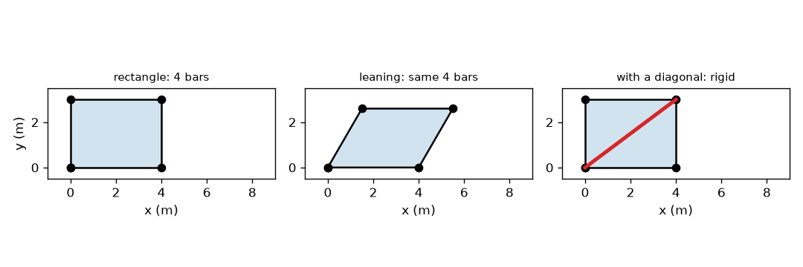
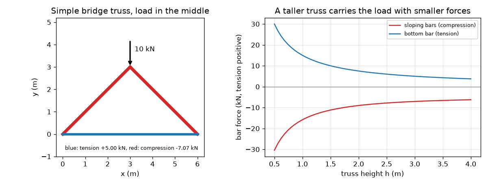

# సెషన్ 1: త్రిభుజం దృఢమైనది, కడ్డీలు తన్యత లేదా సంపీడనం మాత్రమే మోస్తాయి

[Session 1 — हिन्दी](README.hi.md)

*స్థాయి 1 (భావనాత్మక ఇంటరాక్టివ్ మోడల్) · సుమారు 60 నిమిషాలు · opentruss*

> ఇది సరళీకరించిన విద్యా మోడల్. ఇది ధృవీకరించబడిన డిజైన్ సాధనం కాదు; నిజమైన నిర్మాణాలు, విద్యుత్ ఇన్‌స్టాలేషన్‌లు, వాహనాలు, పారిశ్రామిక ప్రక్రియలు లేదా వైద్య నిర్ణయాల కోసం దీనిని ఉపయోగించకూడదు.

**ముందస్తు అవసరాలు (Prerequisites)**

- పాఠశాల త్రికోణమితి: సైన్, కొసైన్, టాంజెంట్.
- మీరు PRIMER.md చదివి, `python start.py 1` ను ఒకసారి రన్ చేసి ఉండాలి.

**అభ్యాస లక్ష్యాలు (Learning objectives).** ఈ సెషన్ తర్వాత మీరు:

- పిన్‌లతో కలిపిన కడ్డీల త్రిభుజం దృఢమైనదని, దీర్ఘచతురస్రం కాదని ఎందుకో వివరించగలరు.
- దృఢమైన పిన్-సంధి చట్రానికి అవసరమైన కడ్డీల సంఖ్యను, j సంధులకు 2 j - 3, లెక్కించగలరు.
- ఒక పిన్ వద్ద బలాల సమతుల్యత నుండి సరళమైన వంతెన ట్రస్‌లో బలాలను కనుగొనగలరు.
- ట్రస్ ఎత్తుకు వ్యతిరేకంగా కడ్డీ బలం గ్రాఫ్‌ను చదివి ఏ కడ్డీలు తన్యతలో, ఏవి సంపీడనంలో ఉన్నాయో చెప్పగలరు.

## A. నిజ జీవిత సమస్య
రైలు వంతెన కిందకు లేదా క్రేన్ చేతిని చూడండి: త్రిభుజాలుగా కలిపిన నేరు కడ్డీలు కనిపిస్తాయి. దీర్ఘచతురస్రాలు కాకుండా త్రిభుజాలు ఎందుకు? ఒక బరువైన లారీ చిన్న వంతెన మధ్యలో ఆగినప్పుడు ఏ కడ్డీలు లాగబడతాయి, ఏవి నలగ్గొట్టబడతాయి? ఇంజనీర్లు తెలుసుకోవాలి, ఎందుకంటే లాగబడిన కడ్డీ, నలగ్గొట్టబడిన కడ్డీ వేర్వేరు విధాలుగా విఫలమవుతాయి. ఈ సెషన్ సరళమైన ట్రస్ నుండి చిత్రాన్ని నిర్మిస్తుంది. ఇది విద్యా మోడల్, డిజైన్ పద్ధతి కాదు.

## B. భావన మరియు సిద్ధాంతం
ట్రస్ (truss) అంటే పిన్‌ల వద్ద కలిపిన నేరు కడ్డీల సమూహం; భారాలు పిన్‌ల వద్ద మాత్రమే పనిచేస్తాయి. అప్పుడు ప్రతి కడ్డీ తన సొంత అక్షం వెంబడి మాత్రమే లాగబడుతుంది లేదా నెట్టబడుతుంది, మరేమీ కాదు. లాగబడిన కడ్డీ తన్యతలో (tension) ఉంటుంది (దాని బలాన్ని ధనాత్మకంగా రాస్తాము, నీలి రంగులో గీస్తాము). నెట్టబడిన కడ్డీ సంపీడనంలో (compression) ఉంటుంది (ఋణాత్మకం, ఎరుపు రంగులో గీస్తాము). దీర్ఘచతురస్రంగా ఉన్న నాలుగు పిన్ కడ్డీలు అన్ని కడ్డీ పొడవులూ మారకుండా సమాంతర చతుర్భుజంగా ఒరగవచ్చు: దీర్ఘచతురస్రం ఒక యంత్రాంగం (mechanism). త్రిభుజం ఒక భుజాన్ని మార్చకుండా కోణాలను మార్చలేదు, కాబట్టి అది దృఢమైనది; j సంధులు ఉన్న చట్రానికి కనీసం 2 j - 3 కడ్డీలు కావాలి. సరళమైన వంతెన ట్రస్‌లో (భారం ఉన్న శిఖరం వద్ద కలిసే రెండు సమాన వాలు కడ్డీలు, పాదాలను కలిపే అడుగు కడ్డీ) ఆధారాలు ఒక్కొక్కటి P/2 మోస్తాయి. శిఖరం వద్ద లంబ బలాల సమతుల్యత 2 F sin(theta) = P ఇస్తుంది, ఒక పాదం వద్ద క్షితిజ సమాంతర బలాల సమతుల్యత అడుగు కడ్డీ బలాన్ని ఇస్తుంది.

| చిహ్నం | అర్థం | యూనిట్ |
|---|---|---|
| P | శిఖరం వద్ద భారం | kN |
| L | ఆధారాల మధ్య విస్తీర్ణం (ఇక్కడ 6 m) | m |
| h | ఆధారాల పైన శిఖరం ఎత్తు | m |
| theta | వాలు కడ్డీల వాలు కోణం | డిగ్రీలు |
| F_top | ప్రతి వాలు కడ్డీలో బలం (ఋణం = సంపీడనం) | kN |
| F_bot | అడుగు కడ్డీలో బలం (ధనం = తన్యత) | kN |
| j | సంధుల (పిన్‌ల) సంఖ్య | యూనిట్ లేదు |

**ఊహలు (Assumptions)**

- కడ్డీలు నేరుగా, బరువులేనివి.
- సంధులు రాపిడి లేని పిన్‌లు, భారాలు పిన్‌ల వద్ద మాత్రమే పనిచేస్తాయి.
- ట్రస్ చిన్న విక్షేపం గలది: భారం పడినప్పుడు దాని ఆకారం మారదు.
- ఒక పిన్ ఆధారం, ఒక రోలర్ ఆధారం ఉన్నాయి, కాబట్టి క్షితిజ సమాంతర ప్రతిచర్య లేదు.

$$ m_{\min}=2j-3\quad\text{(bars needed for a rigid frame of } j \text{ pins)} $$

$$ d^2=a^2+b^2-2ab\cos\varphi\quad\text{(diagonal of a pinned parallelogram)} $$

$$ \theta=\arctan\!\left(\frac{h}{L/2}\right) $$

$$ 2F_{\mathrm{top}}\sin\theta=-P\;\Rightarrow\;F_{\mathrm{top}}=-\frac{P}{2\sin\theta} $$

$$ F_{\mathrm{bot}}=\frac{P}{2\tan\theta} $$

## C. దృశ్య వివరణ
మొదటి చిత్రం నాలుగు కడ్డీల 4 m x 3 m దీర్ఘచతురస్రం, అవే కడ్డీలు 60 డిగ్రీల మూలకు ఒరిగినది (దాని కర్ణం 5.0 m నుండి 3.606 m కు తగ్గుతుంది), 5 m కర్ణం చేర్చిన దీర్ఘచతురస్రం (అది 90 డిగ్రీల ఆకారాన్ని మాత్రమే అనుమతిస్తుంది) చూపుతుంది. రెండవ చిత్రం శిఖరం వద్ద 10 kN భారంతో సరళ వంతెనను గీస్తుంది, వాలు కడ్డీలు ఎరుపు, అడుగు కడ్డీ నీలం, మరియు ఎత్తు h కు వ్యతిరేకంగా రెండు బలాలను గీస్తుంది: ట్రస్ ఎత్తయ్యే కొద్దీ రెండూ తగ్గుతాయి.

*ఒక దీర్ఘచతురస్రం ఒరుగుతుంది (అవే నాలుగు కడ్డీలు); ఒక కర్ణం దానిని దృఢంగా చేస్తుంది.*

*10 kN భారంతో సరళ వంతెన ట్రస్, ఎత్తుకు వ్యతిరేకంగా దాని కడ్డీ బలాలు.*

## D. ఇంటరాక్టివ్ సిమ్యులేషన్
పాఠాన్ని రన్ చేయండి (`python start.py 1`), తర్వాత లైవ్ యాప్‌ను తెరవండి: [సెషన్ 1: ఒక సరళ వంతెన ట్రస్](https://krunalpanchal1995.github.io/pan-iit-oss/opentruss/session-01/) (లేదా ఈ ఫోల్డర్‌లోని `app.html`). ఎత్తు స్లైడర్‌ను జరిపి కడ్డీల వెడల్పు మారడం చూడండి: ట్రస్ ఎంత చదునుగా ఉంటే ప్రతి కడ్డీ అంత కష్టపడుతుంది. రెండు బల వక్రాలను, వాటిపై మీ ప్రస్తుత బిందువును చూడటానికి గ్రాఫ్ వీక్షణకు మారండి.

**సవాలు.** అడుగు కడ్డీ తన్యతను 5 kN కంటే తక్కువగా ఉంచుతూ కనీసం 10 kN భారాన్ని మోయండి.

## E. సాధించిన ఉదాహరణ మరియు ప్రయోగం
**సమస్య.** ఒక చిన్న వంతెన ట్రస్ విస్తీర్ణం 6 m. శిఖరం 3 m ఎత్తులో ఉంది, 10 kN మోస్తుంది. ప్రతి కడ్డీలో బలాన్ని కనుగొని అది తన్యతలోనా సంపీడనంలోనా చెప్పండి.

1. ఆధారాలు: సౌష్ఠవం వల్ల ప్రతిదీ పైకి 10 / 2 = 5 kN మోస్తుంది.
2. వాలు కోణం: theta = arctan(3 / 3) = 45 డిగ్రీలు, కాబట్టి sin(theta) = 0.7071, tan(theta) = 1.
3. శిఖరం పిన్, లంబ బలాల మొత్తం = 0: 2 F sin(45) = 10, కాబట్టి ప్రతి వాలు బలం పరిమాణం 10 / (2 * 0.7071) = 7.07 kN. కడ్డీలు శిఖరాన్ని నెడతాయి, కాబట్టి అవి సంపీడనంలో ఉన్నాయి: F_top = -7.07 kN.
4. ఎడమ పాదం పిన్, క్షితిజ సమాంతర బలాల మొత్తం = 0: వాలు కడ్డీ పాదాన్ని 7.07 * cos(45) = 5.00 kN తో బయటకు నెడుతుంది, కాబట్టి అడుగు కడ్డీ దానిని 5.00 kN తో వెనక్కి లాగాలి: F_bot = +5.00 kN (తన్యత).
5. పాదం వద్ద లంబ సమతుల్యత సరిచూడండి: 7.07 * sin(45) = 5.00 kN, 5 kN ప్రతిచర్యతో సమానం.

**సమాధానం.** రెండు వాలు కడ్డీలు -7.07 kN (సంపీడనం) మోస్తాయి, అడుగు కడ్డీ +5.00 kN (తన్యత) మోస్తుంది.

**ప్రయోగం.** పేపర్ ఫాస్టెనర్లతో పిన్ చేసిన మూడు చెక్క స్కేళ్ళతో ట్రస్ తయారు చేసి, రెండు పుస్తకాల పైన ఉంచి, శిఖరం నుండి తెలిసిన ద్రవ్యరాశి గల సంచిని వేలాడదీయండి. అడుగు స్కేలు స్థానంలో స్ప్రింగ్ తక్కెడ లేదా రబ్బరు బ్యాండ్ ఉంచండి: అది సాగుతుంది, కాబట్టి తన్యతలో ఉంది. శిఖరంపై నొక్కండి, రెండు స్కేళ్ళు కొద్దిగా కుదించుకుపోతాయి, కాబట్టి సంపీడనంలో ఉన్నాయి. మోడల్‌తో తేడాలు: నిజమైన సంధులకు రాపిడి ఉంది, అవి ఖచ్చితమైన పిన్‌లు కావు, స్కేళ్ళకు బరువు ఉంది, పుస్తకాలు బయటకు జరగవచ్చు, కాబట్టి మీరు కొలిచే అడుగు కడ్డీ బలం 10 kN కు 5.00 kN కంటే కొంత తక్కువగా లేదా ఎక్కువగా ఉంటుంది.

## F. మూల్యాంకనం మరియు డిజైన్ సవాలు
**ప్రశ్న రకం A: భావనాత్మక.** ఒక కర్ణాన్ని చేర్చడం పిన్ కడ్డీల దీర్ఘచతురస్రాన్ని ఎందుకు దృఢంగా చేస్తుంది, అది లేని దీర్ఘచతురస్రం ఎందుకు విఫలమవుతుంది? 4 m x 3 m దీర్ఘచతురస్రం సంఖ్యలను ఉపయోగించండి.

సూచన

90 డిగ్రీల మూల వద్ద, ఒరిగిన 60 డిగ్రీల మూల వద్ద కర్ణం పొడవును పోల్చండి.

దశలవారీ పరిష్కారం

కర్ణం లేకుండా, చట్రం ఒరిగినప్పుడు నాలుగు కడ్డీల పొడవులూ అలాగే ఉంటాయి, కాబట్టి ఏదీ దానిని ఆపదు: అది ఒక యంత్రాంగం. అది 90 నుండి 60 డిగ్రీలకు ఒరిగినప్పుడు ఎదురెదురు మూలల మధ్య దూరం 5.0 m నుండి 3.606 m కు మారుతుంది. స్థిరమైన 5 m కడ్డీ ఆ దూరాన్ని స్థిరపరుస్తుంది, కొసైన్ నియమం ప్రకారం 90 డిగ్రీల మూల మాత్రమే 5 m ఇస్తుంది, కాబట్టి చట్రం ఇక కదలలేదు. 4 సంధులున్న చట్రానికి 2*4 - 3 = 5 కడ్డీలు కావాలి, దీర్ఘచతురస్రానికి 4 మాత్రమే ఉన్నాయి.

**ప్రశ్న రకం B: సంఖ్యాత్మక.** 6 m విస్తీర్ణం, 1.5 m ఎత్తు గల ట్రస్ శిఖరం వద్ద 12 kN మోస్తుంది. వాలు కడ్డీలలో, అడుగు కడ్డీలో బలాన్ని, గుర్తులతో, కనుగొనండి.

సూచన

tan(theta) = 1.5 / 3 = 0.5, కాబట్టి sin(theta) = 0.4472.

దశలవారీ పరిష్కారం

F_top = -12 / (2 * 0.4472) = -13.42 kN (సంపీడనం). F_bot = 12 / (2 * 0.5) = +12.00 kN (తన్యత). సరిచూపు: వాలు కడ్డీ లంబ భాగం 13.42 * 0.4472 = 6.0 kN, భారంలో సగం. యూనిట్లు: kN.

**ప్రశ్న రకం C: గ్రాఫ్ మరియు సిమ్యులేషన్ వ్యాఖ్యానం.** ఎత్తుకు వ్యతిరేకంగా బలం గ్రాఫ్‌లో (10 kN భారం), ట్రస్‌ను 0.5 m నుండి 4 m వరకు ఎత్తు చేసినప్పుడు బలాలకు ఏమి జరుగుతుంది? రెండు చివరల బలాలను ఇవ్వండి.

సూచన

h = 0.5, h = 4 వద్ద ఎరుపు, నీలి వక్రాలను చదవండి.

దశలవారీ పరిష్కారం

h పెరిగే కొద్దీ రెండు వక్రాలూ తగ్గుతాయి. h = 0.5 m వద్ద కడ్డీలు -30.41 kN, +30.00 kN మోస్తాయి, 10 kN భారానికి మూడు రెట్లు. h = 4 m వద్ద అవి -6.25 kN, +3.75 kN మోస్తాయి. చదునైన ట్రస్ దాదాపు నేరు కేబుల్, స్తంభంలా ఉంటుంది, అది లోతు తక్కువ కోణంలో భారాన్ని ఎదిరించాలి, కాబట్టి బలాలు చాలా పెద్దవి.

**ప్రశ్న రకం D: డిజైన్ మరియు ఆప్టిమైజేషన్ సవాలు.** డిజైన్: 6 m విస్తీర్ణంలో 10 kN భారం కింద అడుగు కడ్డీ తన్యత గరిష్ఠంగా 4 kN అయ్యేలా అతి చిన్న ఎత్తును (దగ్గరి 0.25 m కు) ఎంచుకోండి. అప్పుడు ప్రతి వాలు కడ్డీ ఎంత సంపీడనం మోస్తుంది, మీరు దేనిని వదులుకుంటున్నారు?

సూచన

F_bot = P / (2 tan theta) = P * 3 / (2 h).

దశలవారీ పరిష్కారం

F_bot = 10 * 3 / (2 h) = 15 / h <= 4 నుండి h >= 3.75 m. h = 3.75 m వద్ద వాలు 51.3 డిగ్రీలు, అడుగు కడ్డీకి సరిగ్గా +4.00 kN, ప్రతి వాలు కడ్డీకి -6.40 kN. రాజీ (trade-off): ఎత్తైన ట్రస్ బలాలను తగ్గిస్తుంది, కానీ పొడవైన కడ్డీలు, ఎక్కువ ఎత్తు ఖాళీ, పక్క గాలికి వ్యతిరేకంగా మరింత బలపరచడం కావాలి, పొడవైన సంపీడన కడ్డీలు వంగిపోయే (buckling) అవకాశం ఎక్కువ.

[RUBRIC.md](../../RUBRIC.md) తో మిమ్మల్ని మీరు స్కోర్ చేసుకోండి. కాగితంపై పని చేయడానికి [కార్యాచరణ షీట్](activity_sheet.md) ప్రింట్ చేయండి.

## సాధారణ అపోహలు
| సాధారణ అపోహ | వాస్తవంగా నిజమైనది |
|---|---|
| బలమైన కడ్డీలతో చేసిన దీర్ఘచతురస్రం దృఢమైనది. | పిన్‌లతో కలిపిన నాలుగు కడ్డీలు ఎంత బలంగా ఉన్నా ఒరుగుతాయి; త్రిభుజం (లేదా త్రిభుజాలుగా బలపరచిన చట్రం) మాత్రమే ఆకారాన్ని నిలుపుకుంటుంది. |
| వంతెనలోని ప్రతి కడ్డీ లాగబడుతుంది. | ట్రస్‌లో కొన్ని కడ్డీలు లాగబడతాయి (తన్యత), కొన్ని నెట్టబడతాయి (సంపీడనం); బలం గుర్తు ఏదో చెబుతుంది. |
| ఎత్తైన ట్రస్ ప్రతి కడ్డీకి ఎక్కువ ఉక్కు కావాలి. | ఇచ్చిన భారానికి ఎత్తైన ట్రస్‌లలో కడ్డీ బలాలు తక్కువ (కానీ కడ్డీలు పొడవైనవి, కాబట్టి మొత్తం ఉక్కు ఒక రాజీ). |
| ట్రస్‌లోని కడ్డీ దూలంలా వంగుతుంది. | భారాలు పిన్‌ల వద్ద మాత్రమే ఉన్నప్పుడు కడ్డీ తన సొంత అక్షం వెంబడి బలాన్ని మాత్రమే మోస్తుంది; వంగడం ఈ మోడల్ పరిధికి వెలుపల ఉంది. |

## పదకోశం (Glossary)
- **ట్రస్ (truss)**: పిన్‌ల వద్ద కలిపిన నేరు కడ్డీల సమూహం, పిన్‌ల వద్ద మాత్రమే భారం పడుతుంది
- **తన్యత (tension)**: కడ్డీ వెంబడి లాగే బలం; ఈ రెపోలో ధనాత్మకం, నీలి రంగులో గీయబడుతుంది
- **సంపీడనం (compression)**: కడ్డీ వెంబడి నెట్టే బలం; ఈ రెపోలో ఋణాత్మకం, ఎరుపు రంగులో గీయబడుతుంది
- **పిన్ (pin)**: కడ్డీలను తిరగనిచ్చి బలాన్ని ప్రసారం చేసే రాపిడి లేని సంధి
- **యంత్రాంగం (mechanism)**: ఏ కడ్డీ పొడవూ మారకుండా కదలగల చట్రం
- **ప్రతిచర్య (reaction)**: ఆధారం వెనక్కి నెట్టే బలం

## ముగింపు
1. [exercises.md](exercises.md) లోని మూడు కోడింగ్ పనులు చేయండి.
2. మీ మార్పుల తర్వాత `python start.py 1` ను మళ్ళీ రన్ చేయండి. అది చెక్‌పాయింట్‌తో ముగుస్తుంది; అది `PASS` అని ప్రింట్ చేసినప్పుడు, మీరు పూర్తి చేసినట్లు. (చెక్‌పాయింట్ మాత్రమే: `python start.py check 1`.)

తదుపరి: [సెషన్ 2](../session-02/README.md)
