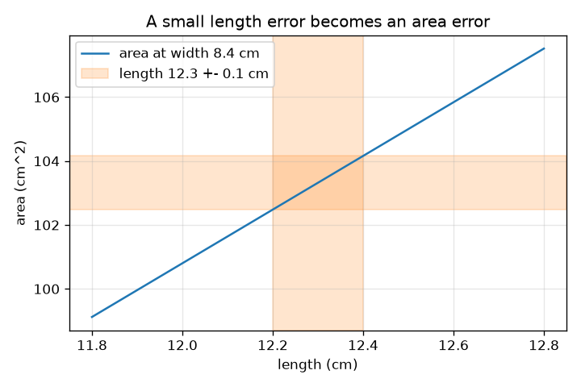
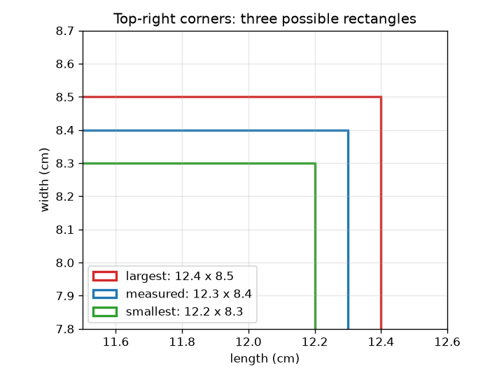

# सत्र 1: हर माप में त्रुटि होती है

*स्तर 1 (वैचारिक इंटरैक्टिव मॉडल) · लगभग 60 मिनट · openuncertainty*

> यह एक सरलीकृत शैक्षिक मॉडल (simplified educational model) है। यह कोई सत्यापित डिज़ाइन टूल नहीं है और इसका उपयोग वास्तविक संरचनाओं, बिजली की स्थापनाओं, वाहनों, औद्योगिक प्रक्रियाओं या चिकित्सा निर्णयों के लिए नहीं किया जाना चाहिए।

**पूर्व-आवश्यकताएँ (Prerequisites)**

- गुणा और प्रतिशत।
- आपने PRIMER.md पढ़ लिया है और `python start.py 1` एक बार चला लिया है।

**सीखने के उद्देश्य (Learning objectives).** इस सत्र के बाद आप:

- किसी माप को मान +- त्रुटि (error) के रूप में लिख सकेंगे और उसे एक अंतराल (interval) के रूप में पढ़ सकेंगे।
- दो अनिश्चित लंबाइयों से किसी आयत का सबसे छोटा और सबसे बड़ा संभावित क्षेत्रफल निकाल सकेंगे।
- किसी त्रुटि को सापेक्ष त्रुटि (relative error, प्रतिशत) में बदल सकेंगे।
- समझा सकेंगे कि परिणाम की त्रुटि आमतौर पर सबसे बुरी स्थिति (worst case) से छोटी क्यों होती है।

## A. वास्तविक दुनिया की समस्या
आप स्कूल के रूलर से एक मेज़ का ऊपरी भाग मापते हैं और एक भुजा के लिए 12.3 cm और दूसरी के लिए 8.4 cm पढ़ते हैं। रूलर को ठीक-ठीक नहीं पढ़ा जा सकता: ईमानदार कथन 12.3 +- 0.1 cm है। अब आप क्षेत्रफल चाहते हैं। अगर दोनों लंबाइयाँ थोड़ी अनिश्चित हैं, तो क्षेत्रफल कितना अनिश्चित है? क्या त्रुटि आगे बढ़ती है, सिकुड़ती है, या बढ़ जाती है?

## B. अवधारणा और सिद्धांत
एक माप को मान +- त्रुटि लिखा जाता है। इसका अर्थ है कि वास्तविक मान को मान घटा त्रुटि और मान जमा त्रुटि के बीच माना जाता है। सापेक्ष त्रुटि त्रुटि भाग मान है (प्रतिशत के लिए 100 से गुणा कीजिए)। दो धनात्मक लंबाइयों के क्षेत्रफल A = L * W के लिए, सबसे छोटा क्षेत्रफल दोनों सबसे छोटी लंबाइयों का उपयोग करता है और सबसे बड़ा दोनों सबसे बड़ी लंबाइयों का। अंतर का आधा भाग सबसे बुरी स्थिति वाली क्षेत्रफल त्रुटि है, L dW + W dL। क्षेत्रफल से भाग देने पर दिखता है कि दोनों भुजाओं की सापेक्ष त्रुटियाँ जुड़ती हैं: dA / A = dL / L + dW / W। यह सबसे बुरी स्थिति मानती है कि दोनों त्रुटियाँ एक साथ एक ही दिशा में धकेलती हैं, जिसकी संभावना कम है, इसलिए सामान्य (typical) त्रुटि छोटी होती है; सत्र 2 दिखाता है कि कितनी।

| प्रतीक | अर्थ | इकाई |
|---|---|---|
| L, W | मापी गई लंबाई और चौड़ाई | cm |
| dL, dW | त्रुटियाँ (पठन अनिश्चितता का आधा) | cm |
| A | क्षेत्रफल L * W | cm^2 |
| dA | क्षेत्रफल की सबसे बुरी स्थिति वाली त्रुटि | cm^2 |
| dL / L | सापेक्ष त्रुटि | कोई इकाई नहीं (या प्रतिशत) |

**मान्यताएँ (Assumptions)**

- मानों की तुलना में त्रुटियाँ छोटी हैं।
- दोनों लंबाइयाँ धनात्मक हैं।
- दी गई त्रुटि वह सबसे बड़ी मात्रा है जितना पठन संभवतः गलत हो सकता है (एक सबसे बुरी स्थिति)।

$$ x = x_0 \pm \delta x \;\Longleftrightarrow\; x_0-\delta x \le x_{\text{true}} \le x_0+\delta x $$

$$ A_{\min}=(L-\delta L)(W-\delta W),\qquad A_{\max}=(L+\delta L)(W+\delta W) $$

$$ \delta A=\frac{A_{\max}-A_{\min}}{2}=L\,\delta W+W\,\delta L $$

$$ \frac{\delta A}{A}=\frac{\delta L}{L}+\frac{\delta W}{W}\quad\text{(small errors)} $$

## C. दृश्य व्याख्या
बायाँ चित्र मापा गया आयत सबसे छोटे और सबसे बड़े संभावित आयतों के साथ बनाता है; रूपरेखाओं के बीच के अंतर त्रुटियाँ हैं। दायाँ चित्र 8.4 cm चौड़ाई पर लंबाई के सापेक्ष क्षेत्रफल दिखाता है। रेखा के चारों ओर की सीधी पट्टी (band) क्षेत्रफल की परास है जब लंबाई केवल 0.1 cm तक ज्ञात हो; इसकी ऊँचाई चौड़ाई गुणा लंबाई त्रुटि है, इसलिए लंबे या चौड़े आयत की क्षेत्रफल त्रुटि बड़ी होती है।

*0.1 cm तक ज्ञात लंबाई 8.4 cm चौड़ाई पर 1.68 cm^2 ऊँची क्षेत्रफल पट्टी देती है।*

*तीन संभावित आयत: मापा गया आयत और सबसे छोटा तथा सबसे बड़ा।*

## D. इंटरैक्टिव सिमुलेशन
पाठ चलाइए (`python start.py 1`), फिर लाइव ऐप खोलिए: [सत्र 1: क्षेत्रफल की त्रुटि](https://krunalpanchal1995.github.io/pan-iit-oss/openuncertainty/session-01/) (या इस फ़ोल्डर में `app.html`)। लंबाइयाँ और त्रुटियाँ बदलिए और तीनों आयतों तथा रीडआउट को देखिए, फिर क्षेत्रफल दृश्य पर जाइए और त्रुटियाँ बढ़ाने पर पट्टी को चौड़ा होते देखिए।

**चुनौती (Challenge).** बारीक रूलर (छोटी त्रुटियाँ) का उपयोग करके 12.3 गुणा 8.4 cm मेज़ के लिए सबसे बुरी स्थिति वाली क्षेत्रफल त्रुटि को 1 cm^2 या उससे कम रखिए।

## E. हल किया गया उदाहरण और प्रयोग
**समस्या.** एक मेज़ 12.3 +- 0.1 cm गुणा 8.4 +- 0.1 cm है। क्षेत्रफल, उसके सबसे छोटे और सबसे बड़े मान, और सापेक्ष त्रुटियाँ निकालिए।

1. क्षेत्रफल = 12.3 * 8.4 = 103.32 cm^2।
2. सबसे छोटा = 12.2 * 8.3 = 101.26 cm^2। सबसे बड़ा = 12.4 * 8.5 = 105.40 cm^2।
3. अंतर का आधा = (105.40 - 101.26) / 2 = 2.07 cm^2।
4. सापेक्ष त्रुटियाँ: 0.1 / 12.3 = 0.81 प्रतिशत और 0.1 / 8.4 = 1.19 प्रतिशत; उनका योग 2.0 प्रतिशत है।
5. जाँच: 103.32 का 2.0 प्रतिशत 2.07 cm^2 है, जो अर्ध-परास (half-range) के बराबर है।

**उत्तर.** क्षेत्रफल = 103.32 cm^2, 101.26 और 105.40 cm^2 के बीच: लगभग 103.3 +- 2.1 cm^2 (2.0 प्रतिशत)।

**प्रयोग (Experiment).** स्कूल के रूलर से किसी किताब का आवरण दो बार मापिए, एक बार रूलर को सावधानी से रखकर और एक बार जल्दी में, और हर बार क्षेत्रफल की परास निकालिए। मॉडल कहता है कि 0.1 cm की पठन त्रुटि के लिए क्षेत्रफल त्रुटि 2.07 cm^2 है। अंतर लंबन (parallax, रूलर को तिरछे देखना) और असमान किनारों से आते हैं: मॉडल में केवल पठन त्रुटि है, किताब में और भी त्रुटियाँ हैं।

## F. मूल्यांकन और डिज़ाइन चुनौती
**प्रश्न प्रकार A: वैचारिक (Conceptual).** मेज़ के लिए सबसे बुरी स्थिति वाली क्षेत्रफल त्रुटि 2.07 cm^2 है, पर सामान्य त्रुटि छोटी है (लगभग 1.49 cm^2, सत्र 2 में दिखाया गया)। सामान्य त्रुटि सबसे बुरी स्थिति से छोटी क्यों है?

संकेत

सबसे बुरी स्थिति के लिए, दोनों लंबाइयों को एक ही समय 'बड़ी' दिशा में गलत होना चाहिए। इसकी कितनी संभावना है?

चरण-दर-चरण हल

सबसे बुरी स्थिति के लिए लंबाई त्रुटि और चौड़ाई त्रुटि का अपने चरम मानों पर होना और एक ही दिशा में धकेलना ज़रूरी है। आमतौर पर एक पाठ्यांक थोड़ा अधिक और दूसरा थोड़ा कम या छोटा होता है, इसलिए उनके प्रभाव आंशिक रूप से कट जाते हैं। स्वतंत्र त्रुटियों को उनके वर्ग जोड़कर (क्षेत्रकलन / quadrature) मिलाने पर sqrt((8.4*0.1)^2 + (12.3*0.1)^2) = 1.49 cm^2 मिलता है, जो 2.07 से कम है।

**प्रश्न प्रकार B: संख्यात्मक (Numerical).** एक आयत 20.0 +- 0.1 cm गुणा 5.0 +- 0.1 cm मापता है। क्षेत्रफल, उसके सबसे छोटे और सबसे बड़े मान, सबसे बुरी स्थिति वाली त्रुटि और सापेक्ष त्रुटि निकालिए।

संकेत

सबसे छोटी और सबसे बड़ी लंबाइयों का उपयोग कीजिए, फिर अंतर का आधा।

चरण-दर-चरण हल

क्षेत्रफल = 100.0 cm^2। सबसे छोटा = 19.9 * 4.9 = 97.51 cm^2, सबसे बड़ा = 20.1 * 5.1 = 102.51 cm^2। अंतर का आधा = 2.50 cm^2, इसलिए क्षेत्रफल 100.0 +- 2.5 cm^2 है। सापेक्ष त्रुटियाँ: 0.5 प्रतिशत + 2.0 प्रतिशत = 2.5 प्रतिशत। तर्कसंगतता जाँच (sanity check): 100 का 2.5 प्रतिशत 2.5 है। छोटी भुजा हावी है क्योंकि उसकी सापेक्ष त्रुटि चार गुना बड़ी है।

**प्रश्न प्रकार C: ग्राफ़ और सिमुलेशन की व्याख्या.** क्षेत्रफल ग्राफ़ (चौड़ाई 8.4 cm) पर, जब लंबाई त्रुटि 0.1 cm है और चौड़ाई सटीक है, तब 12.3 cm लंबाई पर पट्टी कितनी ऊँची है? यह सीधी पट्टी क्यों है?

संकेत

12.2 cm और 12.4 cm पर क्षेत्रफल पढ़िए, या ढलान को लंबाई परास से गुणा कीजिए।

चरण-दर-चरण हल

12.4 cm पर क्षेत्रफल 104.16 और 12.2 cm पर 102.48 है (चौड़ाई 8.4 cm), इसलिए पट्टी 1.68 cm^2 ऊँची है (+- 0.84)। क्षेत्रफल L में ढलान W = 8.4 cm वाली एक सीधी रेखा है, इसलिए 0.2 cm की लंबाई परास हमेशा 8.4 * 0.2 = 1.68 cm^2 ऊँची पट्टी देती है, आप रेखा पर कहीं भी हों।

**प्रश्न प्रकार D: डिज़ाइन और अनुकूलन (optimisation) चुनौती.** डिज़ाइन: आप दोनों में से केवल एक भुजा के लिए बारीक रूलर खरीद सकते हैं (उसकी त्रुटि आधी करके 0.05 cm)। 12.3 गुणा 8.4 cm मेज़ के लिए वह कौन-सी भुजा होनी चाहिए, और नई क्षेत्रफल त्रुटि क्या है?

संकेत

क्षेत्रफल त्रुटि L dW + W dL है। उसकी त्रुटि आधी करने पर कौन-सा पद अधिक घटता है?

चरण-दर-चरण हल

चौड़ाई त्रुटि आधी करने से 12.3 * 0.05 = 0.615 cm^2 घटता है, जिससे 1.455 cm^2 मिलता है। लंबाई त्रुटि आधी करने से केवल 8.4 * 0.05 = 0.42 cm^2 घटता है, जिससे 1.65 cm^2 मिलता है। इसलिए चौड़ाई (WIDTH) का माप सुधारिए: एक भुजा की त्रुटि दूसरी (OTHER) भुजा से गुणा होती है। समझौता (trade-off): बारीक रूलर पर पैसा लगता है, और बजट केवल वहीं खर्च करने लायक है जहाँ वह उत्तर को सबसे अधिक घटाए।

[RUBRIC.md](../../RUBRIC.md) से स्वयं को अंक दीजिए। कागज़ पर काम करने के लिए [गतिविधि पत्रक](activity_sheet.md) प्रिंट कीजिए।

## सामान्य भ्रांतियाँ
| सामान्य भ्रांति (misconception) | वास्तव में क्या सच है |
|---|---|
| मापा गया मान 12.3 cm सटीक है। | यह एक अनुमान है; 12.3 +- 0.1 बताता है कि हम इसे कितनी अच्छी तरह जानते हैं। |
| अगर हर भुजा में 1 प्रतिशत त्रुटि है, तो क्षेत्रफल में 1 प्रतिशत त्रुटि है। | सापेक्ष त्रुटियाँ जुड़ती हैं (यहाँ सबसे बुरी स्थिति में 2 प्रतिशत तक): क्षेत्रफल दोनों भुजाओं पर निर्भर करता है। |
| एक लंबाई में छोटी त्रुटि क्षेत्रफल को उतनी ही मात्रा से प्रभावित करती है। | एक भुजा से क्षेत्रफल त्रुटि वह त्रुटि गुणा दूसरी भुजा है: dL, W से गुणा होता है। |
| कैलकुलेटर पर अधिक दशमलव का अर्थ अधिक सटीक उत्तर है। | उत्तर इनपुट से अधिक सटीक नहीं हो सकता; 103.32 केवल अंतराल से तुलना के लिए दिखाया गया है। |

## शब्दावली
- **त्रुटि (error)**: कोई पाठ्यांक वास्तविक मान से कितना दूर हो सकता है (यहाँ, पठन अनिश्चितता का आधा)
- **सापेक्ष त्रुटि (relative error)**: त्रुटि भाग मान, अक्सर प्रतिशत में
- **सबसे बुरी स्थिति (worst case)**: सभी त्रुटियाँ एक साथ परिणाम को एक ही दिशा में धकेलती हैं
- **अंतराल (interval)**: मान घटा त्रुटि से मान जमा त्रुटि तक की परास
- **अर्ध-परास (half-range)**: सबसे बड़े और सबसे छोटे संभावित परिणाम के अंतर का आधा

## समापन
1. [exercises.md](exercises.md) में दिए तीन कोडिंग कार्य कीजिए।
2. अपने बदलावों के बाद `python start.py 1` फिर से चलाइए। यह चेकपॉइंट (checkpoint) के साथ समाप्त होता है; जब यह `PASS` छापे, तो आपका काम पूरा है। (केवल चेकपॉइंट: `python start.py check 1`।)

आगे: [सत्र 2](../session-02/README.md)
