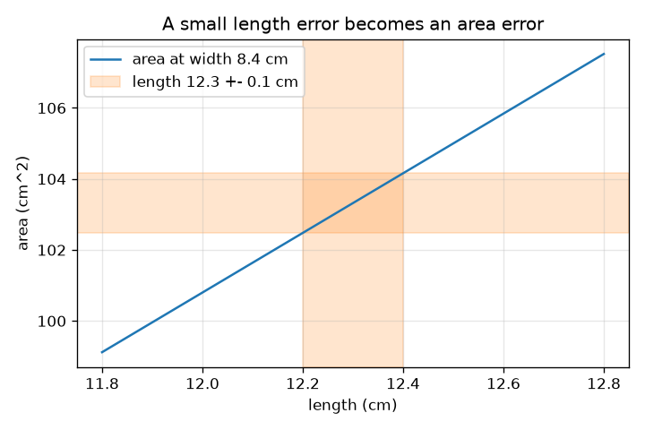
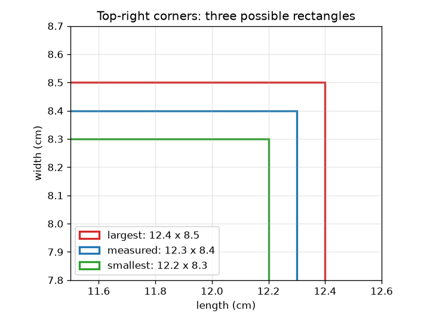

# സെഷൻ 1: ഓരോ അളവിനും ഒരു പിശകുണ്ട്

[Session 1 — हिन्दी](README.hi.md) · [Session 1 — മലയാളം](README.ml.md)

*ലെവൽ 1 (ആശയപരമായ ഇന്ററാക്ടീവ് മോഡൽ) · ഏകദേശം 60 മിനിറ്റ് · openuncertainty*

> ഇത് ലളിതമാക്കിയ ഒരു വിദ്യാഭ്യാസ മോഡലാണ്. ഇത് സാധൂകരിക്കപ്പെട്ട (validated) ഒരു ഡിസൈൻ ഉപകരണമല്ല; യഥാർത്ഥ നിർമ്മിതികൾ, ഇലക്ട്രിക്കൽ ഇൻസ്റ്റലേഷനുകൾ, വാഹനങ്ങൾ, വ്യാവസായിക പ്രക്രിയകൾ അല്ലെങ്കിൽ മെഡിക്കൽ തീരുമാനങ്ങൾ എന്നിവയ്ക്ക് ഇത് ഉപയോഗിക്കരുത്.

**മുൻ‌വ്യവസ്ഥകൾ (Prerequisites)**

- ഗുണനവും ശതമാനവും.
- നിങ്ങൾ PRIMER.md വായിക്കുകയും `python start.py 1` ഒരിക്കൽ റൺ ചെയ്യുകയും ചെയ്തിട്ടുണ്ട്.

**പഠന ലക്ഷ്യങ്ങൾ (Learning objectives).** ഈ സെഷനു ശേഷം നിങ്ങൾക്ക് കഴിയും:

- ഒരു അളവ് മൂല്യം +- പിശക് ആയി എഴുതാനും അതൊരു ഇടവേളയായി വായിക്കാനും.
- രണ്ട് അനിശ്ചിത നീളങ്ങളിൽ നിന്ന് ഒരു ചതുരത്തിന്റെ സാധ്യമായ ഏറ്റവും ചെറുതും ഏറ്റവും വലുതുമായ വിസ്തീർണ്ണം കണക്കാക്കാൻ.
- ഒരു പിശകിനെ ആപേക്ഷിക പിശകാക്കി (ശതമാനം) മാറ്റാൻ.
- ഒരു ഫലത്തിന്റെ പിശക് സാധാരണയായി ഏറ്റവും മോശം സാഹചര്യത്തേക്കാൾ ചെറുതാകുന്നത് എന്തുകൊണ്ടെന്ന് വിശദീകരിക്കാൻ.

## A. യഥാർത്ഥ ലോക പ്രശ്നം
ഒരു സ്കൂൾ സ്കെയിൽ ഉപയോഗിച്ച് നിങ്ങൾ മേശയുടെ മുകൾഭാഗം അളക്കുന്നു, ഒരു വശത്തിന് 12.3 cm, മറ്റേതിന് 8.4 cm എന്ന് വായിക്കുന്നു. ഒരു സ്കെയിൽ കൃത്യമായി വായിക്കാൻ കഴിയില്ല: സത്യസന്ധമായ പ്രസ്താവന 12.3 +- 0.1 cm ആണ്. ഇനി നിങ്ങൾക്ക് വിസ്തീർണ്ണം വേണം. രണ്ട് നീളങ്ങളും അല്പം അനിശ്ചിതമാണെങ്കിൽ, വിസ്തീർണ്ണം എത്ര അനിശ്ചിതമാണ്? പിശക് കടന്നുപോകുന്നുണ്ടോ, ചുരുങ്ങുന്നുണ്ടോ, വളരുന്നുണ്ടോ?

## B. ആശയവും സിദ്ധാന്തവും
ഒരു അളവ് മൂല്യം +- പിശക് ആയി എഴുതുന്നു. യഥാർത്ഥ മൂല്യം മൂല്യം മൈനസ് പിശകിനും മൂല്യം പ്ലസ് പിശകിനും ഇടയിലാണെന്ന് വിശ്വസിക്കപ്പെടുന്നുവെന്നാണ് അതിനർത്ഥം. ആപേക്ഷിക പിശക് (relative error) പിശകിനെ മൂല്യം കൊണ്ട് ഹരിച്ചതാണ് (ശതമാനത്തിന് 100 കൊണ്ട് ഗുണിക്കുക). രണ്ട് പോസിറ്റീവ് നീളങ്ങളുടെ വിസ്തീർണ്ണം A = L * W-ന്, ഏറ്റവും ചെറിയ വിസ്തീർണ്ണം രണ്ട് ചെറിയ നീളങ്ങളും ഏറ്റവും വലുത് രണ്ട് വലിയ നീളങ്ങളും ഉപയോഗിക്കുന്നു. വ്യത്യാസത്തിന്റെ പകുതി ഏറ്റവും മോശം സാഹചര്യത്തിലെ വിസ്തീർണ്ണ പിശകാണ്, L dW + W dL. വിസ്തീർണ്ണം കൊണ്ട് ഹരിക്കുമ്പോൾ രണ്ട് വശങ്ങളുടെയും ആപേക്ഷിക പിശകുകൾ കൂടിച്ചേരുന്നുവെന്ന് കാണിക്കുന്നു: dA / A = dL / L + dW / W. ഈ ഏറ്റവും മോശം സാഹചര്യം രണ്ട് പിശകുകളും ഒരേസമയം ഒരേ ദിശയിൽ തള്ളുമെന്ന് അനുമാനിക്കുന്നു, അത് അസംഭവ്യമാണ്, അതിനാൽ സാധാരണ പിശക് ചെറുതാണ്; എത്ര ചെറുതെന്ന് സെഷൻ 2 കാണിക്കുന്നു.

| ചിഹ്നം | അർത്ഥം | യൂണിറ്റ് |
|---|---|---|
| L, W | അളന്ന നീളവും വീതിയും | cm |
| dL, dW | പിശകുകൾ (വായനാ അനിശ്ചിതത്വത്തിന്റെ പകുതി) | cm |
| A | വിസ്തീർണ്ണം L * W | cm^2 |
| dA | വിസ്തീർണ്ണത്തിന്റെ ഏറ്റവും മോശം സാഹചര്യ പിശക് | cm^2 |
| dL / L | ആപേക്ഷിക പിശക് | യൂണിറ്റ് ഇല്ല (അല്ലെങ്കിൽ ശതമാനം) |

**അനുമാനങ്ങൾ (Assumptions)**

- പിശകുകൾ മൂല്യങ്ങളെ അപേക്ഷിച്ച് ചെറുതാണ്.
- രണ്ട് നീളങ്ങളും പോസിറ്റീവ് ആണ്.
- നൽകിയ പിശക് വായന തെറ്റാൻ സാധ്യതയുള്ള ഏറ്റവും വലുതാണ് (ഏറ്റവും മോശം സാഹചര്യം).

$$ x = x_0 \pm \delta x \;\Longleftrightarrow\; x_0-\delta x \le x_{\text{true}} \le x_0+\delta x $$

$$ A_{\min}=(L-\delta L)(W-\delta W),\qquad A_{\max}=(L+\delta L)(W+\delta W) $$

$$ \delta A=\frac{A_{\max}-A_{\min}}{2}=L\,\delta W+W\,\delta L $$

$$ \frac{\delta A}{A}=\frac{\delta L}{L}+\frac{\delta W}{W}\quad\text{(small errors)} $$

## C. ദൃശ്യ വിശദീകരണം
ഇടത് ചിത്രം അളന്ന ചതുരത്തെ സാധ്യമായ ഏറ്റവും ചെറുതും വലുതുമായ ചതുരങ്ങളോടൊപ്പം വരയ്ക്കുന്നു; രൂപരേഖകൾക്കിടയിലെ വിടവുകൾ പിശകുകളാണ്. വലത് ചിത്രം 8.4 cm വീതിയിൽ നീളത്തിനെതിരെ വിസ്തീർണ്ണം പ്ലോട്ട് ചെയ്യുന്നു. രേഖയ്ക്ക് ചുറ്റുമുള്ള നേർരേഖാ ബാൻഡ് നീളം 0.1 cm വരെ മാത്രമേ അറിയൂ എന്നിരിക്കെ വിസ്തീർണ്ണത്തിന്റെ പരിധിയാണ്; അതിന്റെ ഉയരം വീതി ഗുണം നീളത്തിന്റെ പിശകാണ്, അതിനാൽ നീളമുള്ളതോ വീതിയുള്ളതോ ആയ ചതുരത്തിന് വലിയ വിസ്തീർണ്ണ പിശകുണ്ട്.

*0.1 cm വരെ അറിയാവുന്ന ഒരു നീളം 8.4 cm വീതിയിൽ 1.68 cm^2 ഉയരമുള്ള വിസ്തീർണ്ണ ബാൻഡ് നൽകുന്നു.*

*സാധ്യമായ മൂന്ന് ചതുരങ്ങൾ: അളന്നത്, ഏറ്റവും ചെറുത്, ഏറ്റവും വലുത്.*

## D. ഇന്ററാക്ടീവ് സിമുലേഷൻ
പാഠം റൺ ചെയ്യുക (`python start.py 1`), തുടർന്ന് ലൈവ് ആപ്പ് തുറക്കുക: [സെഷൻ 1: ഒരു വിസ്തീർണ്ണത്തിന്റെ പിശക്](https://krunalpanchal1995.github.io/pan-iit-oss/openuncertainty/session-01/) (അല്ലെങ്കിൽ ഈ ഫോൾഡറിലെ `app.html`). നീളങ്ങളും പിശകുകളും മാറ്റി മൂന്ന് ചതുരങ്ങളും റീഡൗട്ടും നിരീക്ഷിക്കുക, പിന്നെ വിസ്തീർണ്ണ വ്യൂവിലേക്ക് മാറി പിശകുകൾ കൂട്ടുമ്പോൾ ബാൻഡ് വികസിക്കുന്നത് കാണുക.

**വെല്ലുവിളി (Challenge).** കൂടുതൽ സൂക്ഷ്മമായ സ്കെയിൽ (ചെറിയ പിശകുകൾ) ഉപയോഗിച്ച് 12.3 x 8.4 cm മേശയുടെ ഏറ്റവും മോശം സാഹചര്യ വിസ്തീർണ്ണ പിശക് 1 cm^2 അല്ലെങ്കിൽ അതിൽ താഴെ നിലനിർത്തുക.

## E. പരിഹരിച്ച ഉദാഹരണവും പരീക്ഷണവും
**പ്രശ്നം.** ഒരു മേശ 12.3 +- 0.1 cm x 8.4 +- 0.1 cm ആണ്. വിസ്തീർണ്ണം, അതിന്റെ ഏറ്റവും ചെറുതും വലുതുമായ മൂല്യങ്ങൾ, ആപേക്ഷിക പിശകുകൾ എന്നിവ കണ്ടെത്തുക.

1. വിസ്തീർണ്ണം = 12.3 * 8.4 = 103.32 cm^2.
2. ഏറ്റവും ചെറുത് = 12.2 * 8.3 = 101.26 cm^2. ഏറ്റവും വലുത് = 12.4 * 8.5 = 105.40 cm^2.
3. വ്യത്യാസത്തിന്റെ പകുതി = (105.40 - 101.26) / 2 = 2.07 cm^2.
4. ആപേക്ഷിക പിശകുകൾ: 0.1 / 12.3 = 0.81 ശതമാനം, 0.1 / 8.4 = 1.19 ശതമാനം; അവയുടെ തുക 2.0 ശതമാനം.
5. പരിശോധന: 103.32-ന്റെ 2.0 ശതമാനം 2.07 cm^2 ആണ്, അർദ്ധ-പരിധിക്ക് തുല്യം.

**ഉത്തരം.** വിസ്തീർണ്ണം = 103.32 cm^2, 101.26 നും 105.40 cm^2 നും ഇടയിൽ: ഏകദേശം 103.3 +- 2.1 cm^2 (2.0 ശതമാനം).

**പരീക്ഷണം.** ഒരു പുസ്തകത്തിന്റെ കവർ ഒരു സ്കൂൾ സ്കെയിൽ ഉപയോഗിച്ച് രണ്ട് തവണ അളക്കുക, ഒരിക്കൽ സ്കെയിൽ ശ്രദ്ധയോടെ വച്ചും ഒരിക്കൽ വേഗത്തിലും, ഓരോ തവണയും വിസ്തീർണ്ണ പരിധി കണക്കാക്കുക. 0.1 cm വായനാ പിശകിന് വിസ്തീർണ്ണ പിശക് 2.07 cm^2 ആണെന്ന് മോഡൽ പറയുന്നു. വ്യത്യാസങ്ങൾ പാരലാക്സിൽ നിന്നും (സ്കെയിലിനെ ഒരു കോണിൽ നിന്ന് നോക്കുന്നത്) ഒത്തുവരാത്ത അരികുകളിൽ നിന്നും വരുന്നു: മോഡലിന് വായനാ പിശക് മാത്രമേയുള്ളൂ, പുസ്തകത്തിന് കൂടുതലുണ്ട്.

## F. വിലയിരുത്തലും ഡിസൈൻ വെല്ലുവിളിയും
**ചോദ്യ തരം A: ആശയപരം.** മേശയുടെ ഏറ്റവും മോശം സാഹചര്യ വിസ്തീർണ്ണ പിശക് 2.07 cm^2 ആണ്, എന്നാൽ സാധാരണ പിശക് ചെറുതാണ് (ഏകദേശം 1.49 cm^2, സെഷൻ 2-ൽ കാണിക്കുന്നു). സാധാരണ പിശക് ഏറ്റവും മോശം സാഹചര്യത്തേക്കാൾ ചെറുതാകുന്നത് എന്തുകൊണ്ട്?

സൂചന

ഏറ്റവും മോശം സാഹചര്യത്തിന്, രണ്ട് നീളങ്ങളും ഒരേസമയം 'വലിയ' ദിശയിൽ തെറ്റണം. അതിന് എത്ര സാധ്യതയുണ്ട്?

ഘട്ടം ഘട്ടമായുള്ള പരിഹാരം

ഏറ്റവും മോശം സാഹചര്യത്തിന് നീളത്തിന്റെ പിശകും വീതിയുടെ പിശകും അവയുടെ അങ്ങേയറ്റ മൂല്യങ്ങളിൽ ആയിരിക്കുകയും ഒരേ ദിശയിൽ തള്ളുകയും വേണം. സാധാരണയായി ഒരു വായന അല്പം ഉയർന്നതും മറ്റേത് അല്പം താഴ്ന്നതുമായിരിക്കും, അതിനാൽ അവയുടെ ഫലങ്ങൾ ഭാഗികമായി റദ്ദാകുന്നു. സ്വതന്ത്ര പിശകുകളെ അവയുടെ വർഗ്ഗങ്ങൾ കൂട്ടി (quadrature) സംയോജിപ്പിക്കുമ്പോൾ sqrt((8.4*0.1)^2 + (12.3*0.1)^2) = 1.49 cm^2 ലഭിക്കുന്നു, ഇത് 2.07-നേക്കാൾ കുറവാണ്.

**ചോദ്യ തരം B: സംഖ്യാപരം.** ഒരു ചതുരം 20.0 +- 0.1 cm x 5.0 +- 0.1 cm അളക്കുന്നു. വിസ്തീർണ്ണം, അതിന്റെ ഏറ്റവും ചെറുതും വലുതുമായ മൂല്യങ്ങൾ, ഏറ്റവും മോശം സാഹചര്യ പിശക്, ആപേക്ഷിക പിശക് എന്നിവ കണ്ടെത്തുക.

സൂചന

ഏറ്റവും ചെറുതും വലുതുമായ നീളങ്ങൾ ഉപയോഗിക്കുക, പിന്നെ വ്യത്യാസത്തിന്റെ പകുതി.

ഘട്ടം ഘട്ടമായുള്ള പരിഹാരം

വിസ്തീർണ്ണം = 100.0 cm^2. ഏറ്റവും ചെറുത് = 19.9 * 4.9 = 97.51 cm^2, ഏറ്റവും വലുത് = 20.1 * 5.1 = 102.51 cm^2. വ്യത്യാസത്തിന്റെ പകുതി = 2.50 cm^2, അതിനാൽ വിസ്തീർണ്ണം 100.0 +- 2.5 cm^2. ആപേക്ഷിക പിശകുകൾ: 0.5 ശതമാനം + 2.0 ശതമാനം = 2.5 ശതമാനം. യുക്തിപരിശോധന (sanity check): 100-ന്റെ 2.5 ശതമാനം 2.5 ആണ്. ചെറിയ വശം പ്രബലമാണ്, കാരണം അതിന്റെ ആപേക്ഷിക പിശക് നാലിരട്ടി വലുതാണ്.

**ചോദ്യ തരം C: ഗ്രാഫ്, സിമുലേഷൻ വ്യാഖ്യാനം.** വിസ്തീർണ്ണ ഗ്രാഫിൽ (വീതി 8.4 cm), നീളത്തിന്റെ പിശക് 0.1 cm ഉം വീതി കൃത്യവുമാണെങ്കിൽ 12.3 cm നീളത്തിൽ ബാൻഡിന് എത്ര ഉയരമുണ്ട്? അത് നേർരേഖാ ബാൻഡ് ആകുന്നത് എന്തുകൊണ്ട്?

സൂചന

12.2 cm-ലും 12.4 cm-ലും വിസ്തീർണ്ണം വായിക്കുക, അല്ലെങ്കിൽ ചരിവിനെ നീളത്തിന്റെ പരിധി കൊണ്ട് ഗുണിക്കുക.

ഘട്ടം ഘട്ടമായുള്ള പരിഹാരം

12.4 cm-ൽ വിസ്തീർണ്ണം 104.16, 12.2 cm-ൽ 102.48 (വീതി 8.4 cm), അതിനാൽ ബാൻഡിന് 1.68 cm^2 ഉയരമുണ്ട് (+- 0.84). വിസ്തീർണ്ണം L-ൽ ചരിവ് W = 8.4 cm ഉള്ള ഒരു നേർരേഖയാണ്, അതിനാൽ 0.2 cm നീള പരിധി രേഖയിൽ എവിടെയായാലും എപ്പോഴും 8.4 * 0.2 = 1.68 cm^2 ഉയരമുള്ള ബാൻഡ് നൽകുന്നു.

**ചോദ്യ തരം D: ഡിസൈൻ, ഒപ്റ്റിമൈസേഷൻ വെല്ലുവിളി.** ഡിസൈൻ: രണ്ട് വശങ്ങളിൽ ഒന്നിന് മാത്രം കൂടുതൽ സൂക്ഷ്മമായ സ്കെയിൽ വാങ്ങാം (അതിന്റെ പിശക് 0.05 cm ആയി പകുതിയാകുന്നു). 12.3 x 8.4 cm മേശയ്ക്ക് ഏത് വശമായിരിക്കണം, പുതിയ വിസ്തീർണ്ണ പിശക് എത്ര?

സൂചന

വിസ്തീർണ്ണ പിശക് L dW + W dL ആണ്. ഏത് പദമാണ് പിശക് പകുതിയാക്കുമ്പോൾ കൂടുതൽ കുറയുന്നത്?

ഘട്ടം ഘട്ടമായുള്ള പരിഹാരം

വീതിയുടെ പിശക് പകുതിയാക്കുന്നത് 12.3 * 0.05 = 0.615 cm^2 ഒഴിവാക്കി 1.455 cm^2 നൽകുന്നു. നീളത്തിന്റെ പിശക് പകുതിയാക്കുന്നത് 8.4 * 0.05 = 0.42 cm^2 മാത്രം ഒഴിവാക്കി 1.65 cm^2 നൽകുന്നു. അതിനാൽ വീതിയുടെ അളവ് മെച്ചപ്പെടുത്തുക: ഒരു വശത്തിന്റെ പിശക് മറ്റേ വശം കൊണ്ട് ഗുണിക്കപ്പെടുന്നു. വിട്ടുവീഴ്ച (trade-off): കൂടുതൽ സൂക്ഷ്മമായ സ്കെയിലിന് പണം ചെലവാകും, ഉത്തരത്തെ ഏറ്റവും കൂടുതൽ ചുരുക്കുന്നിടത്ത് മാത്രമേ ബജറ്റ് ചെലവഴിക്കാൻ കൊള്ളൂ.

[RUBRIC.md](../../RUBRIC.md) ഉപയോഗിച്ച് സ്വയം സ്കോർ ചെയ്യുക. കടലാസിൽ പ്രവർത്തിക്കാൻ [ആക്ടിവിറ്റി ഷീറ്റ്](activity_sheet.md) പ്രിന്റ് ചെയ്യുക.

## സാധാരണ തെറ്റിദ്ധാരണകൾ
| സാധാരണ തെറ്റിദ്ധാരണ | യഥാർത്ഥത്തിൽ സത്യം എന്താണ് |
|---|---|
| അളന്ന മൂല്യം 12.3 cm കൃത്യമാണ്. | അതൊരു എസ്റ്റിമേറ്റ് ആണ്; 12.3 +- 0.1 അത് എത്ര നന്നായി അറിയാമെന്ന് പറയുന്നു. |
| ഓരോ വശത്തിനും 1 ശതമാനം പിശകുണ്ടെങ്കിൽ വിസ്തീർണ്ണത്തിന് 1 ശതമാനം പിശകുണ്ട്. | ആപേക്ഷിക പിശകുകൾ കൂടുന്നു (ഇവിടെ ഏറ്റവും മോശം സാഹചര്യത്തിൽ 2 ശതമാനമായി): വിസ്തീർണ്ണം രണ്ട് വശങ്ങളെയും ആശ്രയിക്കുന്നു. |
| ഒരു നീളത്തിലെ ചെറിയ പിശക് വിസ്തീർണ്ണത്തെ അതേ അളവിൽ ബാധിക്കുന്നു. | ഒരു വശത്തിൽ നിന്നുള്ള വിസ്തീർണ്ണ പിശക് ആ പിശക് ഗുണം മറ്റേ വശമാണ്: dL, W-നെ ഗുണിക്കുന്നു. |
| കാൽക്കുലേറ്ററിൽ കൂടുതൽ ദശാംശങ്ങൾ എന്നാൽ കൂടുതൽ കൃത്യമായ ഉത്തരം. | ഉത്തരത്തിന് ഇൻപുട്ടുകളേക്കാൾ കൃത്യത ഉണ്ടാകാൻ കഴിയില്ല; ഇടവേളയുമായി താരതമ്യം ചെയ്യാൻ മാത്രമാണ് 103.32 കാണിച്ചത്. |

## പദാവലി (Glossary)
- **പിശക് (error)**: ഒരു വായന യഥാർത്ഥ മൂല്യത്തിൽ നിന്ന് എത്ര അകലെയാകാം (ഇവിടെ വായനാ അനിശ്ചിതത്വത്തിന്റെ പകുതി)
- **ആപേക്ഷിക പിശക് (relative error)**: പിശകിനെ മൂല്യം കൊണ്ട് ഹരിച്ചത്, പലപ്പോഴും ശതമാനത്തിൽ
- **ഏറ്റവും മോശം സാഹചര്യം (worst case)**: എല്ലാ പിശകുകളും ഒരേസമയം ഫലത്തെ ഒരേ ദിശയിൽ തള്ളുന്നു
- **ഇടവേള (interval)**: മൂല്യം മൈനസ് പിശക് മുതൽ മൂല്യം പ്ലസ് പിശക് വരെയുള്ള പരിധി
- **അർദ്ധ-പരിധി (half-range)**: സാധ്യമായ ഏറ്റവും വലുതും ഏറ്റവും ചെറുതുമായ ഫലത്തിന്റെ വ്യത്യാസത്തിന്റെ പകുതി

## പൂർത്തിയാക്കുക
1. [exercises.md](exercises.md)-ലെ മൂന്ന് കോഡിംഗ് ടാസ്കുകൾ ചെയ്യുക.
2. നിങ്ങളുടെ മാറ്റങ്ങൾക്കു ശേഷം `python start.py 1` വീണ്ടും റൺ ചെയ്യുക. അത് ചെക്ക്‌പോയിന്റോടെ അവസാനിക്കുന്നു; അത് `PASS` പ്രിന്റ് ചെയ്യുമ്പോൾ, നിങ്ങൾ പൂർത്തിയാക്കി. (ചെക്ക്‌പോയിന്റ് മാത്രം: `python start.py check 1`.)

അടുത്തത്: [സെഷൻ 2](../session-02/README.md)
