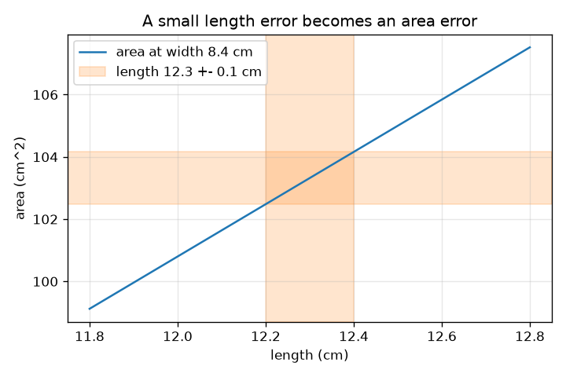
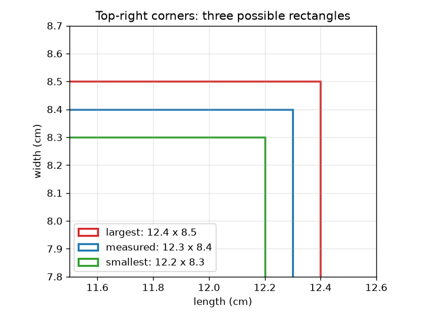

# அமர்வு 1: ஒவ்வொரு அளவீட்டிலும் ஒரு பிழை உண்டு

[Session 1 — हिन्दी](README.hi.md) · [Session 1 — മലയാളം](README.ml.md) · [Session 1 — தமிழ்](README.ta.md)

*நிலை 1 (கருத்துசார் ஊடாடும் மாதிரி) · சுமார் 60 நிமிடங்கள் · openuncertainty*

> இது எளிமைப்படுத்தப்பட்ட ஒரு கல்வி மாதிரி. இது சரிபார்க்கப்பட்ட (validated) வடிவமைப்புக் கருவி அல்ல; உண்மையான கட்டமைப்புகள், மின் நிறுவல்கள், வாகனங்கள், தொழில் செயல்முறைகள் அல்லது மருத்துவ முடிவுகளுக்கு இதைப் பயன்படுத்த வேண்டாம்.

**முன்தேவைகள் (Prerequisites)**

- பெருக்கலும் சதவீதமும்.
- நீங்கள் PRIMER.md-ஐப் படித்து `python start.py 1` ஐ ஒருமுறை இயக்கியிருக்க வேண்டும்.

**கற்றல் நோக்கங்கள் (Learning objectives).** இந்த அமர்வுக்குப் பிறகு உங்களால் முடியும்:

- ஓர் அளவீட்டை மதிப்பு +- பிழை என்று எழுதி, அதை ஓர் இடைவெளியாகப் படிக்க.
- இரு நிச்சயமற்ற நீளங்களிலிருந்து ஒரு செவ்வகத்தின் சாத்தியமான மிகச் சிறிய, மிகப் பெரிய பரப்பளவைக் கணக்கிட.
- ஒரு பிழையை ஒப்புமைப் பிழையாக (சதவீதம்) மாற்ற.
- ஒரு முடிவின் பிழை பொதுவாக மிக மோசமான சூழ்நிலையை விடச் சிறியதாக இருப்பது ஏன் என்று விளக்க.

## A. நிஜ உலகப் பிரச்சினை
பள்ளி அளவுகோலால் மேசையின் மேற்பகுதியை அளந்து, ஒரு பக்கத்துக்கு 12.3 cm, மற்றதற்கு 8.4 cm என்று வாசிக்கிறீர்கள். அளவுகோலைத் துல்லியமாக வாசிக்க முடியாது: நேர்மையான கூற்று 12.3 +- 0.1 cm. இப்போது உங்களுக்குப் பரப்பளவு வேண்டும். இரு நீளங்களும் சற்று நிச்சயமற்றவை என்றால், பரப்பளவு எவ்வளவு நிச்சயமற்றது? பிழை தொடர்கிறதா, சுருங்குகிறதா, வளர்கிறதா?

## B. கருத்தும் கோட்பாடும்
ஓர் அளவீடு மதிப்பு +- பிழை என்று எழுதப்படுகிறது. உண்மை மதிப்பு மதிப்பு கழித்தல் பிழைக்கும் மதிப்பு கூட்டல் பிழைக்கும் இடையே இருப்பதாக நம்பப்படுகிறது என்று அதன் பொருள். ஒப்புமைப் பிழை (relative error) என்பது பிழையை மதிப்பால் வகுத்தது (சதவீதத்துக்கு 100 ஆல் பெருக்குங்கள்). இரு நேர்ம நீளங்களின் பரப்பளவு A = L * W-க்கு, மிகச் சிறிய பரப்பளவு இரு சிறிய நீளங்களையும், மிகப் பெரியது இரு பெரிய நீளங்களையும் பயன்படுத்துகிறது. வேறுபாட்டின் பாதி மிக மோசமான சூழ்நிலைப் பரப்புப் பிழை, L dW + W dL. பரப்பளவால் வகுத்தால் இரு பக்கங்களின் ஒப்புமைப் பிழைகள் கூடுகின்றன என்று தெரிகிறது: dA / A = dL / L + dW / W. இந்த மிக மோசமான சூழ்நிலை இரு பிழைகளும் ஒரே நேரத்தில் ஒரே திசையில் தள்ளும் என்று கருதுகிறது, இது நிகழ வாய்ப்பு குறைவு, எனவே வழக்கமான பிழை சிறியது; எவ்வளவு என்று அமர்வு 2 காட்டுகிறது.

| குறியீடு | பொருள் | அலகு |
|---|---|---|
| L, W | அளந்த நீளம், அகலம் | cm |
| dL, dW | பிழைகள் (வாசிப்பு நிச்சயமின்மையின் பாதி) | cm |
| A | பரப்பளவு L * W | cm^2 |
| dA | பரப்பளவின் மிக மோசமான சூழ்நிலைப் பிழை | cm^2 |
| dL / L | ஒப்புமைப் பிழை | அலகு இல்லை (அல்லது சதவீதம்) |

**அனுமானங்கள் (Assumptions)**

- பிழைகள் மதிப்புகளுடன் ஒப்பிடும்போது சிறியவை.
- இரு நீளங்களும் நேர்மம்.
- கொடுக்கப்பட்ட பிழை வாசிப்பு தவறக்கூடிய மிகப் பெரிய அளவு (மிக மோசமான சூழ்நிலை).

$$ x = x_0 \pm \delta x \;\Longleftrightarrow\; x_0-\delta x \le x_{\text{true}} \le x_0+\delta x $$

$$ A_{\min}=(L-\delta L)(W-\delta W),\qquad A_{\max}=(L+\delta L)(W+\delta W) $$

$$ \delta A=\frac{A_{\max}-A_{\min}}{2}=L\,\delta W+W\,\delta L $$

$$ \frac{\delta A}{A}=\frac{\delta L}{L}+\frac{\delta W}{W}\quad\text{(small errors)} $$

## C. காட்சி விளக்கம்
இடப்பக்கப் படம் அளந்த செவ்வகத்தை சாத்தியமான மிகச் சிறிய, மிகப் பெரிய செவ்வகங்களுடன் வரைகிறது; வெளிக்கோடுகளுக்கு இடையிலான இடைவெளிகள் பிழைகள். வலப்பக்கப் படம் 8.4 cm அகலத்தில் நீளத்துக்கு எதிராகப் பரப்பளவை வரைகிறது. நீளம் 0.1 cm வரை மட்டுமே தெரியும்போது, கோட்டைச் சுற்றியுள்ள நேர்ப் பட்டை பரப்பளவின் வீச்சு; அதன் உயரம் அகலம் பெருக்கல் நீளப் பிழை, எனவே நீளமான அல்லது அகலமான செவ்வகத்துக்குப் பெரிய பரப்புப் பிழை.

*0.1 cm வரை அறியப்பட்ட நீளம், 8.4 cm அகலத்தில் 1.68 cm^2 உயரமுள்ள பரப்புப் பட்டையைத் தருகிறது.*

*சாத்தியமான மூன்று செவ்வகங்கள்: அளந்தது, மிகச் சிறியது, மிகப் பெரியது.*

## D. ஊடாடும் உருவகப்படுத்துதல்
பாடத்தை இயக்கவும் (`python start.py 1`), பின்னர் நேரடி செயலியைத் திறக்கவும்: [அமர்வு 1: ஒரு பரப்பளவின் பிழை](https://krunalpanchal1995.github.io/pan-iit-oss/openuncertainty/session-01/) (அல்லது இந்தக் கோப்புறையில் உள்ள `app.html`). நீளங்களையும் பிழைகளையும் மாற்றி மூன்று செவ்வகங்களையும் வாசிப்புக் காட்டியையும் கவனியுங்கள், பின்னர் பரப்புக் காட்சிக்கு மாறி பிழைகளை உயர்த்தும்போது பட்டை அகலமாவதைப் பாருங்கள்.

**சவால் (Challenge).** நுண்ணிய அளவுகோல் (சிறிய பிழைகள்) பயன்படுத்தி 12.3 x 8.4 cm மேசைக்கு மிக மோசமான சூழ்நிலைப் பரப்புப் பிழையை 1 cm^2 அல்லது அதற்குக் கீழே வைத்திருங்கள்.

## E. தீர்க்கப்பட்ட எடுத்துக்காட்டும் சோதனையும்
**சிக்கல்.** ஒரு மேசை 12.3 +- 0.1 cm x 8.4 +- 0.1 cm. பரப்பளவு, அதன் மிகச் சிறிய, மிகப் பெரிய மதிப்புகள், ஒப்புமைப் பிழைகளைக் கண்டறியுங்கள்.

1. பரப்பளவு = 12.3 * 8.4 = 103.32 cm^2.
2. மிகச் சிறியது = 12.2 * 8.3 = 101.26 cm^2. மிகப் பெரியது = 12.4 * 8.5 = 105.40 cm^2.
3. வேறுபாட்டின் பாதி = (105.40 - 101.26) / 2 = 2.07 cm^2.
4. ஒப்புமைப் பிழைகள்: 0.1 / 12.3 = 0.81 சதவீதம், 0.1 / 8.4 = 1.19 சதவீதம்; அவற்றின் கூட்டுத்தொகை 2.0 சதவீதம்.
5. சரிபார்ப்பு: 103.32-இன் 2.0 சதவீதம் 2.07 cm^2, அரை-வீச்சுக்குச் சமம்.

**விடை.** பரப்பளவு = 103.32 cm^2, 101.26-க்கும் 105.40 cm^2-க்கும் இடையே: சுமார் 103.3 +- 2.1 cm^2 (2.0 சதவீதம்).

**சோதனை.** ஒரு புத்தக அட்டையைப் பள்ளி அளவுகோலால் இரு முறை அளவிடுங்கள், ஒரு முறை அளவுகோலைக் கவனமாக வைத்து, ஒரு முறை அவசரமாக, ஒவ்வொரு முறையும் பரப்பு வீச்சைக் கணக்கிடுங்கள். 0.1 cm வாசிப்புப் பிழைக்குப் பரப்புப் பிழை 2.07 cm^2 என்று மாதிரி சொல்கிறது. வேறுபாடுகள் இடமாறு தோற்றப் பிழையிலிருந்தும் (அளவுகோலைக் கோணத்தில் பார்ப்பது) சீரற்ற ஓரங்களிலிருந்தும் வருகின்றன: மாதிரியில் வாசிப்புப் பிழை மட்டுமே உள்ளது, புத்தகத்தில் அதிகம் உள்ளது.

## F. மதிப்பீடும் வடிவமைப்புச் சவாலும்
**கேள்வி வகை A: கருத்துசார்.** மேசையின் மிக மோசமான சூழ்நிலைப் பரப்புப் பிழை 2.07 cm^2, ஆனால் வழக்கமான பிழை சிறியது (சுமார் 1.49 cm^2, அமர்வு 2-இல் காட்டப்படுகிறது). வழக்கமான பிழை மிக மோசமான சூழ்நிலையை விடச் சிறியதாக இருப்பது ஏன்?

குறிப்பு

மிக மோசமான சூழ்நிலைக்கு, இரு நீளங்களும் ஒரே நேரத்தில் 'பெரிய' திசையில் தவற வேண்டும். அதற்கு எவ்வளவு வாய்ப்பு?

படிப்படியான தீர்வு

மிக மோசமான சூழ்நிலைக்கு நீளப் பிழையும் அகலப் பிழையும் தங்கள் உச்ச மதிப்புகளில் இருந்து ஒரே திசையில் தள்ள வேண்டும். பொதுவாக ஒரு வாசிப்பு சற்று அதிகமாகவும் மற்றது சற்றுக் குறைவாகவும் இருக்கும், எனவே அவற்றின் விளைவுகள் ஓரளவு ரத்தாகின்றன. சுயாதீனப் பிழைகளை அவற்றின் வர்க்கங்களைக் கூட்டி (quadrature) இணைத்தால் sqrt((8.4*0.1)^2 + (12.3*0.1)^2) = 1.49 cm^2 கிடைக்கிறது, இது 2.07-ஐ விடக் குறைவு.

**கேள்வி வகை B: எண்சார்.** ஒரு செவ்வகம் 20.0 +- 0.1 cm x 5.0 +- 0.1 cm அளவு. பரப்பளவு, அதன் மிகச் சிறிய, மிகப் பெரிய மதிப்புகள், மிக மோசமான சூழ்நிலைப் பிழை, ஒப்புமைப் பிழை ஆகியவற்றைக் கண்டறியுங்கள்.

குறிப்பு

மிகச் சிறிய, மிகப் பெரிய நீளங்களைப் பயன்படுத்துங்கள், பின்னர் வேறுபாட்டின் பாதி.

படிப்படியான தீர்வு

பரப்பளவு = 100.0 cm^2. மிகச் சிறியது = 19.9 * 4.9 = 97.51 cm^2, மிகப் பெரியது = 20.1 * 5.1 = 102.51 cm^2. வேறுபாட்டின் பாதி = 2.50 cm^2, எனவே பரப்பளவு 100.0 +- 2.5 cm^2. ஒப்புமைப் பிழைகள்: 0.5 சதவீதம் + 2.0 சதவீதம் = 2.5 சதவீதம். நியாயச் சரிபார்ப்பு (sanity check): 100-இன் 2.5 சதவீதம் 2.5. குறுகிய பக்கம் ஆதிக்கம் செலுத்துகிறது, ஏனெனில் அதன் ஒப்புமைப் பிழை நான்கு மடங்கு பெரியது.

**கேள்வி வகை C: வரைபடம், உருவகப்படுத்துதல் விளக்கம்.** பரப்பு வரைபடத்தில் (அகலம் 8.4 cm), நீளப் பிழை 0.1 cm ஆகவும் அகலம் துல்லியமாகவும் இருக்கும்போது 12.3 cm நீளத்தில் பட்டை எவ்வளவு உயரம்? அது நேர்ப் பட்டையாக இருப்பது ஏன்?

குறிப்பு

12.2 cm-இலும் 12.4 cm-இலும் பரப்பளவை வாசியுங்கள், அல்லது சரிவை நீள வீச்சால் பெருக்குங்கள்.

படிப்படியான தீர்வு

12.4 cm-இல் பரப்பளவு 104.16, 12.2 cm-இல் 102.48 (அகலம் 8.4 cm), எனவே பட்டை 1.68 cm^2 உயரம் (+- 0.84). பரப்பளவு L-இல் சரிவு W = 8.4 cm கொண்ட நேர்கோடு, எனவே 0.2 cm நீள வீச்சு, கோட்டில் எங்கிருந்தாலும் எப்போதும் 8.4 * 0.2 = 1.68 cm^2 உயரப் பட்டையைத் தருகிறது.

**கேள்வி வகை D: வடிவமைப்பு, உகப்பாக்கச் சவால்.** வடிவமைப்பு: இரு பக்கங்களில் ஒன்றுக்கு மட்டும் நுண்ணிய அளவுகோல் வாங்கலாம் (அதன் பிழை 0.05 cm ஆகப் பாதியாகிறது). 12.3 x 8.4 cm மேசைக்கு எந்தப் பக்கம் இருக்க வேண்டும், புதிய பரப்புப் பிழை என்ன?

குறிப்பு

பரப்புப் பிழை L dW + W dL. எந்தப் பதம் பிழையைப் பாதியாக்கும்போது அதிகம் குறைகிறது?

படிப்படியான தீர்வு

அகலப் பிழையைப் பாதியாக்குவது 12.3 * 0.05 = 0.615 cm^2 நீக்கி 1.455 cm^2 தருகிறது. நீளப் பிழையைப் பாதியாக்குவது 8.4 * 0.05 = 0.42 cm^2 மட்டுமே நீக்கி 1.65 cm^2 தருகிறது. எனவே அகல அளவீட்டை மேம்படுத்துங்கள்: ஒரு பக்கத்தின் பிழை மற்ற பக்கத்தால் பெருக்கப்படுகிறது. சமரசம் (trade-off): நுண்ணிய அளவுகோலுக்குப் பணம் செலவாகும், விடையை மிக அதிகமாகச் சுருக்கும் இடத்தில் மட்டுமே பட்ஜெட்டைச் செலவிடுவது பயனுள்ளது.

[RUBRIC.md](../../RUBRIC.md) ஐப் பயன்படுத்தி நீங்களே மதிப்பெண் இடுங்கள். காகிதத்தில் வேலை செய்ய [செயல்பாட்டுத் தாள்](activity_sheet.md) ஐ அச்சிடுங்கள்.

## பொதுவான தவறான புரிதல்கள்
| பொதுவான தவறான புரிதல் | உண்மையில் என்ன |
|---|---|
| அளந்த மதிப்பு 12.3 cm துல்லியமானது. | அது ஒரு மதிப்பீடு; 12.3 +- 0.1 அதை எவ்வளவு நன்றாக அறிவோம் என்று சொல்கிறது. |
| ஒவ்வொரு பக்கத்துக்கும் 1 சதவீதப் பிழை என்றால் பரப்பளவுக்கு 1 சதவீதப் பிழை. | ஒப்புமைப் பிழைகள் கூடுகின்றன (இங்கே மிக மோசமான சூழ்நிலையில் 2 சதவீதமாக): பரப்பளவு இரு பக்கங்களையும் சார்ந்தது. |
| ஒரு நீளத்தில் சிறு பிழை பரப்பளவை அதே அளவு பாதிக்கிறது. | ஒரு பக்கத்திலிருந்து வரும் பரப்புப் பிழை அந்தப் பிழை பெருக்கல் மற்ற பக்கம்: dL, W-ஐப் பெருக்குகிறது. |
| கணிப்பானில் அதிகத் தசமங்கள் என்றால் அதிகத் துல்லியமான விடை. | விடை உள்ளீடுகளை விடத் துல்லியமாக இருக்க முடியாது; இடைவெளியுடன் ஒப்பிடவே 103.32 காட்டப்பட்டது. |

## சொற்பட்டியல் (Glossary)
- **பிழை (error)**: ஒரு வாசிப்பு உண்மை மதிப்பிலிருந்து எவ்வளவு விலகியிருக்கலாம் (இங்கே வாசிப்பு நிச்சயமின்மையின் பாதி)
- **ஒப்புமைப் பிழை (relative error)**: பிழையை மதிப்பால் வகுத்தது, பெரும்பாலும் சதவீதத்தில்
- **மிக மோசமான சூழ்நிலை (worst case)**: அனைத்துப் பிழைகளும் ஒரே நேரத்தில் முடிவை ஒரே திசையில் தள்ளுதல்
- **இடைவெளி (interval)**: மதிப்பு கழித்தல் பிழையிலிருந்து மதிப்பு கூட்டல் பிழை வரையிலான வீச்சு
- **அரை-வீச்சு (half-range)**: சாத்தியமான மிகப் பெரிய, மிகச் சிறிய முடிவுகளின் வேறுபாட்டில் பாதி

## முடிக்கவும்
1. [exercises.md](exercises.md) இல் உள்ள மூன்று நிரலாக்கப் பணிகளைச் செய்யுங்கள்.
2. உங்கள் மாற்றங்களுக்குப் பிறகு `python start.py 1` ஐ மீண்டும் இயக்கவும். அது சோதனைச்சாவடியுடன் முடிகிறது; அது `PASS` என்று அச்சிடும்போது, நீங்கள் முடித்துவிட்டீர்கள். (சோதனைச்சாவடி மட்டும்: `python start.py check 1`.)

அடுத்தது: [அமர்வு 2](../session-02/README.md)
