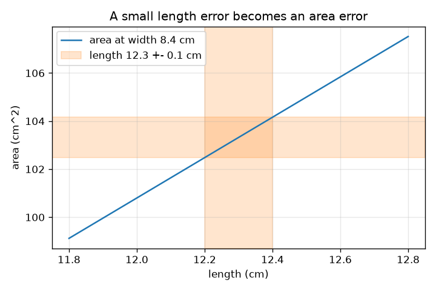
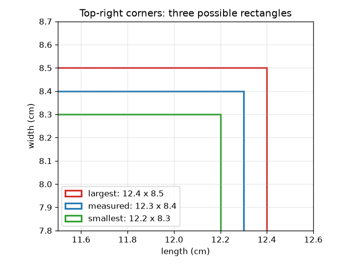

# సెషన్ 1: ప్రతి కొలతలో ఒక దోషం ఉంటుంది

[Session 1 — हिन्दी](README.hi.md) · [Session 1 — മലയാളം](README.ml.md) · [Session 1 — தமிழ்](README.ta.md) · [Session 1 — తెలుగు](README.te.md)

*స్థాయి 1 (భావనాత్మక ఇంటరాక్టివ్ నమూనా) · సుమారు 60 నిమిషాలు · openuncertainty*

> ఇది సరళీకృత విద్యా నమూనా. ఇది ధ్రువీకరించిన (validated) డిజైన్ సాధనం కాదు; నిజమైన నిర్మాణాలు, విద్యుత్ ఏర్పాట్లు, వాహనాలు, పారిశ్రామిక ప్రక్రియలు లేదా వైద్య నిర్ణయాలకు దీనిని ఉపయోగించవద్దు.

**ముందస్తు అవసరాలు (Prerequisites)**

- గుణకారం, శాతాలు.
- మీరు PRIMER.md చదివి `python start.py 1` ను ఒకసారి నడిపి ఉండాలి.

**అభ్యాస లక్ష్యాలు (Learning objectives).** ఈ సెషన్ తర్వాత మీరు చేయగలరు:

- ఒక కొలతను విలువ +- దోషం అని రాసి, దాన్ని ఒక అంతరంగా చదవడం.
- రెండు అనిశ్చిత పొడవుల నుండి ఒక దీర్ఘచతురస్రం సాధ్యమైన అతి చిన్న, అతి పెద్ద వైశాల్యాన్ని లెక్కించడం.
- ఒక దోషాన్ని సాపేక్ష దోషంగా (శాతం) మార్చడం.
- ఒక ఫలితం దోషం సాధారణంగా అత్యంత చెడ్డ సందర్భం కంటే ఎందుకు చిన్నదో వివరించడం.

## A. వాస్తవ ప్రపంచ సమస్య
పాఠశాల స్కేల్‌తో టేబుల్ పైభాగాన్ని కొలిచి, ఒక వైపు 12.3 cm, మరొక వైపు 8.4 cm అని చదువుతారు. స్కేల్‌ను ఖచ్చితంగా చదవలేము: నిజాయితీగల ప్రకటన 12.3 +- 0.1 cm. ఇప్పుడు మీకు వైశాల్యం కావాలి. రెండు పొడవులూ కొంచెం అనిశ్చితమైతే, వైశాల్యం ఎంత అనిశ్చితం? దోషం కొనసాగుతుందా, తగ్గుతుందా, పెరుగుతుందా?

## B. భావన మరియు సిద్ధాంతం
కొలతను విలువ +- దోషం అని రాస్తారు. నిజ విలువ విలువ మైనస్ దోషానికి, విలువ ప్లస్ దోషానికి మధ్య ఉందని నమ్మకం అని దాని అర్థం. సాపేక్ష దోషం (relative error) అంటే దోషాన్ని విలువతో భాగించినది (శాతానికి 100 తో గుణించండి). రెండు ధన పొడవుల వైశాల్యం A = L * W కు, అతి చిన్న వైశాల్యం రెండు చిన్న పొడవులను, అతి పెద్దది రెండు పెద్ద పొడవులను ఉపయోగిస్తుంది. తేడాలో సగం అత్యంత చెడ్డ సందర్భ వైశాల్య దోషం, L dW + W dL. వైశాల్యంతో భాగిస్తే రెండు వైపుల సాపేక్ష దోషాలు కూడుతాయని తెలుస్తుంది: dA / A = dL / L + dW / W. ఈ అత్యంత చెడ్డ సందర్భం రెండు దోషాలూ ఒకేసారి ఒకే దిశలో నెడతాయని ఊహిస్తుంది, అది అసంభవం, కాబట్టి సాధారణ దోషం చిన్నది; ఎంత చిన్నదో సెషన్ 2 చూపుతుంది.

| గుర్తు | అర్థం | ప్రమాణం |
|---|---|---|
| L, W | కొలిచిన పొడవు, వెడల్పు | cm |
| dL, dW | దోషాలు (రీడింగ్ అనిశ్చితిలో సగం) | cm |
| A | వైశాల్యం L * W | cm^2 |
| dA | వైశాల్యం అత్యంత చెడ్డ సందర్భ దోషం | cm^2 |
| dL / L | సాపేక్ష దోషం | ప్రమాణం లేదు (లేదా శాతం) |

**ఊహలు (Assumptions)**

- దోషాలు విలువలతో పోలిస్తే చిన్నవి.
- రెండు పొడవులూ ధనాత్మకం.
- ఇచ్చిన దోషం రీడింగ్ తప్పే అవకాశం ఉన్న అత్యధిక విలువ (అత్యంత చెడ్డ సందర్భం).

$$ x = x_0 \pm \delta x \;\Longleftrightarrow\; x_0-\delta x \le x_{\text{true}} \le x_0+\delta x $$

$$ A_{\min}=(L-\delta L)(W-\delta W),\qquad A_{\max}=(L+\delta L)(W+\delta W) $$

$$ \delta A=\frac{A_{\max}-A_{\min}}{2}=L\,\delta W+W\,\delta L $$

$$ \frac{\delta A}{A}=\frac{\delta L}{L}+\frac{\delta W}{W}\quad\text{(small errors)} $$

## C. దృశ్య వివరణ
ఎడమ చిత్రం కొలిచిన దీర్ఘచతురస్రాన్ని సాధ్యమైన అతి చిన్న, అతి పెద్ద దీర్ఘచతురస్రాలతో గీస్తుంది; రూపురేఖల మధ్య ఖాళీలే దోషాలు. కుడి చిత్రం 8.4 cm వెడల్పు వద్ద పొడవుకు వ్యతిరేకంగా వైశాల్యాన్ని ప్లాట్ చేస్తుంది. పొడవు 0.1 cm వరకు మాత్రమే తెలిసినప్పుడు, రేఖ చుట్టూ ఉన్న నేరు బ్యాండ్ వైశాల్యం పరిధి; దాని ఎత్తు వెడల్పు రెట్లు పొడవు దోషం, కాబట్టి పొడవైన లేదా వెడల్పైన దీర్ఘచతురస్రానికి పెద్ద వైశాల్య దోషం ఉంటుంది.

*0.1 cm వరకు తెలిసిన పొడవు, 8.4 cm వెడల్పు వద్ద 1.68 cm^2 ఎత్తు ఉన్న వైశాల్య బ్యాండ్‌ను ఇస్తుంది.*

*సాధ్యమైన మూడు దీర్ఘచతురస్రాలు: కొలిచినది, అతి చిన్నది, అతి పెద్దది.*

## D. ఇంటరాక్టివ్ అనుకరణ
పాఠాన్ని నడపండి (`python start.py 1`), ఆ తర్వాత లైవ్ యాప్‌ను తెరవండి: [సెషన్ 1: ఒక వైశాల్యం దోషం](https://krunalpanchal1995.github.io/pan-iit-oss/openuncertainty/session-01/) (లేదా ఈ ఫోల్డర్‌లోని `app.html`). పొడవులను, దోషాలను మార్చి మూడు దీర్ఘచతురస్రాలను, రీడౌట్‌ను గమనించండి, ఆ తర్వాత వైశాల్య వీక్షణకు మారి దోషాలను పెంచినప్పుడు బ్యాండ్ వెడల్పవడం చూడండి.

**సవాలు (Challenge).** సూక్ష్మమైన స్కేల్ (చిన్న దోషాలు) ఉపయోగించి 12.3 x 8.4 cm టేబుల్‌కు అత్యంత చెడ్డ సందర్భ వైశాల్య దోషాన్ని 1 cm^2 లేదా అంతకంటే తక్కువగా ఉంచండి.

## E. సాధించిన ఉదాహరణ మరియు ప్రయోగం
**సమస్య.** ఒక టేబుల్ 12.3 +- 0.1 cm x 8.4 +- 0.1 cm. వైశాల్యం, దాని అతి చిన్న, అతి పెద్ద విలువలు, సాపేక్ష దోషాలు కనుగొనండి.

1. వైశాల్యం = 12.3 * 8.4 = 103.32 cm^2.
2. అతి చిన్నది = 12.2 * 8.3 = 101.26 cm^2. అతి పెద్దది = 12.4 * 8.5 = 105.40 cm^2.
3. తేడాలో సగం = (105.40 - 101.26) / 2 = 2.07 cm^2.
4. సాపేక్ష దోషాలు: 0.1 / 12.3 = 0.81 శాతం, 0.1 / 8.4 = 1.19 శాతం; వాటి మొత్తం 2.0 శాతం.
5. తనిఖీ: 103.32 లో 2.0 శాతం 2.07 cm^2, అర్ధ-పరిధికి సమానం.

**జవాబు.** వైశాల్యం = 103.32 cm^2, 101.26 నుండి 105.40 cm^2 మధ్య: సుమారు 103.3 +- 2.1 cm^2 (2.0 శాతం).

**ప్రయోగం.** ఒక పుస్తక కవర్‌ను పాఠశాల స్కేల్‌తో రెండుసార్లు కొలవండి, ఒకసారి స్కేల్‌ను జాగ్రత్తగా ఉంచి, ఒకసారి తొందరగా, ప్రతిసారీ వైశాల్య పరిధిని లెక్కించండి. 0.1 cm రీడింగ్ దోషానికి వైశాల్య దోషం 2.07 cm^2 అని నమూనా చెబుతుంది. తేడాలు పారలాక్స్ (స్కేల్‌ను కోణంలో చూడటం), అసమాన అంచుల నుండి వస్తాయి: నమూనాలో రీడింగ్ దోషం మాత్రమే ఉంది, పుస్తకంలో ఎక్కువ ఉన్నాయి.

## F. మూల్యాంకనం మరియు డిజైన్ సవాలు
**ప్రశ్న రకం A: భావనాత్మక.** టేబుల్ అత్యంత చెడ్డ సందర్భ వైశాల్య దోషం 2.07 cm^2, కానీ సాధారణ దోషం చిన్నది (సుమారు 1.49 cm^2, సెషన్ 2 లో చూపుతారు). సాధారణ దోషం అత్యంత చెడ్డ సందర్భం కంటే చిన్నదిగా ఎందుకు ఉంటుంది?

సూచన

అత్యంత చెడ్డ సందర్భానికి, రెండు పొడవులూ ఒకేసారి 'పెద్ద' దిశలో తప్పాలి. దానికి ఎంత అవకాశం?

దశలవారీ పరిష్కారం

అత్యంత చెడ్డ సందర్భానికి పొడవు దోషం, వెడల్పు దోషం వాటి అంత్య విలువల్లో ఉండి ఒకే దిశలో నెట్టాలి. సాధారణంగా ఒక రీడింగ్ కొంచెం ఎక్కువగా, మరొకటి కొంచెం తక్కువగా ఉంటుంది, కాబట్టి వాటి ప్రభావాలు కొంతవరకు రద్దవుతాయి. స్వతంత్ర దోషాలను వాటి వర్గాలను కూడి (quadrature) కలిపితే sqrt((8.4*0.1)^2 + (12.3*0.1)^2) = 1.49 cm^2 వస్తుంది, ఇది 2.07 కంటే తక్కువ.

**ప్రశ్న రకం B: సంఖ్యాత్మక.** ఒక దీర్ఘచతురస్రం 20.0 +- 0.1 cm x 5.0 +- 0.1 cm కొలుస్తుంది. వైశాల్యం, దాని అతి చిన్న, అతి పెద్ద విలువలు, అత్యంత చెడ్డ సందర్భ దోషం, సాపేక్ష దోషం కనుగొనండి.

సూచన

అతి చిన్న, అతి పెద్ద పొడవులను ఉపయోగించండి, తర్వాత తేడాలో సగం.

దశలవారీ పరిష్కారం

వైశాల్యం = 100.0 cm^2. అతి చిన్నది = 19.9 * 4.9 = 97.51 cm^2, అతి పెద్దది = 20.1 * 5.1 = 102.51 cm^2. తేడాలో సగం = 2.50 cm^2, కాబట్టి వైశాల్యం 100.0 +- 2.5 cm^2. సాపేక్ష దోషాలు: 0.5 శాతం + 2.0 శాతం = 2.5 శాతం. తార్కిక తనిఖీ (sanity check): 100 లో 2.5 శాతం 2.5. చిన్న వైపు ప్రాబల్యం చూపుతుంది, ఎందుకంటే దాని సాపేక్ష దోషం నాలుగు రెట్లు పెద్దది.

**ప్రశ్న రకం C: గ్రాఫ్, అనుకరణ వివరణ.** వైశాల్య గ్రాఫ్‌లో (వెడల్పు 8.4 cm), పొడవు దోషం 0.1 cm, వెడల్పు ఖచ్చితమైనప్పుడు 12.3 cm పొడవు వద్ద బ్యాండ్ ఎంత ఎత్తు? అది నేరు బ్యాండ్ ఎందుకు?

సూచన

12.2 cm, 12.4 cm వద్ద వైశాల్యాన్ని చదవండి, లేదా వాలును పొడవు పరిధితో గుణించండి.

దశలవారీ పరిష్కారం

12.4 cm వద్ద వైశాల్యం 104.16, 12.2 cm వద్ద 102.48 (వెడల్పు 8.4 cm), కాబట్టి బ్యాండ్ ఎత్తు 1.68 cm^2 (+- 0.84). వైశాల్యం L లో వాలు W = 8.4 cm ఉన్న నేరు రేఖ, కాబట్టి 0.2 cm పొడవు పరిధి రేఖపై ఎక్కడైనా ఎల్లప్పుడూ 8.4 * 0.2 = 1.68 cm^2 ఎత్తు బ్యాండ్‌ను ఇస్తుంది.

**ప్రశ్న రకం D: డిజైన్, ఆప్టిమైజేషన్ సవాలు.** డిజైన్: రెండు వైపుల్లో ఒకదానికి మాత్రమే సూక్ష్మమైన స్కేల్ కొనవచ్చు (దాని దోషం 0.05 cm కు సగమవుతుంది). 12.3 x 8.4 cm టేబుల్‌కు ఏ వైపు అయి ఉండాలి, కొత్త వైశాల్య దోషం ఎంత?

సూచన

వైశాల్య దోషం L dW + W dL. దోషాన్ని సగం చేసినప్పుడు ఏ పదం ఎక్కువ తగ్గుతుంది?

దశలవారీ పరిష్కారం

వెడల్పు దోషాన్ని సగం చేస్తే 12.3 * 0.05 = 0.615 cm^2 తొలగి 1.455 cm^2 వస్తుంది. పొడవు దోషాన్ని సగం చేస్తే 8.4 * 0.05 = 0.42 cm^2 మాత్రమే తొలగి 1.65 cm^2 వస్తుంది. కాబట్టి వెడల్పు కొలతను మెరుగుపరచండి: ఒక వైపు దోషం మరొక వైపుతో గుణించబడుతుంది. రాజీ (trade-off): సూక్ష్మ స్కేల్‌కు డబ్బు ఖర్చవుతుంది, జవాబును ఎక్కువగా తగ్గించే చోట మాత్రమే బడ్జెట్ ఖర్చు చేయడం విలువైనది.

[RUBRIC.md](../../RUBRIC.md) ఉపయోగించి మీరే స్కోర్ చేసుకోండి. కాగితంపై పని చేయడానికి [కార్యకలాప పత్రం](activity_sheet.md) ను ప్రింట్ చేయండి.

## సాధారణ అపోహలు
| సాధారణ అపోహ | వాస్తవం ఏమిటి |
|---|---|
| కొలిచిన విలువ 12.3 cm ఖచ్చితమైనది. | అది ఒక అంచనా; 12.3 +- 0.1 మనకు దాని గురించి ఎంత బాగా తెలుసో చెబుతుంది. |
| ప్రతి వైపుకు 1 శాతం దోషం ఉంటే వైశాల్యానికి 1 శాతం దోషం. | సాపేక్ష దోషాలు కూడుతాయి (ఇక్కడ అత్యంత చెడ్డ సందర్భంలో 2 శాతానికి): వైశాల్యం రెండు వైపులపై ఆధారపడుతుంది. |
| ఒక పొడవులో చిన్న దోషం వైశాల్యాన్ని అంతే మేర ప్రభావితం చేస్తుంది. | ఒక వైపు నుండి వచ్చే వైశాల్య దోషం ఆ దోషం రెట్లు మరొక వైపు: dL, W ను గుణిస్తుంది. |
| కాలిక్యులేటర్‌లో ఎక్కువ దశాంశాలు అంటే ఎక్కువ ఖచ్చితమైన జవాబు. | జవాబు ఇన్‌పుట్‌ల కంటే ఖచ్చితంగా ఉండలేదు; అంతరంతో పోల్చడానికి మాత్రమే 103.32 చూపారు. |

## పదకోశం (Glossary)
- **దోషం (error)**: ఒక రీడింగ్ నిజ విలువ నుండి ఎంత దూరంలో ఉండవచ్చు (ఇక్కడ రీడింగ్ అనిశ్చితిలో సగం)
- **సాపేక్ష దోషం (relative error)**: దోషాన్ని విలువతో భాగించినది, తరచుగా శాతంలో
- **అత్యంత చెడ్డ సందర్భం (worst case)**: అన్ని దోషాలూ ఒకేసారి ఫలితాన్ని ఒకే దిశలో నెట్టడం
- **అంతరం (interval)**: విలువ మైనస్ దోషం నుండి విలువ ప్లస్ దోషం వరకు పరిధి
- **అర్ధ-పరిధి (half-range)**: సాధ్యమైన అతి పెద్ద, అతి చిన్న ఫలితాల తేడాలో సగం

## పూర్తి చేయండి
1. [exercises.md](exercises.md) లోని మూడు కోడింగ్ పనులు చేయండి.
2. మీ మార్పుల తర్వాత `python start.py 1` ను మళ్ళీ నడపండి. అది చెక్‌పాయింట్‌తో ముగుస్తుంది; అది `PASS` అని ప్రింట్ చేస్తే, మీరు పూర్తి చేసినట్లే. (చెక్‌పాయింట్ మాత్రమే: `python start.py check 1`.)

తదుపరిది: [సెషన్ 2](../session-02/README.md)
